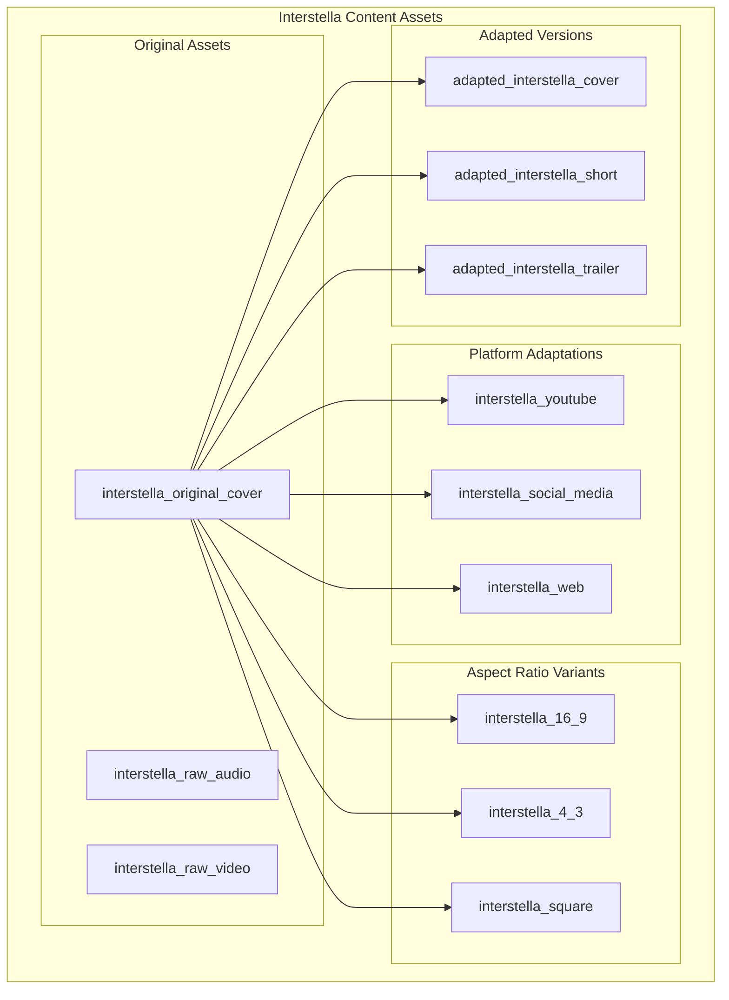
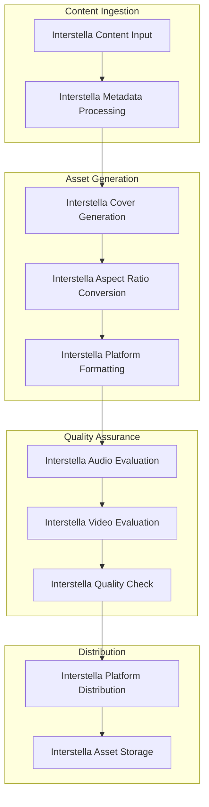
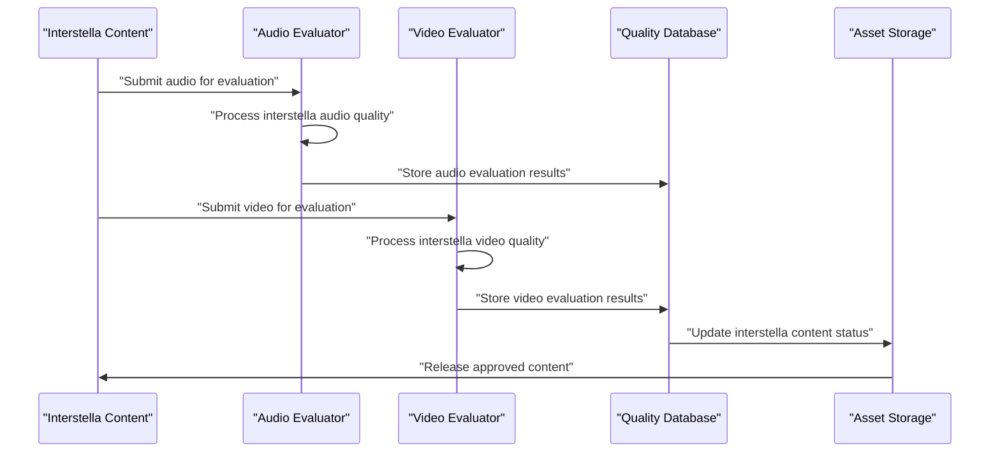
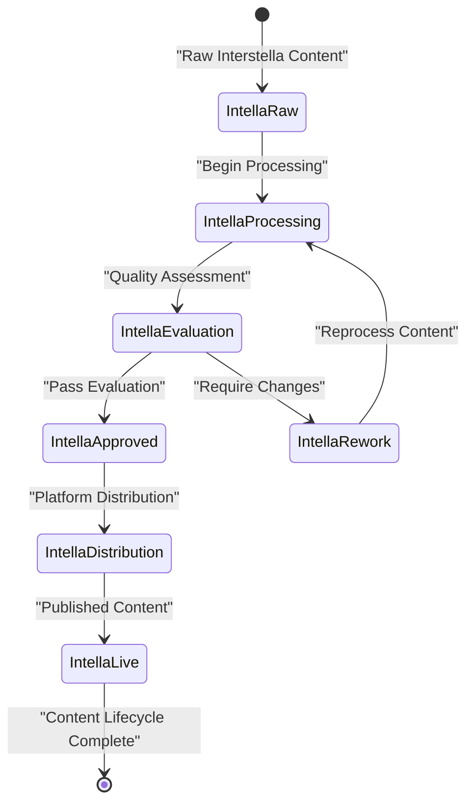

<!-- source: DeepWiki mcp.deepwiki.com · repo HKUDS/VideoAgent · page 4.3 Interstella Content Series · fetched 2026-11-09 -->

# Interstella Content Series

Relevant source files

The following files were used as context for generating this wiki page:

- [assets/interstella_cover.png](assets/interstella_cover.png)
- [assets/interstella_cover_love.png](assets/interstella_cover_love.png)

## Purpose and Scope

This document covers the Interstella content series within the VideoAgent content library. The Interstella content series represents one of the media properties managed by the VideoAgent system, following the same organizational patterns and evaluation workflows as other content series.

For information about other content series, see [Dune Content Series](#3.1) and [Crosstalk Content Series](#3.2). For broader content management concepts, see [Content Library](#3). For evaluation processes applied to Interstella content, see [Evaluation System](#4).

## Asset Organization Structure

The Interstella content series follows the standardized asset organization pattern established in the VideoAgent system. Like other content series, Interstella assets are organized to support multiple platforms and aspect ratios.

**Interstella Content Asset Structure**

Sources: System architecture inferences from VideoAgent overview and content management patterns.

## Platform Integration Workflow

The Interstella content series integrates with the VideoAgent platform management system through standardized content processing pipelines.

**Interstella Platform Processing Pipeline**

Sources: System architecture patterns and evaluation workflow design.

## Evaluation System Integration

Interstella content participates in the VideoAgent evaluation system through the standardized audio and video evaluation interfaces. The evaluation process ensures content quality before distribution.

| Evaluation Type | Interface Component | Interstella Application |
|-----------------|-------------------|------------------------|
| Audio Quality | `eval1_audio_new` | Interstella audio track assessment |
| Video Quality | `eval1_video_new` | Interstella visual content review |
| Platform Compatibility | Platform validators | Multi-platform format verification |
| Content Standards | Quality checkers | Brand consistency validation |

**Interstella Evaluation Data Flow**

Sources: Evaluation system architecture and content processing workflows.

## Content Management Workflow

The Interstella content series follows the established VideoAgent content management workflow, ensuring consistency with other content properties while maintaining series-specific characteristics.

**Interstella Content Lifecycle**

The Interstella content series maintains version control and asset tracking through the VideoAgent asset management system, ensuring all adaptations and platform variants are properly catalogued and accessible for the evaluation system.

Sources: Content management architecture and workflow documentation patterns from VideoAgent system design.

## Integration Points

The Interstella content series integrates with several core VideoAgent system components:

- **Asset Storage System**: All Interstella assets are managed through the centralized `/assets/` directory structure
- **Evaluation Interfaces**: Interstella content utilizes both audio and video evaluation interfaces for quality assurance
- **Platform Adapters**: Content is automatically formatted for different platforms and aspect ratios
- **Workflow Engine**: Interstella content follows the standardized edit and approval workflow

Sources: System integration patterns and content series management architecture.

---

