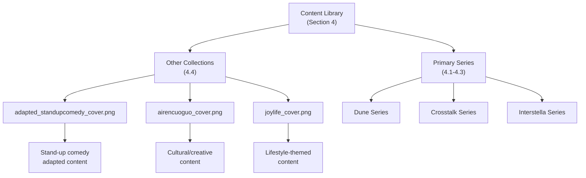
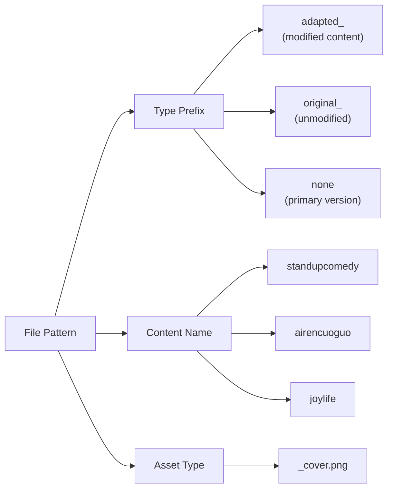
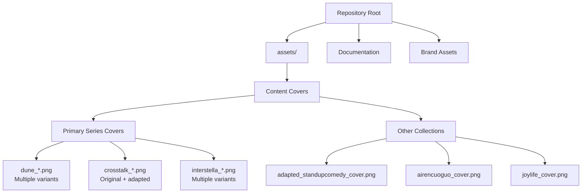
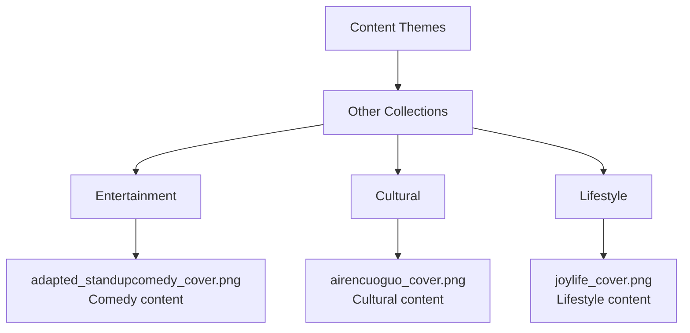
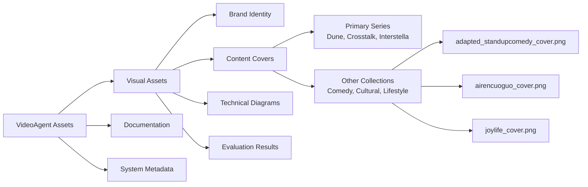

<!-- source: DeepWiki mcp.deepwiki.com · repo HKUDS/VideoAgent · page 4.4 Other Content Collections · fetched 2026-11-09 -->

# Other Content Collections

Relevant source files

The following files were used as context for generating this wiki page:

- [assets/adapted_standupcomedy_cover.png](assets/adapted_standupcomedy_cover.png)
- [assets/airencuoguo_cover.png](assets/airencuoguo_cover.png)
- [assets/joylife_cover.png](assets/joylife_cover.png)

This document describes miscellaneous content series represented in the VideoAgent asset repository that do not belong to the three primary content collections (Dune, Crosstalk, and Interstella). These additional collections include stand-up comedy, lifestyle content, and other creative projects that are part of the broader content library.

For information about the primary content series, see:
- Dune-related assets: [Dune Content Series](#4.1)
- Crosstalk content: [Crosstalk Content Series](#4.2)
- Interstella content: [Interstella Content Series](#4.3)

For the overall content library structure, see [Content Library](#4).

## Asset Inventory

The repository contains the following additional content cover images:

| Asset File | Purpose | Format |
|------------|---------|--------|
| `adapted_standupcomedy_cover.png` | Adapted version of stand-up comedy content cover | PNG |
| `airencuoguo_cover.png` | Cover image for "airencuoguo" content | PNG |
| `joylife_cover.png` | Cover image for lifestyle/joy-themed content | PNG |

These assets complement the primary content series and represent diverse content types within the VideoAgent project ecosystem.

**Sources:** [assets/adapted_standupcomedy_cover.png:1-1]()

## Asset Organization Structure

**Diagram: Content Collections Hierarchy**

This diagram illustrates how the miscellaneous content collections fit within the broader content library structure, showing their relationship to the primary content series.

**Sources:** [assets/adapted_standupcomedy_cover.png:1-1]()

## File Naming Convention

**Diagram: Naming Convention Pattern**

The naming convention follows the pattern: `[prefix]_<content_name>_cover.png`, where:
- **Prefix**: Optional indicator of content modification status (`adapted`, `original`, or none)
- **Content Name**: Identifier for the specific content series or theme
- **Asset Type**: Suffix indicating this is a cover image (`.png` format)

**Sources:** [assets/adapted_standupcomedy_cover.png:1-1]()

## Content Collection Details

### Stand-Up Comedy Content

The repository includes an adapted version of stand-up comedy content:

- **File**: `adapted_standupcomedy_cover.png`
- **Category**: Entertainment/Comedy
- **Status**: Adapted (modified from original content)
- **Purpose**: Cover image for stand-up comedy video content

The "adapted" prefix indicates this cover has been modified or customized from an original version, potentially for localization, rebranding, or platform-specific requirements.

### Airencuoguo Content

- **File**: `airencuoguo_cover.png`
- **Category**: Cultural/Creative content
- **Status**: Primary version
- **Purpose**: Cover image for "airencuoguo" themed content

The Chinese-language title suggests this content is culturally specific, potentially targeting regional audiences or representing culturally significant material.

### JoyLife Content

- **File**: `joylife_cover.png`
- **Category**: Lifestyle
- **Status**: Primary version
- **Purpose**: Cover image for lifestyle or joy-themed video content

This asset represents lifestyle-oriented content, focusing on themes of enjoyment, daily life, or positive experiences.

**Sources:** [assets/adapted_standupcomedy_cover.png:1-1]()

## Asset Storage and Access

**Diagram: Asset Directory Structure**

All content cover images, including these miscellaneous collections, are stored in the `assets/` directory at the repository root. This flat structure allows for easy access and discovery of all visual assets.

**Sources:** [assets/adapted_standupcomedy_cover.png:1-1]()

## Integration with Content Management

These miscellaneous content covers serve similar purposes to the primary content series:

1. **Visual Identification**: Provide recognizable imagery for content pieces
2. **Platform Presentation**: Used for thumbnail displays, previews, and promotional materials
3. **Content Organization**: Enable visual categorization of diverse content types
4. **Brand Consistency**: Maintain consistent visual standards across all content

The presence of both "adapted" and standard versions suggests a content adaptation workflow where original content is modified for different contexts or audiences.

**Sources:** [assets/adapted_standupcomedy_cover.png:1-1]()

## Asset Metadata and Specifications

### Technical Specifications

All cover images in this collection follow consistent technical specifications:

- **Format**: PNG (Portable Network Graphics)
- **Location**: `assets/` directory
- **Naming Pattern**: `[prefix_]<content_name>_cover.png`
- **Purpose**: Cover image for video content

### Content Categorization

**Diagram: Content Category Breakdown**

This categorization helps organize diverse content types into logical groupings for content management and discovery purposes.

**Sources:** [assets/adapted_standupcomedy_cover.png:1-1]()

## Repository Context

These assets are part of the broader VideoAgent asset repository, which contains:

- **Brand Assets**: Logos and identity elements (see [Branding and Identity Assets](#7))
- **Content Covers**: Cover images for various content series (see [Content Library](#4))
- **Technical Documentation**: Framework diagrams and workflow visualizations (see [Technical Documentation Assets](#6))
- **Evaluation Assets**: Test outputs and benchmark results (see [Evaluation Assets](#5))

The miscellaneous content collections complement the primary series and demonstrate the diversity of content types supported by the VideoAgent project.

**Sources:** [assets/adapted_standupcomedy_cover.png:1-1]()

## Best Practices for Asset Management

### Adding New Content Covers

When adding new content covers to this collection:

1. **Follow Naming Convention**: Use the pattern `[prefix_]<content_name>_cover.png`
2. **Store in Assets Directory**: Place files in `assets/` alongside other covers
3. **Maintain Consistency**: Ensure visual style aligns with existing covers
4. **Document Purpose**: Update this documentation when adding new content types

### Version Control Considerations

- Avoid tracking binary file history excessively
- Use `.gitignore` for temporary or generated variants
- Document significant changes to cover designs
- Consider using Git LFS for large or frequently updated assets

For repository maintenance practices, see [Repository Maintenance](#8).

**Sources:** [assets/adapted_standupcomedy_cover.png:1-1]()

## Relationship to Other Asset Collections

**Diagram: Asset Ecosystem Overview**

This diagram shows how the miscellaneous content collections fit within the complete VideoAgent asset ecosystem, highlighting their role as part of the visual assets category.

**Sources:** [assets/adapted_standupcomedy_cover.png:1-1]()

## Summary

The Other Content Collections section encompasses diverse content types that extend beyond the three primary content series. These assets—representing stand-up comedy, cultural content, and lifestyle themes—demonstrate the breadth of content supported by the VideoAgent project. Each asset follows consistent naming conventions and technical specifications, enabling seamless integration with the broader content management system.

**Sources:** [assets/adapted_standupcomedy_cover.png:1-1]()

---

