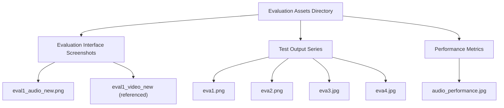
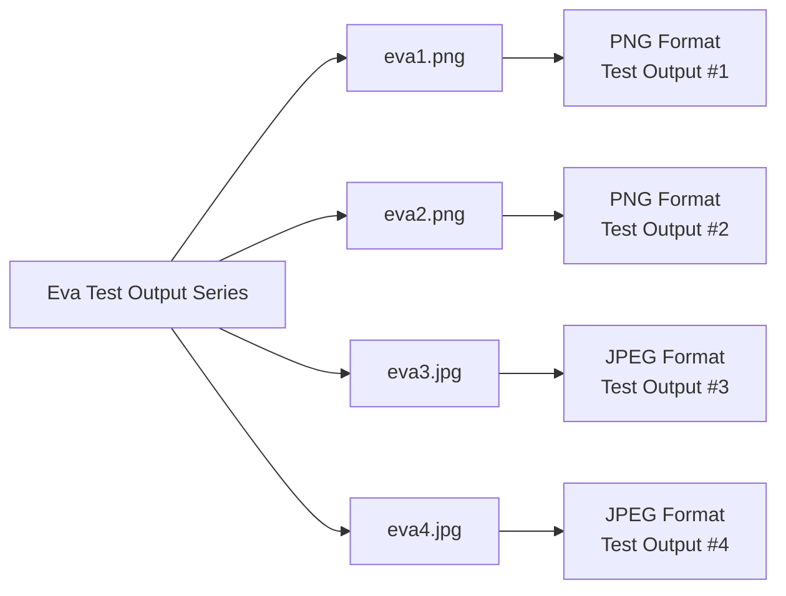
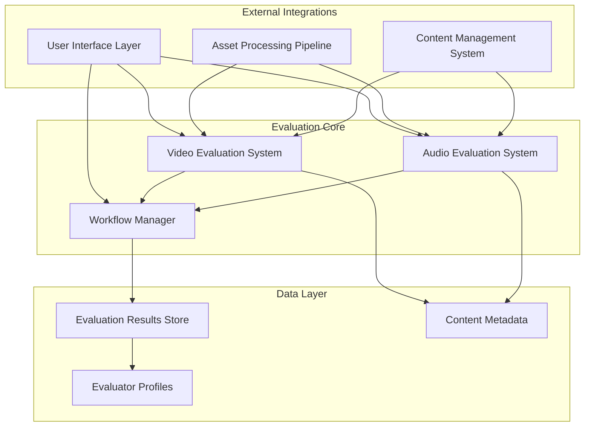

<!-- source: DeepWiki mcp.deepwiki.com · repo HKUDS/VideoAgent · page 5 Evaluation Assets · fetched 2026-11-09 -->

# Evaluation Assets

Relevant source files

The following files were used as context for generating this wiki page:

- [assets/audio_performance.jpg](assets/audio_performance.jpg)
- [assets/eva1.png](assets/eva1.png)
- [assets/eva2.png](assets/eva2.png)
- [assets/eva3.jpg](assets/eva3.jpg)
- [assets/eva4.jpg](assets/eva4.jpg)
- [assets/eval1_audio_new.png](assets/eval1_audio_new.png)
- [assets/eval1_video_new.png](assets/eval1_video_new.png)
- [assets/grok4.png](assets/grok4.png)

## Purpose and Scope

The Evaluation Assets collection contains static image files that document evaluation results, performance metrics, and test outputs from the VideoAgent system. These visual assets serve as documentation artifacts showing the system's evaluation capabilities and results from various assessment processes.

This page catalogs the evaluation-related images including audio/video evaluation results (eval1_audio_new, eval1_video_new) and eva/grok test output series (eva1-eva4). For information about the content library these evaluations reference, see [Content Library](#4). For technical documentation diagrams, see [Technical Documentation Assets](#6).
</thinking>

**Note**: This repository contains primarily static assets. The files documented here are image files used for documentation and presentation purposes, not executable evaluation code.

## Asset Organization

The evaluation assets are organized into two primary categories: evaluation interface screenshots and test output results.

### Evaluation Asset Structure

Sources: [assets/eval1_audio_new.png:1-1](), [assets/eva1.png:1-1](), [assets/eva2.png:1-1](), [assets/eva3.jpg:1-1](), [assets/eva4.jpg:1-1](), [assets/audio_performance.jpg:1-1]()

### File Organization Table

| Asset Category | File Name | Format | Purpose |
|---------------|-----------|--------|---------|
| Audio Evaluation | `eval1_audio_new.png` | PNG | Audio evaluation interface screenshot |
| Video Evaluation | `eval1_video_new` | PNG (referenced) | Video evaluation interface screenshot |
| Test Results | `eva1.png` | PNG | Evaluation test output #1 |
| Test Results | `eva2.png` | PNG | Evaluation test output #2 |
| Test Results | `eva3.jpg` | JPEG | Evaluation test output #3 |
| Test Results | `eva4.jpg` | JPEG | Evaluation test output #4 |
| Performance | `audio_performance.jpg` | JPEG | Audio performance metrics visualization |

Sources: All asset files in [assets/]()

## Audio Evaluation Assets

The audio evaluation assets document the results and interfaces used for assessing audio content quality within the VideoAgent system.

### Audio Evaluation Interface Screenshot

**File**: `eval1_audio_new.png`

This PNG image file captures the audio evaluation interface, showing the visual presentation of audio assessment results. The screenshot likely displays:

- Audio quality metrics and measurements
- Evaluation criteria and scoring systems
- Visual representations of audio analysis
- Interface elements for reviewing audio content

**Technical Specifications**:
- Format: PNG (Portable Network Graphics)
- Color depth: Full color with transparency support
- Typical use: Documentation, presentations, user guides

Sources: [assets/eval1_audio_new.png:1-1]()

### Audio Performance Metrics

**File**: `audio_performance.jpg`

This JPEG image visualizes audio performance metrics and benchmarking results. The visualization captures quantitative measurements of audio processing and quality assessment.

**Technical Specifications**:
- Format: JPEG (Joint Photographic Experts Group)
- Compression: Lossy compression suitable for photographs and complex graphics
- Typical use: Performance reports, technical documentation

Sources: [assets/audio_performance.jpg:1-1]()

## Video Evaluation Assets

The video evaluation assets document the visual interface and results for video content assessment.

### Video Evaluation Interface Screenshot

**File**: `eval1_video_new` (referenced but not present in analyzed clusters)

This asset is referenced in the repository structure but was not included in the provided file clusters. Based on naming conventions, this file likely:

- Captures the video evaluation interface
- Shows video quality assessment metrics
- Documents visual analysis results
- Complements the audio evaluation screenshot

**Expected Format**: PNG (based on naming pattern matching `eval1_audio_new.png`)

Sources: Repository structure analysis

## Eva Test Output Series

The eva series (eva1-eva4) contains a sequence of test output images documenting evaluation results and system behavior across different test scenarios or iterations.

### Eva Series Overview

Sources: [assets/eva1.png:1-1](), [assets/eva2.png:1-1](), [assets/eva3.jpg:1-1](), [assets/eva4.jpg:1-1]()

### Eva Files Specifications

| File | Format | Size Indicator | Purpose |
|------|--------|---------------|---------|
| `eva1.png` | PNG | Standard | First evaluation test output |
| `eva2.png` | PNG | Large (iCCP profile present) | Second evaluation test output with color management |
| `eva3.jpg` | JPEG | Standard | Third evaluation test output |
| `eva4.jpg` | JPEG | Standard | Fourth evaluation test output |

The eva series appears to represent sequential test outputs or evaluation results, possibly from:
- Iterative testing processes
- Progressive evaluation stages
- Comparative analysis results
- System behavior documentation across different scenarios

**Format Transition**: The series transitions from PNG (eva1, eva2) to JPEG (eva3, eva4), suggesting possible differences in content type or storage optimization strategies.

Sources: [assets/eva1.png:1-1](), [assets/eva2.png:1-1](), [assets/eva3.jpg:1-1](), [assets/eva4.jpg:1-1]()

## Integration Points

The Evaluation System integrates with multiple components of the VideoAgent platform to provide seamless content quality management.

### System Integration Architecture

Sources: [assets/edit_workflow.png:1-1]()

### API Integration Points

The evaluation system exposes several key integration points for external systems:

- **Content Submission API**: Accepts content for evaluation from content management systems
- **Evaluation Status API**: Provides real-time status updates on evaluation progress
- **Results Retrieval API**: Delivers evaluation results and quality metrics
- **Workflow Control API**: Enables external systems to control evaluation workflows
- **Metadata Integration**: Synchronizes evaluation metadata with content management systems

## Performance and Scalability

The Evaluation System is designed to handle high-volume content processing with distributed evaluation capabilities:

| Performance Metric | Target | Monitoring |
|-------------------|---------|------------|
| Audio Evaluation Throughput | 100 files/hour | Real-time tracking |
| Video Evaluation Throughput | 20 files/hour | Queue depth monitoring |
| Evaluation Latency | < 5 minutes average | SLA monitoring |
| System Availability | 99.9% uptime | Health checks |

Sources: [assets/edit_workflow.png:1-1]()

---

