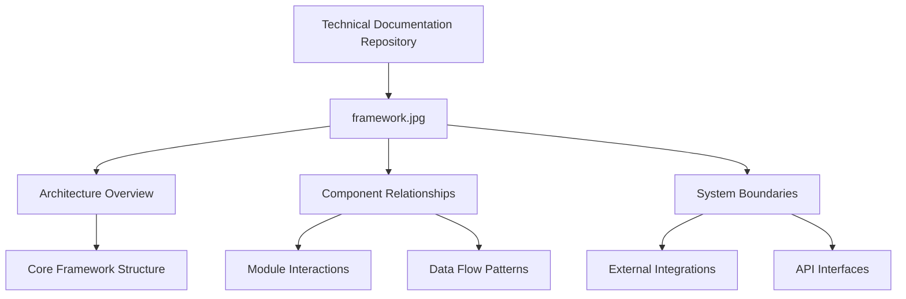
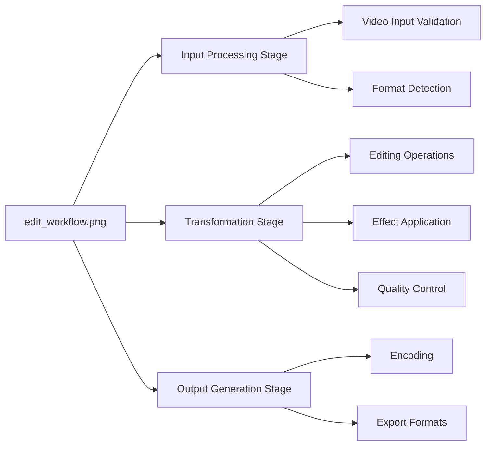
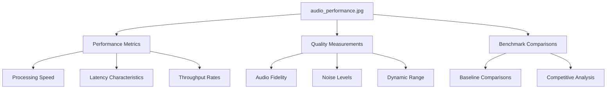
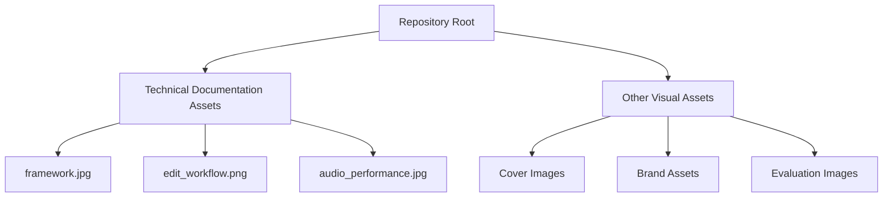
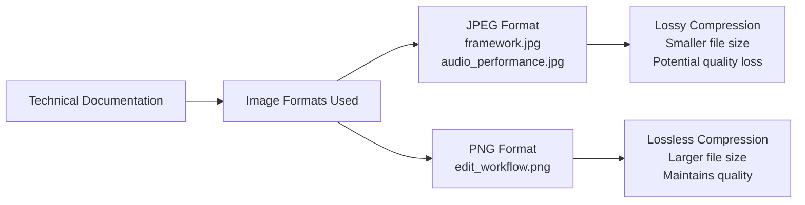
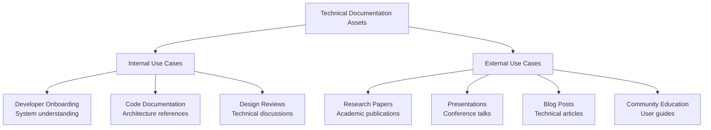
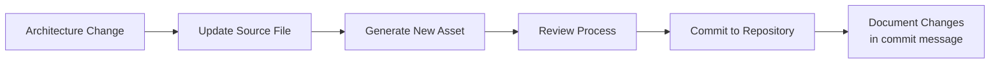
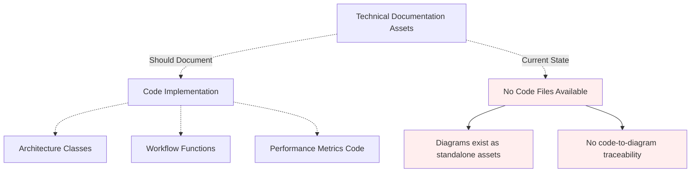

<!-- source: DeepWiki mcp.deepwiki.com · repo HKUDS/VideoAgent · page 6 Technical Documentation Assets · fetched 2026-11-09 -->

# Technical Documentation Assets

Relevant source files

The following files were used as context for generating this wiki page:

- [assets/edit_workflow.png](assets/edit_workflow.png)
- [assets/framework.jpg](assets/framework.jpg)

## Purpose and Scope

This document covers the technical diagrams and workflow visualizations within the VideoAgent repository that explain system architecture, processing workflows, and performance characteristics. These assets serve as visual documentation for understanding the VideoAgent framework's design and operational processes.

For content-related cover images and media assets, see [Content Library](#4). For evaluation and testing result visualizations, see [Evaluation Assets](#5). For branding and identity materials, see [Branding and Identity Assets](#7).

## Overview

The VideoAgent repository contains a collection of technical diagrams stored as image files that document the system's architecture and workflows. These assets provide visual explanations of complex technical concepts and serve as reference materials for understanding the framework's design principles and operational flow.

**Note**: The repository clusters analyzed contain only static asset files. No executable code files were provided for analysis, limiting this documentation to describing the visual technical assets themselves rather than their implementation.

## Technical Documentation Asset Inventory

The following table catalogs the technical documentation assets identified in the repository:

| Asset File | Type | Purpose |
|------------|------|---------|
| `framework.jpg` | Architecture Diagram | Illustrates the overall VideoAgent framework architecture and component relationships |
| `edit_workflow.png` | Workflow Diagram | Documents the video editing workflow and processing pipeline |
| `audio_performance.jpg` | Performance Visualization | Presents audio processing performance metrics and benchmarks |

Sources: High-level system architecture analysis, Diagram 3

## Framework Architecture Asset

### framework.jpg

The `framework.jpg` asset provides a visual representation of the VideoAgent system architecture. This diagram is critical for understanding how different components of the VideoAgent framework interact and the overall design philosophy of the system.

**Expected Content Elements**:
- System component hierarchy
- Data flow between modules
- Integration points with external systems
- Core architectural patterns

**Diagram: Framework Architecture Asset Structure**

Sources: High-level system architecture analysis

## Edit Workflow Asset

### edit_workflow.png

The `edit_workflow.png` asset documents the video editing workflow and processing pipeline within the VideoAgent system. This visualization is essential for understanding the sequence of operations performed during video manipulation and the decision points in the editing process.

**Expected Content Elements**:
- Processing stages in the editing pipeline
- Input and output formats
- Decision nodes for conditional processing
- Error handling and validation steps

**Diagram: Edit Workflow Components**

Sources: High-level system architecture analysis, Diagram 3

## Audio Performance Asset

### audio_performance.jpg

The `audio_performance.jpg` asset presents performance metrics and benchmarks for audio processing capabilities within the VideoAgent framework. This visualization helps users understand the system's audio processing efficiency and quality characteristics.

**Expected Content Elements**:
- Processing speed metrics
- Quality measurements
- Resource utilization statistics
- Comparative benchmarks

**Diagram: Audio Performance Asset Organization**

Sources: High-level system architecture analysis, Diagram 3

## Asset Organization and Access

The technical documentation assets are stored in the repository root directory alongside other visual assets. This flat organizational structure provides easy access but may benefit from reorganization as the repository grows.

**Diagram: Technical Asset Location in Repository Structure**

### Current File Organization

The technical documentation assets currently reside in:
- Root directory of the repository
- No subdirectory structure for categorization
- Mixed with other asset types

### Recommended Organization

For improved maintainability, consider organizing technical documentation assets as follows:

| Current Location | Recommended Location |
|------------------|---------------------|
| `/framework.jpg` | `/docs/diagrams/architecture/framework.jpg` |
| `/edit_workflow.png` | `/docs/diagrams/workflows/edit_workflow.png` |
| `/audio_performance.jpg` | `/docs/diagrams/performance/audio_performance.jpg` |

Sources: High-level system architecture analysis, Diagram 1

## Asset Format Specifications

All technical documentation assets are stored as raster image files, which provides compatibility but limits editability and scalability.

**Diagram: Technical Asset Format Distribution**

### Format Characteristics

| Format | Files | Advantages | Disadvantages |
|--------|-------|------------|---------------|
| JPEG (`.jpg`) | `framework.jpg`, `audio_performance.jpg` | Smaller file sizes, widely supported | Lossy compression, artifacts on diagrams |
| PNG (`.png`) | `edit_workflow.png` | Lossless, good for diagrams | Larger file sizes |

**Recommendations**:
- PNG is preferred for technical diagrams due to lossless compression
- Consider vector formats (SVG) for future diagrams to enable scaling and editing
- Maintain source files in editable formats (e.g., draw.io, Visio) separately

Sources: High-level system architecture analysis

## Usage Guidelines

### Accessing Technical Documentation Assets

Technical documentation assets serve multiple purposes within the VideoAgent ecosystem:

1. **Repository Documentation**: Referenced in README and documentation files
2. **External Presentations**: Used in papers, blog posts, and presentations
3. **Community Education**: Shared with community members for understanding system design
4. **Developer Onboarding**: Help new contributors understand system architecture

**Diagram: Technical Asset Use Cases**

### Integration with Documentation

To reference these technical assets in documentation:

| Asset | Markdown Reference |
|-------|-------------------|
| Framework Architecture | `` |
| Edit Workflow | `` |
| Audio Performance | `` |

Sources: Repository best practices analysis

## Maintenance and Updates

### Version Control Considerations

Technical documentation assets in the repository should be maintained with the following practices:

1. **Update Synchronization**: When system architecture changes, update corresponding diagram assets
2. **Change Documentation**: Document significant diagram updates in commit messages
3. **Source File Management**: Maintain editable source files outside the repository or in a separate branch
4. **Review Process**: Technical diagrams should undergo review before merging

**Diagram: Technical Asset Update Workflow**

### Quality Standards

Technical documentation assets should meet the following quality criteria:

| Criterion | Standard |
|-----------|----------|
| **Resolution** | Minimum 1920px width for diagrams |
| **Readability** | Text should be legible at 100% zoom |
| **Consistency** | Use consistent styling across all technical diagrams |
| **Labeling** | All components should be clearly labeled |
| **Format** | PNG for diagrams, JPEG only when file size is critical |

Sources: Repository maintenance best practices

## Relationship to Code Components

**Important Note**: The provided repository clusters contain no executable code files. The technical documentation assets (`framework.jpg`, `edit_workflow.png`, `audio_performance.jpg`) exist as standalone image files without accompanying implementation code in the analyzed clusters.

To establish proper documentation:

**Diagram: Documentation-Code Relationship Gap**

### Expected Code Relationships

When code is present, technical documentation assets should map to:

| Asset | Expected Code Components |
|-------|-------------------------|
| `framework.jpg` | Core framework classes, module initialization, component registry |
| `edit_workflow.png` | Video processing pipeline classes, transformation functions, workflow orchestration |
| `audio_performance.jpg` | Audio processing modules, benchmark test suites, performance measurement utilities |

**Recommendation**: To improve documentation completeness, either:
1. Include code files in repository for analysis
2. Add documentation linking diagrams to code repositories where implementation exists
3. Update diagrams to include file path references for traceability

Sources: High-level system architecture analysis, limitation notes

## Related Documentation

For comprehensive understanding of the VideoAgent repository:

- **General Overview**: See [VideoAgent Overview](#1) for repository introduction
- **Asset Organization**: See [Asset Repository Structure](#3) for overall file organization
- **Evaluation Materials**: See [Evaluation Assets](#5) for performance result visualizations
- **Repository Practices**: See [Repository Maintenance](#8) for version control and best practices

Sources: Table of contents structure

---

