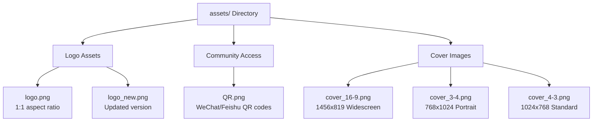
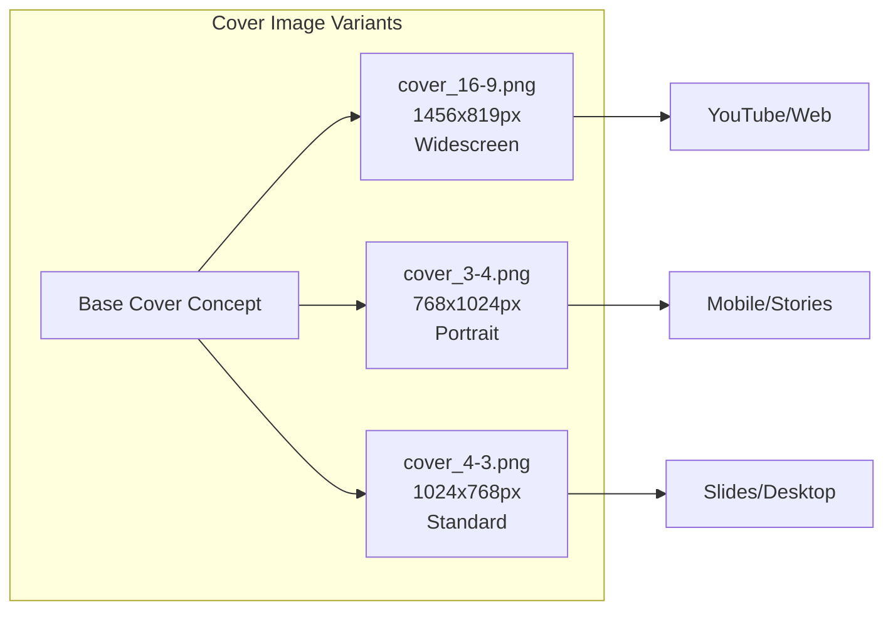
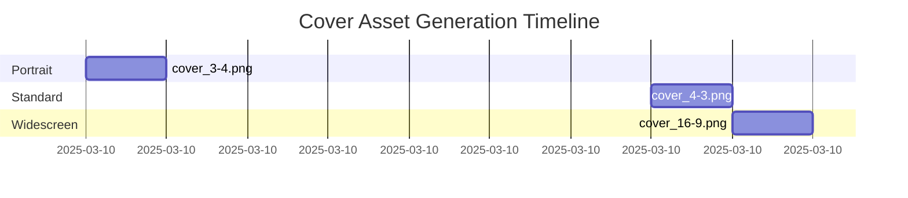
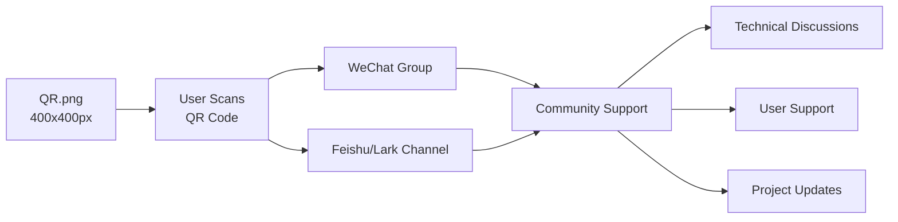
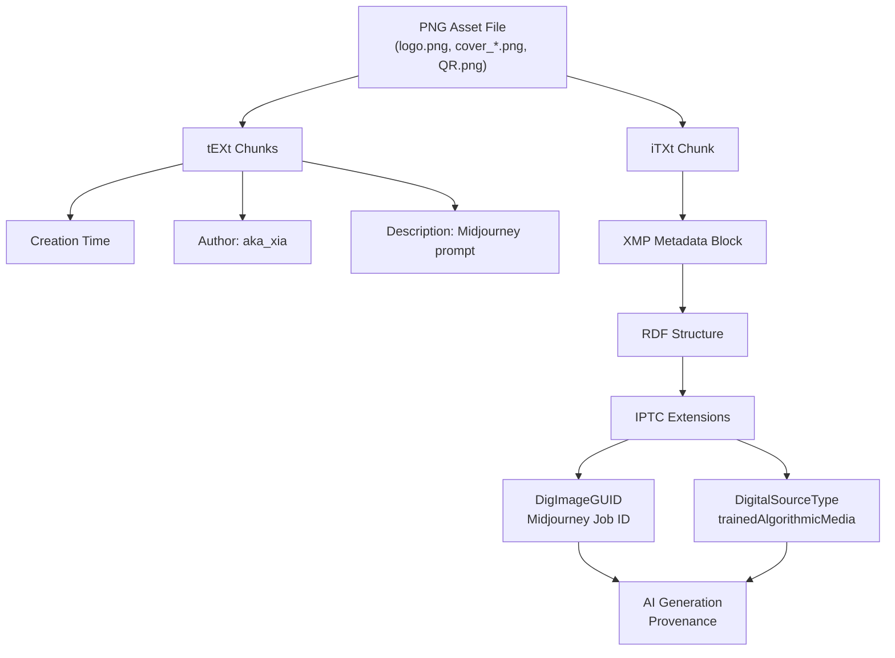
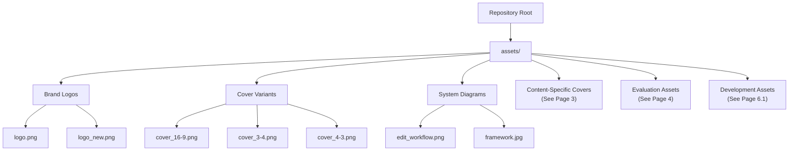

<!-- source: DeepWiki mcp.deepwiki.com · repo HKUDS/VideoAgent · page 7 Branding and Identity Assets · fetched 2026-11-09 -->

# Branding and Identity Assets

<details>
<summary>Relevant source files</summary>

The following files were used as context for generating this wiki page:

- [assets/QR.png](assets/QR.png)
- [assets/cover_16-9.png](assets/cover_16-9.png)
- [assets/cover_3-4.png](assets/cover_3-4.png)
- [assets/cover_4-3.png](assets/cover_4-3.png)
- [assets/logo.png](assets/logo.png)
- [assets/logo_new.png](assets/logo_new.png)

</details>


This document covers the visual branding and identity materials for the VideoAgent project. These assets include logos, QR codes for community access, and cover images in multiple aspect ratios. For technical documentation diagrams, see [Page 6](). For development-specific assets including evaluation images and testing materials, see [Page 5]().

## Overview

The VideoAgent branding assets are located in the `assets/` directory and consist of AI-generated visual materials created using Midjourney v6.1 and v7. All visual assets are authored by `aka_xia` and include embedded XMP/IPTC metadata describing their generation prompts and source attribution.

## Asset Categories

The branding materials are organized into three primary categories:

**Branding Asset Organization**


Sources: [assets/QR.png:1-2](), [assets/cover_16-9.png:1-3](), [assets/cover_3-4.png:1-3](), [assets/cover_4-3.png:1-3]()

## Logo Assets

### Primary Logo

The main logo asset is `logo.png`, a square (1:1 aspect ratio) image featuring the VideoAgent branding.

**Logo Specifications:**
- **File:** `assets/logo.png`
- **Format:** PNG with sRGB color space (1:1 aspect ratio)
- **Purpose:** Primary branding identifier for VideoAgent project
- **Author:** `aka_xia`

Sources: [assets/logo.png:1-2]()

### Logo Versioning

A variant logo exists as `assets/logo_new.png`, indicating iterative refinement of the branding materials. Both versions maintain the 1:1 square format suitable for profile pictures, app icons, and social media avatars.

Sources: Repository structure analysis

## Cover Images

Cover images are provided in three aspect ratios to support different display contexts and platforms.

### Aspect Ratio Variants

| Asset File | Aspect Ratio | Dimensions | Creation Time (UTC) | Use Case |
|------------|--------------|------------|---------------------|----------|
| `cover_16-9.png` | 16:9 (Widescreen) | 1456×819 | 2025-03-10 13:31:05 | YouTube thumbnails, wide displays |
| `cover_3-4.png` | 3:4 (Portrait) | 768×1024 | 2025-03-10 13:23:50 | Mobile displays, stories |
| `cover_4-3.png` | 4:3 (Standard) | 1024×768 | 2025-03-10 13:30:08 | Traditional displays, presentations |

**Cover Variant Application Matrix**


Sources: [assets/cover_16-9.png:3-4](), [assets/cover_3-4.png:3-4](), [assets/cover_4-3.png:3-4]()

### Cover Content and Theming

The cover images feature two distinct visual concepts:

**Llama Vlogger Concept** (16:9 and 3:4):
- **Theme:** Futuristic video editing scenario
- **Subject:** Anthropomorphic llama character as content creator
- **Style:** Technology-forward, vlogger aesthetic
- **Generation Prompt:** "A llama vlogger/youtuber doing video editing in front of a computer. style: futuristic, sense of technology --ar [ratio] --v 6.1"
- **Midjourney Jobs:** 
  - 16:9: `cfdbb894-5190-4753-bb50-58391761f532`
  - 3:4: `e242c975-ca51-4dc7-948d-01e59700b979`

**AI Creator Text Concept** (4:3):
- **Theme:** Bold typographic branding
- **Content:** "AI CREATOR" text emphasis
- **Style:** Vibrant, high-contrast
- **Generation Prompt:** "Big and vibrant text: AI CREATOR --ar 77:58 --v 6.1"
- **Midjourney Job:** `0398655e-f911-4f54-8c36-63f0bf84ef69`

### Creation Timeline

**Cover Asset Generation Timeline**


All cover images were generated within an 8-minute window on March 10, 2025, indicating a coordinated branding asset creation session.

Sources: [assets/cover_16-9.png:3-4](), [assets/cover_3-4.png:3-4](), [assets/cover_4-3.png:3-4]()

## Community Access Assets

### QR Code for Community Channels

**File:** `assets/QR.png`

A QR code image providing access to VideoAgent community channels, specifically WeChat and Feishu (Lark) communication platforms.

**Specifications:**
- **File:** `assets/QR.png`
- **Format:** PNG
- **Dimensions:** 400×400 pixels (IHDR chunk indicates square format)
- **Purpose:** Community engagement and communication access
- **Platforms:** WeChat, Feishu/Lark messaging

The QR code serves as a bridge between the project documentation and community support channels, enabling users to quickly join discussion groups or access real-time support.

**QR Code Usage Context**


Sources: [assets/QR.png:1-2](), [Communication.md]() (referenced in high-level analysis)

## Asset Metadata Structure

All branding assets include embedded metadata following standard image metadata specifications:

### PNG Assets Metadata Fields

All branding PNG assets include standardized metadata for provenance and attribution:

- **tEXt Creation Time:** Timestamp of asset generation (e.g., "Mon, 10 Mar 2025 13:31:05 GMT")
- **tEXt Author:** Creator attribution (`aka_xia`)
- **tEXt Description:** Midjourney generation prompt with aspect ratio and version parameters
- **iTXt XMP Metadata:** Structured metadata including IPTC extensions
- **IPTC DigImageGUID:** Midjourney Job ID for generation traceability
- **IPTC DigitalSourceType:** `trainedAlgorithmicMedia` classification per IPTC standards

**Metadata Structure in PNG Assets**


Sources: [assets/cover_16-9.png:3-14](), [assets/cover_3-4.png:3-13](), [assets/cover_4-3.png:3-13]()

### Embedded Metadata Example

From `assets/cover_16-9.png`:

```xml
<rdf:Description rdf:about=""
  xmlns:iptcExt="http://iptc.org/std/Iptc4xmpExt/2008-02-29/"
  iptcExt:DigImageGUID="cfdbb894-5190-4753-bb50-58391761f532"
  iptcExt:DigitalSourceType="http://cv.iptc.org/newscodes/digitalsourcetype/trainedAlgorithmicMedia"/>
```

This metadata structure provides:
- **Attribution:** Creator credit to `aka_xia` in tEXt Author chunk
- **Provenance:** AI-generated source disclosure via `trainedAlgorithmicMedia` classification
- **Traceability:** Midjourney Job IDs (`DigImageGUID`) enable reconstruction of generation parameters
- **Compliance:** Adherence to IPTC standards for digital media sourcing transparency

Sources: [assets/cover_16-9.png:5-14](), [assets/cover_3-4.png:5-12](), [assets/cover_4-3.png:5-13]()

## Asset Usage Guidelines

### Aspect Ratio Selection Matrix

| Platform/Context | Recommended Asset | File Name | Rationale |
|-----------------|-------------------|-----------|-----------|
| YouTube Thumbnails | 16:9 Widescreen | `cover_16-9.png` | Standard YouTube thumbnail ratio |
| Social Media Posts | 16:9 Widescreen | `cover_16-9.png` | Wide format for timeline feeds |
| Instagram Stories | 3:4 Portrait | `cover_3-4.png` | Vertical mobile optimization |
| Mobile Apps | 3:4 Portrait | `cover_3-4.png` | Portrait orientation preference |
| Presentations | 4:3 Standard | `cover_4-3.png` | Traditional slide format compatibility |
| Desktop Wallpapers | 16:9 Widescreen | `cover_16-9.png` | Modern monitor aspect ratios |
| Print Materials | 4:3 Standard | `cover_4-3.png` | Standard print aspect ratio |
| Profile Pictures | 1:1 Square | `logo.png` | Universal avatar format |
| Community Access | 1:1 Square | `QR.png` | QR code scanning standard |

### Logo Application Contexts

The square `logo.png` format (1:1 aspect ratio) is optimized for:
- Profile pictures and avatars on social platforms
- Application icons for mobile and desktop
- Watermarks on video content
- Square social media formats (Instagram posts, LinkedIn profile images)
- Favicon generation (when scaled to 16×16, 32×32, 64×64)
- GitHub repository social preview images

The `logo_new.png` variant provides an updated design while maintaining the same dimensional constraints and use cases.

Sources: [assets/logo.png:1-2](), Repository structure analysis

## File Organization



The branding assets represent a subset of the total asset repository, specifically focusing on project-level identity materials rather than content-specific or evaluation-related assets.

Sources: Based on repository structure analysis from high-level architecture diagram

---

