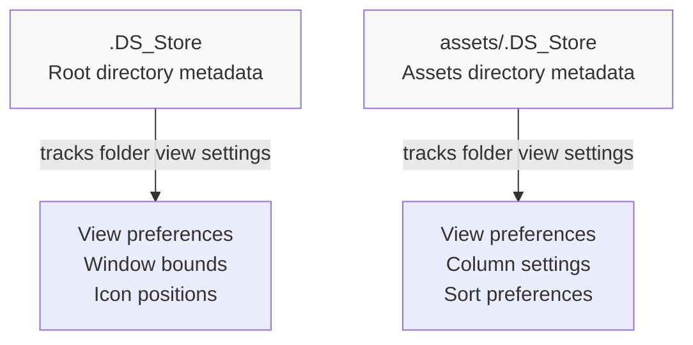
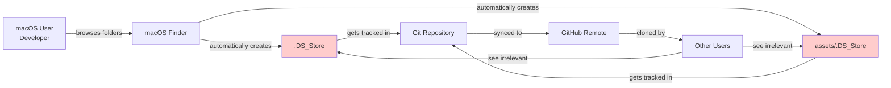
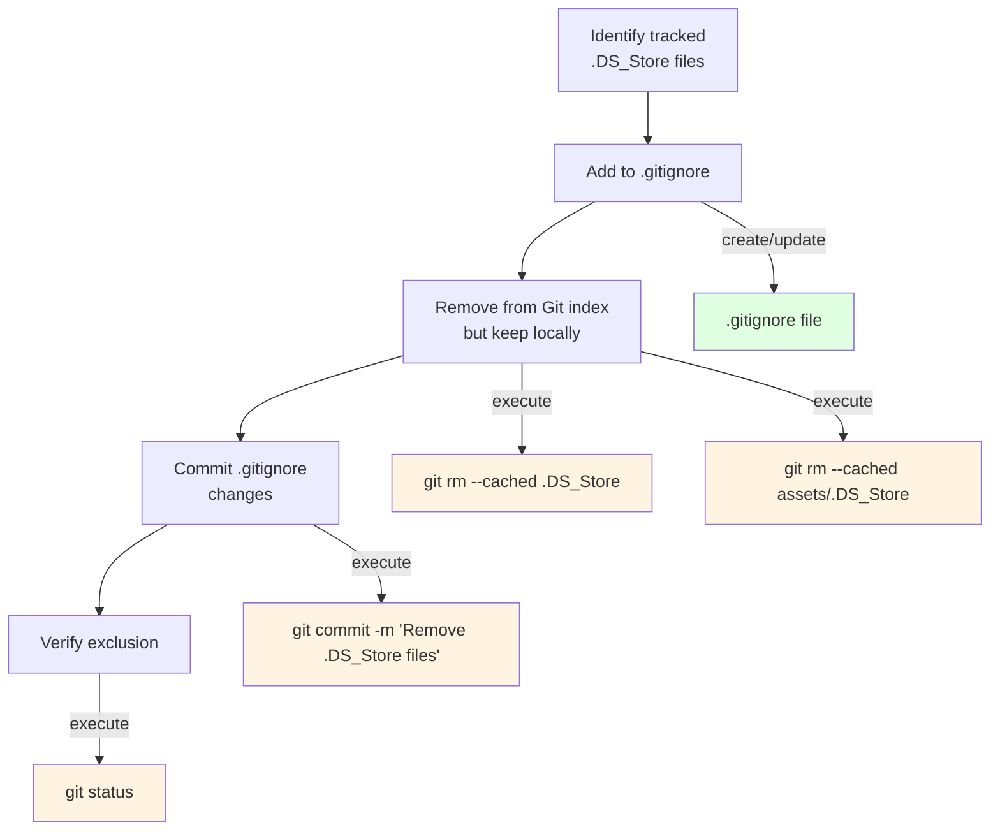
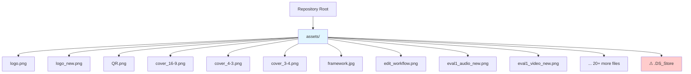
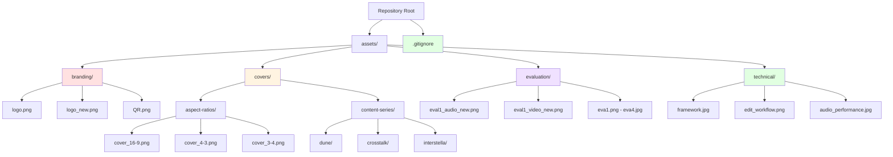
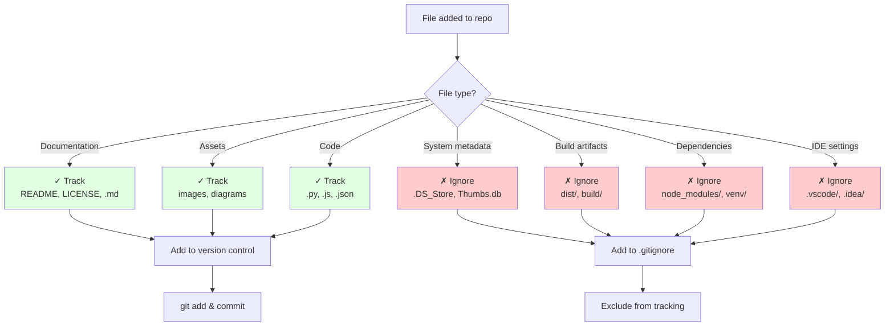
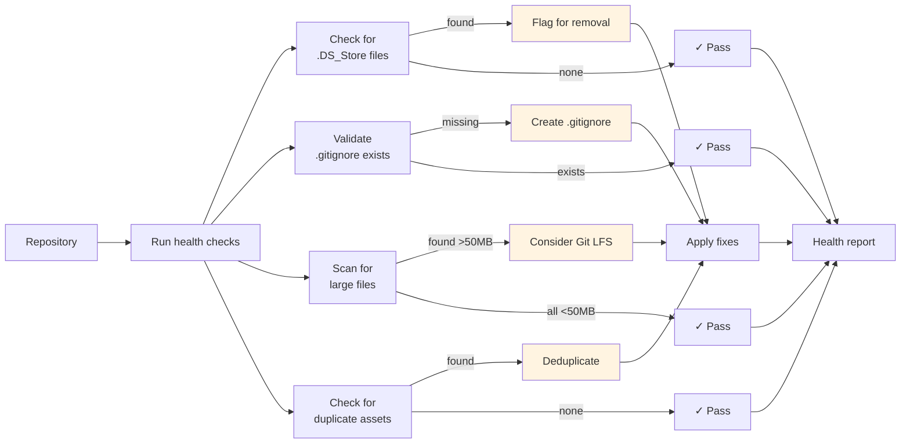

<!-- source: DeepWiki mcp.deepwiki.com · repo HKUDS/VideoAgent · page 8 Repository Maintenance · fetched 2026-11-09 -->

# Repository Maintenance

<details>
<summary>Relevant source files</summary>

The following files were used as context for generating this wiki page:

- [.DS_Store](.DS_Store)
- [assets/.DS_Store](assets/.DS_Store)

</details>


This page documents repository metadata files, version control hygiene practices, and best practices for maintaining the VideoAgent asset repository. It covers the handling of system-generated metadata files (specifically `.DS_Store` files), proper `.gitignore` configuration, and guidelines for asset organization and version control.

For information about the overall repository structure, see [Asset Repository Structure](#3). For details about specific asset types, see [Content Library](#4), [Evaluation Assets](#5), [Technical Documentation Assets](#6), and [Branding and Identity Assets](#7).

---

## System Metadata Files

The repository currently contains macOS system metadata files that are tracked in version control. These files serve no functional purpose in the repository and should be excluded.

### Current Metadata File Structure



**Sources:** [.DS_Store:1-1](), [assets/.DS_Store:1-1]()

### .DS_Store File Analysis

The `.DS_Store` (Desktop Services Store) files are binary files created by macOS Finder to store custom attributes of folders. The repository contains two instances:

| Location | File | Purpose | Should Track |
|----------|------|---------|--------------|
| Root | `.DS_Store` | Stores Finder view preferences for repository root | No |
| Assets directory | `assets/.DS_Store` | Stores Finder view preferences for assets folder | No |

These files contain serialized data including:
- Window bounds and positions
- Icon view settings (icon size, grid spacing)
- Column view preferences (column widths, sort order)
- Folder background settings
- Label colors

**Sources:** [.DS_Store:1-1](), [assets/.DS_Store:1-1]()

---

## .DS_Store File Handling

System metadata files like `.DS_Store` create repository pollution and should be excluded from version control.

### Problem Analysis



**Sources:** [.DS_Store:1-1](), [assets/.DS_Store:1-1]()

### Issues with Tracking Metadata Files

| Issue | Impact | Severity |
|-------|--------|----------|
| Repository pollution | Clutters commit history with non-functional changes | Medium |
| Cross-platform incompatibility | Creates files meaningless to Windows/Linux users | Low |
| Merge conflicts | Can cause unnecessary conflicts in collaborative work | Medium |
| Security/privacy | May expose local directory structure information | Low |
| Binary diff bloat | Cannot generate meaningful diffs for changes | Low |

### Removal and Prevention Workflow



**Sources:** [.DS_Store:1-1](), [assets/.DS_Store:1-1]()

---

## .gitignore Configuration

Proper `.gitignore` configuration prevents system metadata files from being tracked in the first place.

### Recommended .gitignore Entries

Create or update a `.gitignore` file in the repository root with the following entries:

```
# macOS system files
.DS_Store
.DS_Store?
._*
.Spotlight-V100
.Trashes

# Windows system files
Thumbs.db
Thumbs.db:encryptable
ehthumbs.db
Desktop.ini

# Linux system files
*~
.directory

# Editor and IDE files
.vscode/
.idea/
*.swp
*.swo
*~

# Python cache (if Python code exists)
__pycache__/
*.py[cod]
*$py.class
*.so
.Python

# Node modules (if Node.js code exists)
node_modules/
npm-debug.log*
yarn-debug.log*
yarn-error.log*
```

### Removal Commands

To remove existing `.DS_Store` files from Git tracking while preserving local copies:

```bash
# Remove specific .DS_Store files from Git index
git rm --cached .DS_Store
git rm --cached assets/.DS_Store

# Or remove all .DS_Store files recursively
find . -name .DS_Store -print0 | xargs -0 git rm --cached

# Commit the removal
git commit -m "Remove .DS_Store files from version control"

# Add .gitignore if not already committed
git add .gitignore
git commit -m "Add .gitignore to exclude system metadata files"
```

### Global Git Configuration

Alternatively, configure Git globally to ignore `.DS_Store` files across all repositories:

```bash
# Create or update global gitignore
echo ".DS_Store" >> ~/.gitignore_global
echo ".DS_Store?" >> ~/.gitignore_global
echo "._*" >> ~/.gitignore_global

# Configure Git to use the global ignore file
git config --global core.excludesfile ~/.gitignore_global
```

**Sources:** [.DS_Store:1-1](), [assets/.DS_Store:1-1]()

---

## Asset Management Best Practices

The repository contains extensive visual assets that require organized management.

### Current Asset Organization



**Sources:** [assets/.DS_Store:1-1]()

### Recommended Asset Organization



**Sources:** [assets/.DS_Store:1-1]()

### Asset Naming Conventions

| Asset Type | Convention | Example |
|------------|-----------|---------|
| Logos | `logo_[variant].png` | `logo_new.png` |
| Covers | `[content]_[type]_cover.png` | `dune_original_cover.png` |
| Aspect ratios | `cover_[ratio].png` | `cover_16-9.png` |
| Evaluations | `eval[n]_[type]_[version].png` | `eval1_audio_new.png` |
| Technical diagrams | `[description].jpg/png` | `framework.jpg`, `edit_workflow.png` |

**Sources:** [assets/.DS_Store:1-1]()

---

## Version Control Guidelines

### File Type Tracking Policy



**Sources:** [.DS_Store:1-1](), [assets/.DS_Store:1-1]()

### Large Asset Management

For repositories with many large binary assets, consider:

| Strategy | Use Case | Implementation |
|----------|----------|----------------|
| Git LFS | Large binary files (>1MB) | Install Git LFS, track `*.png`, `*.jpg`, `*.mp4` |
| External storage | Very large files (>100MB) | Use cloud storage, reference via URLs |
| Asset versioning | Multiple versions of assets | Organize by version subdirectories |
| Compression | Space optimization | Use lossless compression before committing |

### Commit Message Standards for Assets

Use descriptive commit messages that identify the asset changes:

```
feat(assets): add new logo variants for brand refresh
fix(assets): correct aspect ratio for cover_16-9.png
docs(assets): update evaluation result images for v2.0
refactor(assets): reorganize covers into subdirectories
chore(assets): remove duplicate content covers
```

**Sources:** [assets/.DS_Store:1-1]()

---

## Repository Health Monitoring

### Health Check Workflow



**Sources:** [.DS_Store:1-1](), [assets/.DS_Store:1-1]()

### Automated Checks

Implement pre-commit hooks to prevent system metadata files from being committed:

```bash
#!/bin/sh
# .git/hooks/pre-commit

# Check for .DS_Store files
if git diff --cached --name-only | grep -q "\.DS_Store"; then
    echo "Error: Attempting to commit .DS_Store files"
    echo "Please remove them: git rm --cached \$(find . -name .DS_Store)"
    exit 1
fi

# Check for large files
MAX_SIZE=10485760  # 10MB in bytes
for file in $(git diff --cached --name-only); do
    if [ -f "$file" ]; then
        size=$(wc -c < "$file")
        if [ $size -gt $MAX_SIZE ]; then
            echo "Error: File $file is larger than 10MB"
            echo "Consider using Git LFS for large files"
            exit 1
        fi
    fi
done

exit 0
```

### Repository Statistics

Monitor repository health with these metrics:

| Metric | Current State | Target |
|--------|---------------|--------|
| .DS_Store files tracked | 2 | 0 |
| .gitignore exists | No | Yes |
| Asset organization | Flat structure | Subdirectories |
| Large files (>10MB) | Unknown | Documented/LFS |
| Duplicate assets | Unknown | None |

**Sources:** [.DS_Store:1-1](), [assets/.DS_Store:1-1]()

---

## Maintenance Checklist

### Initial Setup

- [ ] Create `.gitignore` file in repository root
- [ ] Add system metadata file patterns to `.gitignore`
- [ ] Remove existing `.DS_Store` files from Git index: `git rm --cached .DS_Store assets/.DS_Store`
- [ ] Commit `.gitignore` and removal changes
- [ ] Verify files are no longer tracked: `git status`

### Regular Maintenance

- [ ] Audit repository for new system metadata files
- [ ] Review and reorganize assets into subdirectories as needed
- [ ] Check for duplicate or outdated assets
- [ ] Validate all large assets are necessary
- [ ] Update `.gitignore` for new file patterns
- [ ] Document asset organization in README

### Asset Updates

- [ ] Follow naming conventions when adding new assets
- [ ] Place assets in appropriate subdirectories
- [ ] Compress images before committing (if applicable)
- [ ] Write descriptive commit messages for asset changes
- [ ] Verify file sizes are reasonable

**Sources:** [.DS_Store:1-1](), [assets/.DS_Store:1-1]()

---

## Related Documentation

- For overall repository structure: [Asset Repository Structure](#3)
- For community engagement files: [Community and Licensing](#2)
- For specific asset categories: [Content Library](#4), [Evaluation Assets](#5)
- For branding materials: [Branding and Identity Assets](#7)