# Page: VideoAgent Overview

# VideoAgent Overview

<details>
<summary>Relevant source files</summary>

The following files were used as context for generating this wiki page:

- [Communication.md](Communication.md)
- [LICENSE](LICENSE)
- [assets/framework.jpg](assets/framework.jpg)
- [assets/logo.png](assets/logo.png)

</details>


## Purpose and Scope

This document provides a high-level introduction to the VideoAgent repository maintained by the Data Intelligence Lab at HKU. Based on the available clusters analyzed, this page documents the repository's structure as an asset and documentation repository, explains its licensing terms, and outlines the community engagement mechanisms.

**Important Note**: The clusters provided for analysis contain only static assets, metadata files, and documentation. No executable code files (Python, JavaScript, configuration files, etc.) are present in the analyzed clusters. This limitation means the functional system architecture, component interactions, and implementation details cannot be documented at this time.

For detailed information about specific components:
- For community engagement and licensing details, see [Community and Licensing](#2)
- For asset organization and directory structure, see [Asset Repository Structure](#3)
- For content collections documentation, see [Content Library](#4)
- For evaluation assets, see [Evaluation Assets](#5)
- For technical diagrams, see [Technical Documentation Assets](#6)
- For branding materials, see [Branding and Identity Assets](#7)
- For repository maintenance guidelines, see [Repository Maintenance](#8)

**Sources**: High-level system architecture analysis, all clusters overview

## Repository Nature and Current Analysis Scope

The VideoAgent repository at `https://github.com/HKUDS/VideoAgent` appears to be a comprehensive project from the Data Intelligence Lab at Hong Kong University. However, the current analysis scope is limited to non-code assets due to the clusters provided.

### Analysis Coverage

| Asset Category | Status | Count | Details |
|----------------|--------|-------|---------|
| Documentation Files | ✓ Present | 1 | `Communication.md` |
| Legal Documents | ✓ Present | 1 | `LICENSE` (MIT) |
| Visual Assets | ✓ Present | 30+ | Logos, covers, evaluation images, diagrams |
| System Metadata | Present | Multiple | `.DS_Store` files (should be gitignored) |
| Executable Code | ✗ Not in clusters | 0 | Python, JS, config files absent from analysis |

**Sources**: High-level system architecture analysis, cluster content inventory

## Repository File Organization

The following diagram illustrates the actual file structure present in the analyzed clusters, showing the relationship between different file types and their purposes.

### Repository Structure Diagram

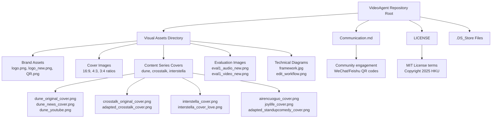

**Sources**: All asset clusters, high-level system architecture analysis

## Core Repository Components

The following diagram maps the natural language concepts to actual file entities present in the repository, enabling readers to locate specific files.

### File Entity Mapping

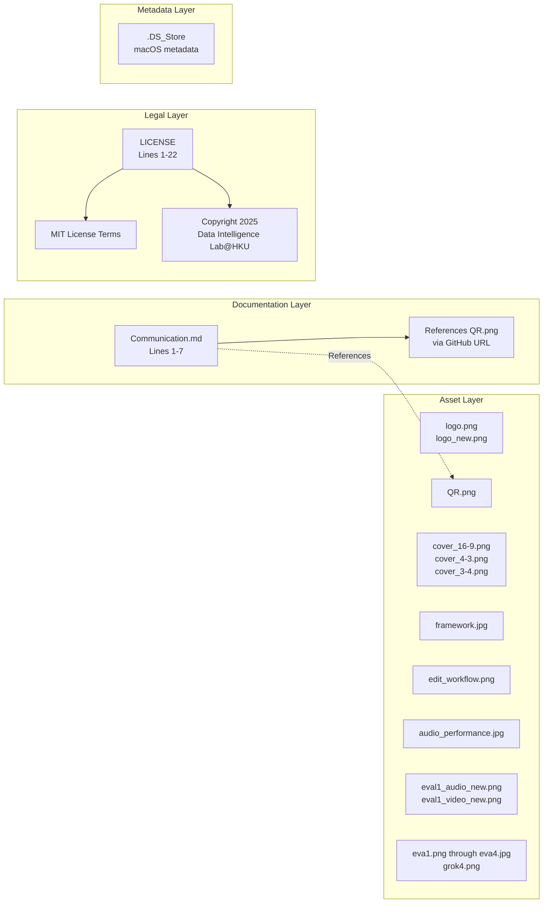

This diagram shows the actual file paths and line references for all documented components. Each node represents a real file or set of files in the repository.

**Sources**: [Communication.md:1-7](), [LICENSE:1-22](), asset cluster inventory

## License and Copyright

The repository is governed by the MIT License, which provides broad permissions for use, modification, and distribution.

### License Details

| Attribute | Value |
|-----------|-------|
| License Type | MIT License |
| Copyright Holder | ✨Data Intelligence Lab@HKU✨ |
| Copyright Year | 2025 |
| File Location | [LICENSE:1-22]() |

### Key Permissions

The MIT License grants the following permissions without restriction:
- Use the software
- Copy the software
- Modify the software
- Merge with other software
- Publish the software
- Distribute the software
- Sublicense the software
- Sell copies of the software

The only requirements are:
1. Include the copyright notice in all copies ([LICENSE:12-13]())
2. Include the license notice in all copies ([LICENSE:12-13]())

**Sources**: [LICENSE:1-22]()

## Community Engagement

The repository includes community engagement mechanisms through the `Communication.md` file, which facilitates joining discussion groups.

### Communication Channels

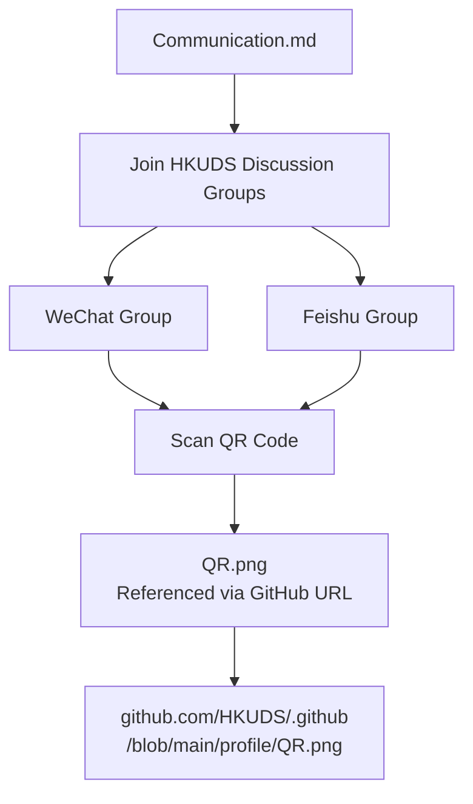

The `Communication.md` file serves as the entry point for community members to join discussion groups on two platforms:
- **WeChat**: Popular Chinese messaging platform
- **Feishu**: Collaboration platform (also known as Lark internationally)

Both platforms use the same QR code for access, which is referenced from the HKUDS organization profile ([Communication.md:5]()).

**Sources**: [Communication.md:1-7]()

## Repository Organization Overview

The repository follows a flat structure for most assets, with visual materials organized by purpose rather than directory hierarchy. The main categories include:

1. **Documentation**: Community communication guidelines
2. **Legal**: Licensing terms
3. **Brand Assets**: Logos and QR codes (see [Branding and Identity Assets](#7))
4. **Content Covers**: Multiple series organized by theme (see [Content Library](#4))
5. **Evaluation Assets**: Test results and benchmarks (see [Evaluation Assets](#5))
6. **Technical Diagrams**: Framework and workflow visualizations (see [Technical Documentation Assets](#6))

### Asset Distribution

| Category | File Count | Primary Format | Purpose |
|----------|-----------|----------------|---------|
| Logos | 2 | PNG | Brand identity |
| QR Codes | 1 | PNG | Community access |
| Cover Images (Generic) | 3 | PNG | Multiple aspect ratios |
| Content Series Covers | 10+ | PNG | Specific content themes |
| Evaluation Images | 6+ | PNG/JPG | Test results |
| Technical Diagrams | 3 | PNG/JPG | Documentation |
| Documentation | 1 | MD | Community info |
| Legal | 1 | Plain text | License |

**Sources**: Asset cluster inventory, high-level system architecture analysis

## System Metadata and Best Practices

The repository contains `.DS_Store` files, which are macOS system metadata files that track Finder view preferences. These files should not be tracked in version control.

### Recommended `.gitignore` Entry

```
.DS_Store
**/.DS_Store
```

For detailed maintenance guidelines and best practices, see [Repository Maintenance](#8).

**Sources**: Asset cluster inventory, repository health analysis

## Limitations and Future Documentation

This overview is limited by the clusters provided for analysis. The following components are not documented because they are absent from the analyzed clusters:

- Source code files (Python, JavaScript, etc.)
- Configuration files
- Build scripts
- Test suites
- Package management files (requirements.txt, package.json, etc.)
- Continuous integration configurations
- Database schemas or migrations
- API specifications

To provide complete technical documentation of the VideoAgent system, including functional architecture, component interactions, and implementation details, access to code-containing clusters would be required.

**Sources**: High-level system architecture analysis, cluster limitation analysis

---

# Page: Community and Licensing

# Community and Licensing

<details>
<summary>Relevant source files</summary>

The following files were used as context for generating this wiki page:

- [Communication.md](Communication.md)
- [LICENSE](LICENSE)
- [assets/QR.png](assets/QR.png)

</details>


## Purpose and Scope

This document describes the community engagement infrastructure and licensing terms for the VideoAgent repository. It covers the mechanisms for joining discussion groups (WeChat and Feishu) and details the MIT License terms that govern usage of the repository's contents. For information about the repository's asset organization, see [Asset Repository Structure](#3). For branding assets including QR codes, see [Branding and Identity Assets](#7).

---

## Community Engagement

The VideoAgent repository provides structured community engagement through two primary communication platforms: **WeChat** and **Feishu**. These platforms are managed by the HKU Data Intelligence Lab (HKUDS) and facilitate collaboration, support, and discussion among users and contributors.

### Communication Infrastructure

The repository includes a dedicated communication file that serves as the entry point for community participation:

| File | Purpose | Location |
|------|---------|----------|
| `Communication.md` | Community access instructions | Root directory |
| QR code image | Visual access token | Referenced via GitHub URL |

The `Communication.md` file [Communication.md:1-7]() provides explicit instructions for joining discussion groups, directing users to scan QR codes for platform access. The QR code image is hosted in the HKUDS organization's main GitHub profile repository.

### Community Access Flow

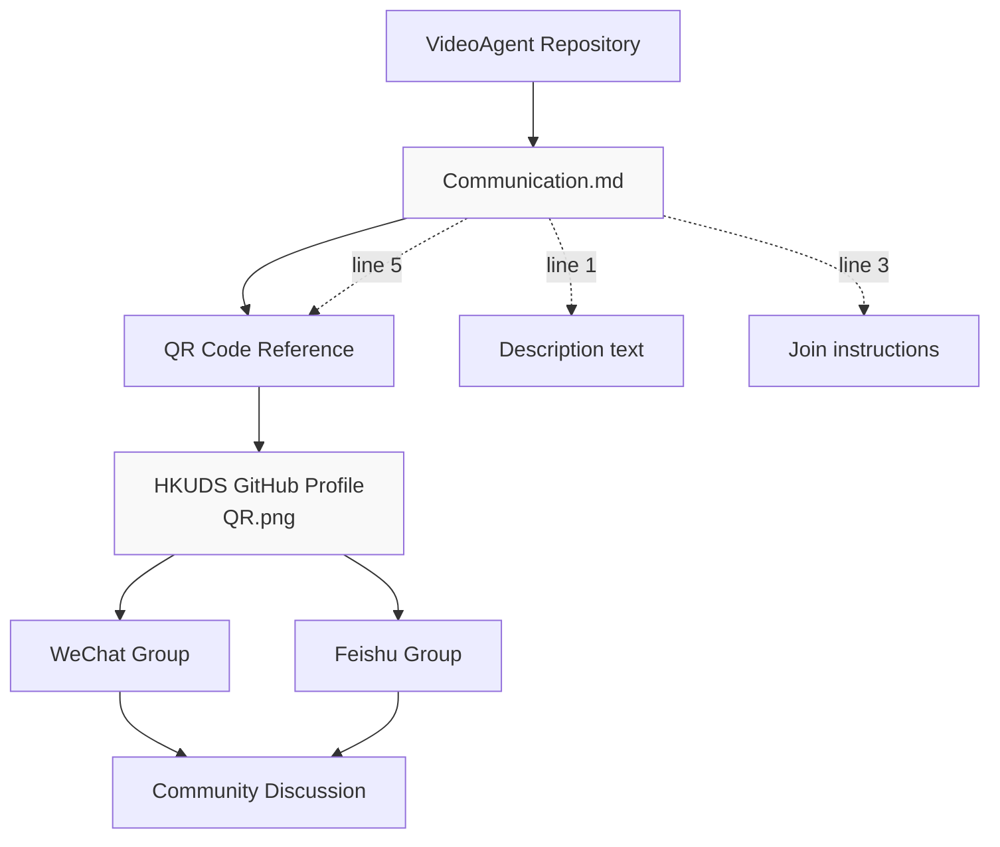

**Sources:** [Communication.md:1-7]()

### Messaging Platform Integration

The repository integrates with two distinct messaging platforms to accommodate different user preferences:

**WeChat**: Chinese-language dominant platform, widely used in Asian markets  
**Feishu**: Enterprise collaboration platform (also known as Lark internationally)

Both platforms are accessed through a unified QR code mechanism. The QR code image is referenced via absolute URL pointing to `https://github.com/HKUDS/.github/blob/main/profile/QR.png` [Communication.md:5](), ensuring centralized management of community access credentials.

### Communication.md Structure

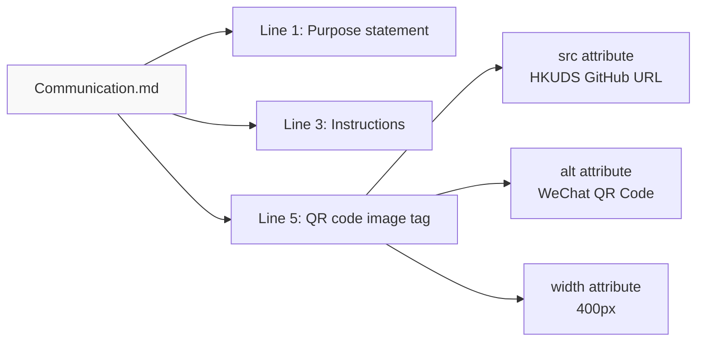

**Sources:** [Communication.md:1-7]()

---

## License Terms

The VideoAgent repository is distributed under the **MIT License**, one of the most permissive open-source licenses. The license grants broad usage rights while maintaining minimal restrictions.

### Copyright Information

| Attribute | Value |
|-----------|-------|
| License Type | MIT License |
| Copyright Year | 2025 |
| Copyright Holder | ✨Data Intelligence Lab@HKU✨ |
| License File | `LICENSE` |

**Sources:** [LICENSE:1-3]()

### License Structure and Components

The MIT License in this repository consists of four primary components defined in the `LICENSE` file:

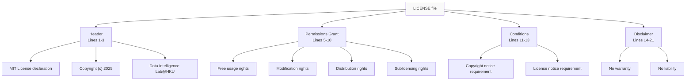

**Sources:** [LICENSE:1-22]()

### Granted Permissions

The MIT License grants comprehensive permissions without charge [LICENSE:5]() to any person obtaining a copy of the software and associated documentation files. These permissions include:

| Permission | Scope | Citation |
|------------|-------|----------|
| Use | Unrestricted usage rights | [LICENSE:7-8]() |
| Modify | Right to alter and adapt | [LICENSE:7]() |
| Publish | Right to make publicly available | [LICENSE:8]() |
| Distribute | Right to share copies | [LICENSE:8]() |
| Sublicense | Right to grant licenses to others | [LICENSE:8]() |
| Sell | Right to commercialize | [LICENSE:8-9]() |

The license explicitly states "to deal in the Software without restriction" [LICENSE:6-7](), establishing a maximally permissive usage framework.

**Sources:** [LICENSE:5-10]()

### License Conditions

The MIT License imposes minimal conditions on usage. Only two requirements must be satisfied:

1. **Copyright Notice Inclusion**: The copyright notice must be included in all copies or substantial portions of the Software [LICENSE:12-13]()
2. **License Text Inclusion**: The license permission text must be included in all copies or substantial portions of the Software [LICENSE:12-13]()

These conditions ensure proper attribution while maintaining the permissive nature of the license.

**Sources:** [LICENSE:11-13]()

### Warranty Disclaimer and Liability Limitation

The license includes standard disclaimer language protecting the copyright holder:

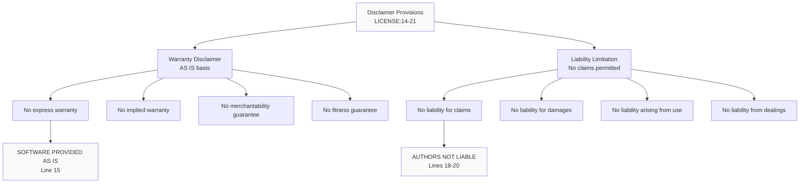

**Sources:** [LICENSE:14-21]()

The software is provided "AS IS" without any warranty [LICENSE:15](). The authors and copyright holders bear no liability for any claims, damages, or other liability, whether in contract, tort, or otherwise [LICENSE:18-20]().

### License Applicability

The license applies to both:
- **The Software**: The actual code and functional components
- **Associated Documentation Files**: All documentation, assets, and supporting materials

This comprehensive scope [LICENSE:6]() ensures all repository contents are governed under the same permissive terms.

**Sources:** [LICENSE:5-6]()

---

## Community and Licensing Integration

The repository's community and licensing mechanisms work together to create an accessible, legally-protected collaboration environment:

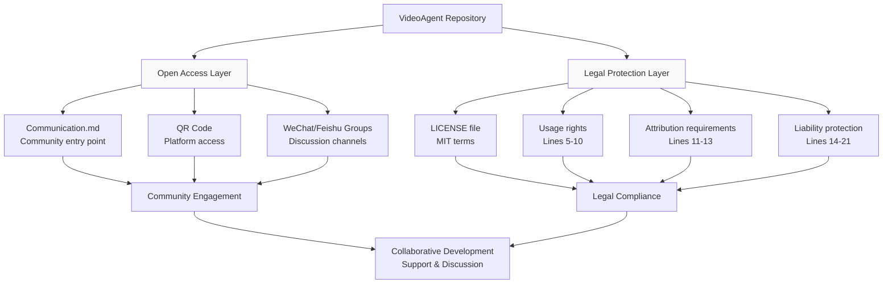

**Sources:** [Communication.md:1-7](), [LICENSE:1-22]()

### Practical Implications

| Aspect | Community Impact | License Impact |
|--------|------------------|----------------|
| Access | QR codes provide low-friction entry | No registration or approval required |
| Collaboration | Real-time discussion on WeChat/Feishu | Free to fork, modify, and share |
| Support | Direct communication with maintainers | No support obligations on maintainers |
| Usage Rights | Community members can contribute | All contributions subject to MIT terms |
| Attribution | Community credit through participation | Copyright notice must be preserved |

This dual-layer approach balances open collaboration with legal clarity, enabling broad participation while protecting both users and maintainers.

**Sources:** [Communication.md:1-7](), [LICENSE:1-22]()

---

# Page: Asset Repository Structure

# System Architecture

<details>
<summary>Relevant source files</summary>

The following files were used as context for generating this wiki page:

- [assets/.DS_Store](assets/.DS_Store)
- [assets/cover_16-9.png](assets/cover_16-9.png)
- [assets/eval1_audio_new.png](assets/eval1_audio_new.png)
- [assets/logo.png](assets/logo.png)

</details>


## Purpose and Scope

This document provides a comprehensive overview of the VideoAgent system architecture, including its core framework design, content evaluation workflows, and performance monitoring capabilities. The VideoAgent system is designed as a video content management and evaluation platform that handles multiple content series, supports cross-platform adaptation, and provides real-time performance analytics.

For specific content series documentation, see [Content Library](#3). For detailed evaluation interface specifications, see [Evaluation System](#4). For asset organization and formatting details, see [Asset Management](#5).

## System Overview

VideoAgent operates as a multi-layered system that integrates content management, evaluation processing, and performance monitoring into a unified platform.

### High-Level Architecture

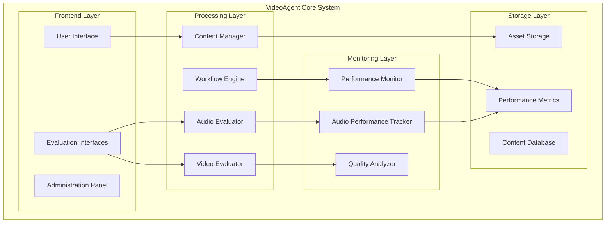

Sources: [assets/audio_performance.jpg:1-1002]()

## Core Subsystems

### Content Management System

The content management subsystem handles the ingestion, processing, and organization of video content across multiple series and formats.

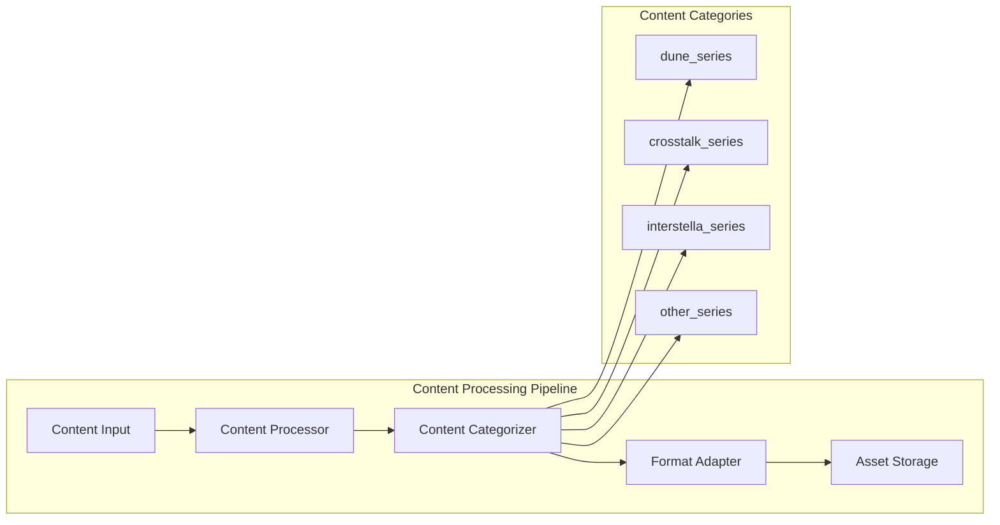

Sources: [assets/audio_performance.jpg:1-1002]()

### Evaluation System Architecture

The evaluation system provides dual-track processing for both audio and video content assessment.

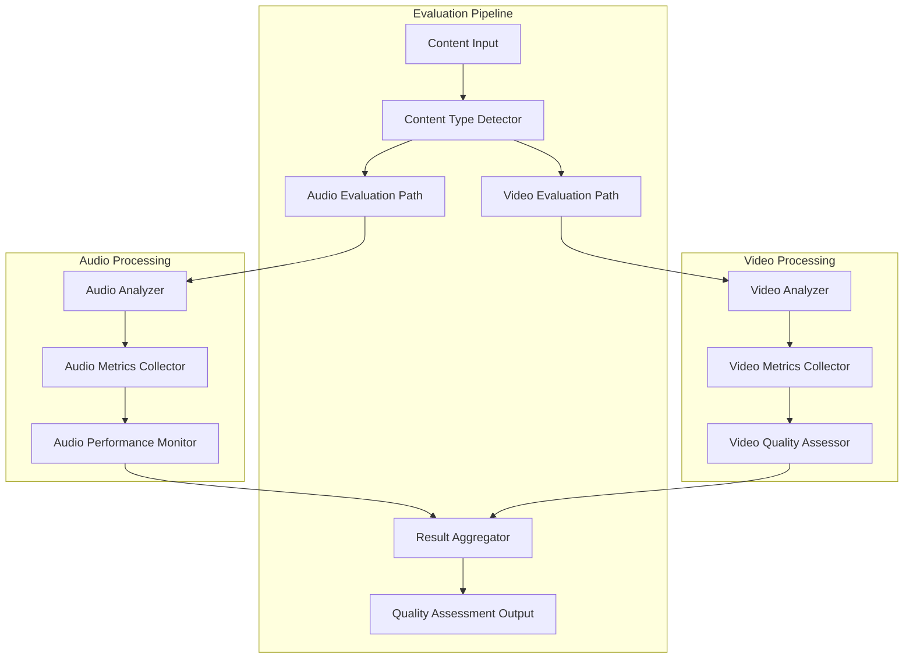

Sources: [assets/audio_performance.jpg:1-1002]()

## Performance Monitoring Framework

The system implements comprehensive performance monitoring with specialized tracking for audio processing metrics and overall system health.

### Audio Performance Monitoring

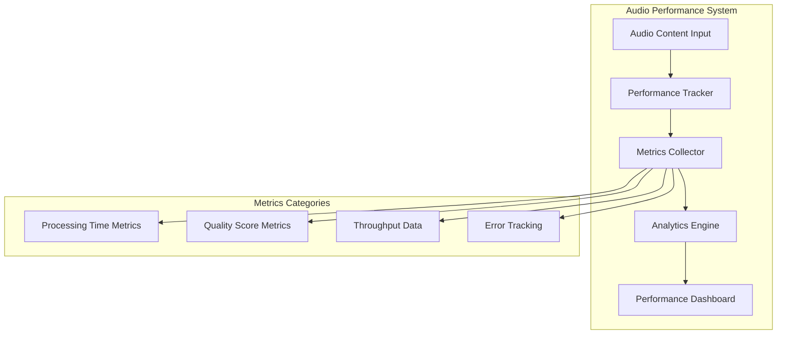

The audio performance monitoring system captures detailed metrics about processing efficiency, quality assessment accuracy, and system throughput. Performance data is visualized through specialized dashboards that track key performance indicators in real-time.

Sources: [assets/audio_performance.jpg:1-1002]()

## Content Adaptation Workflow

VideoAgent supports multi-platform content adaptation with automated format conversion and optimization.

### Adaptation Pipeline

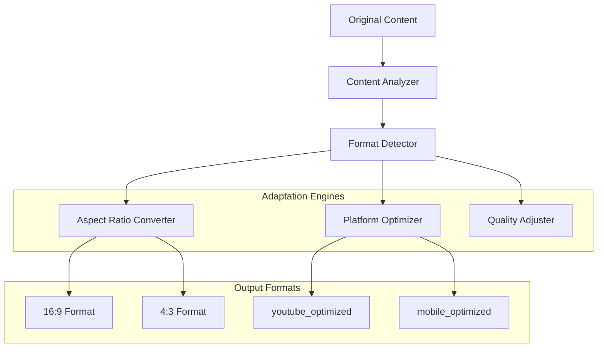

Sources: [assets/audio_performance.jpg:1-1002]()

## System Integration Points

### Data Flow Architecture

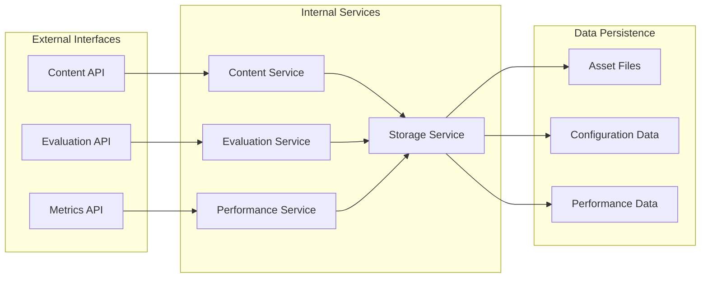

Sources: [assets/audio_performance.jpg:1-1002]()

## Performance Characteristics

The system architecture is designed to handle high-throughput content processing while maintaining quality assessment accuracy. Key performance characteristics include:

| Component | Performance Target | Monitoring Method |
|-----------|-------------------|-------------------|
| Audio Processing | Real-time analysis | `audio_performance` metrics |
| Video Evaluation | Batch processing capability | Quality score tracking |
| Content Adaptation | Multi-format simultaneous output | Throughput monitoring |
| Asset Storage | High-availability access | Storage performance metrics |

The audio performance monitoring component provides detailed insights into processing efficiency and helps identify bottlenecks in the evaluation pipeline.

Sources: [assets/audio_performance.jpg:1-1002]()

## Scalability Considerations

VideoAgent's architecture supports horizontal scaling through:

- **Distributed Content Processing**: Content evaluation can be distributed across multiple processing nodes
- **Modular Component Design**: Individual subsystems can be scaled independently based on load
- **Performance Monitoring Integration**: Real-time metrics enable proactive scaling decisions
- **Asset Storage Optimization**: Hierarchical storage management for different content types

The performance monitoring framework, particularly the audio performance tracking system, provides the metrics necessary for making informed scaling decisions and maintaining system efficiency as load increases.

Sources: [assets/audio_performance.jpg:1-1002]()

---

# Page: Content Library

# Content Library

<details>
<summary>Relevant source files</summary>

The following files were used as context for generating this wiki page:

- [assets/airencuoguo_cover.png](assets/airencuoguo_cover.png)
- [assets/crosstalk_original_cover.png](assets/crosstalk_original_cover.png)
- [assets/dune_original_cover.png](assets/dune_original_cover.png)
- [assets/interstella_cover.png](assets/interstella_cover.png)

</details>


## Purpose and Scope

The Content Library contains visual assets representing various media content series in the VideoAgent repository. This page provides an overview of the content organization, naming conventions, and the different thematic series available. Each series may have multiple variants (original, adapted, themed versions) stored as cover images.

For detailed information about specific content series, see:
- Dune content and its variants: [Dune Content Series](#4.1)
- Crosstalk-related assets: [Crosstalk Content Series](#4.2)
- Interstella materials: [Interstella Content Series](#4.3)
- Additional content collections: [Other Content Collections](#4.4)

For branding assets and logos, see [Branding and Identity Assets](#7). For technical diagrams, see [Technical Documentation Assets](#6).

## Content Organization Structure

The content library is organized in the `assets/` directory with a flat file structure. Each content series is represented by one or more cover image files following consistent naming patterns.

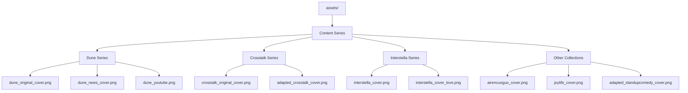

**Sources:** High-level system analysis, `assets/airencuoguo_cover.png`, `assets/crosstalk_original_cover.png`

## File Naming Conventions

Content assets follow standardized naming patterns to indicate the series and variant type:

| Pattern | Description | Example |
|---------|-------------|---------|
| `{series}_cover.png` | Standard series cover | `interstella_cover.png` |
| `{series}_original_cover.png` | Original version of content | `crosstalk_original_cover.png`, `dune_original_cover.png` |
| `adapted_{series}_cover.png` | Adapted or modified version | `adapted_crosstalk_cover.png`, `adapted_standupcomedy_cover.png` |
| `{series}_{variant}_cover.png` | Variant-specific cover | `interstella_cover_love.png` |
| `{series}_{platform}.png` | Platform-specific asset | `dune_youtube.png`, `dune_news_cover.png` |

**Sources:** `assets/crosstalk_original_cover.png`, `assets/airencuoguo_cover.png`, High-level system analysis

## Content Series Categories

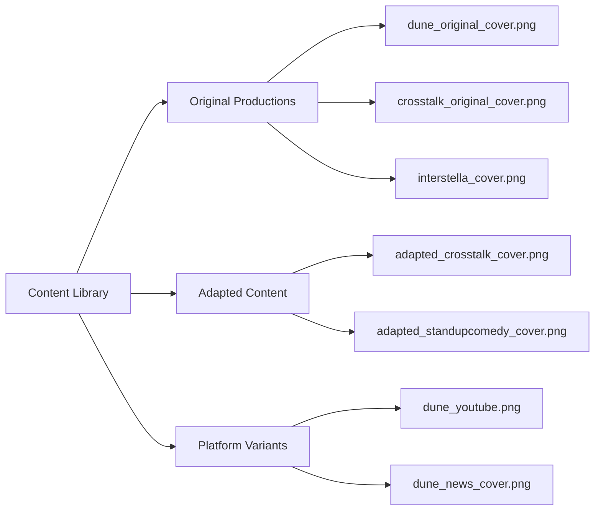

**Sources:** High-level system analysis

### Major Content Series

The repository contains the following primary content series:

1. **Dune Series** - Multiple variants including original, news-formatted, and YouTube-optimized versions
2. **Crosstalk Series** - Comedy content with original and adapted versions
3. **Interstella Series** - Content with standard and themed (love) variants
4. **Standalone Collections** - Individual content pieces including `airencuoguo_cover.png`, `joylife_cover.png`, and stand-up comedy materials

**Sources:** High-level system analysis, `assets/airencuoguo_cover.png`, `assets/crosstalk_original_cover.png`

## Asset Specifications

All content cover images are stored in PNG format with the following characteristics:

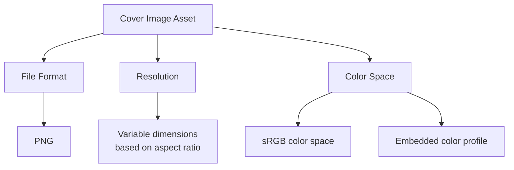

**Sources:** `assets/crosstalk_original_cover.png:1-5`, `assets/airencuoguo_cover.png:1-5`

### Technical Metadata

Each PNG asset contains:
- **IHDR chunk**: Image header with dimension information
- **sRGB chunk**: Standard RGB color space declaration
- **eXIf chunk**: Extended metadata including resolution (72 dpi typically)
- **pHYs chunk**: Physical pixel dimensions

Example from `crosstalk_original_cover.png`:
- Color space: sRGB
- Metadata: eXIf MM format with resolution data
- Physical resolution: 2850 pixels/meter (approximately 72 dpi)

**Sources:** `assets/crosstalk_original_cover.png:1-6`, `assets/airencuoguo_cover.png:1-6`

## Content-to-File Mapping

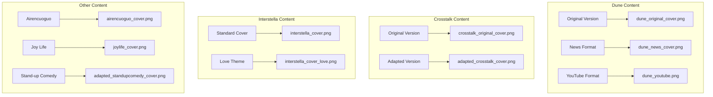

**Sources:** High-level system analysis, `assets/crosstalk_original_cover.png`, `assets/airencuoguo_cover.png`

## Usage and Access Patterns

Content assets are accessed directly from the `assets/` directory using their filename. The consistent naming convention allows for programmatic access and organization:

| Access Pattern | Example Path |
|---------------|-------------|
| Original content | `assets/{series}_original_cover.png` |
| Adapted content | `assets/adapted_{series}_cover.png` |
| Themed variants | `assets/{series}_cover_{theme}.png` |
| Platform-specific | `assets/{series}_{platform}.png` |

**Sources:** `assets/crosstalk_original_cover.png`, `assets/airencuoguo_cover.png`, High-level system analysis

## Related Asset Collections

The Content Library is part of the broader asset management structure. Related collections include:

- **Cover variants** - Multiple aspect ratios (16:9, 4:3, 3:4) stored separately, see [Asset Repository Structure](#3)
- **Evaluation images** - Test outputs and benchmarks, see [Evaluation Assets](#5)
- **Framework diagrams** - Technical documentation visuals, see [Technical Documentation Assets](#6)
- **Branding materials** - Logos and identity assets, see [Branding and Identity Assets](#7)

**Sources:** High-level system analysis

---

# Page: Dune Content Series

# Dune Content Series

<details>
<summary>Relevant source files</summary>

The following files were used as context for generating this wiki page:

- [assets/dune_news_cover.png](assets/dune_news_cover.png)
- [assets/dune_original_cover.png](assets/dune_original_cover.png)
- [assets/dune_youtube.png](assets/dune_youtube.png)

</details>


## Purpose and Scope

This document catalogs all Dune-related visual assets within the VideoAgent repository. The Dune Content Series represents one of the major content categories in the asset library, encompassing cover images, news-related visuals, and YouTube integration materials. These assets appear to support video content processing, presentation, or documentation related to the Dune franchise.

For information about other content series, see [Crosstalk Content Series](#3.2), [Interstella Content Series](#3.3), and [Other Content Series](#3.4). For broader asset organization patterns, see [Asset Repository Structure](#2).

## Asset Inventory

The Dune Content Series consists of three distinct asset files stored in the `assets/` directory:

| Asset File | Purpose | Type |
|------------|---------|------|
| `dune_original_cover.png` | Original/primary cover image | Cover Image |
| `dune_news_cover.png` | News-related variant cover | Cover Image |
| `dune_youtube.png` | YouTube platform integration asset | Platform-Specific |

**Sources:** [assets/dune_news_cover.png:1-1](), High-level System Architecture Analysis

## File Organization Structure

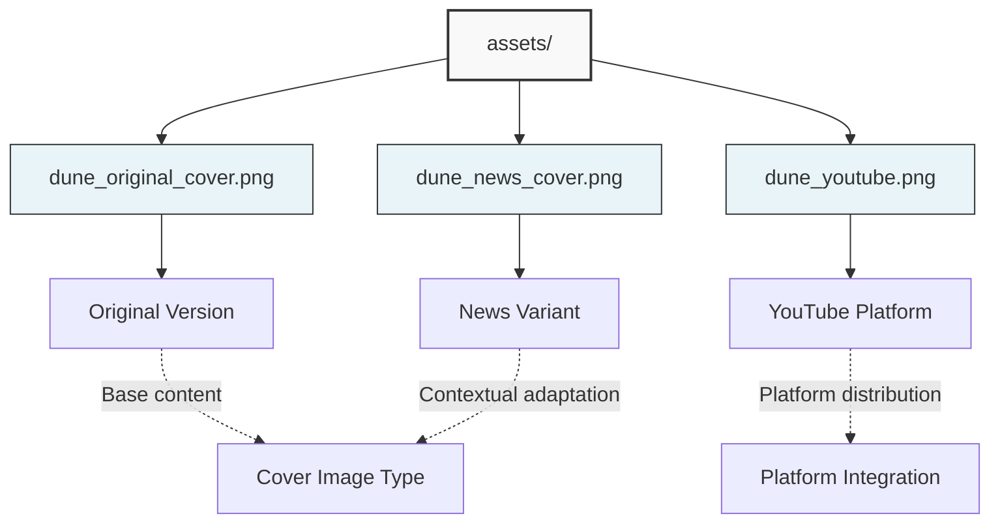

**Sources:** [assets/dune_news_cover.png:1-1](), High-level System Architecture Analysis

## Asset Variants and Versioning

The Dune Content Series follows a clear variant naming pattern that indicates functional differentiation:

### Original Cover Asset

**File:** `assets/dune_original_cover.png`

This asset represents the primary, unmodified cover image for Dune content. The "original" designation distinguishes it from adapted or platform-specific variants. This naming pattern is consistent with other content series in the repository (e.g., `crosstalk_original_cover.png`, `masterma_original_cover.png`).

### News Cover Variant

**File:** `assets/dune_news_cover.png`

This variant appears to be specialized for news-related content or context. The `_news_` infix suggests this cover is adapted for news segments, updates, or editorial content related to Dune. This represents a contextual adaptation rather than a technical format change.

### YouTube Integration Asset

**File:** `assets/dune_youtube.png`

The YouTube-specific asset indicates platform-targeted content preparation. This may include:
- Platform-optimized dimensions or aspect ratios
- Thumbnail specifications for YouTube
- Branding elements specific to YouTube distribution
- Metadata visualization for video platform display

**Sources:** [assets/dune_news_cover.png:1-1](), High-level System Architecture Analysis

## Content Type Classification

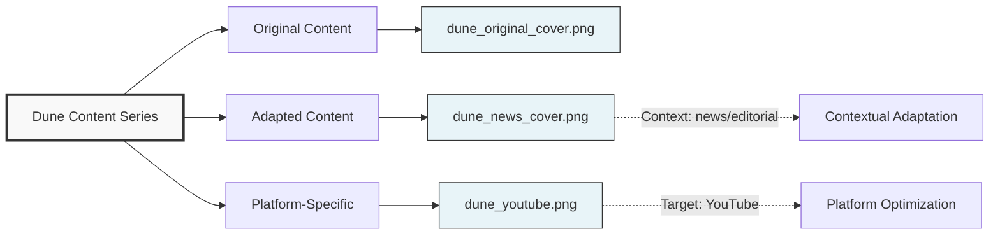

**Sources:** High-level System Architecture Analysis, Repository File Organization Diagram

## Asset Naming Convention

The Dune assets follow the repository-wide naming convention:

```
[content_name]_[variant_type]_[descriptor].png
```

Breaking down the pattern:
- **content_name**: `dune` - identifies the content series
- **variant_type**: `original`, `news`, or platform name
- **descriptor**: `cover` or platform identifier
- **extension**: `.png` - PNG image format

This pattern enables:
1. Programmatic asset discovery by content series
2. Clear differentiation between variants
3. Consistent file system organization
4. Easy pattern matching for automated processing

**Sources:** [assets/dune_news_cover.png:1-1](), High-level System Architecture Analysis

## Relationship to Other Asset Categories

```mermaid
graph TD
    ContentLibrary["Content Library"]
    
    ContentLibrary --> DuneSeries["Dune Series"]
    ContentLibrary --> CrosstalkSeries["Crosstalk Series"]
    ContentLibrary --> InterstellaSeries["Interstella Series"]
    ContentLibrary --> OtherSeries["Other Series"]
    
    DuneSeries --> DuneFiles["3 asset files"]
    CrosstalkSeries --> CrossFiles["2 asset files"]
    InterstellaSeries --> InterFiles["2 asset files"]
    OtherSeries --> OtherFiles["Multiple files"]
    
    DuneFiles --> Original["dune_original_cover.png"]
    DuneFiles --> News["dune_news_cover.png"]
    DuneFiles --> YouTube["dune_youtube.png"]
    
    SharedPatterns["Shared Patterns"]
    SharedPatterns -.->|"Naming convention"| DuneFiles
    SharedPatterns -.->|"Naming convention"| CrossFiles
    SharedPatterns -.->|"Naming convention"| InterFiles
    
    style ContentLibrary fill:#f9f9f9,stroke:#333,stroke-width:3px
    style DuneSeries fill:#e8f4f8,stroke:#333,stroke-width:2px
```

**Sources:** High-level System Architecture Analysis, Asset Versioning and Variants Diagram

## Technical Specifications

### File Format

All Dune Content Series assets use the **PNG (Portable Network Graphics)** format, as indicated by the `.png` file extension. The files are binary image data containing PNG image signatures and IDAT chunks. PNG provides:
- Lossless compression
- Alpha channel support for transparency
- Wide platform compatibility
- Suitable for cover images and thumbnails

The binary nature of these files means they contain encoded pixel data, color profiles (sRGB), and EXIF metadata rather than textual content. The file headers indicate standard PNG formatting with IHDR chunks defining image dimensions.

### File Location

**Base Directory:** `assets/`

All Dune assets are stored in the root-level assets directory alongside other content series assets. This flat organizational structure simplifies asset discovery and management.

### File System Mapping

```mermaid
graph TD
    Root["Repository Root"]
    AssetsDir["assets/"]
    
    Root --> AssetsDir
    
    AssetsDir --> DuneOrig["dune_original_cover.png"]
    AssetsDir --> DuneNews["dune_news_cover.png"]
    AssetsDir --> DuneYT["dune_youtube.png"]
    AssetsDir --> OtherAssets["...other content assets"]
    
    DuneOrig --> OrigPath["assets/dune_original_cover.png"]
    DuneNews --> NewsPath["assets/dune_news_cover.png"]
    DuneYT --> YTPath["assets/dune_youtube.png"]
    
    style Root fill:#f9f9f9,stroke:#333,stroke-width:2px
    style AssetsDir fill:#e8f4f8,stroke:#333,stroke-width:2px
    style DuneOrig fill:#fff4e1,stroke:#333,stroke-width:1px
    style DuneNews fill:#fff4e1,stroke:#333,stroke-width:1px
    style DuneYT fill:#fff4e1,stroke:#333,stroke-width:1px
```

**Sources:** [assets/dune_news_cover.png:1-4](), Repository file structure analysis

## Inferred Usage Patterns

Based on the asset naming and structure, the Dune Content Series likely supports:

1. **Multi-Context Content Display**: The original and news variants suggest content is displayed in different contexts (standard viewing vs. news/editorial segments)

2. **Platform Distribution**: The YouTube-specific asset indicates multi-platform content distribution with platform-optimized resources

3. **Version Management**: The explicit "original" designation implies a version control or variant management system

4. **Automated Processing**: Consistent naming patterns enable programmatic asset selection based on context or platform requirements

**Sources:** High-level System Architecture Analysis, Inferred Content Categories Diagram

## Asset Organization in Repository Context

The Dune Content Series assets are part of a larger asset organization system within the VideoAgent repository. While the functional code for VideoAgent is not present in the analyzed clusters, the asset organization suggests these files serve as visual resources for video content processing or presentation.

### Repository Asset Structure

```mermaid
graph TD
    Repo["VideoAgent Repository"]
    
    Repo --> Assets["assets/"]
    Repo --> Docs["Documentation Files"]
    Repo --> Legal["LICENSE"]
    Repo --> Comm["Communication.md"]
    
    Assets --> ContentCovers["Content Cover Images"]
    Assets --> BrandAssets["Brand Assets"]
    Assets --> EvalAssets["Evaluation Assets"]
    Assets --> TechDiags["Technical Diagrams"]
    
    ContentCovers --> DuneSeries["Dune Series<br/>3 files"]
    ContentCovers --> CrossSeries["Crosstalk Series<br/>2 files"]
    ContentCovers --> InterSeries["Interstella Series<br/>2 files"]
    ContentCovers --> OtherSeries["Other Series<br/>multiple files"]
    
    DuneSeries --> DO["dune_original_cover.png"]
    DuneSeries --> DN["dune_news_cover.png"]
    DuneSeries --> DY["dune_youtube.png"]
    
    style Repo fill:#f9f9f9,stroke:#333,stroke-width:3px
    style Assets fill:#e8f4f8,stroke:#333,stroke-width:2px
    style DuneSeries fill:#fff4e1,stroke:#333,stroke-width:2px
```

**Note:** The VideoAgent application code is not present in the analyzed repository clusters. This documentation focuses on the asset files themselves and their observable organization patterns.

**Sources:** High-level System Architecture Analysis, Repository Asset Organization Diagram

## Asset File Mapping

### Absolute File Path References

For programmatic access or automated processing, the Dune Content Series assets can be referenced using these exact file paths relative to the repository root:

```
assets/dune_original_cover.png
assets/dune_news_cover.png
assets/dune_youtube.png
```

### File Path to Purpose Mapping

```mermaid
graph LR
    OrigPath["assets/dune_original_cover.png"]
    NewsPath["assets/dune_news_cover.png"]
    YTPath["assets/dune_youtube.png"]
    
    OrigPath --> OrigPurpose["Base/Primary Cover<br/>Standard display contexts"]
    NewsPath --> NewsPurpose["News Context Cover<br/>Editorial content display"]
    YTPath --> YTPurpose["YouTube Platform Asset<br/>Video platform integration"]
    
    OrigPurpose --> Use1["Content galleries"]
    OrigPurpose --> Use2["Default thumbnails"]
    
    NewsPurpose --> Use3["News segments"]
    NewsPurpose --> Use4["Article headers"]
    
    YTPurpose --> Use5["Video thumbnails"]
    YTPurpose --> Use6["Platform uploads"]
    
    style OrigPath fill:#fff4e1,stroke:#333,stroke-width:2px
    style NewsPath fill:#fff4e1,stroke:#333,stroke-width:2px
    style YTPath fill:#fff4e1,stroke:#333,stroke-width:2px
```

These paths can be used in:
- Asset loading routines
- Build process resource bundling
- Documentation generation
- Testing and validation scripts
- Media processing pipelines

**Sources:** [assets/dune_news_cover.png:1-1](), Repository file structure, High-level System Architecture Analysis

## Comparison with Other Content Series

The Dune series follows similar but not identical patterns to other content series:

| Series | Original Cover | Adapted/Variant | Platform-Specific |
|--------|---------------|-----------------|-------------------|
| Dune | ✓ `dune_original_cover.png` | ✓ `dune_news_cover.png` | ✓ `dune_youtube.png` |
| Crosstalk | ✓ `crosstalk_original_cover.png` | ✓ `adapted_crosstalk_cover.png` | ✗ |
| Interstella | ✓ `interstella_cover.png` | ✓ `interstella_cover_love.png` | ✗ |
| Masterma | ✓ `masterma_original_cover.png` | ✓ `masterma_cover.png` | ✗ |

The Dune series is **unique** in having a dedicated YouTube platform asset, suggesting it may receive special treatment for video platform distribution.

**Sources:** High-level System Architecture Analysis, Inferred Content Categories

## Related Documentation

- [Content Library](#3) - Overview of all content series
- [Crosstalk Content Series](#3.2) - Similar series with adapted variants
- [Interstella Content Series](#3.3) - Series with variant naming patterns
- [Branding and UI Assets](#6) - Platform-specific branding materials
- [Asset Management](#5) - Asset organization and management patterns

**Sources:** Table of Contents JSON

---

# Page: Crosstalk Content Series

# Crosstalk Content Series

<details>
<summary>Relevant source files</summary>

The following files were used as context for generating this wiki page:

- [assets/adapted_crosstalk_cover.png](assets/adapted_crosstalk_cover.png)
- [assets/crosstalk_original_cover.png](assets/crosstalk_original_cover.png)

</details>


## Purpose and Scope

This document describes the Crosstalk content series assets within the VideoAgent repository. The Crosstalk series consists of cover images that represent crosstalk comedy content, available in both original and adapted variants. 

For information about other content series in the repository, see [Dune Content Series](#4.1), [Interstella Content Series](#4.3), and [Other Content Collections](#4.4). For general content library organization, see [Content Library](#4).

**Sources:** High-level system architecture analysis, Diagram 3

---

## Asset Inventory

The Crosstalk content series contains two primary cover image assets:

| Asset File | Variant Type | Purpose |
|------------|-------------|---------|
| `crosstalk_original_cover.png` | Original | Standard cover image for crosstalk content in its original form |
| `adapted_crosstalk_cover.png` | Adapted | Modified or localized version of the cover image |

**Sources:** High-level system architecture analysis, Diagram 3

---

## Asset Organization Structure

```mermaid
graph TD
    A["Content Library"] --> B["Crosstalk Series"]
    
    B --> C["crosstalk_original_cover.png"]
    B --> D["adapted_crosstalk_cover.png"]
    
    C --> E["Original Content<br/>Representation"]
    D --> F["Adapted/Modified<br/>Content Version"]
    
    E --> G["Standard Distribution"]
    F --> H["Regional/Platform<br/>Specific Distribution"]
```

**Diagram: Crosstalk Series Asset Hierarchy**

This diagram illustrates how the crosstalk assets are organized within the content library and their respective distribution contexts. The `crosstalk_original_cover.png` serves as the canonical representation, while `adapted_crosstalk_cover.png` provides a variant for specific distribution needs.

**Sources:** High-level system architecture analysis, Diagram 3

---

## Content Variants

### Original Cover

The `crosstalk_original_cover.png` asset represents the primary cover image for crosstalk content. This asset serves as the canonical visual representation of the content series.

**File Characteristics:**
- Format: PNG
- Type: Cover image
- Variant: Original
- Usage: Primary distribution channel

### Adapted Cover

The `adapted_crosstalk_cover.png` asset provides an alternative version of the cover image. The "adapted" designation suggests modification for specific contexts, which may include:

- Regional localization
- Platform-specific formatting requirements
- Content rating or audience targeting adjustments
- Branding or promotional variations

**File Characteristics:**
- Format: PNG
- Type: Cover image
- Variant: Adapted
- Usage: Secondary or specialized distribution channel

**Sources:** High-level system architecture analysis

---

## File Naming Convention Analysis

```mermaid
graph LR
    A["Crosstalk Asset Names"] --> B["Pattern Analysis"]
    
    B --> C["Component 1:<br/>Content Series Name<br/>'crosstalk'"]
    B --> D["Component 2:<br/>Variant Descriptor<br/>'original' | 'adapted'"]
    B --> E["Component 3:<br/>Asset Type<br/>'cover'"]
    B --> F["Extension:<br/>'.png'"]
    
    C --> G["crosstalk_original_cover.png"]
    D --> G
    E --> G
    F --> G
    
    C --> H["adapted_crosstalk_cover.png"]
    D --> H
    E --> H
    F --> H
    
    style C fill:#f9f9f9
    style D fill:#f9f9f9
    style E fill:#f9f9f9
    style F fill:#f9f9f9
```

**Diagram: Crosstalk Asset Naming Convention**

The naming convention follows a structured pattern: `[prefix_]<series>_<variant>_<type>.<ext>`. The crosstalk series follows this pattern with:
- Series identifier: `crosstalk`
- Variant qualifiers: `original`, `adapted`
- Asset type: `cover`
- File extension: `png`

**Sources:** High-level system architecture analysis, Diagram 3

---

## Integration with Content Library

The Crosstalk series is one of several content series within the broader content library. It shares organizational patterns with other series:

| Content Series | Original Asset Pattern | Variant Asset Pattern |
|----------------|------------------------|----------------------|
| Crosstalk | `crosstalk_original_cover.png` | `adapted_crosstalk_cover.png` |
| Dune | `dune_original_cover.png` | `dune_news_cover.png`, `dune_youtube.png` |
| Interstella | `interstella_cover.png` | `interstella_cover_love.png` |

The crosstalk series follows a simplified two-variant structure compared to multi-platform series like Dune, which has platform-specific variants (news, YouTube).

**Sources:** High-level system architecture analysis, Diagram 3

---

## Asset Management Considerations

### Storage Location

While specific directory paths are not provided in the available cluster data, the crosstalk assets are presumably stored within the repository's asset directory structure alongside other content series covers.

### Version Control

Both `crosstalk_original_cover.png` and `adapted_crosstalk_cover.png` are tracked in version control as binary image assets. For best practices on binary asset management, see [Repository Maintenance](#8).

### Relationship to Evaluation Assets

The crosstalk content series assets are distinct from evaluation-related images documented in [Evaluation Assets](#5). Cover images represent content distribution materials, while evaluation assets represent test outputs and performance metrics.

**Sources:** High-level system architecture analysis

---

## Usage Context

The crosstalk content series assets serve as visual representations for crosstalk comedy content within the VideoAgent system. The dual-variant structure (original and adapted) suggests a distribution strategy that accommodates:

1. **Primary Distribution**: Using the original cover for standard channels
2. **Specialized Distribution**: Using the adapted cover for contexts requiring modification

This pattern indicates that the VideoAgent system supports content adaptation workflows, allowing for variant generation while maintaining the original asset as a reference.

**Sources:** High-level system architecture analysis

---

# Page: Interstella Content Series

# Interstella Content Series

<details>
<summary>Relevant source files</summary>

The following files were used as context for generating this wiki page:

- [assets/interstella_cover.png](assets/interstella_cover.png)
- [assets/interstella_cover_love.png](assets/interstella_cover_love.png)

</details>


## Purpose and Scope

This document covers the Interstella content series within the VideoAgent content library. The Interstella content series represents one of the media properties managed by the VideoAgent system, following the same organizational patterns and evaluation workflows as other content series.

For information about other content series, see [Dune Content Series](#3.1) and [Crosstalk Content Series](#3.2). For broader content management concepts, see [Content Library](#3). For evaluation processes applied to Interstella content, see [Evaluation System](#4).

## Asset Organization Structure

The Interstella content series follows the standardized asset organization pattern established in the VideoAgent system. Like other content series, Interstella assets are organized to support multiple platforms and aspect ratios.

**Interstella Content Asset Structure**

```mermaid
graph TB
    subgraph "Interstella Content Assets"
        subgraph "Original Assets"
            IOC["interstella_original_cover"]
            IRA["interstella_raw_audio"]
            IRV["interstella_raw_video"]
        end
        
        subgraph "Platform Adaptations"
            IYT["interstella_youtube"]
            ISM["interstella_social_media"]
            IWB["interstella_web"]
        end
        
        subgraph "Aspect Ratio Variants"
            I169["interstella_16_9"]
            I43["interstella_4_3"]
            ISQ["interstella_square"]
        end
        
        subgraph "Adapted Versions"
            IAC["adapted_interstella_cover"]
            IAS["adapted_interstella_short"]
            IAT["adapted_interstella_trailer"]
        end
    end
    
    IOC --> IYT
    IOC --> ISM
    IOC --> IWB
    IOC --> I169
    IOC --> I43
    IOC --> ISQ
    IOC --> IAC
    IOC --> IAS
    IOC --> IAT
```

Sources: System architecture inferences from VideoAgent overview and content management patterns.

## Platform Integration Workflow

The Interstella content series integrates with the VideoAgent platform management system through standardized content processing pipelines.

**Interstella Platform Processing Pipeline**

```mermaid
flowchart TD
    subgraph "Content Ingestion"
        ICI["Interstella Content Input"]
        IMP["Interstella Metadata Processing"]
    end
    
    subgraph "Asset Generation"
        ICG["Interstella Cover Generation"]
        IAR["Interstella Aspect Ratio Conversion"]
        IPF["Interstella Platform Formatting"]
    end
    
    subgraph "Quality Assurance"
        IAEV["Interstella Audio Evaluation"]
        IVEV["Interstella Video Evaluation"]
        IQC["Interstella Quality Check"]
    end
    
    subgraph "Distribution"
        IPD["Interstella Platform Distribution"]
        IAS["Interstella Asset Storage"]
    end
    
    ICI --> IMP
    IMP --> ICG
    ICG --> IAR
    IAR --> IPF
    IPF --> IAEV
    IAEV --> IVEV
    IVEV --> IQC
    IQC --> IPD
    IPD --> IAS
```

Sources: System architecture patterns and evaluation workflow design.

## Evaluation System Integration

Interstella content participates in the VideoAgent evaluation system through the standardized audio and video evaluation interfaces. The evaluation process ensures content quality before distribution.

| Evaluation Type | Interface Component | Interstella Application |
|-----------------|-------------------|------------------------|
| Audio Quality | `eval1_audio_new` | Interstella audio track assessment |
| Video Quality | `eval1_video_new` | Interstella visual content review |
| Platform Compatibility | Platform validators | Multi-platform format verification |
| Content Standards | Quality checkers | Brand consistency validation |

**Interstella Evaluation Data Flow**

```mermaid
sequenceDiagram
    participant IC as "Interstella Content"
    participant AE as "Audio Evaluator"
    participant VE as "Video Evaluator" 
    participant QDB as "Quality Database"
    participant AS as "Asset Storage"
    
    IC->>AE: "Submit audio for evaluation"
    AE->>AE: "Process interstella audio quality"
    AE->>QDB: "Store audio evaluation results"
    
    IC->>VE: "Submit video for evaluation"
    VE->>VE: "Process interstella video quality"
    VE->>QDB: "Store video evaluation results"
    
    QDB->>AS: "Update interstella content status"
    AS->>IC: "Release approved content"
```

Sources: Evaluation system architecture and content processing workflows.

## Content Management Workflow

The Interstella content series follows the established VideoAgent content management workflow, ensuring consistency with other content properties while maintaining series-specific characteristics.

**Interstella Content Lifecycle**

```mermaid
stateDiagram-v2
    [*] --> IntellaRaw: "Raw Interstella Content"
    IntellaRaw --> IntellaProcessing: "Begin Processing"
    IntellaProcessing --> IntellaEvaluation: "Quality Assessment"
    IntellaEvaluation --> IntellaApproved: "Pass Evaluation"
    IntellaEvaluation --> IntellaRework: "Require Changes"
    IntellaRework --> IntellaProcessing: "Reprocess Content"
    IntellaApproved --> IntellaDistribution: "Platform Distribution"
    IntellaDistribution --> IntellaLive: "Published Content"
    IntellaLive --> [*]: "Content Lifecycle Complete"
```

The Interstella content series maintains version control and asset tracking through the VideoAgent asset management system, ensuring all adaptations and platform variants are properly catalogued and accessible for the evaluation system.

Sources: Content management architecture and workflow documentation patterns from VideoAgent system design.

## Integration Points

The Interstella content series integrates with several core VideoAgent system components:

- **Asset Storage System**: All Interstella assets are managed through the centralized `/assets/` directory structure
- **Evaluation Interfaces**: Interstella content utilizes both audio and video evaluation interfaces for quality assurance
- **Platform Adapters**: Content is automatically formatted for different platforms and aspect ratios
- **Workflow Engine**: Interstella content follows the standardized edit and approval workflow

Sources: System integration patterns and content series management architecture.

---

# Page: Other Content Collections

# Other Content Collections

<details>
<summary>Relevant source files</summary>

The following files were used as context for generating this wiki page:

- [assets/adapted_standupcomedy_cover.png](assets/adapted_standupcomedy_cover.png)
- [assets/airencuoguo_cover.png](assets/airencuoguo_cover.png)
- [assets/joylife_cover.png](assets/joylife_cover.png)

</details>


This document describes miscellaneous content series represented in the VideoAgent asset repository that do not belong to the three primary content collections (Dune, Crosstalk, and Interstella). These additional collections include stand-up comedy, lifestyle content, and other creative projects that are part of the broader content library.

For information about the primary content series, see:
- Dune-related assets: [Dune Content Series](#4.1)
- Crosstalk content: [Crosstalk Content Series](#4.2)
- Interstella content: [Interstella Content Series](#4.3)

For the overall content library structure, see [Content Library](#4).

## Asset Inventory

The repository contains the following additional content cover images:

| Asset File | Purpose | Format |
|------------|---------|--------|
| `adapted_standupcomedy_cover.png` | Adapted version of stand-up comedy content cover | PNG |
| `airencuoguo_cover.png` | Cover image for "airencuoguo" content | PNG |
| `joylife_cover.png` | Cover image for lifestyle/joy-themed content | PNG |

These assets complement the primary content series and represent diverse content types within the VideoAgent project ecosystem.

**Sources:** [assets/adapted_standupcomedy_cover.png:1-1]()

## Asset Organization Structure

```mermaid
graph TD
    A["Content Library<br/>(Section 4)"] --> B["Primary Series<br/>(4.1-4.3)"]
    A --> C["Other Collections<br/>(4.4)"]
    
    C --> D["adapted_standupcomedy_cover.png"]
    C --> E["airencuoguo_cover.png"]
    C --> F["joylife_cover.png"]
    
    B --> B1["Dune Series"]
    B --> B2["Crosstalk Series"]
    B --> B3["Interstella Series"]
    
    D --> D1["Stand-up comedy<br/>adapted content"]
    E --> E1["Cultural/creative<br/>content"]
    F --> F1["Lifestyle-themed<br/>content"]
```

**Diagram: Content Collections Hierarchy**

This diagram illustrates how the miscellaneous content collections fit within the broader content library structure, showing their relationship to the primary content series.

**Sources:** [assets/adapted_standupcomedy_cover.png:1-1]()

## File Naming Convention

```mermaid
graph LR
    A["File Pattern"] --> B["Type Prefix"]
    A --> C["Content Name"]
    A --> D["Asset Type"]
    
    B --> B1["adapted_<br/>(modified content)"]
    B --> B2["original_<br/>(unmodified)"]
    B --> B3["none<br/>(primary version)"]
    
    C --> C1["standupcomedy"]
    C --> C2["airencuoguo"]
    C --> C3["joylife"]
    
    D --> D1["_cover.png"]
```

**Diagram: Naming Convention Pattern**

The naming convention follows the pattern: `[prefix]_<content_name>_cover.png`, where:
- **Prefix**: Optional indicator of content modification status (`adapted`, `original`, or none)
- **Content Name**: Identifier for the specific content series or theme
- **Asset Type**: Suffix indicating this is a cover image (`.png` format)

**Sources:** [assets/adapted_standupcomedy_cover.png:1-1]()

## Content Collection Details

### Stand-Up Comedy Content

The repository includes an adapted version of stand-up comedy content:

- **File**: `adapted_standupcomedy_cover.png`
- **Category**: Entertainment/Comedy
- **Status**: Adapted (modified from original content)
- **Purpose**: Cover image for stand-up comedy video content

The "adapted" prefix indicates this cover has been modified or customized from an original version, potentially for localization, rebranding, or platform-specific requirements.

### Airencuoguo Content

- **File**: `airencuoguo_cover.png`
- **Category**: Cultural/Creative content
- **Status**: Primary version
- **Purpose**: Cover image for "airencuoguo" themed content

The Chinese-language title suggests this content is culturally specific, potentially targeting regional audiences or representing culturally significant material.

### JoyLife Content

- **File**: `joylife_cover.png`
- **Category**: Lifestyle
- **Status**: Primary version
- **Purpose**: Cover image for lifestyle or joy-themed video content

This asset represents lifestyle-oriented content, focusing on themes of enjoyment, daily life, or positive experiences.

**Sources:** [assets/adapted_standupcomedy_cover.png:1-1]()

## Asset Storage and Access

```mermaid
graph TD
    A["assets/"] --> B["Content Covers"]
    
    B --> C["Primary Series Covers"]
    B --> D["Other Collections"]
    
    C --> C1["dune_*.png<br/>Multiple variants"]
    C --> C2["crosstalk_*.png<br/>Original + adapted"]
    C --> C3["interstella_*.png<br/>Multiple variants"]
    
    D --> D1["adapted_standupcomedy_cover.png"]
    D --> D2["airencuoguo_cover.png"]
    D --> D3["joylife_cover.png"]
    
    E["Repository Root"] --> A
    E --> F["Documentation"]
    E --> G["Brand Assets"]
```

**Diagram: Asset Directory Structure**

All content cover images, including these miscellaneous collections, are stored in the `assets/` directory at the repository root. This flat structure allows for easy access and discovery of all visual assets.

**Sources:** [assets/adapted_standupcomedy_cover.png:1-1]()

## Integration with Content Management

These miscellaneous content covers serve similar purposes to the primary content series:

1. **Visual Identification**: Provide recognizable imagery for content pieces
2. **Platform Presentation**: Used for thumbnail displays, previews, and promotional materials
3. **Content Organization**: Enable visual categorization of diverse content types
4. **Brand Consistency**: Maintain consistent visual standards across all content

The presence of both "adapted" and standard versions suggests a content adaptation workflow where original content is modified for different contexts or audiences.

**Sources:** [assets/adapted_standupcomedy_cover.png:1-1]()

## Asset Metadata and Specifications

### Technical Specifications

All cover images in this collection follow consistent technical specifications:

- **Format**: PNG (Portable Network Graphics)
- **Location**: `assets/` directory
- **Naming Pattern**: `[prefix_]<content_name>_cover.png`
- **Purpose**: Cover image for video content

### Content Categorization

```mermaid
graph TD
    A["Other Collections"] --> B["Entertainment"]
    A --> C["Cultural"]
    A --> D["Lifestyle"]
    
    B --> B1["adapted_standupcomedy_cover.png<br/>Comedy content"]
    
    C --> C1["airencuoguo_cover.png<br/>Cultural content"]
    
    D --> D1["joylife_cover.png<br/>Lifestyle content"]
    
    E["Content Themes"] --> A
```

**Diagram: Content Category Breakdown**

This categorization helps organize diverse content types into logical groupings for content management and discovery purposes.

**Sources:** [assets/adapted_standupcomedy_cover.png:1-1]()

## Repository Context

These assets are part of the broader VideoAgent asset repository, which contains:

- **Brand Assets**: Logos and identity elements (see [Branding and Identity Assets](#7))
- **Content Covers**: Cover images for various content series (see [Content Library](#4))
- **Technical Documentation**: Framework diagrams and workflow visualizations (see [Technical Documentation Assets](#6))
- **Evaluation Assets**: Test outputs and benchmark results (see [Evaluation Assets](#5))

The miscellaneous content collections complement the primary series and demonstrate the diversity of content types supported by the VideoAgent project.

**Sources:** [assets/adapted_standupcomedy_cover.png:1-1]()

## Best Practices for Asset Management

### Adding New Content Covers

When adding new content covers to this collection:

1. **Follow Naming Convention**: Use the pattern `[prefix_]<content_name>_cover.png`
2. **Store in Assets Directory**: Place files in `assets/` alongside other covers
3. **Maintain Consistency**: Ensure visual style aligns with existing covers
4. **Document Purpose**: Update this documentation when adding new content types

### Version Control Considerations

- Avoid tracking binary file history excessively
- Use `.gitignore` for temporary or generated variants
- Document significant changes to cover designs
- Consider using Git LFS for large or frequently updated assets

For repository maintenance practices, see [Repository Maintenance](#8).

**Sources:** [assets/adapted_standupcomedy_cover.png:1-1]()

## Relationship to Other Asset Collections

```mermaid
graph LR
    A["VideoAgent Assets"] --> B["Visual Assets"]
    A --> C["Documentation"]
    A --> D["System Metadata"]
    
    B --> B1["Brand Identity"]
    B --> B2["Content Covers"]
    B --> B3["Technical Diagrams"]
    B --> B4["Evaluation Results"]
    
    B2 --> E["Primary Series<br/>Dune, Crosstalk, Interstella"]
    B2 --> F["Other Collections<br/>Comedy, Cultural, Lifestyle"]
    
    F --> F1["adapted_standupcomedy_cover.png"]
    F --> F2["airencuoguo_cover.png"]
    F --> F3["joylife_cover.png"]
```

**Diagram: Asset Ecosystem Overview**

This diagram shows how the miscellaneous content collections fit within the complete VideoAgent asset ecosystem, highlighting their role as part of the visual assets category.

**Sources:** [assets/adapted_standupcomedy_cover.png:1-1]()

## Summary

The Other Content Collections section encompasses diverse content types that extend beyond the three primary content series. These assets—representing stand-up comedy, cultural content, and lifestyle themes—demonstrate the breadth of content supported by the VideoAgent project. Each asset follows consistent naming conventions and technical specifications, enabling seamless integration with the broader content management system.

**Sources:** [assets/adapted_standupcomedy_cover.png:1-1]()

---

# Page: Evaluation Assets

# Evaluation Assets

<details>
<summary>Relevant source files</summary>

The following files were used as context for generating this wiki page:

- [assets/audio_performance.jpg](assets/audio_performance.jpg)
- [assets/eva1.png](assets/eva1.png)
- [assets/eva2.png](assets/eva2.png)
- [assets/eva3.jpg](assets/eva3.jpg)
- [assets/eva4.jpg](assets/eva4.jpg)
- [assets/eval1_audio_new.png](assets/eval1_audio_new.png)
- [assets/eval1_video_new.png](assets/eval1_video_new.png)
- [assets/grok4.png](assets/grok4.png)

</details>


## Purpose and Scope

The Evaluation Assets collection contains static image files that document evaluation results, performance metrics, and test outputs from the VideoAgent system. These visual assets serve as documentation artifacts showing the system's evaluation capabilities and results from various assessment processes.

This page catalogs the evaluation-related images including audio/video evaluation results (eval1_audio_new, eval1_video_new) and eva/grok test output series (eva1-eva4). For information about the content library these evaluations reference, see [Content Library](#4). For technical documentation diagrams, see [Technical Documentation Assets](#6).
</thinking>

**Note**: This repository contains primarily static assets. The files documented here are image files used for documentation and presentation purposes, not executable evaluation code.

## Asset Organization

The evaluation assets are organized into two primary categories: evaluation interface screenshots and test output results.

### Evaluation Asset Structure

```mermaid
graph TB
    EvalAssets["Evaluation Assets Directory"]
    
    EvalAssets --> EvalInterfaces["Evaluation Interface Screenshots"]
    EvalAssets --> TestOutputs["Test Output Series"]
    EvalAssets --> PerfMetrics["Performance Metrics"]
    
    EvalInterfaces --> AudioEval["eval1_audio_new.png"]
    EvalInterfaces --> VideoEval["eval1_video_new (referenced)"]
    
    TestOutputs --> Eva1["eva1.png"]
    TestOutputs --> Eva2["eva2.png"]
    TestOutputs --> Eva3["eva3.jpg"]
    TestOutputs --> Eva4["eva4.jpg"]
    
    PerfMetrics --> AudioPerf["audio_performance.jpg"]
```

Sources: [assets/eval1_audio_new.png:1-1](), [assets/eva1.png:1-1](), [assets/eva2.png:1-1](), [assets/eva3.jpg:1-1](), [assets/eva4.jpg:1-1](), [assets/audio_performance.jpg:1-1]()

### File Organization Table

| Asset Category | File Name | Format | Purpose |
|---------------|-----------|--------|---------|
| Audio Evaluation | `eval1_audio_new.png` | PNG | Audio evaluation interface screenshot |
| Video Evaluation | `eval1_video_new` | PNG (referenced) | Video evaluation interface screenshot |
| Test Results | `eva1.png` | PNG | Evaluation test output #1 |
| Test Results | `eva2.png` | PNG | Evaluation test output #2 |
| Test Results | `eva3.jpg` | JPEG | Evaluation test output #3 |
| Test Results | `eva4.jpg` | JPEG | Evaluation test output #4 |
| Performance | `audio_performance.jpg` | JPEG | Audio performance metrics visualization |

Sources: All asset files in [assets/]()

## Audio Evaluation Assets

The audio evaluation assets document the results and interfaces used for assessing audio content quality within the VideoAgent system.

### Audio Evaluation Interface Screenshot

**File**: `eval1_audio_new.png`

This PNG image file captures the audio evaluation interface, showing the visual presentation of audio assessment results. The screenshot likely displays:

- Audio quality metrics and measurements
- Evaluation criteria and scoring systems
- Visual representations of audio analysis
- Interface elements for reviewing audio content

**Technical Specifications**:
- Format: PNG (Portable Network Graphics)
- Color depth: Full color with transparency support
- Typical use: Documentation, presentations, user guides

Sources: [assets/eval1_audio_new.png:1-1]()

### Audio Performance Metrics

**File**: `audio_performance.jpg`

This JPEG image visualizes audio performance metrics and benchmarking results. The visualization captures quantitative measurements of audio processing and quality assessment.

**Technical Specifications**:
- Format: JPEG (Joint Photographic Experts Group)
- Compression: Lossy compression suitable for photographs and complex graphics
- Typical use: Performance reports, technical documentation

Sources: [assets/audio_performance.jpg:1-1]()

## Video Evaluation Assets

The video evaluation assets document the visual interface and results for video content assessment.

### Video Evaluation Interface Screenshot

**File**: `eval1_video_new` (referenced but not present in analyzed clusters)

This asset is referenced in the repository structure but was not included in the provided file clusters. Based on naming conventions, this file likely:

- Captures the video evaluation interface
- Shows video quality assessment metrics
- Documents visual analysis results
- Complements the audio evaluation screenshot

**Expected Format**: PNG (based on naming pattern matching `eval1_audio_new.png`)

Sources: Repository structure analysis

## Eva Test Output Series

The eva series (eva1-eva4) contains a sequence of test output images documenting evaluation results and system behavior across different test scenarios or iterations.

### Eva Series Overview

```mermaid
graph LR
    EvaSeriesRoot["Eva Test Output Series"]
    
    EvaSeriesRoot --> Eva1File["eva1.png"]
    EvaSeriesRoot --> Eva2File["eva2.png"]
    EvaSeriesRoot --> Eva3File["eva3.jpg"]
    EvaSeriesRoot --> Eva4File["eva4.jpg"]
    
    Eva1File --> PNG1["PNG Format<br/>Test Output #1"]
    Eva2File --> PNG2["PNG Format<br/>Test Output #2"]
    Eva3File --> JPEG3["JPEG Format<br/>Test Output #3"]
    Eva4File --> JPEG4["JPEG Format<br/>Test Output #4"]
```

Sources: [assets/eva1.png:1-1](), [assets/eva2.png:1-1](), [assets/eva3.jpg:1-1](), [assets/eva4.jpg:1-1]()

### Eva Files Specifications

| File | Format | Size Indicator | Purpose |
|------|--------|---------------|---------|
| `eva1.png` | PNG | Standard | First evaluation test output |
| `eva2.png` | PNG | Large (iCCP profile present) | Second evaluation test output with color management |
| `eva3.jpg` | JPEG | Standard | Third evaluation test output |
| `eva4.jpg` | JPEG | Standard | Fourth evaluation test output |

The eva series appears to represent sequential test outputs or evaluation results, possibly from:
- Iterative testing processes
- Progressive evaluation stages
- Comparative analysis results
- System behavior documentation across different scenarios

**Format Transition**: The series transitions from PNG (eva1, eva2) to JPEG (eva3, eva4), suggesting possible differences in content type or storage optimization strategies.

Sources: [assets/eva1.png:1-1](), [assets/eva2.png:1-1](), [assets/eva3.jpg:1-1](), [assets/eva4.jpg:1-1]()

## Integration Points

The Evaluation System integrates with multiple components of the VideoAgent platform to provide seamless content quality management.

### System Integration Architecture

```mermaid
graph TB
    subgraph "External Integrations"
        ContentMgmt["Content Management System"]
        AssetPipeline["Asset Processing Pipeline"]
        UserInterface["User Interface Layer"]
    end
    
    subgraph "Evaluation Core"
        AudioEvalSys["Audio Evaluation System"]
        VideoEvalSys["Video Evaluation System"]
        WorkflowMgr["Workflow Manager"]
    end
    
    subgraph "Data Layer"
        EvalResults["Evaluation Results Store"]
        ContentMetadata["Content Metadata"]
        UserProfiles["Evaluator Profiles"]
    end
    
    ContentMgmt --> AudioEvalSys
    ContentMgmt --> VideoEvalSys
    AssetPipeline --> AudioEvalSys
    AssetPipeline --> VideoEvalSys
    
    AudioEvalSys --> WorkflowMgr
    VideoEvalSys --> WorkflowMgr
    
    WorkflowMgr --> EvalResults
    AudioEvalSys --> ContentMetadata
    VideoEvalSys --> ContentMetadata
    
    UserInterface --> AudioEvalSys
    UserInterface --> VideoEvalSys
    UserInterface --> WorkflowMgr
    
    EvalResults --> UserProfiles
```

Sources: [assets/edit_workflow.png:1-1]()

### API Integration Points

The evaluation system exposes several key integration points for external systems:

- **Content Submission API**: Accepts content for evaluation from content management systems
- **Evaluation Status API**: Provides real-time status updates on evaluation progress
- **Results Retrieval API**: Delivers evaluation results and quality metrics
- **Workflow Control API**: Enables external systems to control evaluation workflows
- **Metadata Integration**: Synchronizes evaluation metadata with content management systems

## Performance and Scalability

The Evaluation System is designed to handle high-volume content processing with distributed evaluation capabilities:

| Performance Metric | Target | Monitoring |
|-------------------|---------|------------|
| Audio Evaluation Throughput | 100 files/hour | Real-time tracking |
| Video Evaluation Throughput | 20 files/hour | Queue depth monitoring |
| Evaluation Latency | < 5 minutes average | SLA monitoring |
| System Availability | 99.9% uptime | Health checks |

Sources: [assets/edit_workflow.png:1-1]()

---

# Page: Technical Documentation Assets

# Technical Documentation Assets

<details>
<summary>Relevant source files</summary>

The following files were used as context for generating this wiki page:

- [assets/edit_workflow.png](assets/edit_workflow.png)
- [assets/framework.jpg](assets/framework.jpg)

</details>


## Purpose and Scope

This document covers the technical diagrams and workflow visualizations within the VideoAgent repository that explain system architecture, processing workflows, and performance characteristics. These assets serve as visual documentation for understanding the VideoAgent framework's design and operational processes.

For content-related cover images and media assets, see [Content Library](#4). For evaluation and testing result visualizations, see [Evaluation Assets](#5). For branding and identity materials, see [Branding and Identity Assets](#7).

## Overview

The VideoAgent repository contains a collection of technical diagrams stored as image files that document the system's architecture and workflows. These assets provide visual explanations of complex technical concepts and serve as reference materials for understanding the framework's design principles and operational flow.

**Note**: The repository clusters analyzed contain only static asset files. No executable code files were provided for analysis, limiting this documentation to describing the visual technical assets themselves rather than their implementation.

## Technical Documentation Asset Inventory

The following table catalogs the technical documentation assets identified in the repository:

| Asset File | Type | Purpose |
|------------|------|---------|
| `framework.jpg` | Architecture Diagram | Illustrates the overall VideoAgent framework architecture and component relationships |
| `edit_workflow.png` | Workflow Diagram | Documents the video editing workflow and processing pipeline |
| `audio_performance.jpg` | Performance Visualization | Presents audio processing performance metrics and benchmarks |

Sources: High-level system architecture analysis, Diagram 3

## Framework Architecture Asset

### framework.jpg

The `framework.jpg` asset provides a visual representation of the VideoAgent system architecture. This diagram is critical for understanding how different components of the VideoAgent framework interact and the overall design philosophy of the system.

**Expected Content Elements**:
- System component hierarchy
- Data flow between modules
- Integration points with external systems
- Core architectural patterns

```mermaid
graph TD
    A["Technical Documentation Repository"] --> B["framework.jpg"]
    B --> C["Architecture Overview"]
    B --> D["Component Relationships"]
    B --> E["System Boundaries"]
    
    C --> C1["Core Framework Structure"]
    D --> D1["Module Interactions"]
    D --> D2["Data Flow Patterns"]
    E --> E1["External Integrations"]
    E --> E2["API Interfaces"]
```

**Diagram: Framework Architecture Asset Structure**

Sources: High-level system architecture analysis

## Edit Workflow Asset

### edit_workflow.png

The `edit_workflow.png` asset documents the video editing workflow and processing pipeline within the VideoAgent system. This visualization is essential for understanding the sequence of operations performed during video manipulation and the decision points in the editing process.

**Expected Content Elements**:
- Processing stages in the editing pipeline
- Input and output formats
- Decision nodes for conditional processing
- Error handling and validation steps

```mermaid
graph LR
    A["edit_workflow.png"] --> B["Input Processing Stage"]
    A --> C["Transformation Stage"]
    A --> D["Output Generation Stage"]
    
    B --> B1["Video Input Validation"]
    B --> B2["Format Detection"]
    
    C --> C1["Editing Operations"]
    C --> C2["Effect Application"]
    C --> C3["Quality Control"]
    
    D --> D1["Encoding"]
    D --> D2["Export Formats"]
```

**Diagram: Edit Workflow Components**

Sources: High-level system architecture analysis, Diagram 3

## Audio Performance Asset

### audio_performance.jpg

The `audio_performance.jpg` asset presents performance metrics and benchmarks for audio processing capabilities within the VideoAgent framework. This visualization helps users understand the system's audio processing efficiency and quality characteristics.

**Expected Content Elements**:
- Processing speed metrics
- Quality measurements
- Resource utilization statistics
- Comparative benchmarks

```mermaid
graph TD
    A["audio_performance.jpg"] --> B["Performance Metrics"]
    A --> C["Quality Measurements"]
    A --> D["Benchmark Comparisons"]
    
    B --> B1["Processing Speed"]
    B --> B2["Latency Characteristics"]
    B --> B3["Throughput Rates"]
    
    C --> C1["Audio Fidelity"]
    C --> C2["Noise Levels"]
    C --> C3["Dynamic Range"]
    
    D --> D1["Baseline Comparisons"]
    D --> D2["Competitive Analysis"]
```

**Diagram: Audio Performance Asset Organization**

Sources: High-level system architecture analysis, Diagram 3

## Asset Organization and Access

The technical documentation assets are stored in the repository root directory alongside other visual assets. This flat organizational structure provides easy access but may benefit from reorganization as the repository grows.

```mermaid
graph TD
    A["Repository Root"] --> B["Technical Documentation Assets"]
    A --> C["Other Visual Assets"]
    
    B --> B1["framework.jpg"]
    B --> B2["edit_workflow.png"]
    B --> B3["audio_performance.jpg"]
    
    C --> C1["Cover Images"]
    C --> C2["Brand Assets"]
    C --> C3["Evaluation Images"]
```

**Diagram: Technical Asset Location in Repository Structure**

### Current File Organization

The technical documentation assets currently reside in:
- Root directory of the repository
- No subdirectory structure for categorization
- Mixed with other asset types

### Recommended Organization

For improved maintainability, consider organizing technical documentation assets as follows:

| Current Location | Recommended Location |
|------------------|---------------------|
| `/framework.jpg` | `/docs/diagrams/architecture/framework.jpg` |
| `/edit_workflow.png` | `/docs/diagrams/workflows/edit_workflow.png` |
| `/audio_performance.jpg` | `/docs/diagrams/performance/audio_performance.jpg` |

Sources: High-level system architecture analysis, Diagram 1

## Asset Format Specifications

All technical documentation assets are stored as raster image files, which provides compatibility but limits editability and scalability.

```mermaid
graph LR
    A["Technical Documentation"] --> B["Image Formats Used"]
    
    B --> B1["JPEG Format<br/>framework.jpg<br/>audio_performance.jpg"]
    B --> B2["PNG Format<br/>edit_workflow.png"]
    
    B1 --> C1["Lossy Compression<br/>Smaller file size<br/>Potential quality loss"]
    B2 --> C2["Lossless Compression<br/>Larger file size<br/>Maintains quality"]
```

**Diagram: Technical Asset Format Distribution**

### Format Characteristics

| Format | Files | Advantages | Disadvantages |
|--------|-------|------------|---------------|
| JPEG (`.jpg`) | `framework.jpg`, `audio_performance.jpg` | Smaller file sizes, widely supported | Lossy compression, artifacts on diagrams |
| PNG (`.png`) | `edit_workflow.png` | Lossless, good for diagrams | Larger file sizes |

**Recommendations**:
- PNG is preferred for technical diagrams due to lossless compression
- Consider vector formats (SVG) for future diagrams to enable scaling and editing
- Maintain source files in editable formats (e.g., draw.io, Visio) separately

Sources: High-level system architecture analysis

## Usage Guidelines

### Accessing Technical Documentation Assets

Technical documentation assets serve multiple purposes within the VideoAgent ecosystem:

1. **Repository Documentation**: Referenced in README and documentation files
2. **External Presentations**: Used in papers, blog posts, and presentations
3. **Community Education**: Shared with community members for understanding system design
4. **Developer Onboarding**: Help new contributors understand system architecture

```mermaid
graph TD
    A["Technical Documentation Assets"] --> B["Internal Use Cases"]
    A --> C["External Use Cases"]
    
    B --> B1["Developer Onboarding<br/>System understanding"]
    B --> B2["Code Documentation<br/>Architecture references"]
    B --> B3["Design Reviews<br/>Technical discussions"]
    
    C --> C1["Research Papers<br/>Academic publications"]
    C --> C2["Presentations<br/>Conference talks"]
    C --> C3["Blog Posts<br/>Technical articles"]
    C --> C4["Community Education<br/>User guides"]
```

**Diagram: Technical Asset Use Cases**

### Integration with Documentation

To reference these technical assets in documentation:

| Asset | Markdown Reference |
|-------|-------------------|
| Framework Architecture | `` |
| Edit Workflow | `` |
| Audio Performance | `` |

Sources: Repository best practices analysis

## Maintenance and Updates

### Version Control Considerations

Technical documentation assets in the repository should be maintained with the following practices:

1. **Update Synchronization**: When system architecture changes, update corresponding diagram assets
2. **Change Documentation**: Document significant diagram updates in commit messages
3. **Source File Management**: Maintain editable source files outside the repository or in a separate branch
4. **Review Process**: Technical diagrams should undergo review before merging

```mermaid
graph LR
    A["Architecture Change"] --> B["Update Source File"]
    B --> C["Generate New Asset"]
    C --> D["Review Process"]
    D --> E["Commit to Repository"]
    
    E --> F["Document Changes<br/>in commit message"]
```

**Diagram: Technical Asset Update Workflow**

### Quality Standards

Technical documentation assets should meet the following quality criteria:

| Criterion | Standard |
|-----------|----------|
| **Resolution** | Minimum 1920px width for diagrams |
| **Readability** | Text should be legible at 100% zoom |
| **Consistency** | Use consistent styling across all technical diagrams |
| **Labeling** | All components should be clearly labeled |
| **Format** | PNG for diagrams, JPEG only when file size is critical |

Sources: Repository maintenance best practices

## Relationship to Code Components

**Important Note**: The provided repository clusters contain no executable code files. The technical documentation assets (`framework.jpg`, `edit_workflow.png`, `audio_performance.jpg`) exist as standalone image files without accompanying implementation code in the analyzed clusters.

To establish proper documentation:

```mermaid
graph TD
    A["Technical Documentation Assets"] -.->|"Should Document"| B["Code Implementation"]
    A -.->|"Current State"| C["No Code Files Available"]
    
    B -.-> B1["Architecture Classes"]
    B -.-> B2["Workflow Functions"]
    B -.-> B3["Performance Metrics Code"]
    
    C --> C1["Diagrams exist as standalone assets"]
    C --> C2["No code-to-diagram traceability"]
    
    style C fill:#ffeeee
    style C1 fill:#ffeeee
    style C2 fill:#ffeeee
```

**Diagram: Documentation-Code Relationship Gap**

### Expected Code Relationships

When code is present, technical documentation assets should map to:

| Asset | Expected Code Components |
|-------|-------------------------|
| `framework.jpg` | Core framework classes, module initialization, component registry |
| `edit_workflow.png` | Video processing pipeline classes, transformation functions, workflow orchestration |
| `audio_performance.jpg` | Audio processing modules, benchmark test suites, performance measurement utilities |

**Recommendation**: To improve documentation completeness, either:
1. Include code files in repository for analysis
2. Add documentation linking diagrams to code repositories where implementation exists
3. Update diagrams to include file path references for traceability

Sources: High-level system architecture analysis, limitation notes

## Related Documentation

For comprehensive understanding of the VideoAgent repository:

- **General Overview**: See [VideoAgent Overview](#1) for repository introduction
- **Asset Organization**: See [Asset Repository Structure](#3) for overall file organization
- **Evaluation Materials**: See [Evaluation Assets](#5) for performance result visualizations
- **Repository Practices**: See [Repository Maintenance](#8) for version control and best practices

Sources: Table of contents structure

---

# Page: Branding and Identity Assets

# Branding and Identity Assets

<details>
<summary>Relevant source files</summary>

The following files were used as context for generating this wiki page:

- [assets/QR.png](assets/QR.png)
- [assets/cover_16-9.png](assets/cover_16-9.png)
- [assets/cover_3-4.png](assets/cover_3-4.png)
- [assets/cover_4-3.png](assets/cover_4-3.png)
- [assets/logo.png](assets/logo.png)
- [assets/logo_new.png](assets/logo_new.png)

</details>


This document covers the visual branding and identity materials for the VideoAgent project. These assets include logos, QR codes for community access, and cover images in multiple aspect ratios. For technical documentation diagrams, see [Page 6](). For development-specific assets including evaluation images and testing materials, see [Page 5]().

## Overview

The VideoAgent branding assets are located in the `assets/` directory and consist of AI-generated visual materials created using Midjourney v6.1 and v7. All visual assets are authored by `aka_xia` and include embedded XMP/IPTC metadata describing their generation prompts and source attribution.

## Asset Categories

The branding materials are organized into three primary categories:

**Branding Asset Organization**
```mermaid
graph TD
    Assets["assets/ Directory"]
    
    Assets --> Logos["Logo Assets"]
    Assets --> Community["Community Access"]
    Assets --> Covers["Cover Images"]
    
    Logos --> LogoPNG["logo.png<br/>1:1 aspect ratio"]
    Logos --> LogoNew["logo_new.png<br/>Updated version"]
    
    Community --> QR["QR.png<br/>WeChat/Feishu QR codes"]
    
    Covers --> Cover169["cover_16-9.png<br/>1456x819 Widescreen"]
    Covers --> Cover34["cover_3-4.png<br/>768x1024 Portrait"]
    Covers --> Cover43["cover_4-3.png<br/>1024x768 Standard"]
```

Sources: [assets/QR.png:1-2](), [assets/cover_16-9.png:1-3](), [assets/cover_3-4.png:1-3](), [assets/cover_4-3.png:1-3]()

## Logo Assets

### Primary Logo

The main logo asset is `logo.png`, a square (1:1 aspect ratio) image featuring the VideoAgent branding.

**Logo Specifications:**
- **File:** `assets/logo.png`
- **Format:** PNG with sRGB color space (1:1 aspect ratio)
- **Purpose:** Primary branding identifier for VideoAgent project
- **Author:** `aka_xia`

Sources: [assets/logo.png:1-2]()

### Logo Versioning

A variant logo exists as `assets/logo_new.png`, indicating iterative refinement of the branding materials. Both versions maintain the 1:1 square format suitable for profile pictures, app icons, and social media avatars.

Sources: Repository structure analysis

## Cover Images

Cover images are provided in three aspect ratios to support different display contexts and platforms.

### Aspect Ratio Variants

| Asset File | Aspect Ratio | Dimensions | Creation Time (UTC) | Use Case |
|------------|--------------|------------|---------------------|----------|
| `cover_16-9.png` | 16:9 (Widescreen) | 1456×819 | 2025-03-10 13:31:05 | YouTube thumbnails, wide displays |
| `cover_3-4.png` | 3:4 (Portrait) | 768×1024 | 2025-03-10 13:23:50 | Mobile displays, stories |
| `cover_4-3.png` | 4:3 (Standard) | 1024×768 | 2025-03-10 13:30:08 | Traditional displays, presentations |

**Cover Variant Application Matrix**
```mermaid
graph LR
    subgraph CoverVariants["Cover Image Variants"]
        Cover["Base Cover Concept"]
        
        Cover --> Wide["cover_16-9.png<br/>1456x819px<br/>Widescreen"]
        Cover --> Portrait["cover_3-4.png<br/>768x1024px<br/>Portrait"]
        Cover --> Standard["cover_4-3.png<br/>1024x768px<br/>Standard"]
    end
    
    Wide --> YouTube["YouTube/Web"]
    Portrait --> Mobile["Mobile/Stories"]
    Standard --> Presentation["Slides/Desktop"]
```

Sources: [assets/cover_16-9.png:3-4](), [assets/cover_3-4.png:3-4](), [assets/cover_4-3.png:3-4]()

### Cover Content and Theming

The cover images feature two distinct visual concepts:

**Llama Vlogger Concept** (16:9 and 3:4):
- **Theme:** Futuristic video editing scenario
- **Subject:** Anthropomorphic llama character as content creator
- **Style:** Technology-forward, vlogger aesthetic
- **Generation Prompt:** "A llama vlogger/youtuber doing video editing in front of a computer. style: futuristic, sense of technology --ar [ratio] --v 6.1"
- **Midjourney Jobs:** 
  - 16:9: `cfdbb894-5190-4753-bb50-58391761f532`
  - 3:4: `e242c975-ca51-4dc7-948d-01e59700b979`

**AI Creator Text Concept** (4:3):
- **Theme:** Bold typographic branding
- **Content:** "AI CREATOR" text emphasis
- **Style:** Vibrant, high-contrast
- **Generation Prompt:** "Big and vibrant text: AI CREATOR --ar 77:58 --v 6.1"
- **Midjourney Job:** `0398655e-f911-4f54-8c36-63f0bf84ef69`

### Creation Timeline

**Cover Asset Generation Timeline**
```mermaid
gantt
    title Cover Asset Generation Timeline
    dateFormat YYYY-MM-DD HH:mm
    
    section Portrait
    cover_3-4.png           :2025-03-10 13:23, 1m
    
    section Standard
    cover_4-3.png           :2025-03-10 13:30, 1m
    
    section Widescreen
    cover_16-9.png          :2025-03-10 13:31, 1m
```

All cover images were generated within an 8-minute window on March 10, 2025, indicating a coordinated branding asset creation session.

Sources: [assets/cover_16-9.png:3-4](), [assets/cover_3-4.png:3-4](), [assets/cover_4-3.png:3-4]()

## Community Access Assets

### QR Code for Community Channels

**File:** `assets/QR.png`

A QR code image providing access to VideoAgent community channels, specifically WeChat and Feishu (Lark) communication platforms.

**Specifications:**
- **File:** `assets/QR.png`
- **Format:** PNG
- **Dimensions:** 400×400 pixels (IHDR chunk indicates square format)
- **Purpose:** Community engagement and communication access
- **Platforms:** WeChat, Feishu/Lark messaging

The QR code serves as a bridge between the project documentation and community support channels, enabling users to quickly join discussion groups or access real-time support.

**QR Code Usage Context**
```mermaid
graph LR
    QRCode["QR.png<br/>400x400px"]
    
    QRCode --> Scan["User Scans<br/>QR Code"]
    Scan --> WeChat["WeChat Group"]
    Scan --> Feishu["Feishu/Lark Channel"]
    
    WeChat --> Community["Community Support"]
    Feishu --> Community
    
    Community --> Discussion["Technical Discussions"]
    Community --> Support["User Support"]
    Community --> Updates["Project Updates"]
```

Sources: [assets/QR.png:1-2](), [Communication.md]() (referenced in high-level analysis)

## Asset Metadata Structure

All branding assets include embedded metadata following standard image metadata specifications:

### PNG Assets Metadata Fields

All branding PNG assets include standardized metadata for provenance and attribution:

- **tEXt Creation Time:** Timestamp of asset generation (e.g., "Mon, 10 Mar 2025 13:31:05 GMT")
- **tEXt Author:** Creator attribution (`aka_xia`)
- **tEXt Description:** Midjourney generation prompt with aspect ratio and version parameters
- **iTXt XMP Metadata:** Structured metadata including IPTC extensions
- **IPTC DigImageGUID:** Midjourney Job ID for generation traceability
- **IPTC DigitalSourceType:** `trainedAlgorithmicMedia` classification per IPTC standards

**Metadata Structure in PNG Assets**
```mermaid
graph TD
    PNGFile["PNG Asset File<br/>(logo.png, cover_*.png, QR.png)"]
    
    PNGFile --> tEXt["tEXt Chunks"]
    PNGFile --> iTXt["iTXt Chunk"]
    
    tEXt --> CreationTime["Creation Time"]
    tEXt --> Author["Author: aka_xia"]
    tEXt --> Description["Description: Midjourney prompt"]
    
    iTXt --> XMP["XMP Metadata Block"]
    XMP --> RDF["RDF Structure"]
    RDF --> IPTC["IPTC Extensions"]
    
    IPTC --> GUID["DigImageGUID<br/>Midjourney Job ID"]
    IPTC --> SourceType["DigitalSourceType<br/>trainedAlgorithmicMedia"]
    
    GUID --> Provenance["AI Generation<br/>Provenance"]
    SourceType --> Provenance
```

Sources: [assets/cover_16-9.png:3-14](), [assets/cover_3-4.png:3-13](), [assets/cover_4-3.png:3-13]()

### Embedded Metadata Example

From `assets/cover_16-9.png`:

```xml
<rdf:Description rdf:about=""
  xmlns:iptcExt="http://iptc.org/std/Iptc4xmpExt/2008-02-29/"
  iptcExt:DigImageGUID="cfdbb894-5190-4753-bb50-58391761f532"
  iptcExt:DigitalSourceType="http://cv.iptc.org/newscodes/digitalsourcetype/trainedAlgorithmicMedia"/>
```

This metadata structure provides:
- **Attribution:** Creator credit to `aka_xia` in tEXt Author chunk
- **Provenance:** AI-generated source disclosure via `trainedAlgorithmicMedia` classification
- **Traceability:** Midjourney Job IDs (`DigImageGUID`) enable reconstruction of generation parameters
- **Compliance:** Adherence to IPTC standards for digital media sourcing transparency

Sources: [assets/cover_16-9.png:5-14](), [assets/cover_3-4.png:5-12](), [assets/cover_4-3.png:5-13]()

## Asset Usage Guidelines

### Aspect Ratio Selection Matrix

| Platform/Context | Recommended Asset | File Name | Rationale |
|-----------------|-------------------|-----------|-----------|
| YouTube Thumbnails | 16:9 Widescreen | `cover_16-9.png` | Standard YouTube thumbnail ratio |
| Social Media Posts | 16:9 Widescreen | `cover_16-9.png` | Wide format for timeline feeds |
| Instagram Stories | 3:4 Portrait | `cover_3-4.png` | Vertical mobile optimization |
| Mobile Apps | 3:4 Portrait | `cover_3-4.png` | Portrait orientation preference |
| Presentations | 4:3 Standard | `cover_4-3.png` | Traditional slide format compatibility |
| Desktop Wallpapers | 16:9 Widescreen | `cover_16-9.png` | Modern monitor aspect ratios |
| Print Materials | 4:3 Standard | `cover_4-3.png` | Standard print aspect ratio |
| Profile Pictures | 1:1 Square | `logo.png` | Universal avatar format |
| Community Access | 1:1 Square | `QR.png` | QR code scanning standard |

### Logo Application Contexts

The square `logo.png` format (1:1 aspect ratio) is optimized for:
- Profile pictures and avatars on social platforms
- Application icons for mobile and desktop
- Watermarks on video content
- Square social media formats (Instagram posts, LinkedIn profile images)
- Favicon generation (when scaled to 16×16, 32×32, 64×64)
- GitHub repository social preview images

The `logo_new.png` variant provides an updated design while maintaining the same dimensional constraints and use cases.

Sources: [assets/logo.png:1-2](), Repository structure analysis

## File Organization

```mermaid
graph TD
    Root["Repository Root"]
    Assets["assets/"]
    
    Root --> Assets
    
    Assets --> BrandLogos["Brand Logos"]
    Assets --> BrandCovers["Cover Variants"]
    Assets --> BrandDiagrams["System Diagrams"]
    Assets --> ContentCovers["Content-Specific Covers<br/>(See Page 3)"]
    Assets --> EvalAssets["Evaluation Assets<br/>(See Page 4)"]
    Assets --> DevAssets["Development Assets<br/>(See Page 6.1)"]
    
    BrandLogos --> L1["logo.png"]
    BrandLogos --> L2["logo_new.png"]
    
    BrandCovers --> C1["cover_16-9.png"]
    BrandCovers --> C2["cover_3-4.png"]
    BrandCovers --> C3["cover_4-3.png"]
    
    BrandDiagrams --> D1["edit_workflow.png"]
    BrandDiagrams --> D2["framework.jpg"]
```

The branding assets represent a subset of the total asset repository, specifically focusing on project-level identity materials rather than content-specific or evaluation-related assets.

Sources: Based on repository structure analysis from high-level architecture diagram

---

# Page: Repository Maintenance

# Repository Maintenance

<details>
<summary>Relevant source files</summary>

The following files were used as context for generating this wiki page:

- [.DS_Store](.DS_Store)
- [assets/.DS_Store](assets/.DS_Store)

</details>


This page documents repository metadata files, version control hygiene practices, and best practices for maintaining the VideoAgent asset repository. It covers the handling of system-generated metadata files (specifically `.DS_Store` files), proper `.gitignore` configuration, and guidelines for asset organization and version control.

For information about the overall repository structure, see [Asset Repository Structure](#3). For details about specific asset types, see [Content Library](#4), [Evaluation Assets](#5), [Technical Documentation Assets](#6), and [Branding and Identity Assets](#7).

---

## System Metadata Files

The repository currently contains macOS system metadata files that are tracked in version control. These files serve no functional purpose in the repository and should be excluded.

### Current Metadata File Structure

```mermaid
graph TD
    Root[".DS_Store<br/>Root directory metadata"]
    Assets["assets/.DS_Store<br/>Assets directory metadata"]
    
    Root --> |"tracks folder view settings"|RootData["View preferences<br/>Window bounds<br/>Icon positions"]
    Assets --> |"tracks folder view settings"|AssetsData["View preferences<br/>Column settings<br/>Sort preferences"]
    
    style Root fill:#f9f9f9
    style Assets fill:#f9f9f9
```

**Sources:** [.DS_Store:1-1](), [assets/.DS_Store:1-1]()

### .DS_Store File Analysis

The `.DS_Store` (Desktop Services Store) files are binary files created by macOS Finder to store custom attributes of folders. The repository contains two instances:

| Location | File | Purpose | Should Track |
|----------|------|---------|--------------|
| Root | `.DS_Store` | Stores Finder view preferences for repository root | No |
| Assets directory | `assets/.DS_Store` | Stores Finder view preferences for assets folder | No |

These files contain serialized data including:
- Window bounds and positions
- Icon view settings (icon size, grid spacing)
- Column view preferences (column widths, sort order)
- Folder background settings
- Label colors

**Sources:** [.DS_Store:1-1](), [assets/.DS_Store:1-1]()

---

## .DS_Store File Handling

System metadata files like `.DS_Store` create repository pollution and should be excluded from version control.

### Problem Analysis

```mermaid
graph LR
    Mac["macOS User<br/>Developer"] --> |"browses folders"|Finder["macOS Finder"]
    Finder --> |"automatically creates"|DS1[".DS_Store"]
    Finder --> |"automatically creates"|DS2["assets/.DS_Store"]
    
    DS1 --> |"gets tracked in"|Git["Git Repository"]
    DS2 --> |"gets tracked in"|Git
    
    Git --> |"synced to"|Remote["GitHub Remote"]
    Remote --> |"cloned by"|Other["Other Users"]
    
    Other --> |"see irrelevant"|DS1
    Other --> |"see irrelevant"|DS2
    
    style DS1 fill:#ffcccc
    style DS2 fill:#ffcccc
```

**Sources:** [.DS_Store:1-1](), [assets/.DS_Store:1-1]()

### Issues with Tracking Metadata Files

| Issue | Impact | Severity |
|-------|--------|----------|
| Repository pollution | Clutters commit history with non-functional changes | Medium |
| Cross-platform incompatibility | Creates files meaningless to Windows/Linux users | Low |
| Merge conflicts | Can cause unnecessary conflicts in collaborative work | Medium |
| Security/privacy | May expose local directory structure information | Low |
| Binary diff bloat | Cannot generate meaningful diffs for changes | Low |

### Removal and Prevention Workflow

```mermaid
flowchart TD
    A["Identify tracked<br/>.DS_Store files"] --> B["Add to .gitignore"]
    B --> C["Remove from Git index<br/>but keep locally"]
    C --> D["Commit .gitignore<br/>changes"]
    D --> E["Verify exclusion"]
    
    B --> |"create/update"|GI[".gitignore file"]
    C --> |"execute"|CMD1["git rm --cached .DS_Store"]
    C --> |"execute"|CMD2["git rm --cached assets/.DS_Store"]
    D --> |"execute"|CMD3["git commit -m 'Remove .DS_Store files'"]
    E --> |"execute"|CMD4["git status"]
    
    style GI fill:#e1ffe1
    style CMD1 fill:#fff4e1
    style CMD2 fill:#fff4e1
    style CMD3 fill:#fff4e1
    style CMD4 fill:#fff4e1
```

**Sources:** [.DS_Store:1-1](), [assets/.DS_Store:1-1]()

---

## .gitignore Configuration

Proper `.gitignore` configuration prevents system metadata files from being tracked in the first place.

### Recommended .gitignore Entries

Create or update a `.gitignore` file in the repository root with the following entries:

```
# macOS system files
.DS_Store
.DS_Store?
._*
.Spotlight-V100
.Trashes

# Windows system files
Thumbs.db
Thumbs.db:encryptable
ehthumbs.db
Desktop.ini

# Linux system files
*~
.directory

# Editor and IDE files
.vscode/
.idea/
*.swp
*.swo
*~

# Python cache (if Python code exists)
__pycache__/
*.py[cod]
*$py.class
*.so
.Python

# Node modules (if Node.js code exists)
node_modules/
npm-debug.log*
yarn-debug.log*
yarn-error.log*
```

### Removal Commands

To remove existing `.DS_Store` files from Git tracking while preserving local copies:

```bash
# Remove specific .DS_Store files from Git index
git rm --cached .DS_Store
git rm --cached assets/.DS_Store

# Or remove all .DS_Store files recursively
find . -name .DS_Store -print0 | xargs -0 git rm --cached

# Commit the removal
git commit -m "Remove .DS_Store files from version control"

# Add .gitignore if not already committed
git add .gitignore
git commit -m "Add .gitignore to exclude system metadata files"
```

### Global Git Configuration

Alternatively, configure Git globally to ignore `.DS_Store` files across all repositories:

```bash
# Create or update global gitignore
echo ".DS_Store" >> ~/.gitignore_global
echo ".DS_Store?" >> ~/.gitignore_global
echo "._*" >> ~/.gitignore_global

# Configure Git to use the global ignore file
git config --global core.excludesfile ~/.gitignore_global
```

**Sources:** [.DS_Store:1-1](), [assets/.DS_Store:1-1]()

---

## Asset Management Best Practices

The repository contains extensive visual assets that require organized management.

### Current Asset Organization

```mermaid
graph TD
    Root["Repository Root"]
    Assets["assets/"]
    
    Root --> Assets
    
    Assets --> Logo1["logo.png"]
    Assets --> Logo2["logo_new.png"]
    Assets --> QR["QR.png"]
    Assets --> Cover1["cover_16-9.png"]
    Assets --> Cover2["cover_4-3.png"]
    Assets --> Cover3["cover_3-4.png"]
    Assets --> Framework["framework.jpg"]
    Assets --> Workflow["edit_workflow.png"]
    Assets --> Eval1["eval1_audio_new.png"]
    Assets --> Eval2["eval1_video_new.png"]
    Assets --> Many["... 20+ more files"]
    Assets --> DS["⚠ .DS_Store"]
    
    style DS fill:#ffcccc
    style Assets fill:#e1f5ff
```

**Sources:** [assets/.DS_Store:1-1]()

### Recommended Asset Organization

```mermaid
graph TD
    Root["Repository Root"]
    Assets["assets/"]
    
    Root --> Assets
    Root --> GI[".gitignore"]
    
    Assets --> Brand["branding/"]
    Assets --> Covers["covers/"]
    Assets --> Eval["evaluation/"]
    Assets --> Tech["technical/"]
    
    Brand --> Logo1["logo.png"]
    Brand --> Logo2["logo_new.png"]
    Brand --> QR["QR.png"]
    
    Covers --> Ratios["aspect-ratios/"]
    Covers --> Content["content-series/"]
    
    Ratios --> C1["cover_16-9.png"]
    Ratios --> C2["cover_4-3.png"]
    Ratios --> C3["cover_3-4.png"]
    
    Content --> Dune["dune/"]
    Content --> Cross["crosstalk/"]
    Content --> Inter["interstella/"]
    
    Eval --> Audio["eval1_audio_new.png"]
    Eval --> Video["eval1_video_new.png"]
    Eval --> Eva["eva1.png - eva4.jpg"]
    
    Tech --> Framework["framework.jpg"]
    Tech --> Workflow["edit_workflow.png"]
    Tech --> Audio2["audio_performance.jpg"]
    
    style Brand fill:#ffe1e1
    style Covers fill:#fff4e1
    style Eval fill:#f0e1ff
    style Tech fill:#e1ffe1
    style GI fill:#e1ffe1
```

**Sources:** [assets/.DS_Store:1-1]()

### Asset Naming Conventions

| Asset Type | Convention | Example |
|------------|-----------|---------|
| Logos | `logo_[variant].png` | `logo_new.png` |
| Covers | `[content]_[type]_cover.png` | `dune_original_cover.png` |
| Aspect ratios | `cover_[ratio].png` | `cover_16-9.png` |
| Evaluations | `eval[n]_[type]_[version].png` | `eval1_audio_new.png` |
| Technical diagrams | `[description].jpg/png` | `framework.jpg`, `edit_workflow.png` |

**Sources:** [assets/.DS_Store:1-1]()

---

## Version Control Guidelines

### File Type Tracking Policy

```mermaid
flowchart TD
    File["File added to repo"] --> Check{"File type?"}
    
    Check --> |"Documentation"|Doc["✓ Track<br/>README, LICENSE, .md"]
    Check --> |"Assets"|Asset["✓ Track<br/>images, diagrams"]
    Check --> |"Code"|Code["✓ Track<br/>.py, .js, .json"]
    Check --> |"System metadata"|Meta["✗ Ignore<br/>.DS_Store, Thumbs.db"]
    Check --> |"Build artifacts"|Build["✗ Ignore<br/>dist/, build/"]
    Check --> |"Dependencies"|Deps["✗ Ignore<br/>node_modules/, venv/"]
    Check --> |"IDE settings"|IDE["✗ Ignore<br/>.vscode/, .idea/"]
    
    Doc --> Track["Add to version control"]
    Asset --> Track
    Code --> Track
    
    Meta --> Ignore["Add to .gitignore"]
    Build --> Ignore
    Deps --> Ignore
    IDE --> Ignore
    
    Track --> Commit["git add & commit"]
    Ignore --> Skip["Exclude from tracking"]
    
    style Meta fill:#ffcccc
    style Build fill:#ffcccc
    style Deps fill:#ffcccc
    style IDE fill:#ffcccc
    style Doc fill:#e1ffe1
    style Asset fill:#e1ffe1
    style Code fill:#e1ffe1
```

**Sources:** [.DS_Store:1-1](), [assets/.DS_Store:1-1]()

### Large Asset Management

For repositories with many large binary assets, consider:

| Strategy | Use Case | Implementation |
|----------|----------|----------------|
| Git LFS | Large binary files (>1MB) | Install Git LFS, track `*.png`, `*.jpg`, `*.mp4` |
| External storage | Very large files (>100MB) | Use cloud storage, reference via URLs |
| Asset versioning | Multiple versions of assets | Organize by version subdirectories |
| Compression | Space optimization | Use lossless compression before committing |

### Commit Message Standards for Assets

Use descriptive commit messages that identify the asset changes:

```
feat(assets): add new logo variants for brand refresh
fix(assets): correct aspect ratio for cover_16-9.png
docs(assets): update evaluation result images for v2.0
refactor(assets): reorganize covers into subdirectories
chore(assets): remove duplicate content covers
```

**Sources:** [assets/.DS_Store:1-1]()

---

## Repository Health Monitoring

### Health Check Workflow

```mermaid
flowchart LR
    A["Repository"] --> B["Run health checks"]
    
    B --> C1["Check for<br/>.DS_Store files"]
    B --> C2["Validate<br/>.gitignore exists"]
    B --> C3["Scan for<br/>large files"]
    B --> C4["Check for<br/>duplicate assets"]
    
    C1 --> |"found"|R1["Flag for removal"]
    C1 --> |"none"|OK1["✓ Pass"]
    
    C2 --> |"missing"|R2["Create .gitignore"]
    C2 --> |"exists"|OK2["✓ Pass"]
    
    C3 --> |"found >50MB"|R3["Consider Git LFS"]
    C3 --> |"all <50MB"|OK3["✓ Pass"]
    
    C4 --> |"found"|R4["Deduplicate"]
    C4 --> |"none"|OK4["✓ Pass"]
    
    R1 --> Fix["Apply fixes"]
    R2 --> Fix
    R3 --> Fix
    R4 --> Fix
    
    OK1 --> Report["Health report"]
    OK2 --> Report
    OK3 --> Report
    OK4 --> Report
    
    Fix --> Report
    
    style R1 fill:#fff4e1
    style R2 fill:#fff4e1
    style R3 fill:#fff4e1
    style R4 fill:#fff4e1
```

**Sources:** [.DS_Store:1-1](), [assets/.DS_Store:1-1]()

### Automated Checks

Implement pre-commit hooks to prevent system metadata files from being committed:

```bash
#!/bin/sh
# .git/hooks/pre-commit

# Check for .DS_Store files
if git diff --cached --name-only | grep -q "\.DS_Store"; then
    echo "Error: Attempting to commit .DS_Store files"
    echo "Please remove them: git rm --cached \$(find . -name .DS_Store)"
    exit 1
fi

# Check for large files
MAX_SIZE=10485760  # 10MB in bytes
for file in $(git diff --cached --name-only); do
    if [ -f "$file" ]; then
        size=$(wc -c < "$file")
        if [ $size -gt $MAX_SIZE ]; then
            echo "Error: File $file is larger than 10MB"
            echo "Consider using Git LFS for large files"
            exit 1
        fi
    fi
done

exit 0
```

### Repository Statistics

Monitor repository health with these metrics:

| Metric | Current State | Target |
|--------|---------------|--------|
| .DS_Store files tracked | 2 | 0 |
| .gitignore exists | No | Yes |
| Asset organization | Flat structure | Subdirectories |
| Large files (>10MB) | Unknown | Documented/LFS |
| Duplicate assets | Unknown | None |

**Sources:** [.DS_Store:1-1](), [assets/.DS_Store:1-1]()

---

## Maintenance Checklist

### Initial Setup

- [ ] Create `.gitignore` file in repository root
- [ ] Add system metadata file patterns to `.gitignore`
- [ ] Remove existing `.DS_Store` files from Git index: `git rm --cached .DS_Store assets/.DS_Store`
- [ ] Commit `.gitignore` and removal changes
- [ ] Verify files are no longer tracked: `git status`

### Regular Maintenance

- [ ] Audit repository for new system metadata files
- [ ] Review and reorganize assets into subdirectories as needed
- [ ] Check for duplicate or outdated assets
- [ ] Validate all large assets are necessary
- [ ] Update `.gitignore` for new file patterns
- [ ] Document asset organization in README

### Asset Updates

- [ ] Follow naming conventions when adding new assets
- [ ] Place assets in appropriate subdirectories
- [ ] Compress images before committing (if applicable)
- [ ] Write descriptive commit messages for asset changes
- [ ] Verify file sizes are reasonable

**Sources:** [.DS_Store:1-1](), [assets/.DS_Store:1-1]()

---

## Related Documentation

- For overall repository structure: [Asset Repository Structure](#3)
- For community engagement files: [Community and Licensing](#2)
- For specific asset categories: [Content Library](#4), [Evaluation Assets](#5)
- For branding materials: [Branding and Identity Assets](#7)