<!-- source: DeepWiki mcp.deepwiki.com · repo HKUDS/VideoRAG · page 1 Overview · fetched 2026-11-09 -->

# Overview

<details>
<summary>Relevant source files</summary>

The following files were used as context for generating this wiki page:

- [README.md](README.md)
- [VideoRAG-algorithm/README.md](VideoRAG-algorithm/README.md)
- [cover.png](cover.png)

</details>


## Purpose and Scope

This document provides a high-level introduction to the VideoRAG repository, which contains two integrated systems: **Vimo Desktop Application** and the **VideoRAG Framework**. The VideoRAG system enables intelligent interaction with videos through retrieval-augmented generation (RAG), capable of processing extremely long-context videos (up to hundreds of hours) by combining graph-based knowledge indexing with hierarchical multimodal encoding.

For detailed information on specific components:
- **Vimo Desktop Application** architecture and usage: see [Vimo Desktop Application](#2)
- **VideoRAG Framework** algorithm and implementation: see [VideoRAG Framework](#3)
- **API reference** for programmatic access: see [Core API Reference](#4)
- **LLM provider configuration**: see [LLM Integration](#5)

Sources: [README.md:1-71](), [VideoRAG-algorithm/README.md:1-50]()

## Repository Layout

For details, see [Repository Layout](#1.1). The repository is organized into two primary top-level components: `Vimo-desktop/` (hosting the Electron and React client along with the Flask python backend) and `VideoRAG-algorithm/` (housing the core algorithm implementation, evaluation benchmarks, and notebooks).

```
VideoRAG/
├── Vimo-desktop/              # Electron-based desktop application
│   ├── src/                   # React frontend source code
│   ├── electron/              # Electron main process
│   └── python_backend/        # Flask API server (videorag_api.py)
└── VideoRAG-algorithm/        # Core VideoRAG framework
    ├── videorag.py            # Main VideoRAG class
    ├── reproduce/             # Benchmark evaluation scripts
    └── models/                # Model configurations
```

Sources: [README.md:1-71](), [VideoRAG-algorithm/README.md:112-130]()

## System Architecture at a Glance

For details, see [System Architecture at a Glance](#1.2). The VideoRAG system consists of three architectural layers: a user-facing frontend, a Python backend service layer, and a persistent storage layer.

```mermaid
graph TB
    subgraph "FrontendLayer"
        ElectronApp["electron/main.ts"]
        ReactUI["src/"]
        InitWizard["src/pages/InitialWizard.tsx"]
        ChatInterface["src/pages/VideoChat.tsx"]
    end
    
    subgraph "BackendServiceLayer"
        FlaskAPI["python_backend/videorag_api.py"]
        VideoRAGClass["VideoRAG"]
        
        subgraph "ProcessingPipeline"
            VideoSplitter["split_video"]
            AudioExtractor["audio extraction"]
            WhisperASR["Whisper ASR"]
        end
        
        subgraph "IndexingSystem"
            KGBuilder["Knowledge Graph Builder"]
            VectorIndexer["Vector Indexer"]
        end
        
        subgraph "QuerySystem"
            MultiModalRetriever["Multi-Modal Retriever"]
            QueryMethod["VideoRAG.query"]
        end
    end
    
    subgraph "StorageLayer"
        Neo4jDB["Neo4j Database"]
        VectorDB["hnswlib/nano-vectordb"]
        FileCache["_cache/ directory"]
        KVStore["Key-Value Store"]
    end
    
    subgraph "ExternalServices"
        OpenAI["OpenAI API"]
        DashScope["DashScope API"]
        Ollama["Ollama"]
    end
    
    subgraph "MLModels"
        ImageBind["ImageBind"]
        WhisperModel["faster-distil-whisper"]
        MiniCPM["MiniCPM-V-2_6"]
    end
    
    ElectronApp --> ReactUI
    ReactUI --> InitWizard
    ReactUI --> ChatInterface
    ElectronApp --> FlaskAPI
    
    FlaskAPI --> VideoRAGClass
    VideoRAGClass --> VideoSplitter
    VideoRAGClass --> AudioExtractor
    VideoRAGClass --> WhisperASR
    VideoRAGClass --> KGBuilder
    VideoRAGClass --> VectorIndexer
    VideoRAGClass --> MultiModalRetriever
    VideoRAGClass --> QueryMethod
    
    VideoSplitter --> FileCache
    AudioExtractor --> FileCache
    WhisperASR --> KVStore
    KGBuilder --> Neo4jDB
    VectorIndexer --> VectorDB
    MultiModalRetriever --> VectorDB
    MultiModalRetriever --> Neo4jDB
    
    VideoRAGClass --> ImageBind
    VideoRAGClass --> WhisperModel
    VideoRAGClass --> MiniCPM
    VideoRAGClass --> OpenAI
    VideoRAGClass --> DashScope
    VideoRAGClass --> Ollama
```



Sources: [README.md:1-71](), [VideoRAG-algorithm/README.md:31-90]()

---

