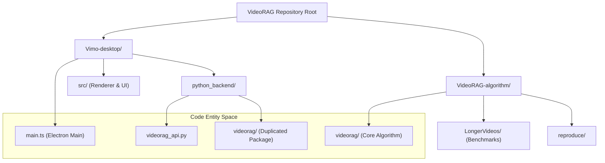
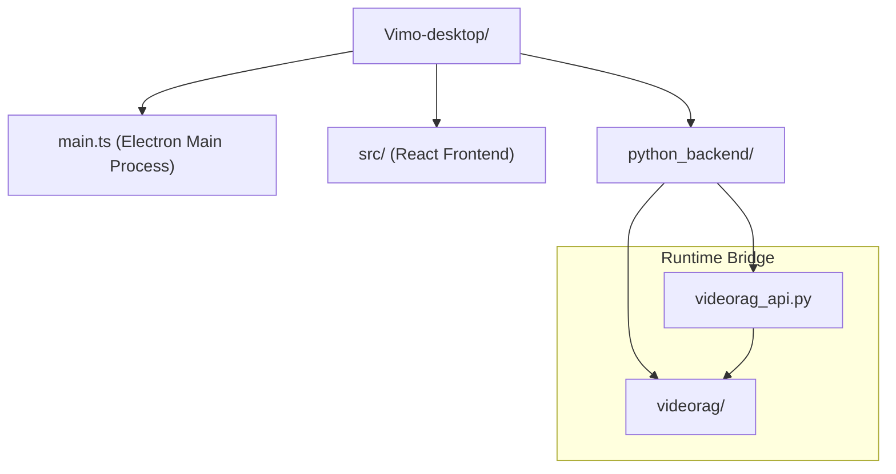

<!-- source: DeepWiki mcp.deepwiki.com · repo HKUDS/VideoRAG · page 1.1 Repository Layout · fetched 2026-11-09 -->

# Repository Layout

Relevant source files

The following files were used as context for generating this wiki page:

- [README.md](README.md)
- [Vimo-desktop/README.md](Vimo-desktop/README.md)

## Purpose and Scope

This document maps the top-level directory structure and subdirectories of the VideoRAG repository (`https://github.com/HKUDS/VideoRAG`), distinguishing between the desktop application component (`Vimo-desktop/`) and the core algorithmic framework (`VideoRAG-algorithm/`). It details the organization of source files, backend bridges, and the duplicated `videorag` package utilized by the Python backend server.

Sources: [README.md:1-71](), [Vimo-desktop/README.md:1-134]()

---

## Top-Level Directory Structure

The repository is divided into two primary root components:
1. `Vimo-desktop/`: Contains the Electron-based desktop frontend, renderer components, and the bundled `python_backend/` service wrapper [Vimo-desktop/README.md:19-38]().
2. `VideoRAG-algorithm/`: Houses the standalone core algorithmic implementation of VideoRAG, including graph-indexing modules, benchmark datasets, and evaluation scripts [README.md:26-71]().

*Figure 1: High-level repository component layout bridging top-level folders to primary code entities.*

Sources: [README.md:26-71](), [Vimo-desktop/README.md:19-134]()

---

## Vimo Desktop Architecture (`Vimo-desktop/`)

The `Vimo-desktop/` directory implements the Electron client application, providing desktop-native window management, local file handling, and IPC routing to the underlying Python services [Vimo-desktop/README.md:21-38](). 

Key structural aspects include:
- **Electron Main Process (`main.ts`)**: Initializes application lifecycle events and manages native window contexts.
- **Renderer Process (`src/`)**: Built using React, managing user-facing views such as the chat interface, settings, and drag-and-drop upload managers.
- **Python Backend Wrapper (`python_backend/`)**: Hosts the Flask-based API bridge responsible for executing VideoRAG tasks locally [Vimo-desktop/README.md:102-105]().

*Figure 2: Vimo desktop structural breakdown mapping desktop components to execution scripts.*

Sources: [Vimo-desktop/README.md:70-117]()

---

## Python Backend Bridge and Package Duplication (`python_backend/`)

To support self-contained desktop execution, `Vimo-desktop/python_backend/` bundles a dedicated Python API server (`videorag_api.py`) along with an embedded copy of the `videorag` package [Vimo-desktop/README.md:102-105](). 

- **`videorag_api.py`**: Acts as the Flask/IPC bridge endpoint exposing video insertion and query execution routes to the Electron frontend.
- **Embedded `videorag/` Package**: A localized copy of the core processing engine optimized to run within the conda environment (`vimo`) established during desktop setup [Vimo-desktop/README.md:75-97]().

Sources: [Vimo-desktop/README.md:70-117]()

---

## VideoRAG Algorithm Package Layout (`VideoRAG-algorithm/`)

The `VideoRAG-algorithm/` directory contains the core research implementation and modular components of the framework [README.md:26-71](). 

- **`videorag/`**: The primary algorithmic package containing modules for dual-channel graph construction, multi-modal context encoding, and the six-stage query pipeline.
- **`LongerVideos/`**: Benchmark datasets and evaluation artifacts consisting of long-form video content [README.md:55-58]().
- **`reproduce/`**: Quantitative evaluation scripts and comparative winrate testing utilities.

Sources: [README.md:26-71]()

---

