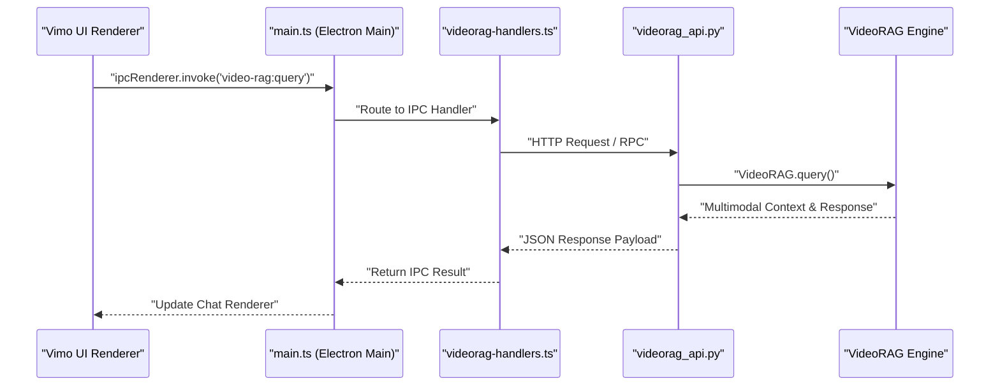

<!-- source: DeepWiki mcp.deepwiki.com · repo HKUDS/VideoRAG · page 1.2 System Architecture at a Glance · fetched 2026-11-09 -->

# System Architecture at a Glance

<details>
<summary>Relevant source files</summary>

The following files were used as context for generating this wiki page:

- [README.md](README.md)
- [Vimo-desktop/src/main/main.ts](Vimo-desktop/src/main/main.ts)

</details>


## Purpose and Scope
This document provides a comprehensive end-to-end technical summary of the VideoRAG (Vimo Desktop) system architecture. It details the interaction boundaries between the Electron-based frontend (`Vimo-desktop`), the Python backend bridge (`python_backend/videorag_api.py`), and the core `VideoRAG` algorithmic engine. For deeper dives into individual subsystems, refer to the relevant architectural and API reference pages.

Sources: [README.md:1-71](), [Vimo-desktop/src/main/main.ts:1-50]()

---

## Three-Tier System Architecture

The Vimo system operates across a three-tier architecture that bridges desktop UI components with high-performance video retrieval and graph-driven indexing algorithms.

1. **Frontend Tier (Electron Renderer & Main)**: Built with web technologies inside an Electron container, managing user interactions, drag-and-drop ingestion, chat states, and local settings.
2. **IPC & Bridge Tier**: The Electron main process (`[Vimo-desktop/src/main/main.ts:23-29]()`) coordinates native OS operations, file verification, and communicates with the Python backend via local HTTP/API bridges.
3. **Backend & Engine Tier (`VideoRAG-algorithm`)**: Executes the heavy-lifting video preprocessing, multimodal embeddings, knowledge graph construction, and multi-stage query retrieval pipelines.

### Diagram: End-to-End Architecture & Code Entity Mapping
```mermaid
graph TD
    subgraph Frontend["Electron Renderer Space"]
        UI[""Vimo UI & Renderer Components""]
    end

    subgraph MainProcess["Electron Main Process"]
        Main[""main.ts (app.whenReady)""]
        FileH[""file-handlers.ts""]
        ChatH[""chat-session-handlers.ts""]
        VraH[""videorag-handlers.ts""]
        Settings[""settings.ts""]
    end

    subgraph PythonBridge["Python Backend Bridge"]
        API[""python_backend/videorag_api.py""]
    end

    subgraph CoreEngine["VideoRAG Algorithm Engine"]
        Engine[""VideoRAG Class / Indexing & Retrieval""]
        DB[""Neo4j & Vector DB (hnswlib)""]
    end

    UI -->|""IPC Invoke""| Main
    Main --> FileH
    Main --> ChatH
    Main --> VraH
    Main --> Settings
    VraH -->|""HTTP / RPC""| API
    API --> Engine
    Engine --> DB
```
Sources: [Vimo-desktop/src/main/main.ts:1-49]()

---

## Electron Main Process and IPC Integration

The application lifecycle begins in the Electron main entry point (`[Vimo-desktop/src/main/main.ts:16-39]`), where hardware acceleration is disabled (`[Vimo-desktop/src/main/main.ts:13]()`) to stabilize GPU rendering across diverse host systems. Upon readiness, the main process registers critical Inter-Process Communication (IPC) handlers and initializes the main window (`[Vimo-desktop/src/main/main.ts:24-34]()`):

* `registerFileHandlers()`: Manages local file selection and path resolutions.
* `registerSettingsHandlers()`: Persists user configuration and API keys.
* `registerChatSessionHandlers()`: Manages conversational history and session states.
* `setupVideoRAGHandlers()`: Coordinates backend startup, shutdown, and inference requests.
* `registerModelHandlers()`: Verifies local assets such as `imagebind_huge.pth` and handles fallback downloads (`[Vimo-desktop/src/main/main.ts:56-189]()`).

Cleanup routines ensure background services terminate gracefully upon application exit via `stopVideoRAGService()` (`[Vimo-desktop/src/main/main.ts:46-49]()`).

Sources: [Vimo-desktop/src/main/main.ts:1-189]()

---

## Data Flow and Request Lifecycle

When a user submits a query or drops a video file into Vimo, requests traverse through the desktop bridge into the core Python engine. 

### Diagram: Request Lifecycle Sequence

Sources: [Vimo-desktop/src/main/main.ts:1-35]()

---

