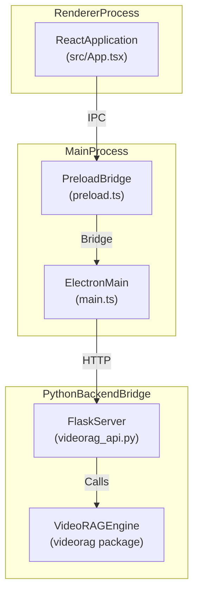
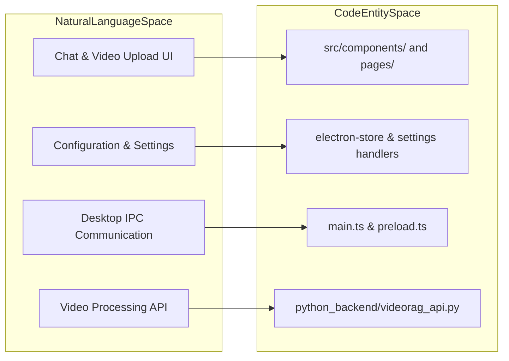
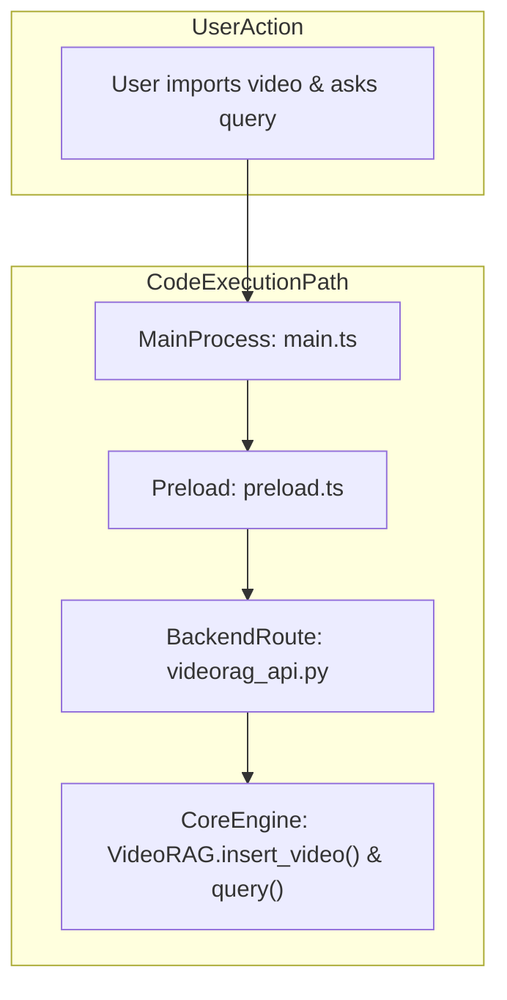

<!-- source: DeepWiki mcp.deepwiki.com · repo HKUDS/VideoRAG · page 2 Vimo Desktop Application · fetched 2026-11-09 -->

# Vimo Desktop Application

Relevant source files

The following files were used as context for generating this wiki page:

- [Vimo-desktop/README.md](Vimo-desktop/README.md)
- [Vimo-desktop/package.json](Vimo-desktop/package.json)

## Purpose and Scope

This document provides a high-level overview of the Vimo Desktop Application, an Electron-based cross-platform client that serves as the user-facing interface for the VideoRAG system [Vimo-desktop/README.md:19-22](). It covers the application's overall architecture, technology stack, and its integration with the Python backend [Vimo-desktop/README.md:70-105]().

As a parent page, this section introduces key operational areas. For detailed implementation specifics, refer to the child pages:
- For setup guides and environment requirements, see [Installation and Setup](#2.1).
- For UI layouts, component structures, and user features, see [User Interface and Features](#2.2).
- For settings, API keys, and model downloads, see [Configuration Management](#2.3).
- For Electron process management and IPC handlers, see [Electron Main Process and IPC](#2.4).
- For the Python Flask API bridge and bundled wrapper, see [Python Backend Bridge](#2.5).

**Sources:** [Vimo-desktop/README.md:1-134](), [Vimo-desktop/package.json:1-56]()

---

## Architecture Overview

Vimo Desktop implements a hybrid architecture combining an Electron frontend (`Vimo-desktop/`) with a Python backend service (`python_backend/`) [Vimo-desktop/README.md:70-118](). The frontend handles user interactions and window control through `main.ts` and React views, while the backend Flask server (`videorag_api.py`) coordinates video processing and AI model inference [Vimo-desktop/README.md:100-105]().

### High-Level System Architecture

**Sources:** [Vimo-desktop/README.md:70-118](), [Vimo-desktop/package.json:1-15]()

---

## Natural Language to Code Entity Mapping

To bridge natural language concepts to concrete code components within the Vimo desktop and backend ecosystem, the following mappings link user-facing features to their respective codebase entities:

**Sources:** [Vimo-desktop/README.md:70-118](), [Vimo-desktop/package.json:1-56]()

---

## Sub-Topic Summaries

### Installation and Setup
Vimo Desktop requires a Node.js runtime environment (>=20.x) for the Electron frontend [Vimo-desktop/package.json:53-55]() and a Python 3.11 environment for the backend service [Vimo-desktop/README.md:75-76](). Users install dependencies via `pnpm` [Vimo-desktop/README.md:113]() and configure deep learning libraries such as PyTorch, MoviePy, and ImageBind [Vimo-desktop/README.md:78-96]().
For details, see [Installation and Setup](#2.1).

### User Interface and Features
The Vimo renderer is built with React 18, Vite, and Tailwind CSS [Vimo-desktop/package.json:1-52](), providing drag-and-drop video upload, multi-video workspace analysis, and an interactive chat interface. State is managed via custom hooks and React context providers.
For details, see [User Interface and Features](#2.2).

### Configuration Management
Vimo features settings persistence using `electron-store` [Vimo-desktop/package.json:14]() to manage API keys, storage directories, and model configurations. An initialization wizard guides new users through setting up required parameters before launching the main application window.
For details, see [Configuration Management](#2.3).

### Electron Main Process and IPC
The Electron main process (`main.ts`) manages application windows, life cycle events, and secure inter-process communication (IPC) via `preload.ts` [Vimo-desktop/README.md:62-118](). Dedicated IPC handlers manage file dialogues, session states, and communication with the local backend server.
For details, see [Electron Main Process and IPC](#2.4).

### Python Backend Bridge
The Python backend bridge (`python_backend/videorag_api.py`) wraps the core `videorag` package into a Flask REST API server listening on port 5000. It translates incoming desktop requests into video parsing, knowledge graph construction, and retrieval tasks.
For details, see [Python Backend Bridge](#2.5).

**Sources:** [Vimo-desktop/README.md:1-134](), [Vimo-desktop/package.json:1-56]()

---

