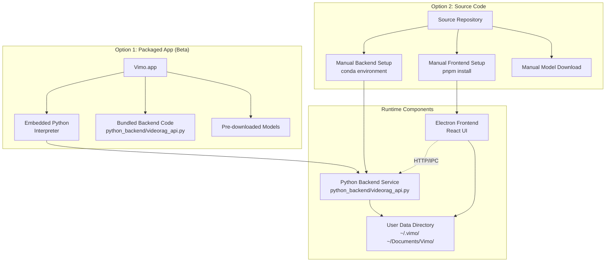
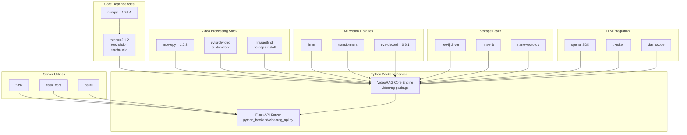
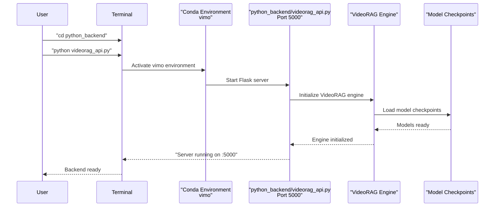
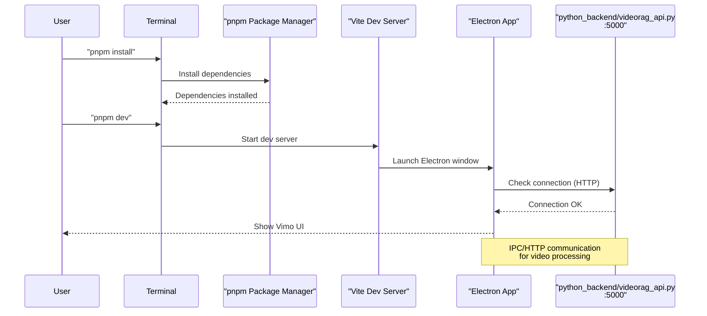
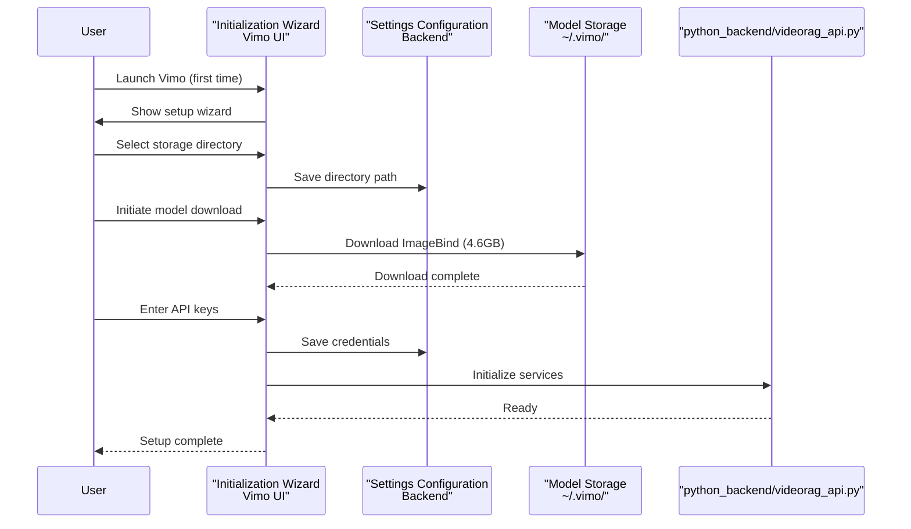
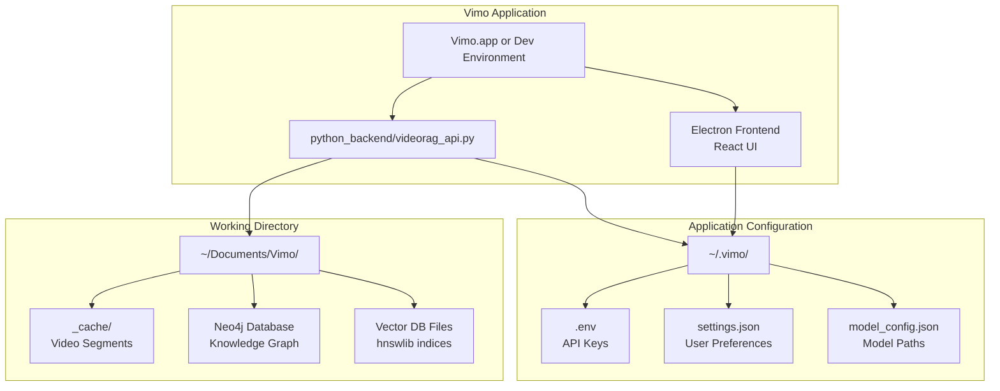

<!-- source: DeepWiki mcp.deepwiki.com · repo HKUDS/VideoRAG · page 2.1 Installation and Setup · fetched 2026-11-09 -->

# Installation and Setup

<details>
<summary>Relevant source files</summary>

The following files were used as context for generating this wiki page:

- [Vimo-desktop/README.md](Vimo-desktop/README.md)
- [Vimo-desktop/package.json](Vimo-desktop/package.json)

</details>


This document provides installation instructions for the Vimo Desktop Application, including system requirements, downloading the packaged application, and setting up the development environment from source code. Vimo requires both a Python backend service (`videorag_api.py`) and an Electron-based frontend application (`Vimo-desktop/`).

For installation of the core VideoRAG framework as a standalone library, see page 3 (VideoRAG Framework).

## System Requirements

Vimo Desktop has been tested on macOS with Apple M1 chips and requires GPU acceleration for video processing. The application architecture separates the frontend (Electron) from the backend (Python VideoRAG server).

### Hardware Requirements

| Component | Requirement | Notes |
|-----------|-------------|-------|
| **GPU** | NVIDIA RTX 3090 (24GB) or equivalent | For processing hundreds of hours of video |
| **RAM** | 32GB minimum | Recommended for smooth operation |
| **Storage** | 50GB+ free space | For models, video cache, and databases |
| **OS** | macOS (Apple Silicon tested) | Windows and Linux support planned |

### Software Prerequisites

- **Python**: Version 3.11
- **CUDA**: Compatible installation for PyTorch (GPU version)
- **Node.js**: For frontend development (if running from source)
- **pnpm**: Package manager for frontend dependencies (`Vimo-desktop/package.json`)

Sources: [Vimo-desktop/README.md:68](), [Vimo-desktop/package.json:54]()

## Installation Options

Vimo Desktop offers two installation methods: downloading a packaged application or running from source code. The packaged application simplifies deployment by embedding all required components.

**Vimo Installation Architecture**


Sources: [Vimo-desktop/README.md:46-61](), [Vimo-desktop/README.md:99-105]()

### Option 1: Download Vimo App (Beta Release)

The packaged Vimo application provides a single-file installation experience with all dependencies bundled.

**Availability Status:**

| Platform | Status | Notes |
|----------|--------|-------|
| macOS (Apple Silicon) | **Beta** - Coming Soon | First release target |
| Windows | Planned | Future release |
| Linux | Planned | Future release |

The packaged version will include:
- Embedded Python backend environment
- Pre-bundled VideoRAG API server (`python_backend/videorag_api.py`)
- Downloaded model checkpoints (ImageBind, Whisper, MiniCPM-V)
- Self-contained Electron frontend (`Vimo-desktop/`)

Sources: [Vimo-desktop/README.md:48-58](), [Vimo-desktop/README.md:99-105]()

### Option 2: Run from Source Code

Running Vimo from source requires manual setup of both backend and frontend components. This option is recommended for developers or users who want to customize the application.

> **Important**: The backend service must be running before launching the frontend application.

Sources: [Vimo-desktop/README.md:64-68]()

#### Step 1: Backend Service Setup

The Python backend runs the VideoRAG API server on port 5000 and handles all video processing operations.

**Create Conda Environment**
```bash
conda create --name vimo python=3.11
conda activate vimo
```

**Install Backend Dependencies**

The backend dependencies are organized into functional categories (`Vimo-desktop/README.md`):

```bash
# Core numerical and deep learning libraries
pip install numpy==1.26.4 torch==2.1.2 torchvision==0.16.2 torchaudio==2.1.2

# Video processing utilities
pip install moviepy==1.0.3
pip install git+https://github.com/Re-bin/pytorchvideo.git@58f50da4e4b7bf0b17b1211dc6b283ba42e522df
pip install --no-deps git+https://github.com/facebookresearch/ImageBind.git@3fcf5c9039de97f6ff5528ee4a9dce903c5979b3

# Multi-modal and vision libraries
pip install timm ftfy regex einops fvcore eva-decord==0.6.1 iopath matplotlib types-regex cartopy

# Audio processing and vector databases
pip install neo4j hnswlib xxhash nano-vectordb

# Language models and utilities
pip install tiktoken openai tenacity dashscope

# Web server and utilities
pip install flask psutil flask_cors setproctitle
```

**Backend Dependency Architecture**


Sources: [Vimo-desktop/README.md:74-97]()

**Start Backend Service**

Navigate to the Python backend directory and start the VideoRAG API server:

```bash
cd python_backend
python videorag_api.py
```

The server will start on `http://localhost:5000` and provide endpoints for video ingestion (`/process_video`), querying (`/query`), and data management.

**Backend Service Communication Flow**


Sources: [Vimo-desktop/README.md:99-105]()

#### Step 2: Frontend Application Setup

The frontend is an Electron application built with React and managed using `pnpm` (`Vimo-desktop/package.json`).

**Install Frontend Dependencies**

From the project root or `Vimo-desktop` directory:

```bash
pnpm install
```

**Start Development Server**

```bash
pnpm dev
```

This command runs `electron-vite dev --watch` (`Vimo-desktop/package.json`), launching the Vite development server and the Electron application window.

**Frontend Startup Flow**


Sources: [Vimo-desktop/package.json:10](), [Vimo-desktop/README.md:107-117]()

## Initial Configuration

After launching Vimo for the first time, the application will guide you through an initialization wizard to configure necessary settings.

### Initialization Wizard Steps

The initialization wizard manages the following configuration:

1. **Storage Directory Selection**: Choose where Vimo stores processed video data
2. **Model Download**: Download ImageBind model checkpoints (~4.6GB)
3. **API Key Configuration**: Set up LLM provider credentials
4. **Database Initialization**: Create Neo4j graph database and vector indices

**Initialization Wizard Flow**


### Configuration Files and Directories

Vimo creates and manages several directories for configuration and data storage:

| Directory | Purpose | Typical Location |
|-----------|---------|------------------|
| `~/.vimo/` | Application configuration, API keys | User home directory |
| `~/Documents/Vimo/` | Working directory for videos | User documents |
| `~/Documents/Vimo/_cache/` | Video segments and audio cache | Working directory |
| Neo4j database | Knowledge graph storage | Working directory |
| Vector DB files | HNSWLIB and nano-vectordb indices | Working directory |

**Vimo Data Storage Architecture**


Sources: [Vimo-desktop/README.md:119]()

### API Key Configuration

Vimo supports multiple LLM providers. Configure at least one provider during the initialization wizard:

**Supported LLM Providers:**

| Provider | Required Key | Configuration Location |
|----------|--------------|------------------------|
| OpenAI | `OPENAI_API_KEY` | Settings page or `.env` |
| Azure OpenAI | `AZURE_OPENAI_API_KEY` | Settings page or `.env` |
| DashScope (Alibaba) | `DASHSCOPE_API_KEY` | Settings page or `.env` |
| Ollama | Local installation | No key required |

Sources: [Vimo-desktop/README.md:74-97]()

## Important Notes and Limitations

### Current Version Constraints

**File Path Stability (Beta Version)**

> ⚠️ **Warning**: In the current beta version, avoid moving or renaming video files after importing them into Vimo. Changing the file path may disrupt Vimo's ability to access the video (`Vimo-desktop/README.md`).

Sources: [Vimo-desktop/README.md:119]()

## Installation Verification

### Basic Functionality Test

After installation, verify the Python backend setup with a test script:

```python
import warnings
import multiprocessing
warnings.filterwarnings("ignore")

# Test imports
from videorag import VideoRAG, QueryParam
from videorag._llm import openai_4o_mini_config

if __name__ == '__main__':
    multiprocessing.set_start_method('spawn')
    videorag = VideoRAG(llm=openai_4o_mini_config, working_dir="./test-workdir")
    print("VideoRAG successfully initialized!")
```

Sources: [Vimo-desktop/README.md:68-97]()

Sources: [Vimo-desktop/README.md:46-119](), [Vimo-desktop/package.json:1-55]()

---

