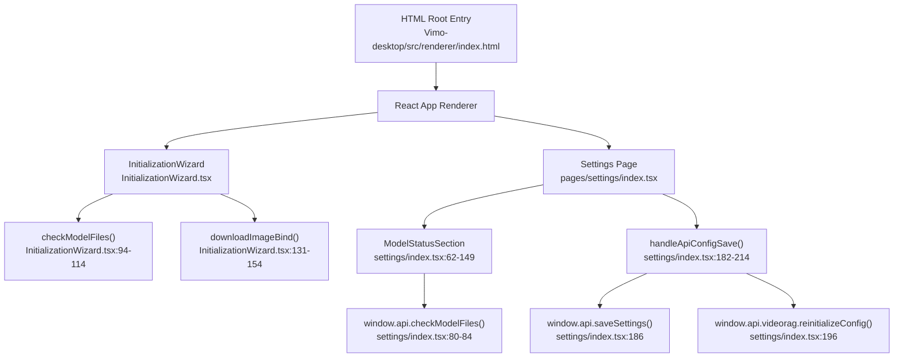
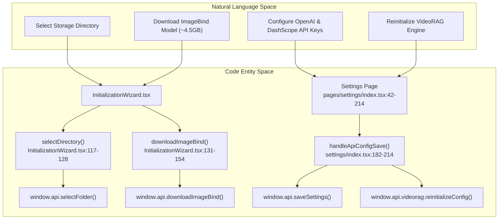
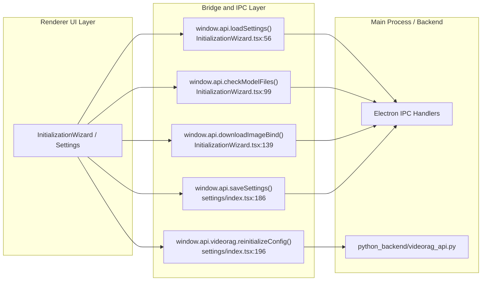

<!-- source: DeepWiki mcp.deepwiki.com · repo HKUDS/VideoRAG · page 2.2 User Interface and Features · fetched 2026-11-09 -->

# User Interface and Features

Relevant source files

The following files were used as context for generating this wiki page:

- [Vimo-desktop/src/renderer/index.html](Vimo-desktop/src/renderer/index.html)
- [Vimo-desktop/src/renderer/src/components/InitializationWizard.tsx](Vimo-desktop/src/renderer/src/components/InitializationWizard.tsx)
- [Vimo-desktop/src/renderer/src/pages/settings/index.tsx](Vimo-desktop/src/renderer/src/pages/settings/index.tsx)

This document provides a technical breakdown of the user interface and client-side renderer architecture for the Vimo Desktop application (`Vimo-desktop/`). It details the React renderer structure (pages, components, contexts, hooks), core user-facing features (drag-and-drop video upload, conversational chat interface, multi-video analysis, and export capabilities), and how the renderer interacts with the Electron main process and backend APIs through IPC.

---

## Renderer Structure

The Vimo Desktop renderer process is built using React and TypeScript, hosted inside an Electron web container (`Vimo-desktop/src/renderer/index.html:1-36`). The application is structured around modular pages, reusable UI components, React contexts, and custom hooks that manage client-side state and bridge operations to the Electron main process via `window.api`.

### Pages and Components
- **`InitializationWizard` (`Vimo-desktop/src/renderer/src/components/InitializationWizard.tsx:22-210`)**: Guides first-time users through directory configuration (`storeDirectory`), model verification/download (`imagebindStatus`), and API key provisioning (`apiKeySettings`).
- **`Settings` (`Vimo-desktop/src/renderer/src/pages/settings/index.tsx:42-214`)**: Manages application-wide runtime configurations, including OpenAI base URLs, API keys (`openaiApiKey`, `dashscopeApiKey`), model selectors (`processingModel`, `analysisModel`, `captionModel`, `asrModel`), and local model storage directories.

**Diagram: Renderer Component Hierarchy and Initialization Flow**

**Sources:** `Vimo-desktop/src/renderer/index.html:1-36`, `Vimo-desktop/src/renderer/src/components/InitializationWizard.tsx:1-210`, `Vimo-desktop/src/renderer/src/pages/settings/index.tsx:1-214`

---

## Core User Features

### Drag-and-Drop Video Upload
The video ingestion interface accepts raw container formats (MP4, MKV, AVI, MOV) via drag-and-drop actions. Once dropped, the file path is transmitted to the backend bridge, triggering video segmentation, audio extraction via Whisper ASR, knowledge graph extraction, and vector index construction.

### Conversational Interface
The chat interface provides natural language interaction over indexed video content. Users input queries which pass through a multi-stage retrieval pipeline. Responses render primary answer text alongside precise timestamp references (`MM:SS`), confidence metrics, and extracted keyframe thumbnails. Clicking a timestamp reference invokes the integrated video player to seek and play the specific segment.

### Multi-Video Session Management
Vimo supports parallel indexing of multiple videos within a single working directory (`storeDirectory`). The underlying Neo4j knowledge graph manages cross-video entity relationships, enabling comparative queries, multi-document synthesis, and cross-reference retrieval.

### Export Capabilities
The export subsystem formats conversation history, timestamped video references, and model-generated captions into structured JSON, tabular CSV, or human-readable Markdown files saved to user-selected locations.

**Sources:** `Vimo-desktop/src/renderer/src/components/InitializationWizard.tsx:32-154`, `Vimo-desktop/src/renderer/src/pages/settings/index.tsx:62-149`

---

## Natural Language Space to Code Entity Space: Initialization and Configuration

The following diagram bridges user-facing configuration workflows (Natural Language Space) to their corresponding React component handlers and IPC API bindings (Code Entity Space).

**Diagram: Mapping UI Configuration Actions to IPC Code Entities**

**Sources:** `Vimo-desktop/src/renderer/src/components/InitializationWizard.tsx:117-154`, `Vimo-desktop/src/renderer/src/pages/settings/index.tsx:182-214`

---

## State Management and IPC Bridge

The React renderer communicates with the Electron main process via asynchronous IPC wrappers exposed on the global `window.api` interface.

**Diagram: Renderer-to-Backend IPC Data Flow**

**Sources:** `Vimo-desktop/src/renderer/src/components/InitializationWizard.tsx:52-154`, `Vimo-desktop/src/renderer/src/pages/settings/index.tsx:158-214`

---

