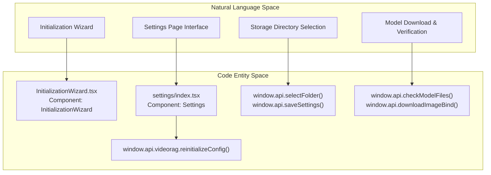
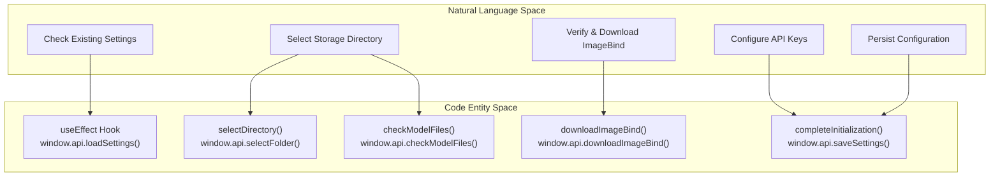

<!-- source: DeepWiki mcp.deepwiki.com · repo HKUDS/VideoRAG · page 2.3 Configuration Management · fetched 2026-11-09 -->

# Configuration Management

<details>
<summary>Relevant source files</summary>

The following files were used as context for generating this wiki page:

- [Vimo-desktop/src/renderer/src/components/InitializationWizard.tsx](Vimo-desktop/src/renderer/src/components/InitializationWizard.tsx)
- [Vimo-desktop/src/renderer/src/pages/settings/index.tsx](Vimo-desktop/src/renderer/src/pages/settings/index.tsx)

</details>


## Purpose and Scope

This document details how the Vimo Desktop application manages configuration data, covering the first-time setup via the `InitializationWizard` component [Vimo-desktop/src/renderer/src/components/InitializationWizard.tsx:22-29](), ongoing configuration management via the `Settings` page component [Vimo-desktop/src/renderer/src/pages/settings/index.tsx:42-53](), API key provisioning, storage directory selection, and the asynchronous ImageBind model download pipeline.

For information on how the UI consumes these configurations, see [User Interface and Features](#2.2). For details on backend initialization, see [Python Backend Bridge](#2.5).

---

## Configuration Architecture Overview

The configuration system bridges the React-based renderer process with Electron's main process via secure IPC wrappers (`window.api`), persisting settings to the local file system and re-initializing the Python `VideoRAG` engine when parameters change.

### Diagram: Natural Language Space to Code Entity Space — Configuration Pipeline



**Configuration Pipeline Code Mapping**
Sources: [Vimo-desktop/src/renderer/src/components/InitializationWizard.tsx:22-154](), [Vimo-desktop/src/renderer/src/pages/settings/index.tsx:42-196]()

---

## Configuration Schema and State Interface

Both the `InitializationWizard` and `Settings` components interact with a unified configuration schema defined by `SettingsState` [Vimo-desktop/src/renderer/src/pages/settings/index.tsx:23-40]() and local state structures [Vimo-desktop/src/renderer/src/components/InitializationWizard.tsx:40-48]().

| Field Name | Type | Description | Default / Source |
| :--- | :--- | :--- | :--- |
| `openaiBaseUrl` | string | OpenAI-compatible API endpoint | `https://api.openai.com/v1` [Vimo-desktop/src/renderer/src/components/InitializationWizard.tsx:41]() |
| `openaiApiKey` | string | API key for OpenAI models | User-provided [Vimo-desktop/src/renderer/src/components/InitializationWizard.tsx:42]() |
| `processingModel` | string | Model used for high-volume preprocessing | `gpt-4o-mini` [Vimo-desktop/src/renderer/src/components/InitializationWizard.tsx:43]() |
| `analysisModel` | string | Model used for fine-grained analysis | `gpt-4o-mini` [Vimo-desktop/src/renderer/src/components/InitializationWizard.tsx:44]() |
| `dashscopeApiKey` | string | Alibaba DashScope API key | User-provided [Vimo-desktop/src/renderer/src/components/InitializationWizard.tsx:45]() |
| `captionModel` | string | Vision/captioning model identifier | `qwen-vl-plus-latest` [Vimo-desktop/src/renderer/src/components/InitializationWizard.tsx:46]() |
| `asrModel` | string | Speech recognition model identifier | `paraformer-realtime-v2` [Vimo-desktop/src/renderer/src/components/InitializationWizard.tsx:47]() |
| `storeDirectory` | string | Local path for storing models and cache | User-selected folder [Vimo-desktop/src/renderer/src/components/InitializationWizard.tsx:33]() |
| `imagebindInstalled` | boolean | ImageBind model installation boolean | Checked via `checkModelFiles()` [Vimo-desktop/src/renderer/src/pages/settings/index.tsx:39]() |

Sources: [Vimo-desktop/src/renderer/src/components/InitializationWizard.tsx:40-48](), [Vimo-desktop/src/renderer/src/pages/settings/index.tsx:23-40]()

---

## Initialization Wizard Implementation

The `InitializationWizard` component manages first-time setup across four discrete steps: Directory selection (`step: 1`), Models (`step: 2`), API Keys (`step: 3`), and Complete (`step: 4`) [Vimo-desktop/src/renderer/src/components/InitializationWizard.tsx:24-29]().

### Diagram: Natural Language Space to Code Entity Space — Wizard Execution Flow



**Initialization Wizard Code Mapping**
Sources: [Vimo-desktop/src/renderer/src/components/InitializationWizard.tsx:52-154](), [Vimo-desktop/src/renderer/src/components/InitializationWizard.tsx:202-215]()

### Step-by-Step Logic
1. **Directory Selection (`step 1`)**: Invokes `selectDirectory()`, calling `window.api.selectFolder()` [Vimo-desktop/src/renderer/src/components/InitializationWizard.tsx:117-128](). Automatically triggers `checkModelFiles(result.path)` to detect pre-existing models [Vimo-desktop/src/renderer/src/components/InitializationWizard.tsx:123]().
2. **Model Download (`step 2`)**: Manages `imagebindStatus` (`'pending' | 'downloading' | 'completed' | 'error'`) [Vimo-desktop/src/renderer/src/components/InitializationWizard.tsx:34](). Progress events are received via `window.api.onDownloadProgress()` [Vimo-desktop/src/renderer/src/components/InitializationWizard.tsx:85]().
3. **API Keys (`step 3`)**: Updates local `apiKeySettings` state via `handleApiKeyChange()` [Vimo-desktop/src/renderer/src/components/InitializationWizard.tsx:193-198]().
4. **Completion (`step 4`)**: Combines directory, model status, and API settings into a payload passed to `window.api.saveSettings()` [Vimo-desktop/src/renderer/src/components/InitializationWizard.tsx:205-210]().

Sources: [Vimo-desktop/src/renderer/src/components/InitializationWizard.tsx:32-210]()

---

## Settings Page and Backend Reinitialization

The `Settings` component (`settings/index.tsx`) allows users to inspect and modify settings post-initialization [Vimo-desktop/src/renderer/src/pages/settings/index.tsx:42-53]().

### Save and Reinitialization Workflow
When users update their configuration in the settings UI, `handleApiConfigSave()` executes a two-phase update [Vimo-desktop/src/renderer/src/pages/settings/index.tsx:182-208]():
1. **Save Settings**: Calls `window.api.saveSettings(settings)` to write updated configurations to persistent storage [Vimo-desktop/src/renderer/src/pages/settings/index.tsx:186]().
2. **Backend Reinitialization**: Calls `window.api.videorag.reinitializeConfig()` to instruct the Python backend bridge to reload configuration without restarting the entire desktop process [Vimo-desktop/src/renderer/src/pages/settings/index.tsx:196]().
3. **Event Dispatched**: Dispatches a custom `storage-config-updated` event if the `storeDirectory` changed [Vimo-desktop/src/renderer/src/pages/settings/index.tsx:211-216]().

```typescript
// Example from settings/index.tsx saving configuration
const handleApiConfigSave = async () => {
  setApiConfigStatus('saving');
  try {
    const saveResult = await window.api.saveSettings(settings);
    if (!saveResult.success) {
      setApiConfigStatus('error');
      setTimeout(() => setApiConfigStatus('idle'), 2000);
      return;
    }
    const initResult = await window.api.videorag.reinitializeConfig();
    setApiConfigStatus('saved');
  } catch (initError) {
    setApiConfigStatus('saved');
  }
};
```

Sources: [Vimo-desktop/src/renderer/src/pages/settings/index.tsx:182-208]()

---

## Model Status Verification Component

The `ModelStatusSection` sub-component nested within the settings page checks if required model assets (such as ImageBind) are present in the designated `storeDirectory` [Vimo-desktop/src/renderer/src/pages/settings/index.tsx:62-149]().

- **Status Checking**: Calls `window.api.checkModelFiles(storeDirectory)` whenever `storeDirectory` updates [Vimo-desktop/src/renderer/src/pages/settings/index.tsx:71-93]().
- **UI States**: Displays visual feedback including loading spinner, green checkmark for ready state, or red cross if files are missing [Vimo-desktop/src/renderer/src/pages/settings/index.tsx:118-124]().

Sources: [Vimo-desktop/src/renderer/src/pages/settings/index.tsx:62-149]()

---

Sources: [Vimo-desktop/src/renderer/src/components/InitializationWizard.tsx:1-210](), [Vimo-desktop/src/renderer/src/pages/settings/index.tsx:1-214]()

---

