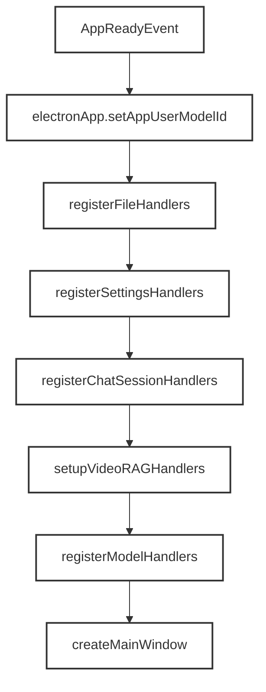
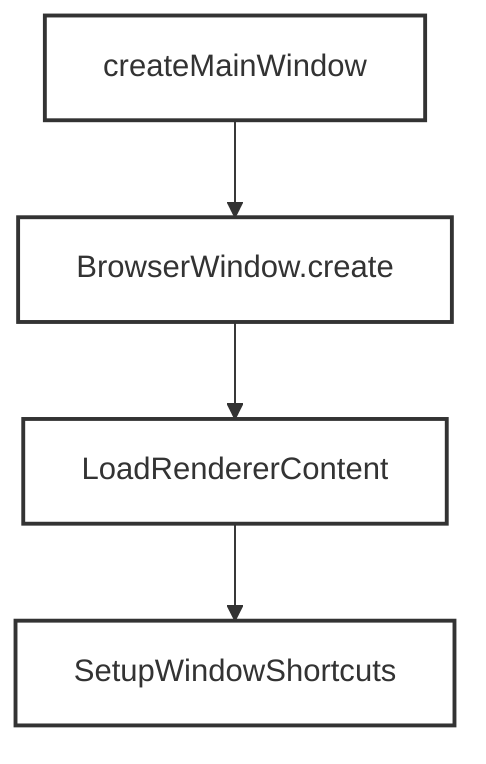

<!-- source: DeepWiki mcp.deepwiki.com · repo HKUDS/VideoRAG · page 2.4 Electron Main Process and IPC · fetched 2026-11-09 -->

# Electron Main Process and IPC

<details>
<summary>Relevant source files</summary>

The following files were used as context for generating this wiki page:

- [Vimo-desktop/src/main/main.ts](Vimo-desktop/src/main/main.ts)
- [Vimo-desktop/src/renderer/src/components/InitializationWizard.tsx](Vimo-desktop/src/renderer/src/components/InitializationWizard.tsx)
- [Vimo-desktop/src/renderer/src/pages/settings/index.tsx](Vimo-desktop/src/renderer/src/pages/settings/index.tsx)

</details>


## Purpose and Scope

This page documents the Electron main process implementation, window management routines, and Inter-Process Communication (IPC) handlers for the Vimo Desktop Application. The main process (`main.ts`) acts as the secure bridge between the web-based renderer frontend and native system resources, file systems, and the underlying Python VideoRAG backend service.

Sources: `[Vimo-desktop/src/main/main.ts:1-49]()`

---

## Main Process Lifecycle and Initialization

The entry point for the desktop application's main process is `[Vimo-desktop/src/main/main.ts:1]`. Upon startup, the application disables hardware acceleration to prevent GPU crashes on Linux and specific environments (`[Vimo-desktop/src/main/main.ts:13]()`), configures the application user model ID (`[Vimo-desktop/src/main/main.ts:17]()`), and sets up window shortcut watchers (`[Vimo-desktop/src/main/main.ts:19-21]()`).

When `app.whenReady()` resolves, the main process registers all IPC handler modules and instantiates the primary application window:


*Figure: Main process initialization flow mapping bootstrap events to handler registration functions.*

Sources: `[Vimo-desktop/src/main/main.ts:16-39]()`

---

## Window Management

Window management is isolated within the window helper module `[Vimo-desktop/src/main/handlers/window]()`. The `createMainWindow()` function handles window creation, security policies (such as context isolation and preload script configuration), and loading the renderer bundle or development URL.


*Figure: Window creation and lifecycle management.*

Sources: `[Vimo-desktop/src/main/main.ts:5]`, `[Vimo-desktop/src/main/main.ts:34]()`

---

## IPC Handler Subsystems

The Vimo application organizes its IPC routing into distinct functional modules called via `ipcMain.handle()` and `ipcMain.on()`.

### 1. File Handlers (`file-handlers.ts`)
Managed by `[Vimo-desktop/src/main/handlers/file-handlers.ts]`, these handlers expose native file system dialogs and file operations to the renderer. This includes selecting local video files, opening storage directories (`[Vimo-desktop/src/renderer/src/components/InitializationWizard.tsx:117-128]()`), and streaming file metadata.

### 2. Settings Handlers (`settings.ts`)
Managed by `[Vimo-desktop/src/main/handlers/settings]`, these routines persist and retrieve user configurations—such as API keys (`openaiApiKey`, `dashscopeApiKey`), endpoint base URLs, and selected model identifiers—to local configuration files (`[Vimo-desktop/src/renderer/src/pages/settings/index.tsx:153-172]()`).

### 3. Chat Session Handlers (`chat-session-handlers.ts`)
Implemented in `[Vimo-desktop/src/main/handlers/chat-session-handlers]`, these handlers manage chat history persistence, conversation state retrieval, and session creation for multi-video interactive dialogues.

### 4. VideoRAG Handlers and Python Bridge (`videorag-handlers.ts`)
Initialized via `setupVideoRAGHandlers()` (`[Vimo-desktop/src/main/main.ts:6]()`), this module manages the lifecycle of the bundled Python backend service (`python_backend/videorag_api.py`), spawning the child process, monitoring health endpoints, proxying video ingestion requests, and ensuring clean termination via `stopVideoRAGService()` upon application quit (`[Vimo-desktop/src/main/main.ts:47-49]()`).

### 5. Model Management Handlers
Model-related handlers reside directly inside `[Vimo-desktop/src/main/main.ts:56-189]()`. They provide two core IPC channels:
*   `check-model-files`: Asynchronously verifies the presence of model weights like `imagebind_huge.pth` inside the designated `storeDirectory` (`[Vimo-desktop/src/main/main.ts:58-75]()`).
*   `download-imagebind`: Streams the ImageBind model weights from remote sources (`https://dl.fbaipublicfiles.com/imagebind/imagebind_huge.pth`) directly to the local storage directory with real-time download progress broadcasting to the renderer (`[Vimo-desktop/src/main/main.ts:78-188]()`).

```mermaid
graph TD
    sub17["RendererInitializationWizard"] -->| "window.api.downloadImageBind" | sub18["ipcMainHandleDownloadImagebind"]
    sub18 --> sub19["HttpsGetModelStream"]
    sub19 -->| "event.sender.send('download-progress')" | sub20["RendererProgressEventListener"]
    sub18 --> sub21["FileSystemWriteImagebindHugePth"]

    classDef default fill:#fff,stroke:#333,stroke-width:2px;
```
*Figure: IPC execution flow for ImageBind model verification and streaming download.*

Sources: `[Vimo-desktop/src/main/main.ts:1-189]`, `[Vimo-desktop/src/renderer/src/components/InitializationWizard.tsx:52-154]`, `[Vimo-desktop/src/renderer/src/pages/settings/index.tsx:71-149]()`

---

## Complete IPC Architecture & Data Flow

The following diagram bridges the natural language concepts of frontend user actions with the precise code entities and IPC channels implemented across the Electron main and renderer processes.

```mermaid
graph TD
    sub22["UserActionSelectDirectory"] -->| "window.api.selectFolder" | sub23["registerFileHandlers"]
    sub24["UserActionCheckModels"] -->| "window.api.checkModelFiles" | sub25["check-model-files"]
    sub26["UserActionDownloadModel"] -->| "window.api.downloadImageBind" | sub27["download-imagebind"]
    sub28["UserActionSaveSettings"] -->| "window.api.saveSettings" | sub29["registerSettingsHandlers"]
    sub30["UserActionInitVideoRAG"] -->| "window.api.videorag.reinitializeConfig" | sub31["setupVideoRAGHandlers"]
    sub32["UserActionQuitApp"] -->| "app.on('before-quit')" | sub33["stopVideoRAGService"]

    classDef default fill:#fff,stroke:#333,stroke-width:2px;
```
*Figure: Code Entity mapping for IPC channels bridging renderer requests to main process handlers.*

Sources: `[Vimo-desktop/src/main/main.ts:1-49]`, `[Vimo-desktop/src/main/main.ts:56-189]`, `[Vimo-desktop/src/renderer/src/components/InitializationWizard.tsx:75-154]`, `[Vimo-desktop/src/renderer/src/pages/settings/index.tsx:182-214]()`

---

