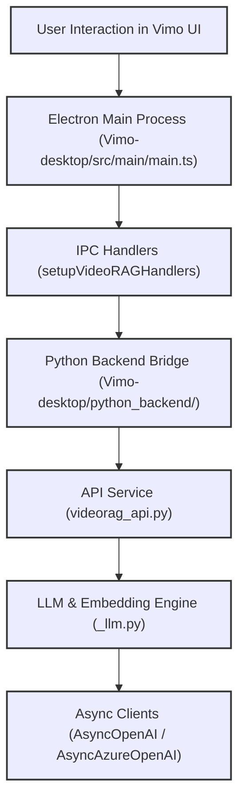
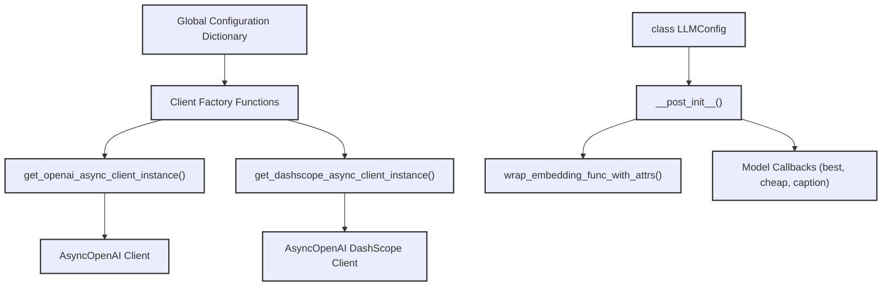

<!-- source: DeepWiki mcp.deepwiki.com · repo HKUDS/VideoRAG · page 2.5 Python Backend Bridge · fetched 2026-11-09 -->

# Python Backend Bridge

Relevant source files

The following files were used as context for generating this wiki page:

- [Vimo-desktop/python_backend/videorag/_llm.py](Vimo-desktop/python_backend/videorag/_llm.py)
- [Vimo-desktop/src/main/main.ts](Vimo-desktop/src/main/main.ts)

The Python Backend Bridge serves as the crucial integration layer between the Electron-based Vimo desktop application and the Python-based VideoRAG algorithmic engine. Located under `Vimo-desktop/python_backend/`, this subsystem packages a modified version of the `videorag` package alongside an API service (`videorag_api.py`) that handles video processing requests, knowledge graph construction, and multi-modal query execution initiated from the desktop UI.

---

## 1. Architecture and Component Overview

The desktop application manages local execution of Python scripts and interacts with them via standard input/output streams or local HTTP endpoints managed through Electron IPC handlers. The backend bridge encapsulates environment configuration, model initialization, and asynchronous LLM wrappers tailored for desktop deployments.

### Natural Language Space to Code Entity Space Mapping

*Sources: [Vimo-desktop/src/main/main.ts:1-189](), [Vimo-desktop/python_backend/videorag/_llm.py:1-190]()*

---

## 2. Bundled `videorag` Package Structure

The bundled `videorag` package within `Vimo-desktop/python_backend/videorag/` differs from the standalone `VideoRAG-algorithm` repository by embedding runtime adjustments optimized for local desktop execution, desktop storage paths, and integrated client factories.

### Core Modules and Configuration

The `_llm.py` module defines client instance initializers and the core configuration dataclass `LLMConfig` [Vimo-desktop/python_backend/videorag/_llm.py:40-72](). Global asynchronous clients for OpenAI and DashScope are lazily instantiated using runtime configuration parameters:

* `get_openai_async_client_instance(global_config)`: Initializes and caches an `AsyncOpenAI` client using `openai_api_key` and `openai_base_url` [Vimo-desktop/python_backend/videorag/_llm.py:21-28]().
* `get_dashscope_async_client_instance(global_config)`: Initializes and caches an `AsyncOpenAI` client configured for Ali DashScope endpoints [Vimo-desktop/python_backend/videorag/_llm.py:30-37]().

*Sources: [Vimo-desktop/python_backend/videorag/_llm.py:18-91]()*

---

## 3. Key Functions and Execution Flow

The backend bridge provides robust wrappers featuring caching and retry logic to handle unstable local network conditions or API rate limits.

### Caching and Retry Decorators

The module `_llm.py` applies exponential backoff retries via `tenacity` for transient network errors and rate-limiting responses (`RateLimitError`, `APIConnectionError`) [Vimo-desktop/python_backend/videorag/_llm.py:6-11](), [Vimo-desktop/python_backend/videorag/_llm.py:93-97]()]:

* `openai_complete_if_cache`: Intercepts completion calls, computes an argument hash via `compute_args_hash`, checks local key-value storage (`hashing_kv`), and caches successful LLM responses [Vimo-desktop/python_backend/videorag/_llm.py:98-131]().
* `openai_embedding`: Handles batch embedding generation with `AsyncOpenAI.embeddings.create` [Vimo-desktop/python_backend/videorag/_llm.py:148-156]().
* `dashscope_caption_complete`: Manages multimodal vision completions for video captioning tasks using DashScope models [Vimo-desktop/python_backend/videorag/_llm.py:163-182]().

| Function Name | Target API / Purpose | Retry / Caching Behavior |
| :--- | :--- | :--- |
| `openai_complete_if_cache` | `openai_async_client.chat.completions.create` | Retries up to 5 times with exponential backoff (min 4s, max 10s); checks/updates `hashing_kv` cache [Vimo-desktop/python_backend/videorag/_llm.py:93-131]() |
| `openai_embedding` | `openai_async_client.embeddings.create` | Retries up to 5 times on connection/rate-limit errors [Vimo-desktop/python_backend/videorag/_llm.py:148-156]() |
| `dashscope_caption_complete` | DashScope multimodal chat completions | Retries up to 5 times for vision-based video captioning [Vimo-desktop/python_backend/videorag/_llm.py:163-182]() |

*Sources: [Vimo-desktop/python_backend/videorag/_llm.py:6-182]()*

---

## 4. Desktop Integration & Model Management

The Electron main process manages model dependencies (such as the `imagebind_huge.pth` weights) directly through IPC event listeners registered in `Vimo-desktop/src/main/main.ts` [Vimo-desktop/src/main/main.ts:56-189](). 

* `check-model-files`: Validates local existence of model files under the selected storage directory [Vimo-desktop/src/main/main.ts:58-75]().
* `download-imagebind`: Streams model weights from remote sources (`https://dl.fbaipublicfiles.com/imagebind/imagebind_huge.pth`) with progress broadcasting (`download-progress`) and automatic cleanup routines on failure or timeout [Vimo-desktop/src/main/main.ts:78-188]().

Sources: [Vimo-desktop/src/main/main.ts:56-189](), [Vimo-desktop/python_backend/videorag/_llm.py:1-190]()

---

