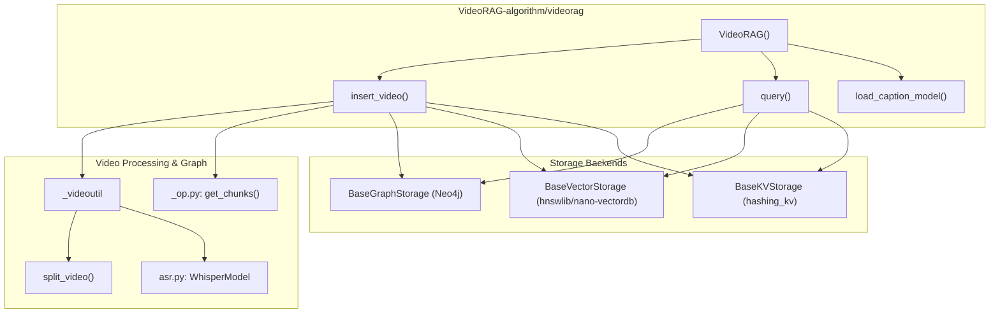
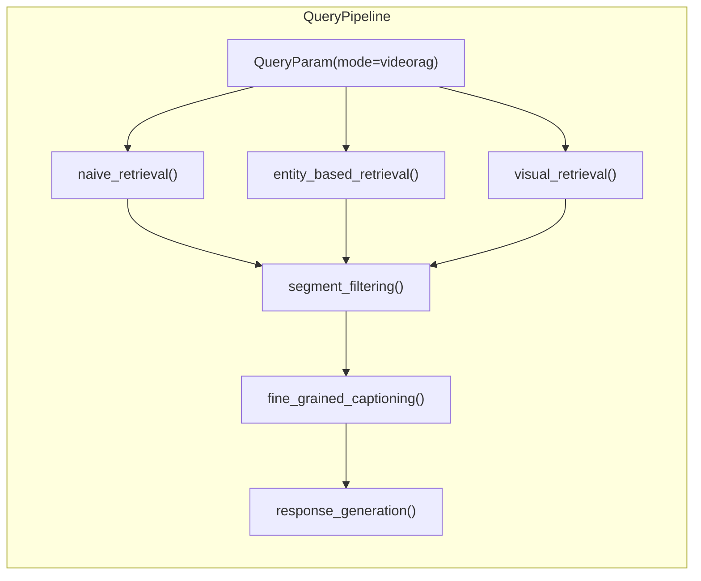

<!-- source: DeepWiki mcp.deepwiki.com · repo HKUDS/VideoRAG · page 3 VideoRAG Framework · fetched 2026-11-09 -->

# VideoRAG Framework

Relevant source files

The following files were used as context for generating this wiki page:

- [VideoRAG-algorithm/README.md](VideoRAG-algorithm/README.md)
- [VideoRAG-algorithm/videorag/_llm.py](VideoRAG-algorithm/videorag/_llm.py)
- [VideoRAG-algorithm/videorag/_op.py](VideoRAG-algorithm/videorag/_op.py)

This page provides an overview of the VideoRAG framework, the core algorithmic engine that powers video understanding in this repository. VideoRAG is a retrieval-augmented generation (RAG) system designed to process and understand extremely long-context videos, spanning from minutes to hundreds of hours on a single NVIDIA RTX 3090 GPU (24GB) [VideoRAG-algorithm/README.md:19-40]().

For information about the desktop application that provides a user interface for VideoRAG, see [Vimo Desktop Application](#2). 

For detailed information about specific subsystems, see the child pages:
- [Dual-Channel Architecture](#3.1) — Detailed explanation of VideoRAG's dual-channel architecture: graph-driven knowledge indexing and hierarchical multimodal context encoding
- [Video Processing Pipeline](#3.2) — Document the video preprocessing workflow including video segmentation, audio extraction, speech-to-text transcription using Whisper, and frame extraction
- [Knowledge Graph Construction](#3.3) — Explain how VideoRAG extracts entities and relationships from video content, builds multi-modal knowledge graphs, and stores them in Neo4j
- [Query Processing](#3.4) — Document the six-stage query pipeline including naive retrieval, entity-based retrieval, visual retrieval, filtering, captioning, and response generation
- [Storage Subsystem](#3.5) — Explain the multi-modal storage architecture including Neo4j graph database, vector databases (hnswlib/nano-vectordb), and key-value stores

Sources: [VideoRAG-algorithm/README.md:1-40]()

## System Architecture Overview

The VideoRAG framework combines graph-driven textual knowledge grounding with hierarchical multimodal context encoding to handle hundreds of hours of video content efficiently [VideoRAG-algorithm/README.md:31-38](). The main programmatic interface is provided by the `VideoRAG` class (`videorag/__init__.py`), which orchestrates video ingestion, indexing, and multi-stage query execution [VideoRAG-algorithm/README.md:139-197]().

**Diagram: Bridging Natural Language Concepts to Code Entities (`VideoRAG` class and storage methods)**

Sources: [VideoRAG-algorithm/README.md:139-197](), [VideoRAG-algorithm/videorag/_op.py:1-29]()

## Core Subsystems

### 1. Dual-Channel Architecture

VideoRAG introduces a dual-channel design that synergistically integrates graph-driven textual knowledge grounding for modeling cross-video semantic relationships with hierarchical multimodal context encoding to preserve spatiotemporal visual patterns [VideoRAG-algorithm/README.md:37](). This structure optimizes retrieval efficiency via adaptive multimodal fusion mechanisms [VideoRAG-algorithm/README.md:37]().

For detailed information, see [Dual-Channel Architecture](#3.1).

Sources: [VideoRAG-algorithm/README.md:31-38]()

### 2. Video Processing Pipeline

The video processing pipeline handles raw video files by performing video segmentation, audio extraction via MoviePy, speech-to-text transcription using `WhisperModel` (`videorag/_videoutil/asr.py`), and frame extraction [VideoRAG-algorithm/README.md:74-87](). Videos are split into manageable segments to generate rough captions and visual feature embeddings using ImageBind [VideoRAG-algorithm/README.md:75-80]().

For detailed information, see [Video Processing Pipeline](#3.2).

Sources: [VideoRAG-algorithm/README.md:74-89]()

### 3. Knowledge Graph Construction

After preprocessing, VideoRAG extracts entities and relationships from video content using asynchronous LLM processing (`_op.py`) and constructs multi-modal knowledge graphs persisted in Neo4j (`BaseGraphStorage`) [VideoRAG-algorithm/README.md:42-43](). This graph structure enables 1-hop neighbor traversal and entity-based segment discovery [VideoRAG-algorithm/README.md:37]().

For detailed information, see [Knowledge Graph Construction](#3.3).

Sources: [VideoRAG-algorithm/README.md:37-43](), [VideoRAG-algorithm/videorag/_op.py:181-204]()

### 4. Query Processing

Query execution relies on a robust six-stage pipeline configured via `QueryParam` (`videorag/base.py`) [VideoRAG-algorithm/README.md:188-196](). The stages include naive text retrieval, entity-based retrieval, visual retrieval, segment filtering, fine-grained captioning with MiniCPM-V, and final response generation [VideoRAG-algorithm/README.md:168-197]().

**Diagram: Code Entity Mapping for Query Execution (`QueryParam` and retrieval stages)**

For detailed information, see [Query Processing](#3.4).

Sources: [VideoRAG-algorithm/README.md:168-197](), [VideoRAG-algorithm/videorag/base.py:28]()

### 5. Storage Subsystem

VideoRAG implements a multi-modal storage architecture comprising Neo4j for graph storage (`BaseGraphStorage`), vector databases (`hnswlib` and `nano-vectordb` via `BaseVectorStorage`), and key-value stores (`BaseKVStorage`) for caching and document chunks [VideoRAG-algorithm/README.md:83](). All persistent state is managed within the specified `working_dir` directory [VideoRAG-algorithm/README.md:164]().

For detailed information, see [Storage Subsystem](#3.5).

Sources: [VideoRAG-algorithm/README.md:83-89](), [VideoRAG-algorithm/videorag/base.py:21-29]()

---

