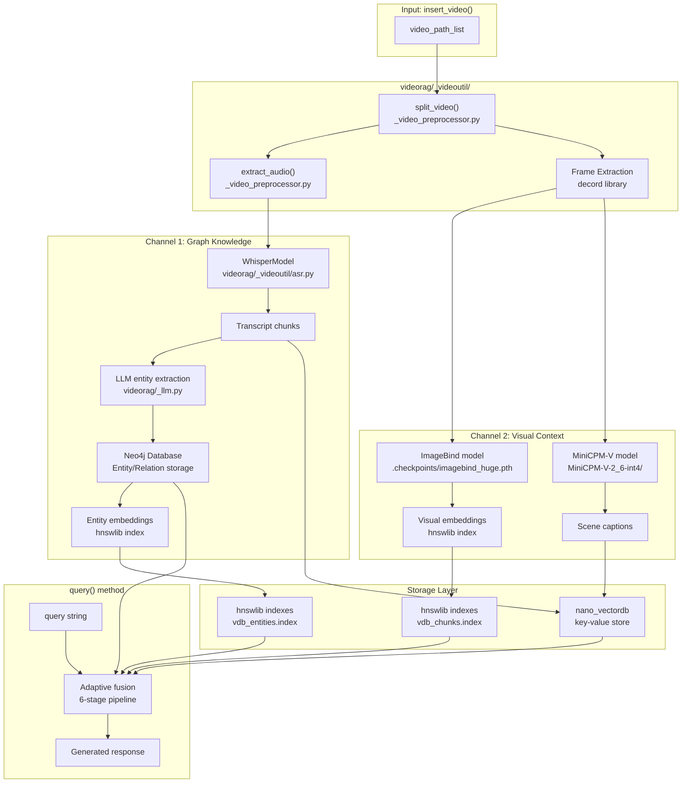
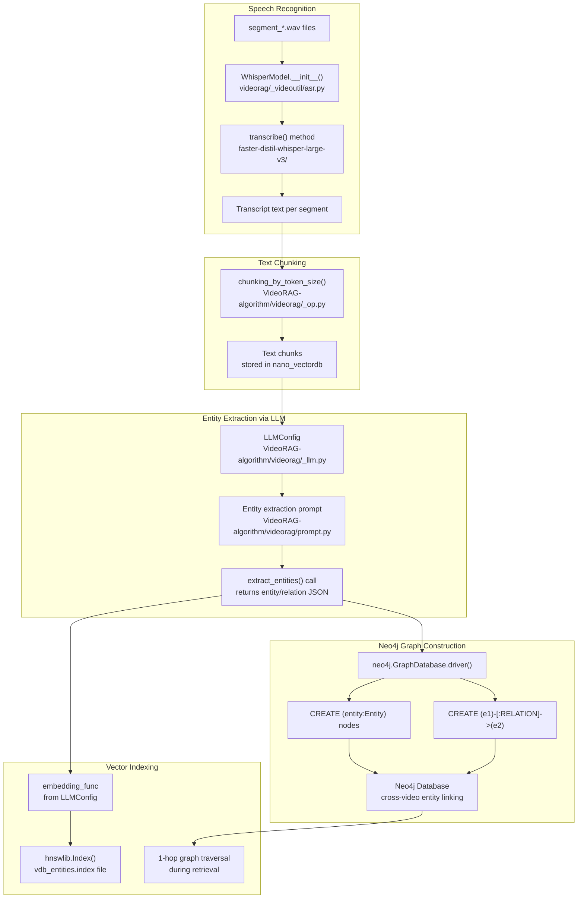
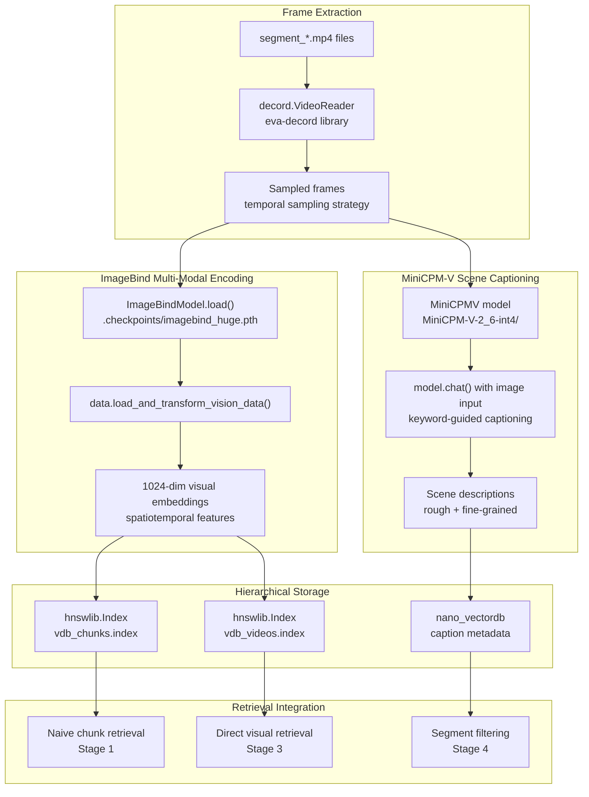
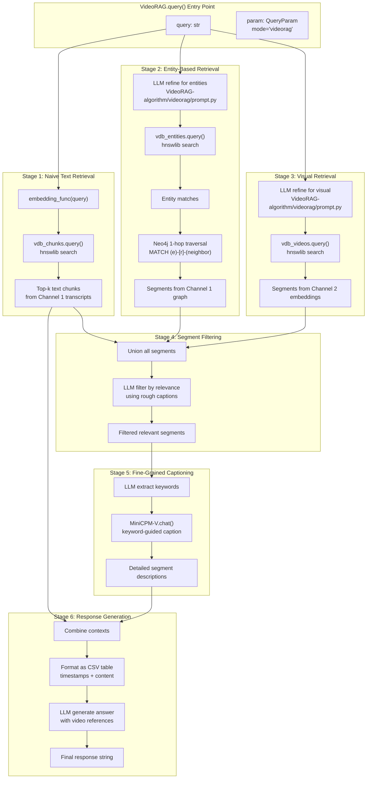
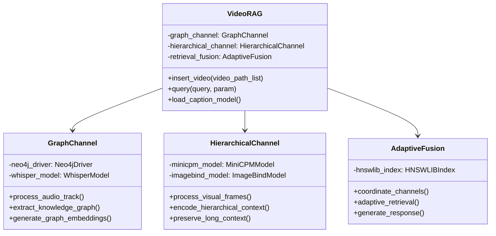

<!-- source: DeepWiki mcp.deepwiki.com · repo HKUDS/VideoRAG · page 3.1 Dual-Channel Architecture · fetched 2026-11-09 -->

# Dual-Channel Architecture

Relevant source files

The following files were used as context for generating this wiki page:

- [VideoRAG-algorithm/README.md](VideoRAG-algorithm/README.md)
- [VideoRAG-algorithm/videorag/_llm.py](VideoRAG-algorithm/videorag/_llm.py)
- [VideoRAG-algorithm/videorag/_op.py](VideoRAG-algorithm/videorag/_op.py)

The dual-channel architecture is the core technical innovation of VideoRAG, enabling processing of extreme long-context videos (hundreds of hours) by decomposing video understanding into two complementary processing streams that operate in parallel and are unified during retrieval.

For the overall VideoRAG framework, see [VideoRAG Framework](#3). For video preprocessing, see [Video Processing Pipeline](#3.2). For graph construction details, see [Knowledge Graph Construction](#3.3). For query processing, see [Query Processing](#3.4).

## Overview

The architecture consists of:

1. **Channel 1: Graph-Driven Knowledge Indexing** - Extracts speech via `WhisperModel`, identifies entities/relations via LLM, constructs knowledge graphs in `Neo4j`, enabling cross-video semantic reasoning
2. **Channel 2: Hierarchical Visual Context Encoding** - Encodes visual frames via `ImageBind`, generates scene descriptions via `MiniCPM-V`, preserves spatiotemporal patterns in hierarchical indexes

Both channels produce vector embeddings stored in `hnswlib` indexes. During query processing, an adaptive fusion mechanism weights each channel based on query characteristics, combining graph-based retrieval with visual similarity search.

Sources: [VideoRAG-algorithm/README.md:36-37]()

## Architecture Overview

**Dual-Channel Processing Flow with Code Components**

Sources: [VideoRAG-algorithm/README.md:139-196]()

## Channel 1: Graph-Driven Knowledge Indexing

Channel 1 constructs structured knowledge representations from video speech content, enabling semantic reasoning across videos.

### Processing Pipeline

**Graph Channel Implementation Flow**

### Key Implementation Details

| Component | File/Class | Configuration |
|-----------|------------|---------------|
| **ASR Model** | [VideoRAG-algorithm/videorag/_videoutil/asr.py]() `WhisperModel` | Model path: `faster-distil-whisper-large-v3/` |
| **LLM Provider** | [VideoRAG-algorithm/videorag/_llm.py]() `LLMConfig` | Defaults: `openai_4o_mini_config`, configurable via `ollama_config`, `deepseek_config` |
| **Graph Database** | `neo4j` driver | Connection configured in `VideoRAG.__init__()` |
| **Entity Embeddings** | `hnswlib.Index` | Stored in `vdb_entities.index`, dimensionality from `embedding_dim` |
| **Entity Storage** | `nano_vectordb.NanoVectorDB` | Key-value store for entity descriptions |

The graph structure enables cross-video reasoning: entities extracted from different videos are linked if they share semantic similarity (measured via embedding distance). During retrieval, 1-hop graph traversal expands entity-based results to include related entities.

Sources: [VideoRAG-algorithm/README.md:83-84](), [VideoRAG-algorithm/README.md:139-166]()

## Channel 2: Hierarchical Visual Context Encoding

Channel 2 preserves spatiotemporal visual patterns that cannot be captured through text alone, maintaining visual coherence across long video sequences.

### Processing Architecture

**Visual Context Encoding Implementation**

### Multi-Modal Model Integration

| Model | Files/Classes | Purpose |
|-------|--------------|---------|
| **ImageBind** | Checkpoint: `.checkpoints/imagebind_huge.pth` Import: `--no-deps git+https://github.com/facebookresearch/ImageBind.git` | Generates 1024-dim multi-modal embeddings binding visual and textual semantics |
| **MiniCPM-V** | Model dir: `MiniCPM-V-2_6-int4/` Loading: `transformers.AutoModel.from_pretrained()` | Produces vision-language captions, both rough (during indexing) and fine-grained (during retrieval Stage 5) |
| **PyTorchVideo** | Custom fork: `git+https://github.com/facebookresearch/pytorchvideo.git` Used via `decord` | Handles efficient video frame decoding |

The hierarchical structure is achieved through two-level indexing:
1. **Chunk-level**: Individual video segments indexed via `vdb_chunks.index` (fine-grained retrieval)
2. **Video-level**: Entire video representations indexed via `vdb_videos.index` (coarse-grained retrieval)

This hierarchy enables efficient retrieval across videos of any length by first identifying relevant videos, then drilling down to specific segments.

Sources: [VideoRAG-algorithm/README.md:77-80](), [VideoRAG-algorithm/README.md:99-109]()

## Adaptive Fusion and Retrieval

The dual channels converge during query processing through a 6-stage retrieval pipeline that adaptively weights each channel based on query characteristics.

**6-Stage Retrieval Pipeline Coordinating Both Channels**

### Adaptive Weighting Mechanism

The system balances channels based on query and content characteristics:

| Stage | Channel 1 Contribution | Channel 2 Contribution | Adaptive Factor |
|-------|----------------------|----------------------|-----------------|
| **Stage 1** | Text chunks from transcripts | - | Query semantic similarity |
| **Stage 2** | Entity graph traversal | - | Entity density in query |
| **Stage 3** | - | Visual similarity search | Visual keyword presence |
| **Stage 4** | Rough captions (text) | Rough captions (visual) | Combined relevance scoring |
| **Stage 5** | - | Fine-grained visual captions | Keyword-guided generation |
| **Stage 6** | Text chunks | Visual captions | Unified context assembly |

The `QueryParam.mode` setting controls pipeline behavior:
- `mode="videorag"`: Full 6-stage pipeline with both channels
- `mode="naive"`: Stage 1 only (text-based baseline)
- `mode="hybrid"`: Adaptive stage selection based on query

Sources: [VideoRAG-algorithm/README.md:45-46](), [VideoRAG-algorithm/README.md:188-196]()

## Implementation Details

The dual-channel architecture is implemented through the core `VideoRAG` class and its supporting components.

**Core Implementation Structure**

Sources: [VideoRAG-algorithm/README.md:151-166](), [VideoRAG-algorithm/README.md:182-196]()

### Performance Characteristics

The dual-channel architecture achieves exceptional performance metrics:

- **Scalability**: Process 100+ hours on single RTX 3090 GPU
- **Efficiency**: Structured indexing reduces memory footprint by orders of magnitude
- **Accuracy**: Outperforms existing methods on LongerVideos benchmark
- **Responsiveness**: Sub-second query response times for most queries

Sources: [VideoRAG-algorithm/README.md:39-41](), [VideoRAG-algorithm/README.md:121-124]()

Sources: [VideoRAG-algorithm/README.md:36-196](), [VideoRAG-algorithm/videorag/_op.py:35-120](), [VideoRAG-algorithm/videorag/_llm.py:44-84]()

---

