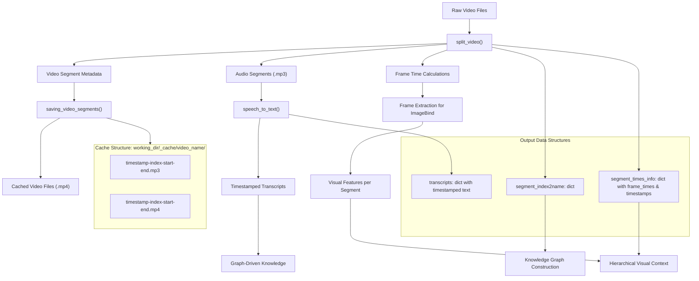
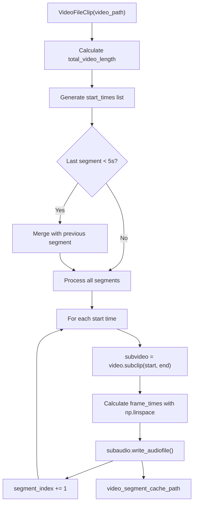
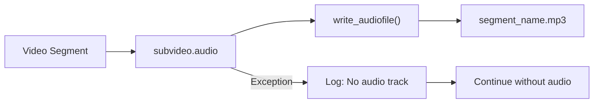
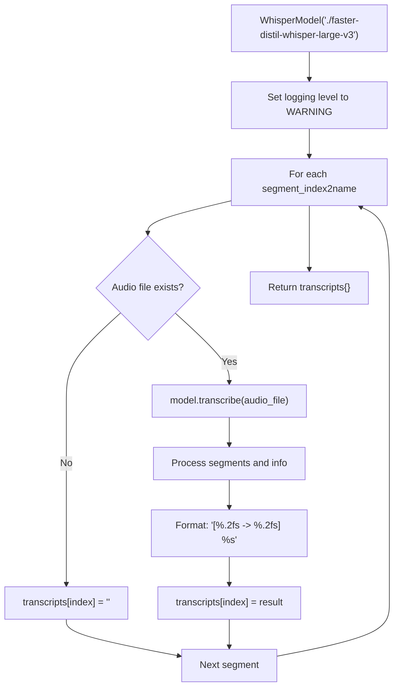
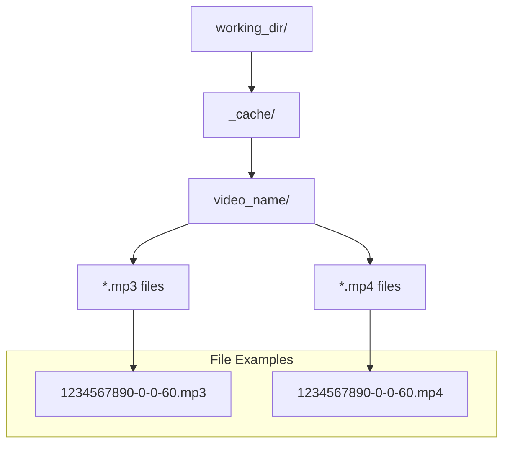

<!-- source: DeepWiki mcp.deepwiki.com · repo HKUDS/VideoRAG · page 3.2 Video Processing Pipeline · fetched 2026-11-09 -->

# Video Processing Pipeline

<details>
<summary>Relevant source files</summary>

The following files were used as context for generating this wiki page:

- [VideoRAG-algorithm/videorag/_videoutil/asr.py](VideoRAG-algorithm/videorag/_videoutil/asr.py)
- [VideoRAG-algorithm/videorag/_videoutil/split.py](VideoRAG-algorithm/videorag/_videoutil/split.py)

</details>


This document covers the video preprocessing stage of the VideoRAG framework, which handles video segmentation, audio extraction, and speech-to-text processing. The pipeline transforms raw video files into structured, timestamped segments with corresponding transcripts that can be indexed by the dual-channel architecture.

For information about how these processed segments are used in knowledge construction, see page 3.3 (Knowledge Graph Construction). For details about the overall VideoRAG architecture, see page 3.1 (Dual-Channel Architecture).

## Pipeline Overview

The video processing pipeline consists of three main stages that convert raw video files into structured, searchable content. The pipeline is designed to handle extremely long videos efficiently by breaking them into manageable segments while preserving temporal context.

### Pipeline Flow Diagram



Sources: [VideoRAG-algorithm/videorag/_videoutil/split.py:10-80](), [VideoRAG-algorithm/videorag/_videoutil/asr.py:8-30]()

## Video Segmentation Process

The `split_video()` function [VideoRAG-algorithm/videorag/_videoutil/split.py:10-59]() serves as the entry point for video processing, handling the segmentation of input videos into fixed-length chunks while extracting audio streams.

### Core Segmentation Logic

| Parameter | Type | Purpose |
|-----------|------|---------|
| `video_path` | str | Path to input video file |
| `working_dir` | str | Base directory for cache storage |
| `segment_length` | int | Duration of each segment in seconds |
| `num_frames_per_segment` | int | Number of frames to extract per segment |
| `audio_output_format` | str | Audio format (default: 'mp3') |

The segmentation process creates two key data structures:

- **`segment_index2name`**: Dictionary mapping segment indices (as strings) to unique filename identifiers
- **`segment_times_info`**: Dictionary containing `frame_times` (numpy array of frame timestamps) and `timestamp` tuple (start, end) for each segment

These structures are returned by `split_video()` [VideoRAG-algorithm/videorag/_videoutil/split.py:59]() and used throughout the VideoRAG pipeline for indexing and retrieval operations.

### Segmentation Algorithm



Sources: [VideoRAG-algorithm/videorag/_videoutil/split.py:26-58]()

### File Naming Convention

The system generates unique identifiers for each segment using the pattern:
`{unique_timestamp}-{segment_index}-{start_time}-{end_time}`

Where `unique_timestamp` is created using `int(time.time() * 1000)` [VideoRAG-algorithm/videorag/_videoutil/split.py:17]() to ensure uniqueness across processing sessions. This naming convention allows the system to identify segment temporal boundaries directly from the filename.

## Audio Extraction and Processing

Audio extraction occurs simultaneously with video segmentation, creating MP3 files for each segment that will be processed by the speech recognition system [VideoRAG-algorithm/videorag/_videoutil/split.py:48-55]().

### Audio Processing Details

The audio extraction process handles edge cases such as videos without audio tracks, logging warnings when audio extraction fails [VideoRAG-algorithm/videorag/_videoutil/split.py:54-55]().



Sources: [VideoRAG-algorithm/videorag/_videoutil/split.py:48-56]()

## Speech Recognition Pipeline

The `speech_to_text()` function [VideoRAG-algorithm/videorag/_videoutil/asr.py:8-30]() processes the extracted audio segments using the Faster Whisper model to generate timestamped transcripts.

### ASR Configuration

The speech recognition system uses the `faster-distil-whisper-large-v3` model loaded from the local directory structure via `WhisperModel("./faster-distil-whisper-large-v3")` [VideoRAG-algorithm/videorag/_videoutil/asr.py:9](). The system is configured to suppress verbose logging [VideoRAG-algorithm/videorag/_videoutil/asr.py:10]().

### Transcript Processing



Sources: [VideoRAG-algorithm/videorag/_videoutil/asr.py:8-30]()

### Transcript Format

Each transcript entry in the `transcripts` dictionary contains timestamped text in the format generated by the Whisper model:
```
[start_time -> end_time] transcribed_text
```

Example output:
```
[0.00s -> 3.50s] Welcome to this video tutorial.
[3.50s -> 7.20s] Today we'll be discussing machine learning.
```

**Important**: The transcript timing is relative to the individual segment, not the original video timeline. To obtain the absolute timestamp in the full video, add the segment's start time from `segment_times_info[index]["timestamp"][0]`.

## Cache Management and File Structure

The video processing pipeline creates a structured cache system within the working directory to manage processed segments efficiently.

### Directory Structure



The cache directory is recreated for each video processing session [VideoRAG-algorithm/videorag/_videoutil/split.py:19-22](), ensuring clean state between runs.

### Parallel Video Saving

The `saving_video_segments()` function [VideoRAG-algorithm/videorag/_videoutil/split.py:61-80]() operates as a separate process to save video segments to disk without blocking the main processing pipeline. This function includes error handling through a queue-based mechanism [VideoRAG-algorithm/videorag/_videoutil/split.py:67-79]().

Sources: [VideoRAG-algorithm/videorag/_videoutil/split.py:61-80](), [VideoRAG-algorithm/videorag/_videoutil/asr.py:12-28]()

## Integration with VideoRAG Framework

The video processing pipeline produces structured outputs that integrate directly with the VideoRAG dual-channel architecture. The processed segments and transcripts feed into both the graph-driven knowledge indexing and hierarchical context encoding channels.

The pipeline's output format ensures compatibility with the multi-modal embedding and knowledge graph construction processes described in subsequent framework components.

Sources: [VideoRAG-algorithm/videorag/_videoutil/split.py:1-80](), [VideoRAG-algorithm/videorag/_videoutil/asr.py:1-30]()

---

