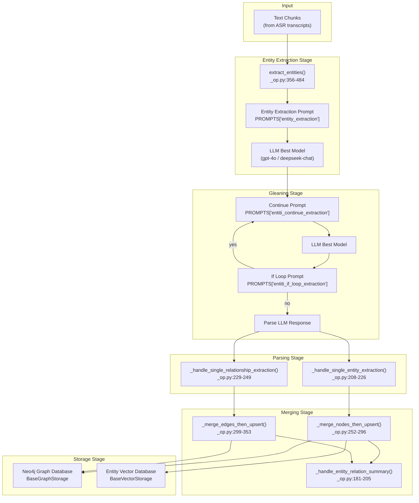
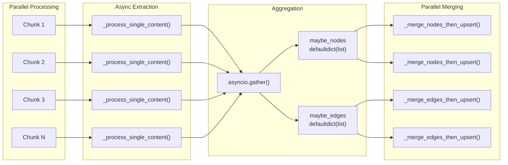
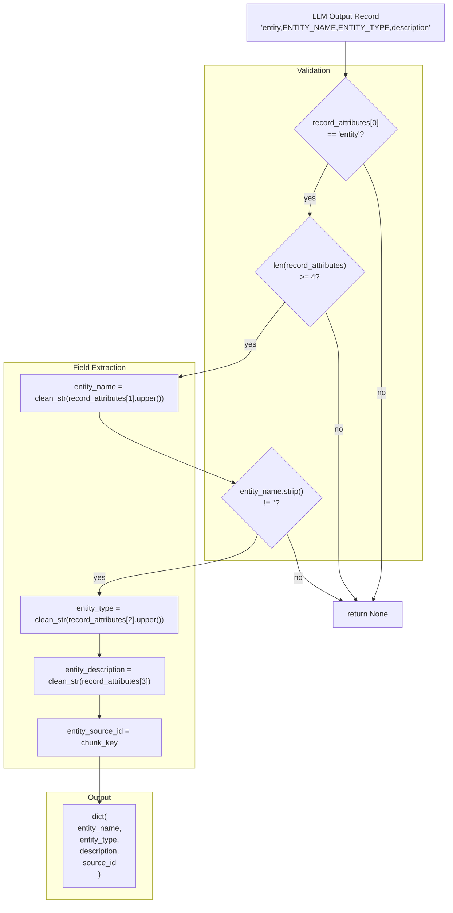
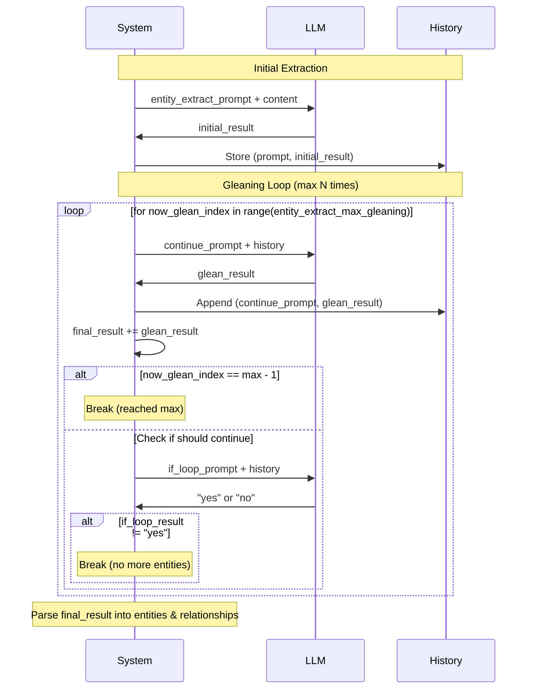
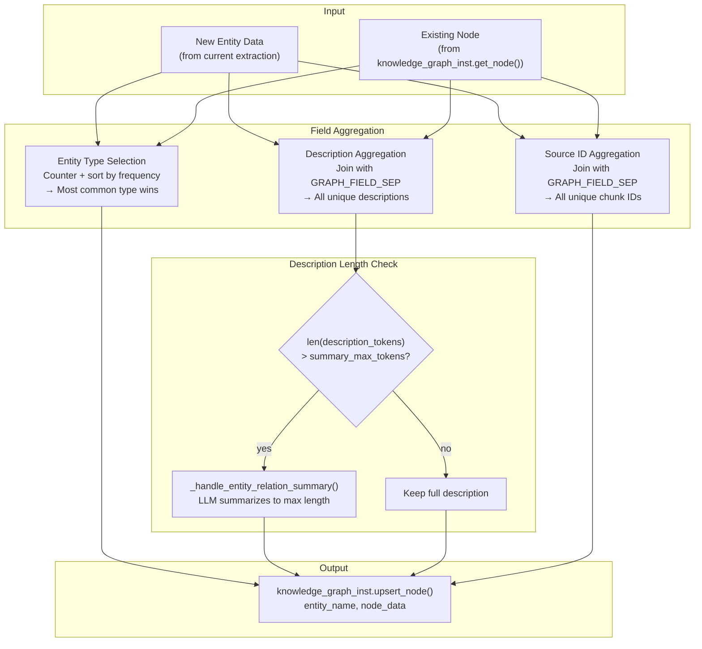
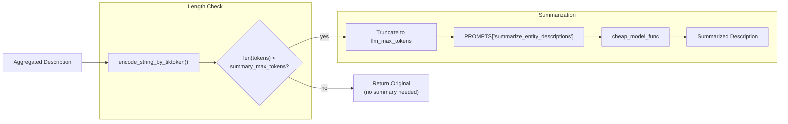
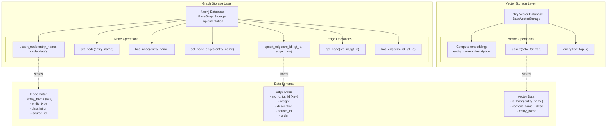

<!-- source: DeepWiki mcp.deepwiki.com · repo HKUDS/VideoRAG · page 3.3 Knowledge Graph Construction · fetched 2026-11-09 -->

# Knowledge Graph Construction

<details>
<summary>Relevant source files</summary>

The following files were used as context for generating this wiki page:

- [VideoRAG-algorithm/videorag/_llm.py](VideoRAG-algorithm/videorag/_llm.py)
- [VideoRAG-algorithm/videorag/_op.py](VideoRAG-algorithm/videorag/_op.py)

</details>


## Purpose and Scope

This page documents the knowledge graph construction subsystem within VideoRAG, which transforms unstructured video transcripts and segments into a structured, queryable knowledge graph. The knowledge graph serves as one of the two primary channels in VideoRAG's dual-channel architecture (for the other channel, see [Dual-Channel Architecture](#3.1)).

The construction process extracts entities and relationships from text chunks using LLM-based extraction, then stores them in a Neo4j graph database with corresponding vector embeddings for semantic retrieval. This structured representation enables cross-video semantic relationship modeling and supports entity-based retrieval during query processing (see [Query Processing](#3.4) for retrieval mechanisms).

## Knowledge Graph Construction Pipeline

The knowledge graph is built from text chunks that have been generated from video segment transcripts. The pipeline consists of four main stages: entity extraction, relationship extraction, node merging, and graph storage.

### Pipeline Architecture



**Sources:** [VideoRAG-algorithm/videorag/_op.py:356-484](), [VideoRAG-algorithm/videorag/_op.py:208-226](), [VideoRAG-algorithm/videorag/_op.py:229-249](), [VideoRAG-algorithm/videorag/_op.py:252-296](), [VideoRAG-algorithm/videorag/_op.py:299-353]()

### Data Flow and Async Processing

The knowledge graph construction is designed for high-throughput parallel processing using Python's `asyncio` framework. The `extract_entities` function processes all chunks concurrently, limited only by the LLM provider's rate limits and the configured `best_model_max_async` parameter.



**Sources:** [VideoRAG-algorithm/videorag/_op.py:447-470]()

## Entity and Relationship Extraction

### LLM-Based Extraction Process

The extraction process uses a structured prompt format with specific delimiters to guide the LLM in generating parseable output. The system employs a "gleaning" technique—multiple iterative passes over the same content to extract additional entities that may have been missed in the first pass.

**Key Configuration Parameters:**

| Parameter | Location | Purpose |
|-----------|----------|---------|
| `entity_extract_max_gleaning` | `global_config` | Maximum number of gleaning iterations per chunk (default: typically 1-2) |
| `DEFAULT_TUPLE_DELIMITER` | `PROMPTS` | Separates fields within entity/relationship records |
| `DEFAULT_RECORD_DELIMITER` | `PROMPTS` | Separates multiple entity/relationship records |
| `DEFAULT_COMPLETION_DELIMITER` | `PROMPTS` | Marks the end of extraction output |
| `DEFAULT_ENTITY_TYPES` | `PROMPTS` | Expected entity type categories |

**Sources:** [VideoRAG-algorithm/videorag/_op.py:363-376](), [VideoRAG-algorithm/videorag/prompt.py]()

### Entity Extraction Record Format

When the LLM extracts entities, it produces records in the following format:

```
("entity"<TUPLE_DELIMITER><ENTITY_NAME><TUPLE_DELIMITER><ENTITY_TYPE><TUPLE_DELIMITER><ENTITY_DESCRIPTION>)
```

The `_handle_single_entity_extraction` function parses these records:



**Sources:** [VideoRAG-algorithm/videorag/_op.py:208-226]()

### Relationship Extraction Record Format

Relationships follow a similar structure:

```
("relationship"<TUPLE_DELIMITER><SOURCE_ENTITY><TUPLE_DELIMITER><TARGET_ENTITY><TUPLE_DELIMITER><DESCRIPTION><TUPLE_DELIMITER><WEIGHT>)
```

The `_handle_single_relationship_extraction` function parses these:

| Field | Processing | Purpose |
|-------|------------|---------|
| `record_attributes[0]` | Must equal `"relationship"` | Record type identifier |
| `record_attributes[1]` | `clean_str(...).upper()` → `source` | Source entity name (normalized to uppercase) |
| `record_attributes[2]` | `clean_str(...).upper()` → `target` | Target entity name (normalized to uppercase) |
| `record_attributes[3]` | `clean_str(...)` → `edge_description` | Relationship description |
| `record_attributes[-1]` | `float(...)` if regex match, else `1.0` → `weight` | Relationship strength |
| `chunk_key` | Passed as context → `edge_source_id` | Source chunk reference |

**Sources:** [VideoRAG-algorithm/videorag/_op.py:229-249]()

### Gleaning: Iterative Extraction

The gleaning process performs multiple extraction passes to capture entities and relationships that might be missed in a single pass:



**Sources:** [VideoRAG-algorithm/videorag/_op.py:389-403]()

## Node and Edge Merging

### Entity Node Merging Strategy

Multiple extraction passes and overlapping chunks may produce duplicate entities. The `_merge_nodes_then_upsert` function handles deduplication and aggregation:

**Entity Merge Logic:**



**Sources:** [VideoRAG-algorithm/videorag/_op.py:252-296](), [VideoRAG-algorithm/videorag/_op.py:268-282]()

### Relationship Edge Merging Strategy

Relationships between entities are merged with weight accumulation and description aggregation:

**Edge Merge Logic:**

| Field | Merge Strategy | Rationale |
|-------|----------------|-----------|
| `weight` | `sum(all_weights)` | Accumulate evidence strength across mentions |
| `description` | `GRAPH_FIELD_SEP.join(sorted(set(...)))` | Keep all unique descriptions |
| `source_id` | `GRAPH_FIELD_SEP.join(set(...))` | Track all source chunks |
| `order` | `min(all_orders)` | Preserve earliest mention order |

**Automatic Node Creation:**

If either the source or target entity doesn't exist in the graph, the system automatically creates placeholder nodes with type `"UNKNOWN"`:

**Sources:** [VideoRAG-algorithm/videorag/_op.py:299-353](), [VideoRAG-algorithm/videorag/_op.py:328-337]()

### Description Summarization

When entity or relationship descriptions exceed the maximum token limit, they are summarized using the cheap LLM model:



**Configuration Parameters:**
- `entity_summary_to_max_tokens`: Target length for summaries (from `global_config`)
- `cheap_model_max_token_size`: Maximum input tokens for cheap model (from `llm` config)
- `tiktoken_model_name`: Tokenizer model name (from `global_config`)

**Sources:** [VideoRAG-algorithm/videorag/_op.py:181-205]()

## Graph Storage Architecture

### Storage Components

The knowledge graph uses a multi-tier storage architecture combining Neo4j for graph structure and vector databases for semantic search:



**Sources:** [VideoRAG-algorithm/videorag/_op.py:356-484](), [VideoRAG-algorithm/videorag/_op.py:475-483](), [VideoRAG-algorithm/videorag/base.py]()

### Entity Vector Database Integration

After nodes are merged and upserted to Neo4j, their embeddings are computed and stored in a vector database for semantic retrieval.

**Key Design Decisions:**

1. **Content Composition**: Entity name and description are concatenated for embedding to capture both identity and semantics
2. **Hash ID Generation**: `compute_mdhash_id` creates deterministic IDs with `"ent-"` prefix for deduplication
3. **Metadata Preservation**: Original `entity_name` stored separately for retrieval mapping back to graph nodes

**Sources:** [VideoRAG-algorithm/videorag/_op.py:476-483]()

## Data Schemas and Field Semantics

### Node Schema

| Field | Type | Description | Example |
|-------|------|-------------|---------|
| `entity_name` | `str` | Normalized entity identifier (UPPERCASE) | `"IMAGEBIND MODEL"` |
| `entity_type` | `str` | Category of entity | `"TECHNOLOGY"`, `"PERSON"`, `"ORGANIZATION"` |
| `description` | `str` | Aggregated descriptions (GRAPH_FIELD_SEP-separated if multiple) | `"A multi-modal AI model"` |
| `source_id` | `str` | Chunk IDs where entity appears (GRAPH_FIELD_SEP-separated) | `"chunk-abc123<GRAPH_FIELD_SEP>chunk-def456"` |

### Edge Schema

| Field | Type | Description | Example |
|-------|------|-------------|---------|
| `src_id` | `str` | Source entity name | `"VIDEORAG FRAMEWORK"` |
| `tgt_id` | `str` | Target entity name | `"IMAGEBIND MODEL"` |
| `weight` | `float` | Accumulated relationship strength | `3.0` (mentioned 3 times) |
| `description` | `str` | Aggregated relationship descriptions | `"uses for embeddings"` |
| `source_id` | `str` | Chunk IDs where relationship appears | `"chunk-abc123"` |
| `order` | `int` | Earliest mention order (optional) | `1` |

**Sources:** [VideoRAG-algorithm/videorag/_op.py:286-293](), [VideoRAG-algorithm/videorag/_op.py:341-346]()

## Integration with Query Processing

The constructed knowledge graph serves as a key component in VideoRAG's entity-based retrieval mechanism. During query processing:

1. **Entity Retrieval**: User query is embedded and matched against `entity_vdb` to find relevant entities
2. **Graph Traversal**: Retrieved entities' neighbors are explored via `get_node_edges()` to find related entities
3. **Text Unit Resolution**: Entity `source_id` fields map back to original text chunks and video segments
4. **Ranking**: Graph structure (relation counts) influences chunk relevance scoring

```mermaid
graph LR
    QUERY["User Query"]
    
    subgraph "Entity-Based Retrieval"
        EMB["Embed Query"]
        SEARCH["entity_vdb.query()<br/>top_k entities"]
        NODES["Retrieved Entity Nodes"]
    end
    
    subgraph "Graph Traversal"
        EDGES["knowledge_graph_inst.get_node_edges()"]
        NEIGHBORS["1-hop Neighbor Entities"]
        NEIGHBOR_DATA["get_node() for neighbors"]
    end
    
    subgraph "Chunk Resolution"
        SOURCE_IDS["Extract source_id fields"]
        CHUNKS["text_chunks_db.get_by_id()"]
        SEGMENTS["Map to video segments"]
    end
    
    QUERY --> EMB
    EMB --> SEARCH
    SEARCH --> NODES
    NODES --> EDGES
    EDGES --> NEIGHBORS
    NEIGHBORS --> NEIGHBOR_DATA
    NODES --> SOURCE_IDS
    NEIGHBOR_DATA --> SOURCE_IDS
    SOURCE_IDS --> CHUNKS
    CHUNKS --> SEGMENTS
```



**Sources:** [VideoRAG-algorithm/videorag/_op.py:487-545]()

## Performance Considerations

### Async Concurrency Limits

The knowledge graph construction is rate-limited by LLM provider constraints via `best_model_max_async` and `cheap_model_max_async`, configured in `LLMConfig` [VideoRAG-algorithm/videorag/_llm.py:157-176]().

### Caching Strategy

To avoid redundant LLM calls, the system implements a caching layer using `hashing_kv` and `compute_args_hash` in `openai_complete_if_cache` [VideoRAG-algorithm/videorag/_llm.py:92-120]().

**Sources:** [VideoRAG-algorithm/videorag/_llm.py:92-120](), [VideoRAG-algorithm/videorag/_llm.py:157-176]()

---

