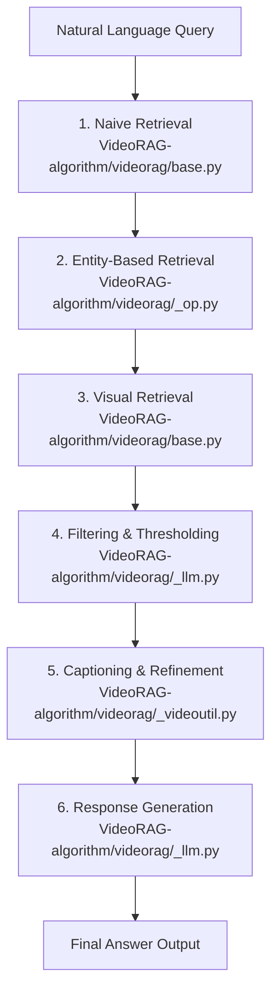
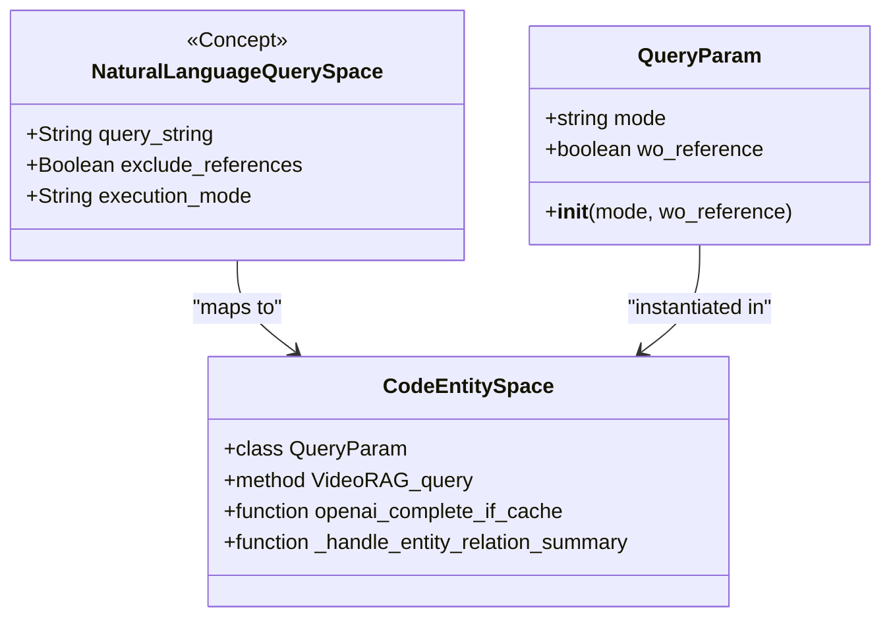
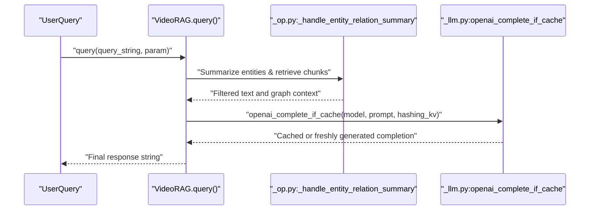

<!-- source: DeepWiki mcp.deepwiki.com · repo HKUDS/VideoRAG · page 3.4 Query Processing · fetched 2026-11-09 -->

# Query Processing

Relevant source files

The following files were used as context for generating this wiki page:

- [VideoRAG-algorithm/videorag/_llm.py](VideoRAG-algorithm/videorag/_llm.py)
- [VideoRAG-algorithm/videorag/_op.py](VideoRAG-algorithm/videorag/_op.py)

This document details the query processing subsystem of the VideoRAG framework. It defines how natural language queries are ingested and transformed through a six-stage pipeline comprising naive retrieval, entity-based retrieval, visual retrieval, filtering, captioning, and final response generation.

For details on the underlying multi-modal retrieval mechanisms, see [Basic Video Processing](#6.1). For details about LLM integration and response generation, see [LLM Integration](#5).

## The Six-Stage Query Pipeline

The VideoRAG system processes user queries via a sequential six-stage pipeline implemented across core algorithm modules. The pipeline bridges natural language query strings to underlying code entities such as `VideoRAG.query()`, `QueryParam`, vector indices (`BaseVectorStorage`), graph stores (`BaseGraphStorage`), caption utilities (`retrieved_segment_caption`), and LLM completion functions (`best_model_func`).

**Six-Stage Query Pipeline Architecture**

Sources: [VideoRAG-algorithm/videorag/_op.py:1-33](), [VideoRAG-algorithm/videorag/_llm.py:44-121]()

---

### Stage 1: Naive Retrieval
The pipeline begins by analyzing the raw query string and extracting baseline text chunks or tokens using standard splitting mechanisms (`chunking_by_token_size` or `chunking_by_seperators` in `[VideoRAG-algorithm/videorag/_op.py:35-155]()`). This provides an initial set of candidate text segments from the underlying key-value stores (`BaseKVStorage`).

Sources: [VideoRAG-algorithm/videorag/_op.py:35-155](), [VideoRAG-algorithm/videorag/base.py:21-29]()

---

### Stage 2: Entity-Based Retrieval
Using the graph-driven channel, the system queries the knowledge graph (Neo4j) via graph storage abstractions (`BaseGraphStorage`) to extract relevant entities, relationships, and multi-hop neighbor descriptions. Summarization helpers (`_handle_entity_relation_summary` in `[VideoRAG-algorithm/videorag/_op.py:181-204]()`) condense descriptions using the cheap model function (`cheap_model_func`) when token sizes exceed thresholds.

Sources: [VideoRAG-algorithm/videorag/_op.py:181-204](), [VideoRAG-algorithm/videorag/base.py:21-29]()

---

### Stage 3: Visual Retrieval
Parallel or subsequent vector searches execute against multi-modal vector embeddings stored in HNSWLIB or NanoVectorDB (`BaseVectorStorage`). This retrieves video segment IDs, visual frame embeddings, and spatial-temporal features corresponding to the query semantics.

Sources: [VideoRAG-algorithm/videorag/base.py:21-29]()

---

### Stage 4: Filtering and Pruning
Retrieved candidates from both graph and vector search are filtered based on relevance thresholds (such as `query_better_than_threshold` defined in `LLMConfig` at `[VideoRAG-algorithm/videorag/_llm.py:44-64]()`). Low-scoring contexts are pruned to maintain high signal-to-noise ratios before downstream context assembly.

Sources: [VideoRAG-algorithm/videorag/_llm.py:44-64]()

---

### Stage 5: Captioning Integration
The filtered segment IDs trigger visual captioning routines (`retrieved_segment_caption` from `[VideoRAG-algorithm/videorag/_videoutil.py:32-33]()`). The system ensures the caption model is loaded via `load_caption_model()` to synthesize detailed visual descriptions for the matched video frames.

Sources: [VideoRAG-algorithm/videorag/_videoutil.py:32-33]()

---

### Stage 6: Response Generation
The assembled context—incorporating text chunks, graph summaries, and visual captions—is bundled into prompt templates and passed to the LLM completion runner (`openai_complete_if_cache` in `[VideoRAG-algorithm/videorag/_llm.py:91-121]()`). Caching via `hashing_kv` and retry logic (`tenacity` decorators) ensure reliable response output.

Sources: [VideoRAG-algorithm/videorag/_llm.py:7-121]()

---

## QueryParam Configuration and Code Entity Mapping

The `QueryParam` class configures query execution parameters. The following diagram bridges natural language configuration concepts to their exact code symbols in the repository.

**Natural Language to Code Entity Space Mapping**

| Parameter | Type | Code Symbol / Reference | Default |
|-----------|------|-------------------------|---------|
| `mode` | string | `QueryParam.mode` | `"videorag"` |
| `wo_reference` | boolean | `QueryParam.wo_reference` | `False` |

Sources: [VideoRAG-algorithm/videorag/base.py:28-29](), [VideoRAG-algorithm/videorag/_llm.py:91-121]()

---

## Execution Sequence and Subsystem Integration

The sequence below illustrates how `VideoRAG.query()` coordinates text chunking, graph search, visual retrieval, and LLM response generation.

**Query Execution Sequence Diagram**

Sources: [VideoRAG-algorithm/videorag/_op.py:181-204](), [VideoRAG-algorithm/videorag/_llm.py:91-121]()

---

