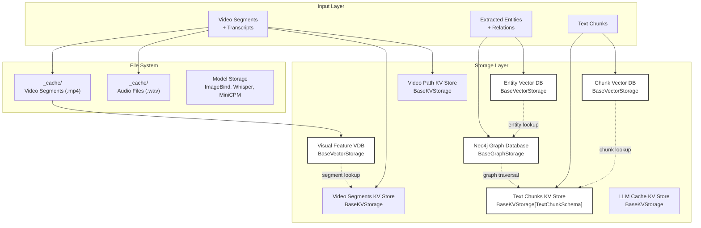
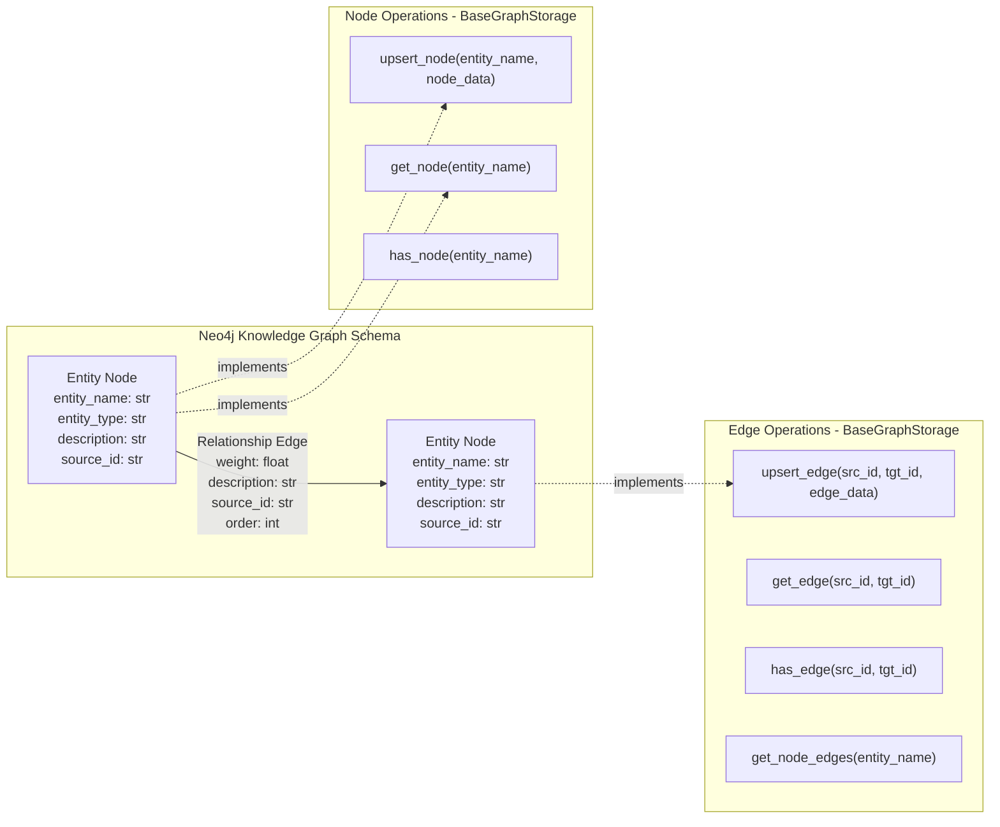
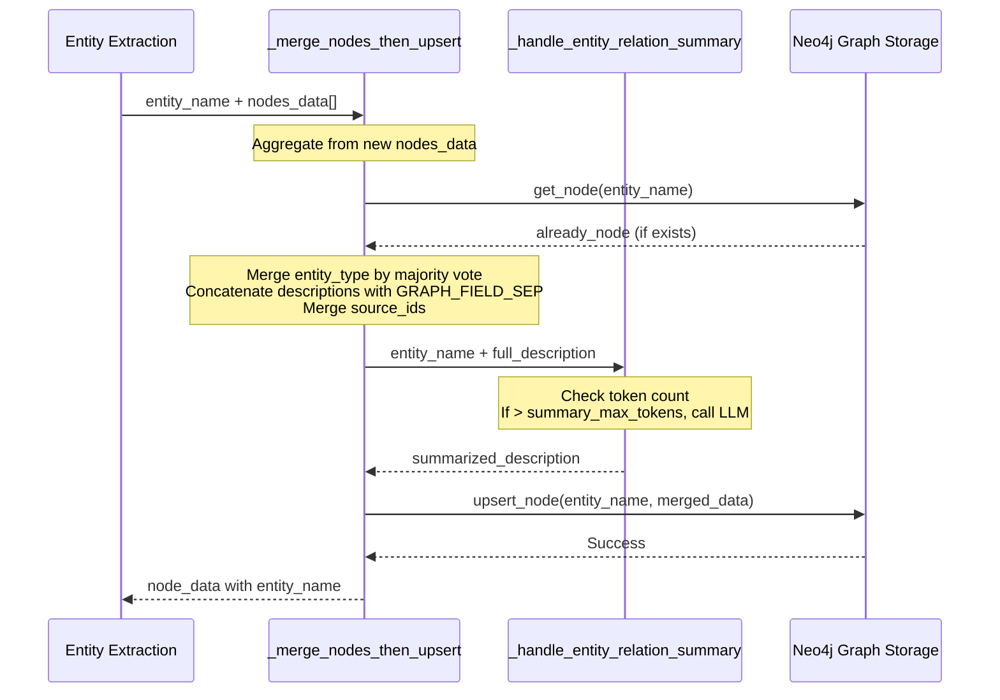
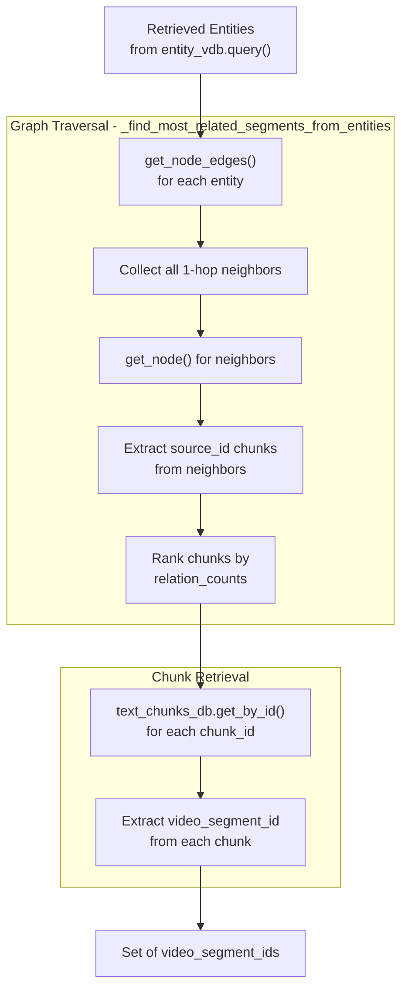
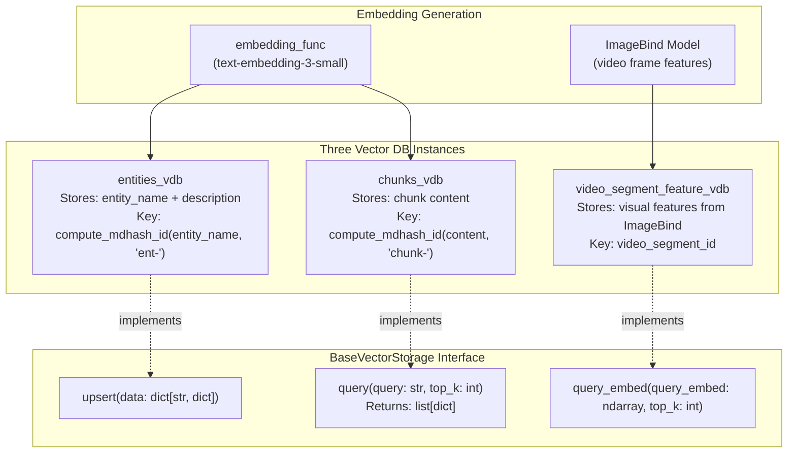
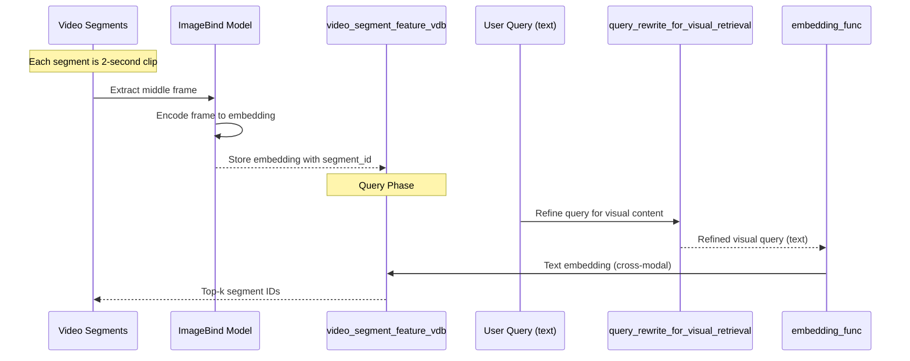
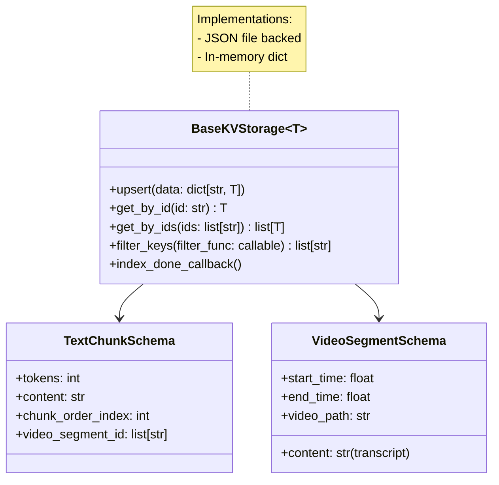
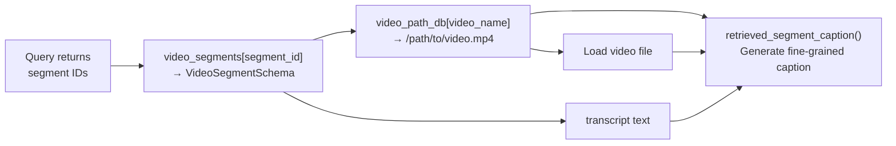
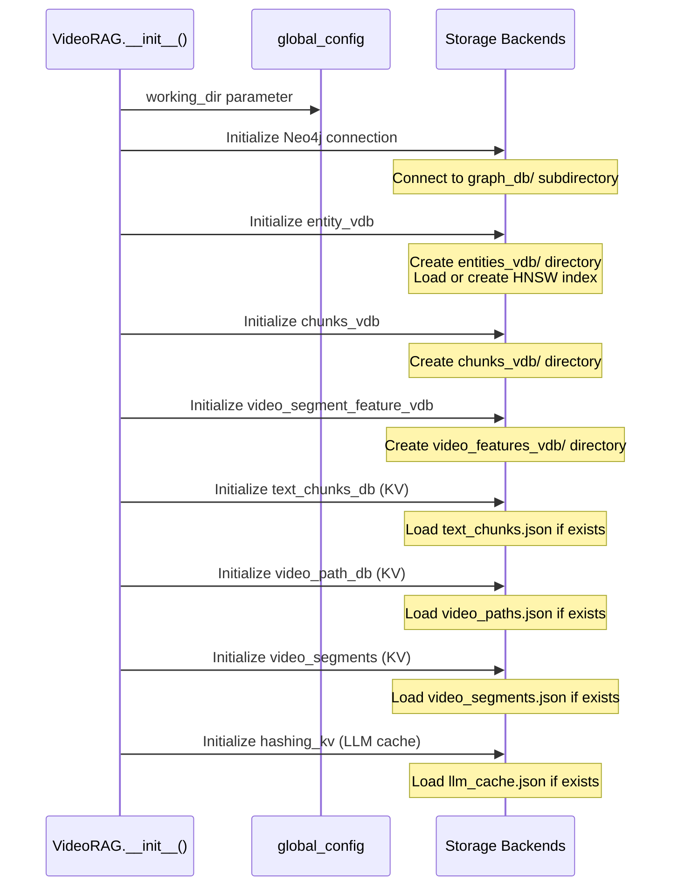
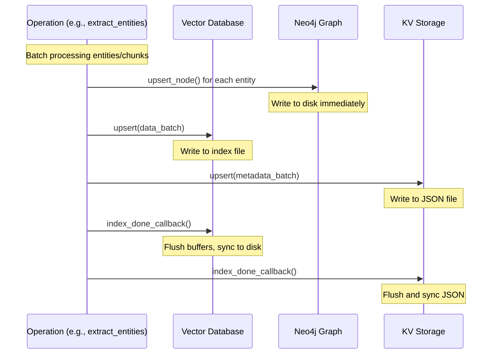

<!-- source: DeepWiki mcp.deepwiki.com · repo HKUDS/VideoRAG · page 3.5 Storage Subsystem · fetched 2026-11-09 -->

# Storage Subsystem

<details>
<summary>Relevant source files</summary>

The following files were used as context for generating this wiki page:

- [VideoRAG-algorithm/README.md](VideoRAG-algorithm/README.md)
- [VideoRAG-algorithm/videorag/_llm.py](VideoRAG-algorithm/videorag/_llm.py)
- [VideoRAG-algorithm/videorag/_op.py](VideoRAG-algorithm/videorag/_op.py)

</details>


## Purpose and Scope

This document describes VideoRAG's multi-modal storage architecture, which manages three distinct types of data: structured knowledge graphs (entities and relationships), high-dimensional vector embeddings (for semantic search), and key-value pairs (for text chunks and metadata). The storage subsystem is designed to support efficient retrieval across textual, visual, and graph-based modalities during query processing.

For information about how data is ingested and indexed into these storage systems, see [Video Processing Pipeline](#3.2) and [Knowledge Graph Construction](#3.3). For details on how these storage systems are queried during retrieval, see [Query Processing](#3.4).

---

## Multi-Modal Storage Architecture

VideoRAG employs a three-tier storage architecture where each tier is optimized for different access patterns and data characteristics:



**Storage Tier Responsibilities:**

| Storage Type | Implementation | Data Stored | Query Pattern | Use Case |
|--------------|----------------|-------------|---------------|----------|
| Graph Database | Neo4j | Entities, Relationships | Graph traversal, 1-hop neighbors | Entity-based retrieval, relationship inference |
| Vector Database | hnswlib / nano-vectordb | Text embeddings, Visual features, Entity embeddings | Approximate nearest neighbor (ANN) | Semantic similarity search |
| Key-Value Store | JSON files / In-memory dict | Text chunks, Video paths, Segment metadata | Direct ID lookup | Chunk content retrieval, metadata access |
| File System | Local disk | Video segments, Audio files, Model checkpoints | Path-based access | Raw media storage, model loading |

Sources: [VideoRAG-algorithm/videorag/_op.py:356-484](), [VideoRAG-algorithm/README.md:183-189]()

---

## Neo4j Graph Storage

### Graph Schema and Node Types

The knowledge graph stored in Neo4j represents entities and their relationships extracted from video transcripts. Each node represents an entity, and each edge represents a relationship between entities.



**Node Schema (`node_data` dictionary):**
- `entity_name` (str): Unique identifier, uppercase normalized
- `entity_type` (str): Category from `DEFAULT_ENTITY_TYPES` (e.g., "PERSON", "ORGANIZATION", "LOCATION", "EVENT", "CONCEPT")
- `description` (str): Concatenated descriptions from multiple mentions, separated by `GRAPH_FIELD_SEP`
- `source_id` (str): Concatenated chunk IDs where entity appears, separated by `GRAPH_FIELD_SEP`

**Edge Schema (`edge_data` dictionary):**
- `weight` (float): Cumulative weight from multiple extractions (default 1.0 per extraction)
- `description` (str): Concatenated relationship descriptions, separated by `GRAPH_FIELD_SEP`
- `source_id` (str): Concatenated chunk IDs where relationship appears
- `order` (int): Relationship proximity/importance (lower is more important)

Sources: [VideoRAG-algorithm/videorag/_op.py:252-296](), [VideoRAG-algorithm/videorag/_op.py:299-354]()

### Entity and Relationship Merging

When multiple chunks mention the same entity or relationship, VideoRAG merges them to create comprehensive descriptions:



**Merging Logic:**
1. **Entity Type Selection**: Most frequent type across all extractions (Counter-based voting)
2. **Description Consolidation**: Unique descriptions joined by `GRAPH_FIELD_SEP` (`<SEP>`)
3. **Source ID Aggregation**: All chunk IDs where entity mentioned
4. **LLM Summarization**: If concatenated description exceeds `entity_summary_to_max_tokens`, use LLM to summarize

The same merging logic applies to edges, with weight accumulation across multiple extractions.

Sources: [VideoRAG-algorithm/videorag/_op.py:252-296](), [VideoRAG-algorithm/videorag/_op.py:181-205]()

### Graph Traversal for Retrieval

During entity-based retrieval, VideoRAG performs 1-hop graph traversal to find related segments:



**Relation Count Calculation:**
For each text chunk, `relation_counts` is the number of 1-hop neighbor entities that also mention this chunk in their `source_id`. This measures how central the chunk is to the retrieved entity cluster.

Sources: [VideoRAG-algorithm/videorag/_op.py:487-545]()

---

## Vector Storage Subsystem

### Vector Database Implementations

VideoRAG supports two vector database backends, both implementing the `BaseVectorStorage` interface:

| Implementation | Library | Index Type | Characteristics | Use Case |
|----------------|---------|------------|-----------------|----------|
| `HNSWVectorStorage` | hnswlib | HNSW (Hierarchical Navigable Small World) | Fast approximate search, memory-efficient | Production deployments with large datasets |
| `NanoVectorDB` | nano-vectordb | Flat index with optional HNSW | Simple, pure Python, easy to debug | Development, small-scale testing |

Both implementations persist to disk and support the same query interface.



Sources: [VideoRAG-algorithm/videorag/_op.py:475-483](), [VideoRAG-algorithm/videorag/_op.py:597-599]()

### Entity Vector Storage

Entity vectors enable semantic search over extracted entities using their names and descriptions:

**Data Format:**
```python
data_for_vdb = {
    compute_mdhash_id(dp["entity_name"], prefix="ent-"): {
        "content": dp["entity_name"] + dp["description"],
        "entity_name": dp["entity_name"],
    }
    for dp in all_entities_data
}
```

**Query Flow:**
1. User query refined by LLM via `query_rewrite_for_entity_retrieval` prompt
2. Refined query embedded using `embedding_func`
3. `entities_vdb.query(refined_query, top_k)` returns top-k entities
4. Entity names used to look up nodes in Neo4j for graph traversal

Sources: [VideoRAG-algorithm/videorag/_op.py:475-483](), [VideoRAG-algorithm/videorag/_op.py:613-621]()

### Text Chunk Vector Storage

Chunk vectors enable naive semantic retrieval over text content:

**Data Format:**
Chunks are created by `chunking_by_video_segments()` which groups consecutive video segments into chunks up to `max_token_size`:

```python
{
    "tokens": len(chunk_token),
    "content": chunk.strip(),
    "chunk_order_index": chunk_order_index,
    "video_segment_id": chunk_segment_ids,  # list of segment IDs
}
```

**Storage Structure:**
- Key: `compute_mdhash_id(chunk["content"], prefix="chunk-")`
- Indexed content: `chunk["content"]` (full text)
- Metadata stored in parallel in `text_chunks_db` (KV store)

**Query Flow:**
1. User query directly embedded (no refinement for naive retrieval)
2. `chunks_vdb.query(query, top_k)` returns top-k chunk IDs
3. `text_chunks_db.get_by_ids(chunk_ids)` retrieves full chunk metadata
4. Chunks truncated to `naive_max_token_for_text_unit` before context assembly

Sources: [VideoRAG-algorithm/videorag/_op.py:68-120](), [VideoRAG-algorithm/videorag/_op.py:597-612]()

### Visual Feature Vector Storage

Visual vectors enable cross-modal retrieval from text queries to video segments:

**Feature Extraction:**
Visual features are extracted using the ImageBind multi-modal model, which embeds video frames into the same semantic space as text:



**Data Format:**
- Key: `f"{video_name}_{segment_index}"` (e.g., `"video1_042"`)
- Value: ImageBind embedding (ndarray)

**Query Flow:**
1. Query refined by `query_rewrite_for_visual_retrieval` prompt (emphasizes visual aspects)
2. Refined text query embedded using `embedding_func` 
3. Text embedding queries visual feature space (cross-modal retrieval via ImageBind's shared space)
4. Returns segment IDs ranked by visual similarity

Sources: [VideoRAG-algorithm/videorag/_op.py:613-640]()

---

## Key-Value Storage Subsystem

### Storage Interface and Schemas

The `BaseKVStorage[T]` interface provides typed key-value storage with batch operations:



Sources: [VideoRAG-algorithm/videorag/base.py]() (implied from usage patterns)

### Text Chunks Storage

The `text_chunks_db` stores chunk metadata indexed by MD5 hash of content:

**Schema (`TextChunkSchema`):**
- `tokens` (int): Token count for the chunk
- `content` (str): Full text content of the chunk
- `chunk_order_index` (int): Sequential order within video
- `video_segment_id` (list[str]): List of segment IDs that comprise this chunk

**Key Generation:**
```python
chunk_id = compute_mdhash_id(chunk["content"], prefix="chunk-")
```

**Usage Pattern:**
1. **Write**: During video ingestion, chunks created by `get_chunks()` are stored
2. **Read**: During retrieval, chunk IDs from vector search are batched via `get_by_ids()`
3. **Lookup**: Chunks map to video segments for final caption generation

Sources: [VideoRAG-algorithm/videorag/_op.py:158-179](), [VideoRAG-algorithm/videorag/_op.py:602-603]()

### Video Path and Segment Storage

Two additional KV stores manage video file locations and segment metadata:

**`video_path_db`**: Maps video names to file paths
- Key: `video_name` (e.g., `"lecture_01"`)
- Value: Absolute path to video file (e.g., `"/path/to/lecture_01.mp4"`)

**`video_segments`**: Stores segment-level metadata
- Key: `f"{video_name}_{segment_index}"` (e.g., `"lecture_01_042"`)
- Value: `VideoSegmentSchema` with transcript, timestamps, and video path



Sources: [VideoRAG-algorithm/videorag/_op.py:31-33]() (imported function), [VideoRAG-algorithm/videorag/_op.py:640-650]()

### LLM Response Cache

The `hashing_kv` storage caches LLM responses to avoid redundant API calls:

**Cache Key:**
```python
args_hash = compute_args_hash(model_name, messages)
```
Where `messages` is the full conversation history including system prompt, user prompt, and any history.

**Cache Value:**
```python
{
    "return": response_text,
    "model": model_name
}
```

**Usage in LLM Functions:**
```python
if hashing_kv is not None and use_cache:
    if_cache_return = await hashing_kv.get_by_id(args_hash)
    if if_cache_return is not None and if_cache_return["return"] is not None:
        return if_cache_return["return"]  # Cache hit
```

After LLM call completes, result is stored:
```python
await hashing_kv.upsert({args_hash: {"return": response, "model": model}})
await hashing_kv.index_done_callback()
```

This cache is used across all LLM providers (OpenAI, Azure, Ollama, DeepSeek) via the `*_complete_if_cache()` wrapper functions.

Sources: [VideoRAG-algorithm/videorag/_llm.py:94-120](), [VideoRAG-algorithm/videorag/_llm.py:205-239](), [VideoRAG-algorithm/videorag/_llm.py:304-341]()

---

## File System Storage

### Video Cache Directory Structure

The `_cache/` directory stores processed video segments and extracted audio:

```
working_dir/
├── _cache/
│   ├── {video_name}_segment_000.mp4
│   ├── {video_name}_segment_001.mp4
│   ├── ...
│   ├── {video_name}_audio.wav
│   └── {video_name}_audio_000.wav  (chunked for Whisper)
├── {database_name}.json  (KV storage)
├── {database_name}_vdb/  (Vector DB files)
└── graph_db/  (Neo4j data directory)
```

**Video Segment Naming:**
- Format: `{video_name}_segment_{index:03d}.mp4`
- Each segment is approximately 2 seconds (configurable)
- Created by `split_video()` during video processing

**Audio File Naming:**
- Original audio: `{video_name}_audio.wav`
- Chunked for Whisper: `{video_name}_audio_{chunk_index:03d}.wav`
- Whisper processes in 30-second chunks with overlap

Sources: [VideoRAG-algorithm/videorag/_videoutil.py]() (implied from usage), [README.md:90-91]()

### Model Checkpoint Storage

Pre-trained models are stored separately from working directories:

| Model | Storage Location | Size | Purpose |
|-------|------------------|------|---------|
| ImageBind | `~/.cache/torch/hub/` or custom | 4.6 GB | Multi-modal embeddings (text/video alignment) |
| Whisper (faster-distil-whisper-large-v3) | HuggingFace cache | ~1.5 GB | Speech-to-text transcription |
| MiniCPM-V-2_6-int4 | Model directory | ~4 GB | Vision-language model for captioning |

**Model Loading Pattern:**
Models are loaded once at VideoRAG initialization and kept in memory:
```python
# Implied from usage patterns
imagebind_model = load_imagebind_model()
whisper_model = load_whisper_model()
caption_model, caption_tokenizer = load_minicpm_model()
```

Sources: [README.md:79-96](), [Vimo-desktop/README.md:79-96]()

---

## Storage Initialization and Configuration

### Configuration Parameters

Storage subsystem configuration is managed through the `global_config` dictionary:

```python
global_config = {
    "working_dir": "./videorag_cache",  # Base directory for all storage
    "entity_summary_to_max_tokens": 500,  # When to trigger LLM summarization
    "llm": {
        "best_model_func": async_llm_function,
        "cheap_model_func": async_llm_function,
        "best_model_max_token_size": 32768,
        "cheap_model_max_token_size": 32768,
    },
    "tiktoken_model_name": "gpt-4o",
    # ... embedding and other configs
}
```

Sources: [VideoRAG-algorithm/videorag/_llm.py:44-69]()

### Storage Component Initialization



**Directory Layout After Initialization:**
```
working_dir/
├── graph_db/           (Neo4j database)
├── entities_vdb/       (Entity vectors)
├── chunks_vdb/         (Chunk vectors)
├── video_features_vdb/ (Visual vectors)
├── text_chunks.json    (Chunk metadata)
├── video_paths.json    (Video file paths)
├── video_segments.json (Segment metadata)
├── llm_cache.json      (LLM response cache)
└── _cache/             (Video segments, audio)
```

Sources: [VideoRAG-algorithm/videorag/_op.py:356-484]() (implied from storage usage)

---

## Data Persistence and Synchronization

### Write-Ahead Pattern

All storage operations follow a write-ahead pattern where data is first written to persistent storage before being marked as indexed:



**Crash Recovery:**
All storage backends persist to disk immediately on write. If VideoRAG crashes during processing:
1. Neo4j transactions are atomic (commit or rollback)
2. Vector DB index files are synced after each batch
3. KV stores write complete JSON files atomically
4. On restart, VideoRAG checks for existing data and resumes or skips already processed content

Sources: [VideoRAG-algorithm/videorag/_op.py:446-484]()

### Concurrent Access Patterns

VideoRAG uses asyncio for concurrent storage access with rate limiting:

```python
# LLM calls are wrapped with semaphore to limit concurrency
use_llm_func = wrap_with_semaphore(raw_llm_func, max_async=16)

# Batch processing with asyncio.gather
results = await asyncio.gather(
    *[_process_single_content(chunk) for chunk in ordered_chunks]
)
```

**Storage-Level Concurrency:**
- **Neo4j**: Thread-safe, handles concurrent reads/writes internally
- **Vector DBs**: Single-writer, multiple-reader pattern (HNSW index)
- **KV Stores**: File-level locking via atomic writes
- **File System**: No concurrent writes to same segment

Sources: [VideoRAG-algorithm/videorag/_op.py:447-450](), [VideoRAG-algorithm/videorag/_llm.py:52-83]()

---

## Storage Performance Characteristics

### Query Latency Profile

| Storage Type | Operation | Typical Latency | Bottleneck |
|--------------|-----------|-----------------|------------|
| Neo4j | `get_node()` | <10ms | Network (if remote) or disk I/O |
| Neo4j | `get_node_edges()` + 1-hop traversal | 50-200ms | Number of edges, data locality |
| Vector DB (HNSW) | `query()` top-k=10 | 10-50ms | Index size, dimensionality |
| Vector DB (HNSW) | `query()` top-k=100 | 50-200ms | Index size, ef_search parameter |
| KV Store | `get_by_id()` | <5ms | Deserialization (JSON parsing) |
| KV Store | `get_by_ids()` batch | 10-100ms | Batch size, JSON file size |
| File System | Load video segment | 50-200ms | Disk I/O, codec decompression |

**Optimization Strategies:**
1. **Batch Operations**: `get_by_ids()` instead of multiple `get_by_id()` calls
2. **Early Filtering**: Rank chunks by `relation_counts` before full lookup
3. **Token Truncation**: Limit context size with `truncate_list_by_token_size()`
4. **LLM Cache**: Avoid redundant expensive API calls via `hashing_kv`

Sources: [VideoRAG-algorithm/videorag/_op.py:487-545](), [VideoRAG-algorithm/videorag/_op.py:604-612]()

### Storage Size Estimates

For a typical long-form video (2 hours):

| Component | Estimated Size | Notes |
|-----------|----------------|-------|
| Video segments (2s each) | ~500 MB | H.264 compressed, 1080p |
| Audio files | ~100 MB | 16kHz WAV |
| Text chunks (KV) | ~5 MB | JSON with transcripts |
| Video segment metadata (KV) | ~2 MB | JSON with timestamps |
| Chunk vectors (1536-dim) | ~30 MB | 5000 chunks × 1536 × 4 bytes |
| Entity vectors (1536-dim) | ~2 MB | 300 entities × 1536 × 4 bytes |
| Visual feature vectors | ~50 MB | 3600 segments × 1024-dim × 4 bytes |
| Neo4j graph | ~10 MB | 300 entities, 500 relationships |
| LLM cache | ~50 MB | Cached responses |
| **Total** | **~750 MB** | Per 2-hour video |

For the LongerVideos benchmark (134.6 hours total), full storage requirements are approximately 50 GB.

Sources: [VideoRAG-algorithm/README.md:144-154]()

---

