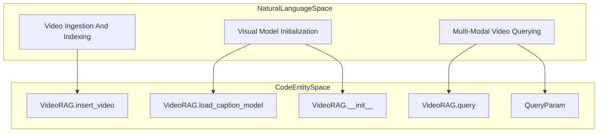
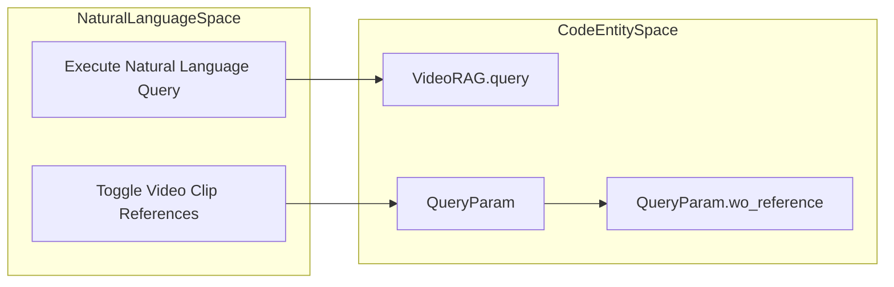

<!-- source: DeepWiki mcp.deepwiki.com · repo HKUDS/VideoRAG · page 4 Core API Reference · fetched 2026-11-09 -->

# Core API Reference

Relevant source files

The following files were used as context for generating this wiki page:

- [VideoRAG-algorithm/README.md](VideoRAG-algorithm/README.md)

The Core API Reference serves as the primary programmatic interface to the VideoRAG framework, exposing high-level classes and methods for video ingestion, knowledge graph construction, and multi-modal querying. The API abstracts complex underlying subsystems—such as Whisper ASR transcription [VideoRAG-algorithm/README.md:83](), MiniCPM-V captioning [VideoRAG-algorithm/README.md:100](), Neo4j graph indexing [VideoRAG-algorithm/README.md:83](), and HNSW vector storage [VideoRAG-algorithm/README.md:83]()—into simple Pythonic method calls.

Sources: [VideoRAG-algorithm/README.md:139-197]()

## Architecture and Component Mapping

The following diagram maps natural language capabilities to code entities within the repository, illustrating how user-facing concepts correspond to programmatic classes and methods.

Sources: [VideoRAG-algorithm/README.md:151-197]()

## 4.1. VideoRAG Class

The `VideoRAG` class acts as the central orchestrator for all video processing, indexing, and storage operations within the system. Initialized with an `LLMConfig` provider and a local working directory path, it configures graph storage, vector indices, and model execution environments. Videos are ingested via the `insert_video` method, which executes segmentation, audio extraction, transcription, visual analysis, and graph construction.

For comprehensive details on constructor parameters, storage directory structures, and the `insert_video` ingestion pipeline, see [VideoRAG Class](#4.1).

Sources: [VideoRAG-algorithm/README.md:164-166]()

## 4.2. Query Methods and Parameters

Query execution is managed through the `query` method combined with the `QueryParam` configuration class. Users specify retrieval behaviors, such as toggling video clip reference inclusion via `wo_reference`, and submit natural language prompts to retrieve synthesized answers grounded in multi-modal video content.

For detailed documentation on query modes, configuration parameters, and the multi-stage retrieval pipeline, see [Query Methods and Parameters](#4.2).

Sources: [VideoRAG-algorithm/README.md:188-197]()

The mapping between user query configuration concepts and code objects is structured as follows:

Sources: [VideoRAG-algorithm/README.md:188-192]()

---

