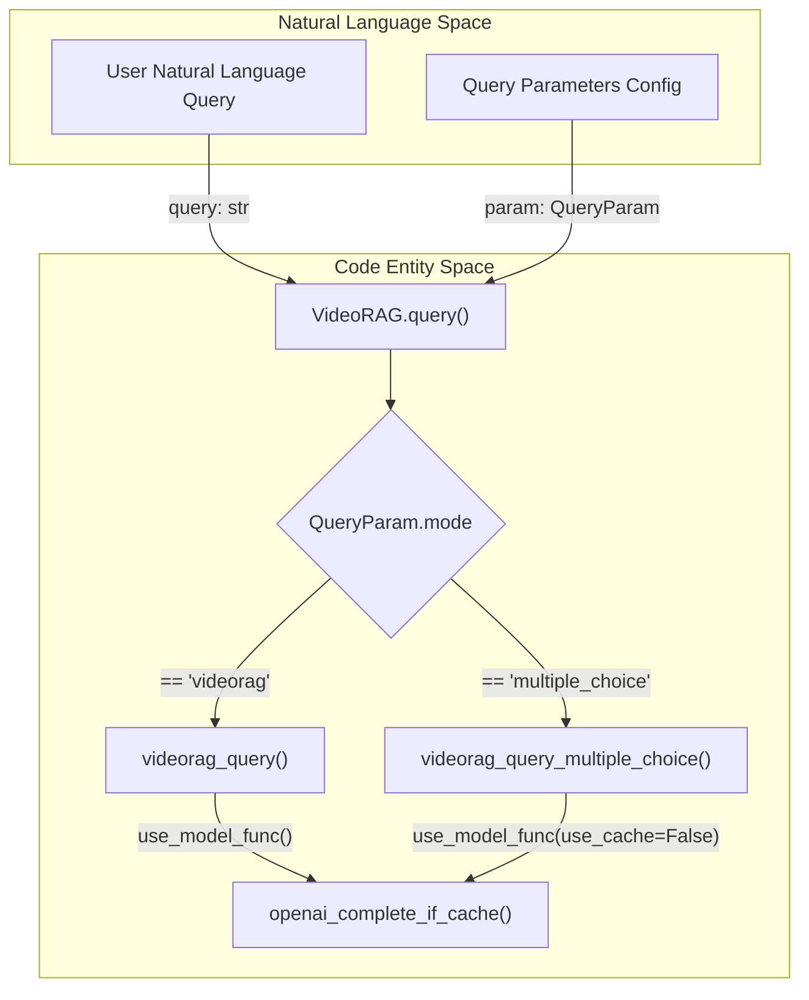
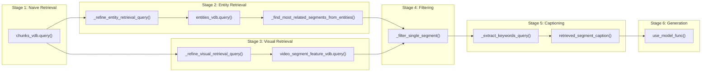

<!-- source: DeepWiki mcp.deepwiki.com · repo HKUDS/VideoRAG · page 4.2 Query Methods and Parameters · fetched 2026-11-09 -->

# Query Methods and Parameters

<details>
<summary>Relevant source files</summary>

The following files were used as context for generating this wiki page:

- [VideoRAG-algorithm/examples/process_videos_deepseek.py](VideoRAG-algorithm/examples/process_videos_deepseek.py)
- [VideoRAG-algorithm/examples/query_videos_deepseek.py](VideoRAG-algorithm/examples/query_videos_deepseek.py)
- [VideoRAG-algorithm/videorag/_llm.py](VideoRAG-algorithm/videorag/_llm.py)
- [VideoRAG-algorithm/videorag/_op.py](VideoRAG-algorithm/videorag/_op.py)

</details>


## Purpose and Scope

This page documents the query interface of the VideoRAG system, including the `query()` method, the `QueryParam` configuration class, and the configuration options governing query execution and retrieval. For information about `VideoRAG` class initialization and video insertion, see [VideoRAG Class](#4.1). For details about LLM configurations used during query processing, see [LLM Configuration Options](#5.1).

Sources: [VideoRAG-algorithm/videorag/_op.py:1-34](), [VideoRAG-algorithm/examples/query_videos_deepseek.py:14-33]()

## Overview

The VideoRAG query interface provides programmatic entry points for interacting with indexed video corpora. The system supports two primary retrieval modes configurable via `QueryParam`:
- **`videorag`**: The standard 6-stage hybrid retrieval pipeline combining naive text chunking, graph-based entity retrieval, and visual feature search for comprehensive open-ended queries.
- **`multiple_choice`**: A specialized execution path designed for evaluating multiple-choice questions with strict JSON response formatting.

Sources: [VideoRAG-algorithm/videorag/_op.py:580-926](), [VideoRAG-algorithm/examples/query_videos_deepseek.py:24-26]()

## Query Method Signature

The public querying interface is exposed via the `query` method on the `VideoRAG` class:

```python
response = videorag.query(query: str, param: QueryParam) -> Union[str, dict]
```

**Parameters:**
- `query`: A natural language string representing the user prompt or question.
- `param`: An instance of `QueryParam` specifying execution parameters, mode, thresholds, and formatting preferences.

**Returns:** Either a formatted natural language string response (with or without video segment citations) or a structured dictionary for multiple-choice tasks.

Sources: [VideoRAG-algorithm/videorag/_op.py:580-744](), [VideoRAG-algorithm/examples/query_videos_deepseek.py:33-36]()

## QueryParam Configuration Class

The `QueryParam` class (defined in `base.py` and utilized across query execution paths) controls the internal behavior of the retrieval pipeline:

### Core Parameters

| Parameter | Type | Default | Description |
|-----------|------|---------|-------------|
| `mode` | `str` | `"videorag"` | Selects between `"videorag"` and `"multiple_choice"` execution flows. |
| `top_k` | `int` | `60` | Number of top vector candidates retrieved during vector database queries. |
| `naive_max_token_for_text_unit` | `int` | `12000` | Maximum token ceiling allocated for naive text chunk retrieval context. |
| `wo_reference` | `bool` | `False` | When set to `True`, omits video segment timestamp citations from the generated response. |
| `response_type` | `str` | `"Multiple Paragraphs"` | Specifies formatting style (e.g., `"Multiple Paragraphs"`, `"Single Paragraph"`). |

### Usage Example

```python
from videorag import QueryParam

param = QueryParam(mode="videorag")
param.wo_reference = True
response = videorag.query(query="What is the main topic?", param=param)
```

Sources: [VideoRAG-algorithm/videorag/_op.py:28](), [VideoRAG-algorithm/examples/query_videos_deepseek.py:24-26]()

## Query Execution Flow

The following diagram bridges natural language inputs to code entities by showing how `VideoRAG.query()` routes execution based on `QueryParam.mode`:



Sources: [VideoRAG-algorithm/videorag/_op.py:580-926](), [VideoRAG-algorithm/videorag/_llm.py:91-120]()

## Query Pipeline Stages

The core query logic processes inputs through a 6-stage hybrid retrieval pipeline. The diagram below maps these operational stages to their underlying code implementations:



Sources: [VideoRAG-algorithm/videorag/_op.py:487-744]()

## Detailed Parameter Behavior

### mode Parameter
- **`"videorag"`**: Invokes `videorag_query()` [VideoRAG-algorithm/videorag/_op.py:580]() utilizing open-ended prompt structures with optional timestamp citations.
- **`"multiple_choice"`**: Invokes `videorag_query_multiple_choice()` [VideoRAG-algorithm/videorag/_op.py:746]() which forces JSON compliance (`{"Answer": "...", "Explanation": "..."}`).

### top_k Parameter
Controls maximum items fetched from `chunks_vdb` [VideoRAG-algorithm/videorag/_op.py:598]() and `entities_vdb` [VideoRAG-algorithm/videorag/_op.py:619](), directly impacting recall and asynchronous filtering loads.

### naive_max_token_for_text_unit Parameter
Passes limits to `truncate_list_by_token_size()` [VideoRAG-algorithm/videorag/_op.py:604]() to keep naive chunk context under token bounds.

### wo_reference Parameter
Toggles between `PROMPTS["videorag_response"]` and `PROMPTS["videorag_response_wo_reference"]` to control citation injection.

Sources: [VideoRAG-algorithm/videorag/_op.py:28-30](), [VideoRAG-algorithm/videorag/_op.py:580-926]()

## Query Function Implementations

### videorag_query Function
The primary execution method orchestrating text chunk retrieval, entity graph lookups, visual feature search, single-segment filtering, and localized caption generation before final LLM synthesis [VideoRAG-algorithm/videorag/_op.py:580-744]().

### videorag_query_multiple_choice Function
A specialized pathway that bypasses caching (`use_cache=False`), intercepts empty chunk sets by returning `"No Content"` [VideoRAG-algorithm/videorag/_op.py:769](), and enforces structured JSON decoding via validation loops [VideoRAG-algorithm/videorag/_op.py:914-925]().

Sources: [VideoRAG-algorithm/videorag/_op.py:580-926]()

## Helper Functions for Query Processing

### Query Refinement and Entity Traversal
- `_refine_entity_retrieval_query()` [VideoRAG-algorithm/videorag/_op.py:547](): Rewrites natural language queries for entity databases.
- `_refine_visual_retrieval_query()` [VideoRAG-algorithm/videorag/_op.py:558](): Reformulates queries for visual feature alignment.
- `_find_most_related_segments_from_entities()` [VideoRAG-algorithm/videorag/_op.py:487](): Traverses Neo4j graph nodes and edges via `knowledge_graph_inst` to score and rank video segments connected to target entities.

Sources: [VideoRAG-algorithm/videorag/_op.py:487-578]()

## Response Generation

The final generation phase builds a composite system prompt incorporating `retreived_video_context` and `retreived_chunk_context`, format specifications (`response_type`), and structural templates from `PROMPTS` [VideoRAG-algorithm/videorag/_op.py:730-743]().

Sources: [VideoRAG-algorithm/videorag/_op.py:30](), [VideoRAG-algorithm/videorag/_op.py:730-743]()

---

