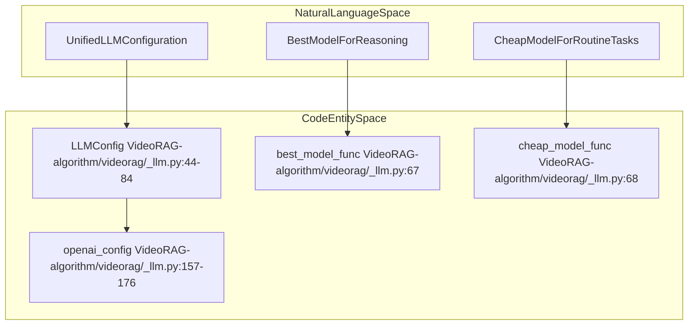
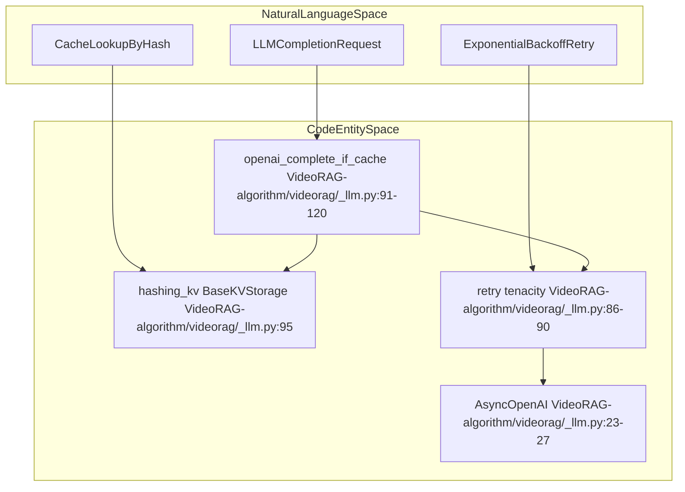

<!-- source: DeepWiki mcp.deepwiki.com · repo HKUDS/VideoRAG · page 5 LLM Integration · fetched 2026-11-09 -->

# LLM Integration

Relevant source files

The following files were used as context for generating this wiki page:

- [VideoRAG-algorithm/videorag/_llm.py](VideoRAG-algorithm/videorag/_llm.py)
- [VideoRAG-algorithm/videorag/_op.py](VideoRAG-algorithm/videorag/_op.py)

## Purpose and Scope

This document provides a high-level overview of how VideoRAG integrates with various Large Language Model (LLM) providers to handle multimodal video understanding, knowledge graph extraction, query refinement, segment filtering, and response generation. LLMs are invoked across multiple stages of the algorithm pipeline via standardized callable wrappers `[VideoRAG-algorithm/videorag/_llm.py:44-83]`, `[VideoRAG-algorithm/videorag/_op.py:181-204]()`.

As a parent page, this document outlines the core architecture and concepts. For deep technical details, refer to the child pages:
- For specific dataclasses and provider presets, see [LLM Configuration Options](#5.1).
- For caching layers and retry resilience, see [Caching and Retry Mechanisms](#5.2).

Sources: `[VideoRAG-algorithm/videorag/_llm.py:44-83]`, `[VideoRAG-algorithm/videorag/_op.py:181-204]()`

---

## 5.1 LLM Configuration Options

VideoRAG unifies all embedding and completion model parameters using the `LLMConfig` dataclass `[VideoRAG-algorithm/videorag/_llm.py:44-84]`. This design separates high-tier reasoning models (`best_model_func`) from cost-effective routine models (`cheap_model_func`) and embedding functions (`embedding_func`) `[VideoRAG-algorithm/videorag/_llm.py:66-68]`.

Pre-configured options exist for multiple providers including OpenAI (`openai_config`), Azure OpenAI, Ollama, and DeepSeek `[VideoRAG-algorithm/videorag/_llm.py:157-176]()`.

Diagram: LLM Configuration Mapping to Code Entities

For detailed configuration parameters, initialization logic, and custom provider setup, see [LLM Configuration Options](#5.1).

Sources: `[VideoRAG-algorithm/videorag/_llm.py:44-84]`, `[VideoRAG-algorithm/videorag/_llm.py:157-176]()`

---

## 5.2 Caching and Retry Mechanisms

To optimize performance and minimize API costs, VideoRAG implements a caching layer using argument hashing (`compute_args_hash`) stored in `BaseKVStorage` (`hashing_kv`) `[VideoRAG-algorithm/videorag/_llm.py:91-120]()`. Furthermore, all network calls are protected by robust retry policies using `tenacity` with exponential backoff to handle transient rate limits (`RateLimitError`) and connection errors (`APIConnectionError`) `[VideoRAG-algorithm/videorag/_llm.py:86-90]()`.

Diagram: Caching and Retry Flow to Code Entities

For complete implementation details on cache storage backends, hash computation, and retry tuning, see [Caching and Retry Mechanisms](#5.2).

Sources: `[VideoRAG-algorithm/videorag/_llm.py:23-120]()`

---

