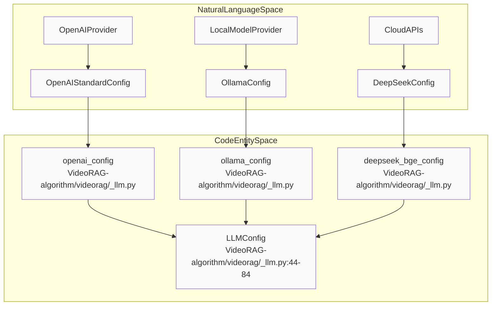
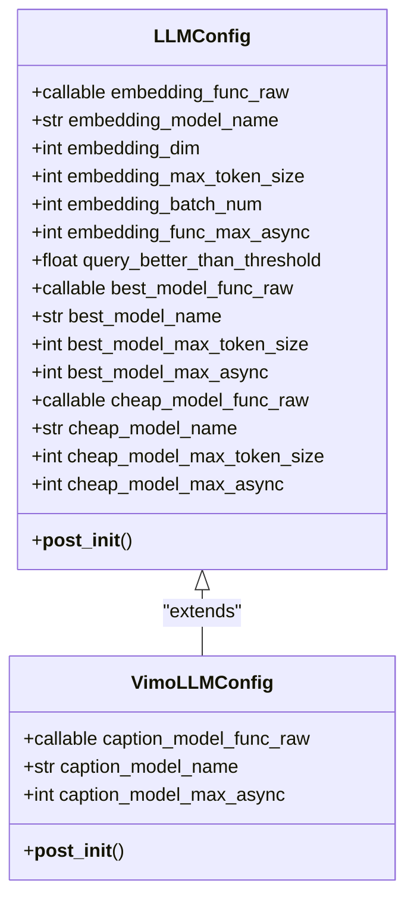
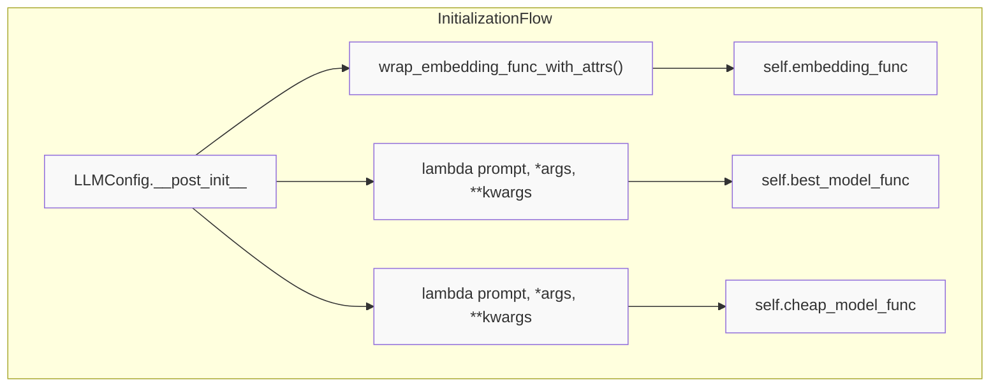
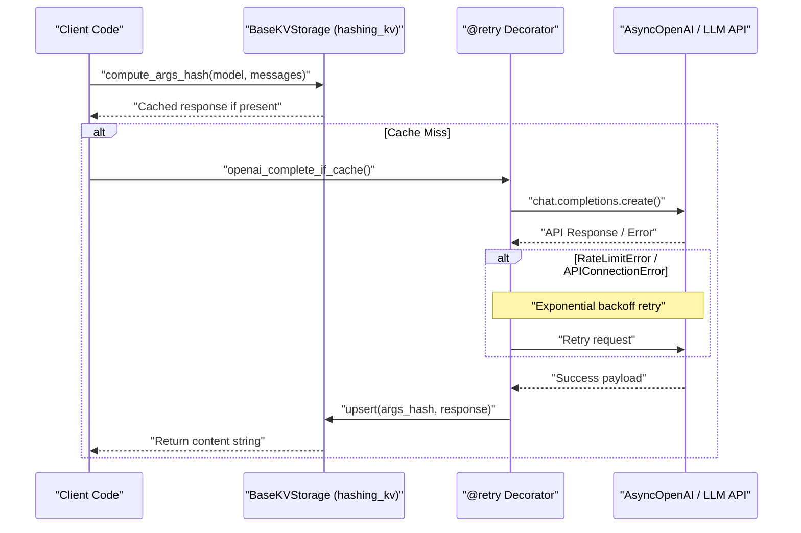
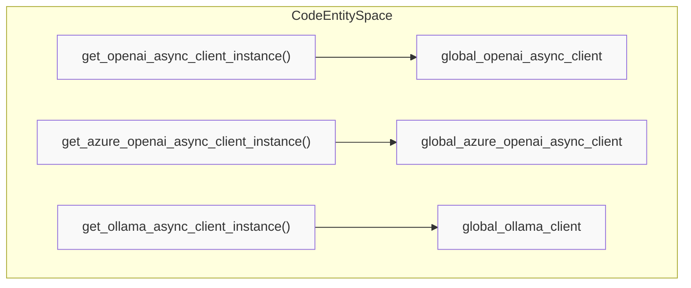

<!-- source: DeepWiki mcp.deepwiki.com · repo HKUDS/VideoRAG · page 5.1 LLM Configuration Options · fetched 2026-11-09 -->

# LLM Configuration Options

Relevant source files

The following files were used as context for generating this wiki page:

- [VideoRAG-algorithm/videorag/_llm.py](VideoRAG-algorithm/videorag/_llm.py)
- [VideoRAG-algorithm/videorag/_op.py](VideoRAG-algorithm/videorag/_op.py)
- [Vimo-desktop/python_backend/videorag/_llm.py](Vimo-desktop/python_backend/videorag/_llm.py)

This document details the Language Model (`LLM`) configuration options available in the VideoRAG framework, mapping high-level provider concepts to underlying code implementations such as `LLMConfig` dataclasses, provider client singletons, and caching/retry decorators.

Sources: [VideoRAG-algorithm/videorag/_llm.py:44-84](), [Vimo-desktop/python_backend/videorag/_llm.py:41-90]()

## Overview of LLM Configuration in VideoRAG

VideoRAG employs a unified configuration structure managed through the `LLMConfig` dataclass [VideoRAG-algorithm/videorag/_llm.py:44-84](). This structure decouples pipeline logic from specific model providers by abstracting embedding, primary inference ("best model"), efficient preprocessing ("cheap model"), and visual reasoning ("caption model") capabilities.

**Diagram: Bridging Natural Language Names to Code Entities for LLM Configs**

Sources: [VideoRAG-algorithm/videorag/_llm.py:44-84](), [VideoRAG-algorithm/videorag/_llm.py:157-176](), [VideoRAG-algorithm/videorag/_llm.py:381-397](), [VideoRAG-algorithm/videorag/_llm.py:491-509]()

## LLMConfig Structure

The core configuration class `LLMConfig` defines raw embedding and completion functions, token sizing limits, and concurrency configurations [VideoRAG-algorithm/videorag/_llm.py:44-84](). The Vimo-desktop variant extends this by adding `caption_model` parameters [Vimo-desktop/python_backend/videorag/_llm.py:41-90]().

**Diagram: Class Hierarchy for LLM Configurations**

Sources: [VideoRAG-algorithm/videorag/_llm.py:44-84](), [Vimo-desktop/python_backend/videorag/_llm.py:41-90]()

### Post-Initialization Processing

During instantiation, `LLMConfig.__post_init__` executes wrapping logic via `wrap_embedding_func_with_attrs` and binds lambda functions to streamline model calls [VideoRAG-algorithm/videorag/_llm.py:71-83]().

**Diagram: Post-Initialization Function Binding Flow**

Sources: [VideoRAG-algorithm/videorag/_llm.py:71-83](), [Vimo-desktop/python_backend/videorag/_llm.py:73-90]()

## Provider-Specific Configurations

### OpenAI Configuration
Standard OpenAI configurations use `gpt-4o` for primary tasks and `gpt-4o-mini` for fast/cheap tasks, utilizing `text-embedding-3-small` for vector embeddings [VideoRAG-algorithm/videorag/_llm.py:157-197](). They route requests through `openai_complete_if_cache` [VideoRAG-algorithm/videorag/_llm.py:91-120]().

Sources: [VideoRAG-algorithm/videorag/_llm.py:91-197]()

### Azure OpenAI Configuration
Azure OpenAI configurations map model parameters to Azure deployment names, calling `azure_openai_complete_if_cache` and leveraging `get_azure_openai_async_client_instance()` [VideoRAG-algorithm/videorag/_llm.py:30-34](), [VideoRAG-algorithm/videorag/_llm.py:200-298]().

Sources: [VideoRAG-algorithm/videorag/_llm.py:30-34](), [VideoRAG-algorithm/videorag/_llm.py:200-298]()

### Ollama Configuration
Local inference via Ollama utilizes `gemma2:latest` and `olmo2`, with `nomic-embed-text` providing 768-dimensional embeddings [VideoRAG-algorithm/videorag/_llm.py:381-397](). Concurrency parameters are strictly throttled (`*_max_async = 1`, `embedding_batch_num = 1`).

Sources: [VideoRAG-algorithm/videorag/_llm.py:36-41](), [VideoRAG-algorithm/videorag/_llm.py:381-397]()

### DeepSeek Configuration
DeepSeek leverages `deepseek-chat` for completions alongside `BAAI/bge-m3` via SiliconFlow for 1024-dimensional embeddings, using `httpx.AsyncClient` directly [VideoRAG-algorithm/videorag/_llm.py:399-488]().

Sources: [VideoRAG-algorithm/videorag/_llm.py:399-488](), [VideoRAG-algorithm/videorag/_llm.py:491-509]()

## LLM Request Flow & Caching

LLM completion functions check cache storage (`hashing_kv`) prior to making remote API calls, utilizing `tenacity`-based retry logic for handling transient connection errors and rate limits [VideoRAG-algorithm/videorag/_llm.py:86-120]().

**Diagram: Request Execution Flow with Caching and Retry Logic**

Sources: [VideoRAG-algorithm/videorag/_llm.py:86-120](), [Vimo-desktop/python_backend/videorag/_llm.py:93-131]()

## Global Client Singletons

To manage connection overhead, VideoRAG implements global asynchronous client accessor functions.

**Diagram: Global Client Accessor Functions and Singletons**

Sources: [VideoRAG-algorithm/videorag/_llm.py:19-41]()

---

