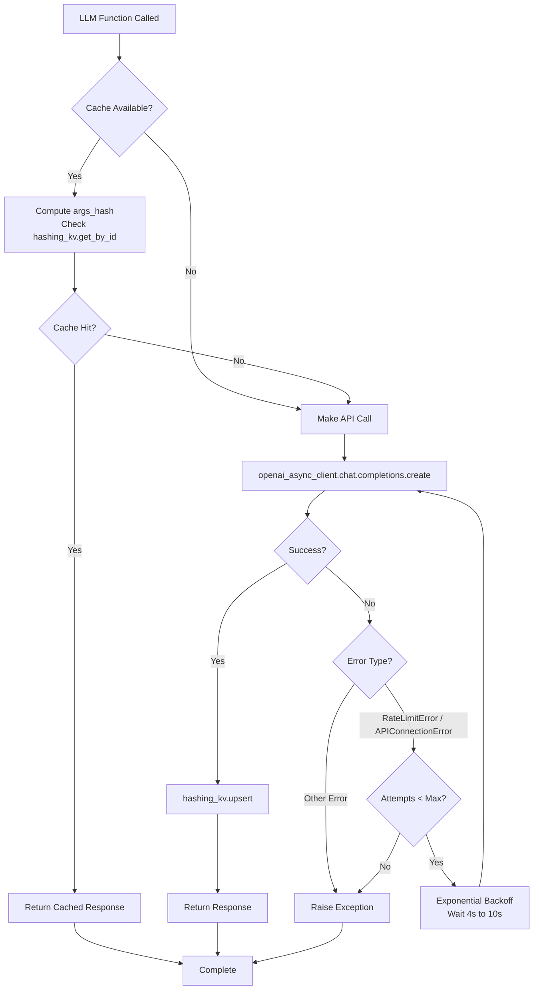
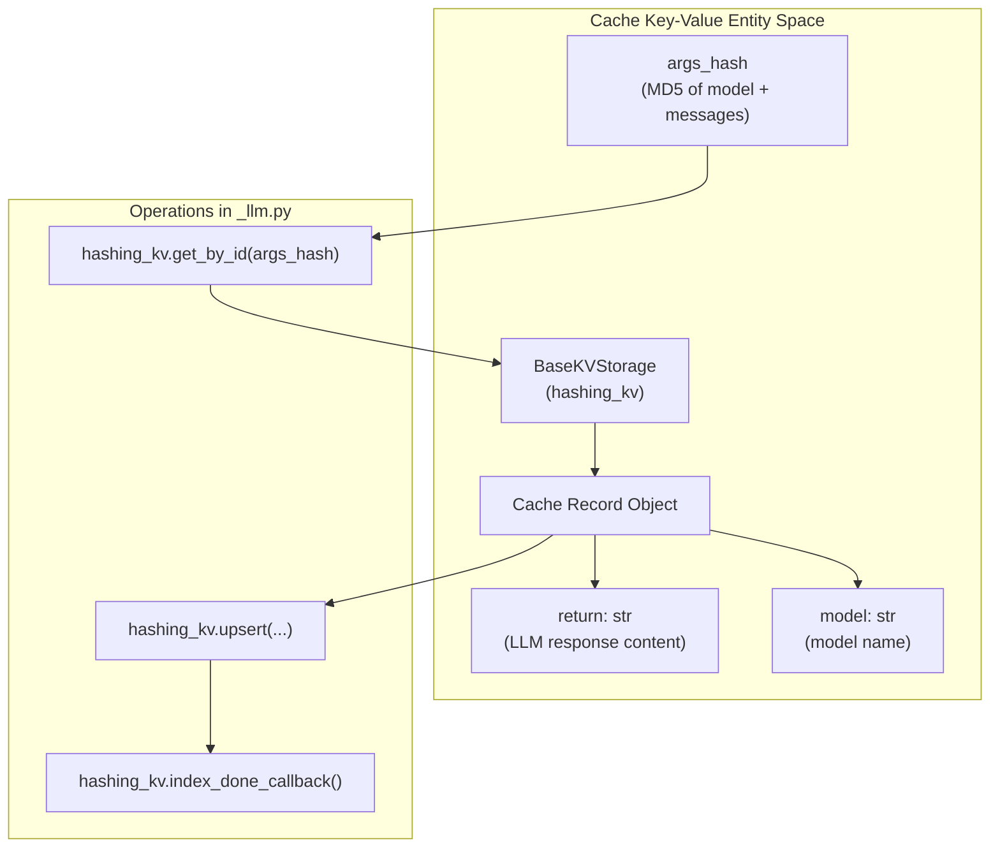
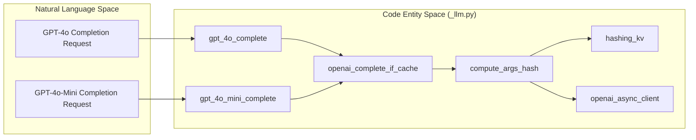

<!-- source: DeepWiki mcp.deepwiki.com · repo HKUDS/VideoRAG · page 5.2 Caching and Retry Mechanisms · fetched 2026-11-09 -->

# Caching and Retry Mechanisms

<details>
<summary>Relevant source files</summary>

The following files were used as context for generating this wiki page:

- [VideoRAG-algorithm/videorag/_llm.py](VideoRAG-algorithm/videorag/_llm.py)
- [VideoRAG-algorithm/videorag/_op.py](VideoRAG-algorithm/videorag/_op.py)

</details>


## Purpose and Scope

This document details the caching and retry mechanisms implemented in the VideoRAG system to ensure reliable and efficient interactions with external LLM providers. The caching layer (`hashing_kv`) reduces redundant API calls and processing costs, while the retry mechanism handles transient failures such as rate limits and connection errors via exponential backoff.

For related information about LLM configuration options and provider setup, see [LLM Configuration Options](#5.1). For general API usage patterns, see [Core API Reference](#4).

**Sources**: [VideoRAG-algorithm/videorag/_llm.py:1-201]()

---

## Overview

VideoRAG implements two complementary reliability mechanisms within its LLM wrapper layer:

1. **Response Caching**: Hash-based key-value storage (`hashing_kv`) that caches LLM responses to avoid redundant API calls.
2. **Automatic Retry**: Exponential backoff retry logic (`tenacity.retry`) that handles transient failures from rate limiting (`RateLimitError`) and connection errors (`APIConnectionError`).

These mechanisms operate transparently across supported LLM providers and are integrated into every LLM completion function throughout the pipeline.

**Sources**: [VideoRAG-algorithm/videorag/_llm.py:86-120]()

---

## Retry Mechanism Architecture

### Retry Decorator Configuration

All LLM completion and embedding functions are decorated with the `@retry` decorator from the `tenacity` library, specifying stop conditions, exponential wait intervals, and specific exception types.

```python
@retry(
    stop=stop_after_attempt(5),
    wait=wait_exponential(multiplier=1, min=4, max=10),
    retry=retry_if_exception_type((RateLimitError, APIConnectionError)),
)
async def openai_complete_if_cache(...):
    ...
```

| Parameter | Value | Purpose |
|-----------|-------|---------|
| `stop_after_attempt` | 3 - 5 attempts | Maximum retry attempts before raising an exception |
| `wait_exponential` | multiplier=1, min=4s, max=10s | Exponential backoff wait time between retries |
| `retry_if_exception_type` | `RateLimitError`, `APIConnectionError` | Restricts retries to transient connection/rate limit faults |

### Retry and Cache Flow Diagram

The following diagram bridges natural language operational steps to the underlying Python functions (`openai_complete_if_cache`, `compute_args_hash`, `hashing_kv.get_by_id`, `openai_async_client.chat.completions.create`) in `VideoRAG-algorithm/videorag/_llm.py`:



**Sources**: [VideoRAG-algorithm/videorag/_llm.py:86-120]()

---

## Caching Mechanism Architecture

### Cache Key Generation

Cache keys are computed using `compute_args_hash`, generating a deterministic hash from the model name and constructed messages list (including system prompts, history, and the user prompt).

```python
args_hash = compute_args_hash(model, messages)
```

If `hashing_kv` is provided and `use_cache=True`, the system checks for an existing record before invoking the external API client.

**Sources**: [VideoRAG-algorithm/videorag/_llm.py:104-110]()

### Cache Storage Structure



**Sources**: [VideoRAG-algorithm/videorag/_llm.py:104-120]()

---

## Integration with LLM Functions

### Completion Function Mapping

All high-level completion functions delegate to `openai_complete_if_cache` or provider-equivalent cached wrappers:



**Sources**: [VideoRAG-algorithm/videorag/_llm.py:91-143]()

---

## Performance Considerations

1. **Cost and Latency Reduction**: Cache hits return immediately without incurring model usage costs or network round-trip delays.
2. **Rate Limit Mitigation**: Caching frequent entity descriptions and query refiners reduces total outbound requests, protecting against quota exhaustion.
3. **Retry Overhead Trade-off**: Exponential backoff adds up to ~22 seconds of delay across maximum retries in exchange for system resilience against transient network blips.

**Sources**: [VideoRAG-algorithm/videorag/_llm.py:86-90]()

---

