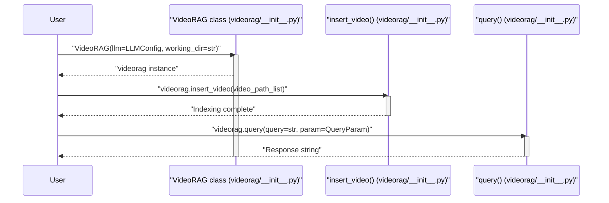

<!-- source: DeepWiki mcp.deepwiki.com · repo HKUDS/VideoRAG · page 6 Usage Examples · fetched 2026-11-09 -->

# Usage Examples

<details>
<summary>Relevant source files</summary>

The following files were used as context for generating this wiki page:

- [VideoRAG-algorithm/examples/process_videos_deepseek.py](VideoRAG-algorithm/examples/process_videos_deepseek.py)
- [VideoRAG-algorithm/examples/query_videos_deepseek.py](VideoRAG-algorithm/examples/query_videos_deepseek.py)

</details>


This page provides an overview of practical usage examples for the VideoRAG framework, illustrating how to process, index, and query video content using the core programmatic interface. The system exposes a primary `VideoRAG` class that manages video preprocessing, knowledge graph construction, vector indexing, and retrieval-augmented generation [VideoRAG-algorithm/README.md:139-197]().

This is a parent overview page. For deep technical details, step-by-step guides, and provider-specific configurations, please refer to the child pages:
- [Basic Video Processing](#6.1) — Detailed setup, video ingestion, and querying workflow.
- [Using Alternative LLM Providers](#6.2) — Configuration examples for DeepSeek, Ollama, and Azure OpenAI.
- [Benchmark Evaluation](#6.3) — Guide to the LongerVideos dataset and evaluation scripts.

Sources: [VideoRAG-algorithm/README.md:139-197]()

## Core API Usage Pattern

The primary interaction with the framework revolves around instantiating the `VideoRAG` class, populating the index via `insert_video()`, and executing queries using `query()` [VideoRAG-algorithm/README.md:139-197]().


*Sources: [VideoRAG-algorithm/README.md:139-197]()*

```mermaid
graph TB
    subgraph "Natural Language Space"
        VideoIndexing["Video Ingestion & Indexing"]
        VideoQuery["Multi-Stage Querying"]
        ProviderConfig["Model Configuration"]
        Benchmarking["Performance Benchmarking"]
    end

    subgraph "Code Entity Space"
        VideoRAGClass["VideoRAG class<br/>(videorag/__init__.py)"]
        InsertVideo["insert_video()<br/>(videorag/__init__.py)"]
        Query["query()<br/>(videorag/__init__.py)"]
        LoadCaption["load_caption_model()<br/>(videorag/__init__.py)"]
        LLMConfig["LLMConfig<br/>(videorag/_llm.py)"]
        QueryParam["QueryParam<br/>(videorag/__init__.py)"]
    end

    VideoIndexing --> VideoRAGClass
    VideoIndexing --> InsertVideo
    VideoQuery --> Query
    VideoQuery --> QueryParam
    VideoQuery --> LoadCaption
    ProviderConfig --> LLMConfig
    Benchmarking --> VideoRAGClass

*Sources: [VideoRAG-algorithm/README.md:139-197](), [VideoRAG-algorithm/README.md:286-303]()*

## 6.1 Basic Video Processing

VideoRAG ingests raw video files, extracts audio and visual features, constructs knowledge graphs, and builds vector indexes to support retrieval-augmented generation. Basic video processing involves setting up the environment, initializing the `VideoRAG` class with a provider configuration (such as OpenAI), inserting video files into a designated working directory, and running queries using `QueryParam`.

For step-by-step instructions, environment setup, video insertion examples, and basic querying workflows, see [Basic Video Processing](#6.1).

*Sources: [VideoRAG-algorithm/README.md:139-197]()*

## 6.2 Using Alternative LLM Providers

Beyond standard OpenAI configurations, VideoRAG supports integration with alternative large language model and embedding providers, including DeepSeek, Ollama for local offline execution, and Azure OpenAI. Each provider is configured via `LLMConfig` parameters specifying embedding functions, model names, and API endpoints.

For detailed examples of configuring and running VideoRAG with DeepSeek, Ollama, and other providers, see [Using Alternative LLM Providers](#6.2).

*Sources: [VideoRAG-algorithm/examples/process_videos_deepseek.py:1-30](), [VideoRAG-algorithm/README.md:281-309]()*

## 6.3 Benchmark Evaluation

To evaluate system performance on extreme long-context videos, VideoRAG includes support for the LongerVideos benchmark dataset. The evaluation suite provides scripts for dataset preparation, batch processing collections, and performing quantitative scoring and win-rate comparisons against baseline systems like NaiveRAG, GraphRAG, and LightRAG.

For detailed instructions on running benchmark collections, executing evaluation scripts in `reproduce/`, and reproducing research results, see [Benchmark Evaluation](#6.3).

*Sources: [VideoRAG-algorithm/README.md:204-279]()*

---

