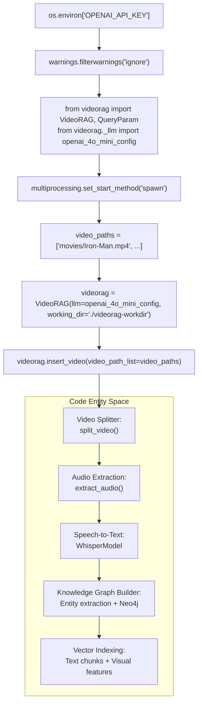
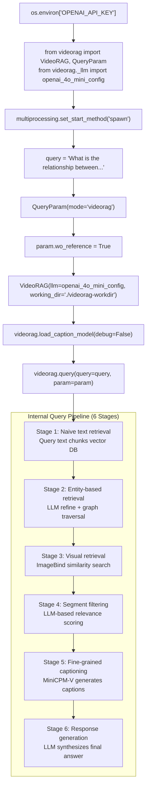

<!-- source: DeepWiki mcp.deepwiki.com · repo HKUDS/VideoRAG · page 6.1 Basic Video Processing · fetched 2026-11-09 -->

# Basic Video Processing

<details>
<summary>Relevant source files</summary>

The following files were used as context for generating this wiki page:

- [VideoRAG-algorithm/README.md](VideoRAG-algorithm/README.md)
- [VideoRAG-algorithm/examples/process_videos_deepseek.py](VideoRAG-algorithm/examples/process_videos_deepseek.py)
- [VideoRAG-algorithm/examples/query_videos_deepseek.py](VideoRAG-algorithm/examples/query_videos_deepseek.py)

</details>


This page provides a step-by-step guide for processing videos and running queries using the VideoRAG framework. It demonstrates the complete workflow from environment setup through video insertion to query execution using the `VideoRAG` class.

For query processing architecture details, see page 3.4. For LLM configuration options, see page 5.1. For alternative LLM providers, see page 6.2.

## Prerequisites

Before processing videos with VideoRAG, ensure the following requirements are met:

**Environment Requirements:**
- Python 3.11 conda environment
- VideoRAG dependencies installed ([VideoRAG-algorithm/README.md:55-89]())
- Model checkpoints downloaded: `MiniCPM-V-2_6-int4`, `faster-distil-whisper-large-v3`, `imagebind_huge.pth`

**API Access:**
- API key for chosen LLM provider (OpenAI, DeepSeek, Azure OpenAI, or Ollama)
- Environment variable configuration for API authentication

**Hardware:**
- NVIDIA GPU with 24GB VRAM recommended (e.g., RTX 3090) for processing
- Sufficient disk space for video segments and model weights

**Video Files:**
- Supported formats: `.mp4`, `.mkv`, and other common video formats
- No strict length limitations (system designed for hundreds of hours)

The framework supports multiple LLM providers with different API key requirements:
- **OpenAI**: `OPENAI_API_KEY` [VideoRAG-algorithm/README.md:149]()
- **DeepSeek**: `DEEPSEEK_API_KEY` and `SILICONFLOW_API_KEY` [VideoRAG-algorithm/examples/process_videos_deepseek.py:9-11]()
- **Azure OpenAI**: Azure-specific credentials
- **Ollama**: Local deployment, no API key required

Sources: [VideoRAG-algorithm/README.md:51-129](), [VideoRAG-algorithm/examples/process_videos_deepseek.py:1-30]()

## Video Insertion Workflow

### Video Insertion Process Flow


Sources: [VideoRAG-algorithm/README.md:138-166]()

**Video Insertion Implementation:**

The `insert_video()` method triggers a multi-stage processing pipeline that extracts, indexes, and stores video content:

**Step 1: Environment Setup**
```python
os.environ["OPENAI_API_KEY"] = "your-key-here"
warnings.filterwarnings("ignore")
logging.getLogger("httpx").setLevel(logging.WARNING)
```
[VideoRAG-algorithm/README.md:142-146]()

**Step 2: Module Import and Multiprocessing Configuration**
```python
from videorag._llm import openai_4o_mini_config
from videorag import VideoRAG, QueryParam

if __name__ == '__main__':
    multiprocessing.set_start_method('spawn')
```
The `set_start_method('spawn')` call is required for cross-platform compatibility and GPU processing. [VideoRAG-algorithm/README.md:151-156]()

**Step 3: Video Path Preparation**
```python
video_paths = [
    'movies/Iron-Man.mp4',
    'movies/Spider-Man.mkv',
]
```
The `video_paths` list accepts multiple video files with no length restrictions. [VideoRAG-algorithm/README.md:158-163]()

**Step 4: VideoRAG Initialization**
```python
videorag = VideoRAG(llm=openai_4o_mini_config, working_dir=f"./videorag-workdir")
```
[VideoRAG-algorithm/README.md:164]()

**Step 5: Video Processing Execution**
```python
videorag.insert_video(video_path_list=video_paths)
```
This method triggers the internal processing pipeline including video splitting, audio extraction, ASR transcription, entity extraction, and multi-modal indexing. [VideoRAG-algorithm/README.md:165]()

### VideoRAG Class Constructor Parameters

| Parameter | Type | Purpose | Example Value |
|-----------|------|---------|---------------|
| `llm` | `LLMConfig` | LLM provider configuration | `openai_4o_mini_config` |
| `working_dir` | `str` | Directory for index storage | `"./videorag-workdir"` |

### insert_video() Method Parameters

| Parameter | Type | Purpose | Notes |
|-----------|------|---------|-------|
| `video_path_list` | `List[str]` | List of video file paths | Supports `.mp4`, `.mkv`, etc. |

### Internal Processing Components

During `insert_video()` execution, the following components are invoked:

| Component | File/Module | Purpose |
|-----------|-------------|---------|
| Video Splitter | `videorag._videoutil` | Segments videos into chunks |
| Audio Extractor | `videorag._videoutil` | Extracts audio tracks |
| `WhisperModel` | `videorag._videoutil.asr` | Converts speech to text |
| Knowledge Graph Builder | `videorag._storage` | Extracts entities and relationships |
| Vector Indexer | `videorag._storage` | Creates embeddings for retrieval |

Sources: [VideoRAG-algorithm/README.md:138-166](), [VideoRAG-algorithm/examples/process_videos_deepseek.py:1-30]()

## Querying Workflow

### Query Execution Process Flow


Sources: [VideoRAG-algorithm/README.md:168-197]()

**Query Implementation:**

**Step 1: Environment and Module Setup**
```python
os.environ["OPENAI_API_KEY"] = "your-key-here"
from videorag._llm import openai_4o_mini_config
from videorag import VideoRAG, QueryParam

if __name__ == '__main__':
    multiprocessing.set_start_method('spawn')
```
[VideoRAG-algorithm/README.md:170-185]()

**Step 2: Define Query String**
```python
query = 'What is the relationship between Iron Man and Spider-Man? How do they meet, and how does Iron Man help Spider-Man?'
```
Natural language queries can reference multiple videos and ask complex cross-video questions. [VideoRAG-algorithm/README.md:188]()

**Step 3: Configure Query Parameters**
```python
param = QueryParam(mode="videorag")
param.wo_reference = True  # Set to False to include video segment timestamps
```
[VideoRAG-algorithm/README.md:189-191]()

**Step 4: Initialize VideoRAG Instance**
```python
videorag = VideoRAG(llm=openai_4o_mini_config, working_dir=f"./videorag-workdir")
```
The `working_dir` must match the directory used during `insert_video()`. [VideoRAG-algorithm/README.md:193]()

**Step 5: Load Caption Model**
```python
videorag.load_caption_model(debug=False)
```
This loads the `MiniCPM-V-2_6-int4` model for fine-grained video captioning. [VideoRAG-algorithm/README.md:194]()

**Step 6: Execute Query**
```python
response = videorag.query(query=query, param=param)
print(response)
```
[VideoRAG-algorithm/README.md:195-196]()

### QueryParam Class Configuration

| Attribute | Type | Purpose | Values |
|-----------|------|---------|--------|
| `mode` | `str` | Query processing mode | `"videorag"`, `"naive"`, `"local"`, `"global"` |
| `wo_reference` | `bool` | Include video segment references | `True` (exclude), `False` (include) |

**Reference Inclusion Behavior:**
- `wo_reference=True`: Returns plain text answer without timestamps
- `wo_reference=False`: Returns answer with video segment references (file names and timestamps)

### load_caption_model() Method

| Parameter | Type | Purpose | Default |
|-----------|------|---------|---------|
| `debug` | `bool` | Enable debug logging | `False` |

This method must be called before executing queries to load the vision-language model used in Stage 5 of the query pipeline.

### query() Method Signature

```python
def query(self, query: str, param: QueryParam) -> str:
    """
    Execute query against indexed videos.
    
    Args:
        query: Natural language question
        param: QueryParam instance with configuration
        
    Returns:
        String response with answer (and optional references)
    """
```

Sources: [VideoRAG-algorithm/README.md:168-197](), [VideoRAG-algorithm/examples/query_videos_deepseek.py:1-36]()

## Complete Usage Example

### Full Video Processing and Query Session

This example demonstrates a complete workflow using the OpenAI LLM provider:

**Video Insertion Script:**
```python
import os
import logging
import warnings
import multiprocessing

warnings.filterwarnings("ignore")
logging.getLogger("httpx").setLevel(logging.WARNING)

os.environ["OPENAI_API_KEY"] = "sk-your-key-here"

from videorag._llm import openai_4o_mini_config
from videorag import VideoRAG, QueryParam

if __name__ == '__main__':
    multiprocessing.set_start_method('spawn')
    
    video_paths = [
        'movies/Iron-Man.mp4',
        'movies/Spider-Man.mkv',
    ]
    
    videorag = VideoRAG(
        llm=openai_4o_mini_config,
        working_dir="./videorag-workdir"
    )
    
    videorag.insert_video(video_path_list=video_paths)
```
[VideoRAG-algorithm/README.md:139-166]()

**Query Script:**
```python
import os
import logging
import warnings
import multiprocessing

warnings.filterwarnings("ignore")
logging.getLogger("httpx").setLevel(logging.WARNING)

os.environ["OPENAI_API_KEY"] = "sk-your-key-here"

from videorag._llm import openai_4o_mini_config
from videorag import VideoRAG, QueryParam

if __name__ == '__main__':
    multiprocessing.set_start_method('spawn')
    
    query = 'What is the relationship between Iron Man and Spider-Man? How do they meet, and how does Iron Man help Spider-Man?'
    
    param = QueryParam(mode="videorag")
    param.wo_reference = True
    
    videorag = VideoRAG(
        llm=openai_4o_mini_config,
        working_dir="./videorag-workdir"
    )
    
    videorag.load_caption_model(debug=False)
    response = videorag.query(query=query, param=param)
    
    print(response)
```
[VideoRAG-algorithm/README.md:168-197]()

### Alternative: DeepSeek Provider Example

For users preferring DeepSeek with BGE embeddings:

**Video Insertion:**
```python
os.environ["DEEPSEEK_API_KEY"] = "sk-*******"
os.environ["SILICONFLOW_API_KEY"] = "sk-******"

from videorag._llm import deepseek_bge_config
from videorag import VideoRAG

videorag = VideoRAG(llm=deepseek_bge_config, working_dir="./videorag-workdir")
videorag.insert_video(video_path_list=video_paths)
```
[VideoRAG-algorithm/examples/process_videos_deepseek.py:9-30]()

**Query Execution:**
```python
query = '请描述两个视频的主要内容是什么？'  # Chinese language support
param = QueryParam(mode="videorag")
param.wo_reference = True

videorag = VideoRAG(llm=deepseek_bge_config, working_dir="./videorag-workdir")
videorag.load_caption_model(debug=False)
response = videorag.query(query=query, param=param)
```
[VideoRAG-algorithm/examples/query_videos_deepseek.py:21-36]()

**Language Support Note:** VideoRAG has been primarily tested with English content. For multilingual video processing, modify the `WhisperModel` configuration in `videorag._videoutil.asr` module. See [faster-whisper documentation](https://github.com/systran/faster-whisper) for language-specific ASR settings. [VideoRAG-algorithm/README.md:135-137]()

Sources: [VideoRAG-algorithm/README.md:132-197](), [VideoRAG-algorithm/examples/process_videos_deepseek.py:1-30](), [VideoRAG-algorithm/examples/query_videos_deepseek.py:1-36]()

## Complete Basic Usage Example

### Video Processing Session

A complete video processing workflow requires maintaining consistency between insertion and querying phases. The `working_dir` parameter must remain identical across both operations to ensure proper index loading.

**Critical Configuration Requirements:**

- Multiprocessing method must be set to `'spawn'` before any VideoRAG operations
- Environment variables for API access must be configured before importing VideoRAG modules  
- The same `working_dir` path must be used for both `insert_video()` and subsequent `query()` operations
- Caption model loading via `load_caption_model()` is required before executing queries

### Error Prevention

Common configuration issues include:
- Mismatched `working_dir` paths between insertion and querying sessions
- Missing multiprocessing configuration causing process spawning failures
- Undefined environment variables leading to API authentication errors
- Attempting queries without loading the caption model

Sources: [VideoRAG-algorithm/examples/process_videos_deepseek.py:1-30](), [VideoRAG-algorithm/examples/query_videos_deepseek.py:1-36]()

---

