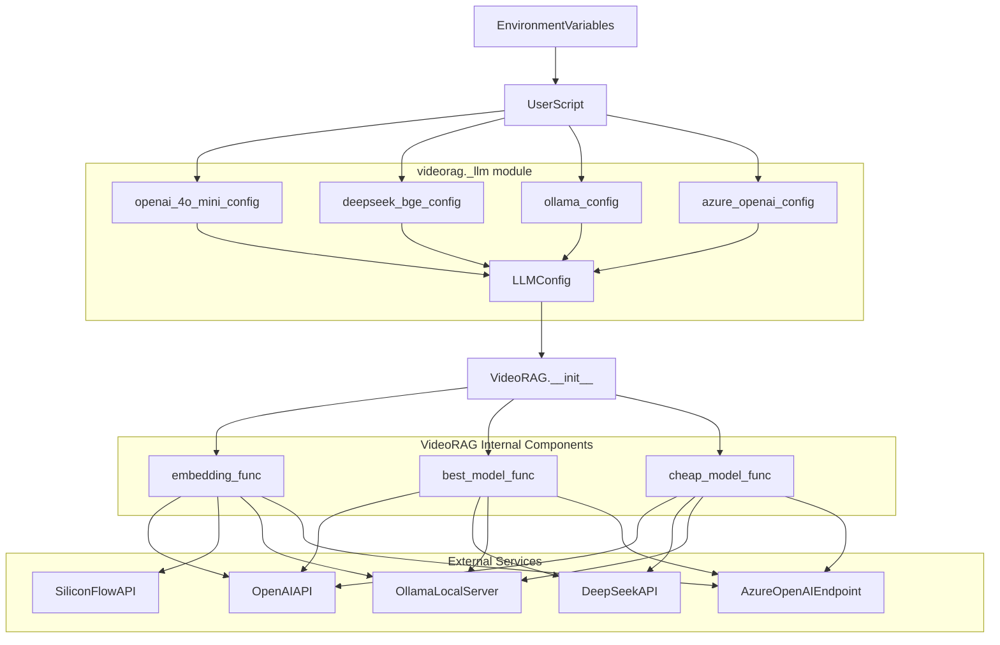
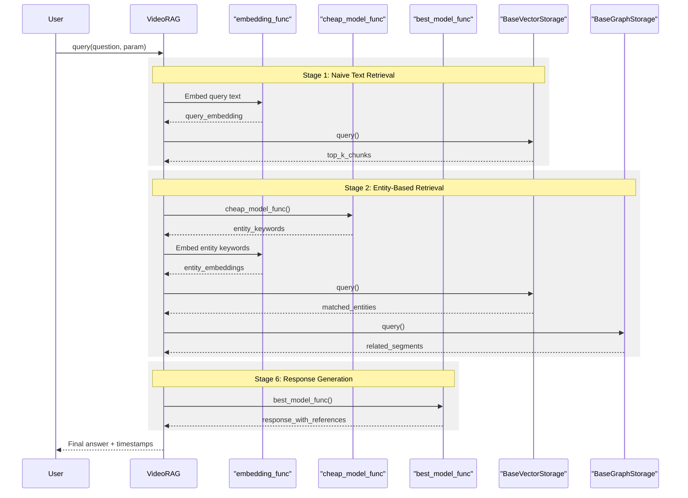
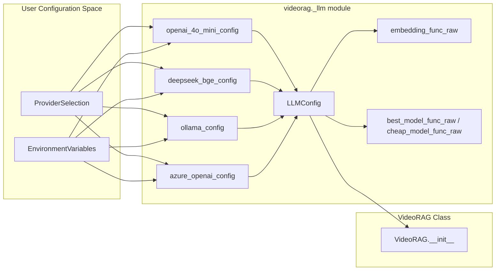

<!-- source: DeepWiki mcp.deepwiki.com · repo HKUDS/VideoRAG · page 6.2 Using Alternative LLM Providers · fetched 2026-11-09 -->

# Using Alternative LLM Providers

<details>
<summary>Relevant source files</summary>

The following files were used as context for generating this wiki page:

- [VideoRAG-algorithm/examples/process_videos_deepseek.py](VideoRAG-algorithm/examples/process_videos_deepseek.py)
- [VideoRAG-algorithm/examples/query_videos_deepseek.py](VideoRAG-algorithm/examples/query_videos_deepseek.py)
- [VideoRAG-algorithm/videorag/_llm.py](VideoRAG-algorithm/videorag/_llm.py)
- [VideoRAG-algorithm/videorag/_op.py](VideoRAG-algorithm/videorag/_op.py)

</details>


## Purpose and Scope

This document provides practical examples for configuring VideoRAG with alternative Large Language Model (LLM) providers beyond the default OpenAI setup. It demonstrates how to set up and use DeepSeek, Ollama (for local inference), and Azure OpenAI as LLM backends for video processing and querying tasks by leveraging the `LLMConfig` dataclass defined in `VideoRAG-algorithm/videorag/_llm.py` [VideoRAG-algorithm/videorag/_llm.py:44-84]().

## Supported LLM Providers

VideoRAG supports multiple LLM providers through its flexible `LLMConfig` interface (`[VideoRAG-algorithm/videorag/_llm.py:44-84]()`). The following table summarizes the currently available provider configurations:

| Provider | Config Variable | Embedding Model | Best Model | Cheap Model | Deployment Type |
|----------|----------------|-----------------|------------|-------------|-----------------|
| OpenAI | `openai_4o_mini_config` [VideoRAG-algorithm/videorag/_llm.py:178-197]() | text-embedding-3-small | gpt-4o | gpt-4o-mini | Cloud API |
| DeepSeek | `deepseek_bge_config` [VideoRAG-algorithm/examples/process_videos_deepseek.py:13-13]() | bge-m3 (SiliconFlow) | deepseek-chat | deepseek-chat | Cloud API |
| Ollama | `ollama_config` [VideoRAG-algorithm/videorag/_llm.py:36-41]() | nomic-embed-text | gemma2:latest | olmo2 | Local |
| Azure OpenAI | `azure_openai_config` [VideoRAG-algorithm/videorag/_llm.py:30-34]() | text-embedding-3-small | gpt-4o | gpt-4o-mini | Cloud API (Private) |

Sources: [VideoRAG-algorithm/videorag/_llm.py:30-84](), [VideoRAG-algorithm/examples/process_videos_deepseek.py:13-13]()

## Provider Configuration Flow

The following diagram illustrates how VideoRAG initializes with different LLM providers and how the configuration flows through `LLMConfig` [VideoRAG-algorithm/videorag/_llm.py:44-84]() to client instances like `get_openai_async_client_instance` [VideoRAG-algorithm/videorag/_llm.py:23-27](), `get_azure_openai_async_client_instance` [VideoRAG-algorithm/videorag/_llm.py:30-34](), and `get_ollama_async_client_instance` [VideoRAG-algorithm/videorag/_llm.py:36-41]():

Title: Provider Configuration Flow

Sources: [VideoRAG-algorithm/videorag/_llm.py:23-84](), [VideoRAG-algorithm/examples/process_videos_deepseek.py:9-14]()

## Using DeepSeek with SiliconFlow Embeddings

DeepSeek is a cost-effective alternative to OpenAI, offering competitive performance for reasoning and text generation tasks. The `deepseek_bge_config` configuration uses SiliconFlow for embeddings and DeepSeek for LLM completion tasks (`[VideoRAG-algorithm/examples/process_videos_deepseek.py:9-14]`).

### Environment Setup

Configure the required API keys before initializing `VideoRAG` (`[VideoRAG-algorithm/examples/process_videos_deepseek.py:9-11]()`):

```python
import os
os.environ["DEEPSEEK_API_KEY"] = "sk-*******"
os.environ["SILICONFLOW_API_KEY"] = "sk-*******"
```

### Video Processing with DeepSeek

The following example (`[VideoRAG-algorithm/examples/process_videos_deepseek.py:17-30]()`) demonstrates processing videos with DeepSeek configuration:

```python
import warnings
import logging
import multiprocessing

warnings.filterwarnings("ignore")
logging.getLogger("httpx").setLevel(logging.WARNING)

from videorag._llm import deepseek_bge_config
from videorag import VideoRAG, QueryParam

if __name__ == '__main__':
    multiprocessing.set_start_method('spawn')
    
    video_paths = [
        '/home/zy/VideoRAG/fc6207139422fa5f030113b7d79efe5e.mp4',
    ]
    
    videorag = VideoRAG(llm=deepseek_bge_config, working_dir="./videorag-workdir")
    videorag.insert_video(video_path_list=video_paths)
```

Sources: [VideoRAG-algorithm/examples/process_videos_deepseek.py:1-30]()

### Querying with DeepSeek

After processing, query the videos using `VideoRAG.query` (`[VideoRAG-algorithm/examples/query_videos_deepseek.py:17-36]()`):

```python
if __name__ == '__main__':
    multiprocessing.set_start_method('spawn')
    
    query = '请描述两个视频的主要内容是什么？'
    param = QueryParam(mode="videorag")
    param.wo_reference = True
    
    videorag = VideoRAG(llm=deepseek_bge_config, working_dir="./videorag-workdir")
    videorag.load_caption_model(debug=False)
    
    response = videorag.query(query=query, param=param)
    print(response)
```

Sources: [VideoRAG-algorithm/examples/query_videos_deepseek.py:1-36]()

## Using Ollama for Local Inference

Ollama enables fully local inference without cloud API dependencies via `get_ollama_async_client_instance` (`[VideoRAG-algorithm/videorag/_llm.py:36-41]()`).

### Ollama Configuration Structure

The `ollama_config` utilizes `LLMConfig` (`[VideoRAG-algorithm/videorag/_llm.py:44-84]()`) with local client bindings:

```python
ollama_config = LLMConfig(
    embedding_func_raw = ollama_embedding,
    embedding_model_name = "nomic-embed-text",
    embedding_dim = 768,
    embedding_max_token_size=8192,
    embedding_batch_num = 1,
    embedding_func_max_async = 1,
    query_better_than_threshold = 0.2,
    best_model_func_raw = ollama_complete,
    best_model_name = "gemma2:latest",
    best_model_max_token_size = 32768,
    best_model_max_async = 1,
    cheap_model_func_raw = ollama_mini_complete,
    cheap_model_name = "olmo2",
    cheap_model_max_token_size = 32768,
    cheap_model_max_async = 1
)
```

Sources: [VideoRAG-algorithm/videorag/_llm.py:36-84]()

### Prerequisites

Before using Ollama, ensure the Ollama server is running locally and the required models are pulled:

```bash
ollama pull nomic-embed-text
ollama pull gemma2:latest
ollama pull olmo2
curl http://localhost:11434/api/tags
```

Sources: [VideoRAG-algorithm/videorag/_llm.py:36-41]()

## Using Azure OpenAI

Azure OpenAI provides enterprise-grade security and compliance for OpenAI models via `get_azure_openai_async_client_instance` (`[VideoRAG-algorithm/videorag/_llm.py:30-34]()`).

### Environment Setup

```python
import os
os.environ["AZURE_OPENAI_API_KEY"] = "your-azure-api-key"
os.environ["AZURE_OPENAI_ENDPOINT"] = "https://your-resource.openai.azure.com/"
os.environ["AZURE_OPENAI_API_VERSION"] = "2024-02-15-preview"
```

Sources: [VideoRAG-algorithm/videorag/_llm.py:30-34]()

## LLM Provider Lifecycle During Query Processing

The following sequence diagram illustrates how `best_model_func_raw`, `cheap_model_func_raw`, and `embedding_func_raw` are invoked during query execution (`[VideoRAG-algorithm/videorag/_op.py]`):

Title: LLM Provider Query Lifecycle

Sources: [VideoRAG-algorithm/videorag/_llm.py:44-84](), [VideoRAG-algorithm/videorag/_op.py:1-204]()

## Configuration Code Entity Mapping

The following diagram bridges user configuration options with concrete symbols in `videorag/_llm.py`:

Title: Configuration Code Entity Mapping

Sources: [VideoRAG-algorithm/videorag/_llm.py:44-84](), [VideoRAG-algorithm/examples/process_videos_deepseek.py:13-29]()

---

