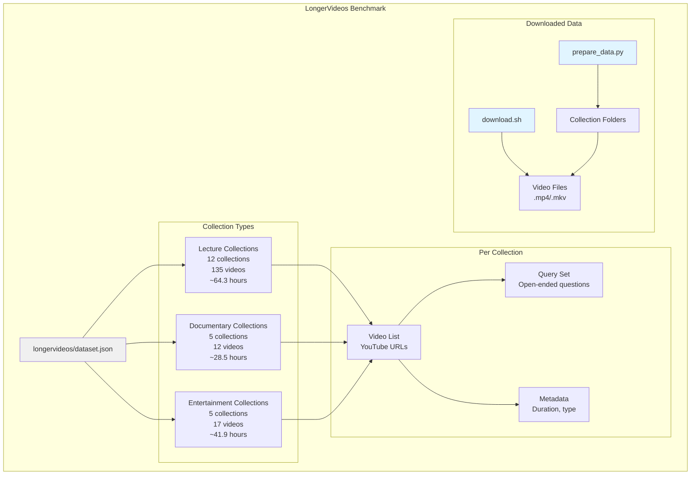
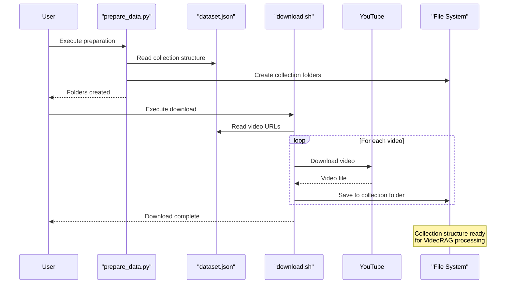
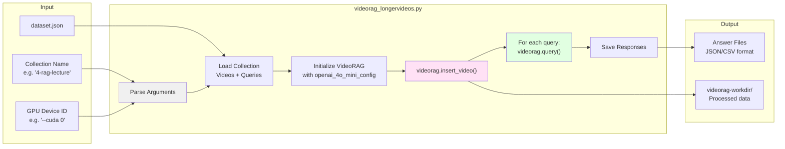
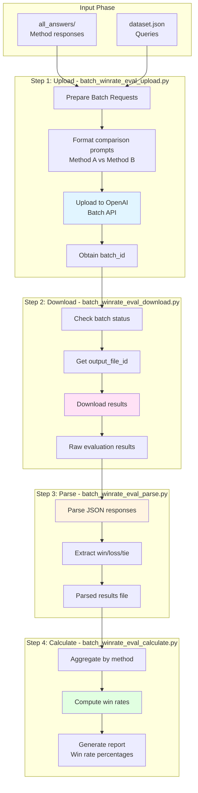
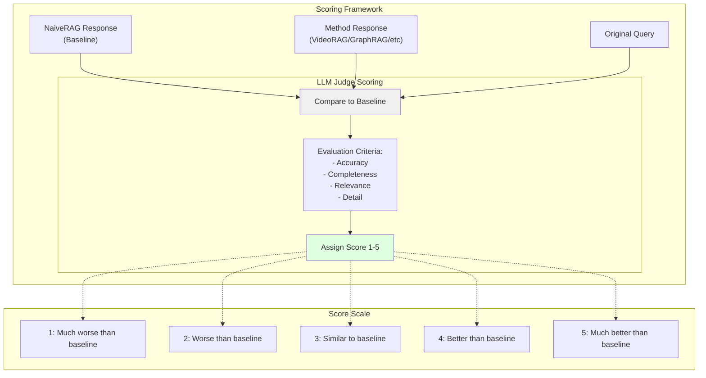
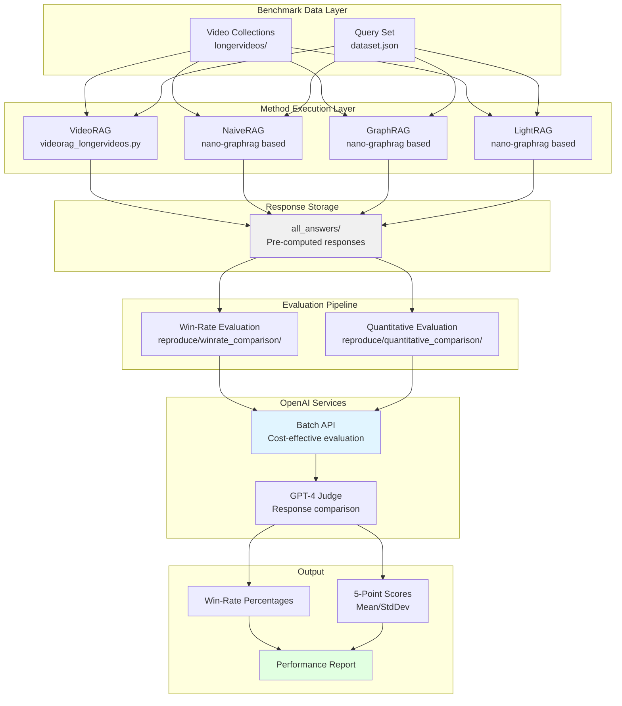

<!-- source: DeepWiki mcp.deepwiki.com · repo HKUDS/VideoRAG · page 6.3 Benchmark Evaluation · fetched 2026-11-09 -->

# Benchmark Evaluation

<details>
<summary>Relevant source files</summary>

The following files were used as context for generating this wiki page:

- [README.md](README.md)
- [VideoRAG-algorithm/README.md](VideoRAG-algorithm/README.md)

</details>


This page documents the evaluation methodology for VideoRAG using the LongerVideos benchmark dataset. It covers the benchmark structure, data preparation procedures, execution of VideoRAG on benchmark videos, and the two evaluation approaches: win-rate comparison and quantitative scoring.

For information on basic video processing with VideoRAG, see [Basic Video Processing](#6.1). For details on the query processing pipeline being evaluated, see [Query Processing](#3.4).

---

## LongerVideos Benchmark Dataset

The LongerVideos benchmark is specifically designed to evaluate video understanding systems on extremely long-context videos. The benchmark contains open-access YouTube videos organized into collections, with associated queries testing various aspects of video comprehension.

### Dataset Structure

The benchmark is organized hierarchically with video collections, individual videos, and evaluation queries:



**Dataset Statistics**

The following table summarizes the LongerVideos benchmark composition:

| Video Type | Collections | Videos | Queries | Avg. Queries/Collection | Total Duration |
|------------|------------:|-------:|--------:|------------------------:|---------------:|
| Lecture | 12 | 135 | 376 | 31.3 | ~64.3 hours |
| Documentary | 5 | 12 | 114 | 22.8 | ~28.5 hours |
| Entertainment | 5 | 17 | 112 | 22.4 | ~41.9 hours |
| **Total** | **22** | **164** | **602** | **27.4** | **~134.6 hours** |

The dataset JSON file [VideoRAG-algorithm/README.md:201-209]() contains the complete specification of video URLs and queries for each collection.

**Sources:** [VideoRAG-algorithm/README.md:201-209]()

---

## Data Preparation

Before running evaluations, the benchmark videos must be downloaded and organized into the correct directory structure.

### Preparation Steps

The data preparation process involves two main scripts:

1. **Create Collection Folders**: The `prepare_data.py` script creates the directory structure for organizing videos by collection.

2. **Download Videos**: The `download.sh` script retrieves videos from YouTube URLs specified in the dataset JSON.



### Execution Commands

Navigate to the benchmark directory and execute the preparation scripts:

```bash
cd longervideos
python prepare_data.py  # Create collection folders
sh download.sh          # Download videos from YouTube
```

After execution, the directory structure will contain organized video files grouped by collection type and specific collection name.

**Sources:** [VideoRAG-algorithm/README.md:211-219]()

---

## Running VideoRAG on Benchmark Collections

Once the benchmark data is prepared, VideoRAG can be executed on individual collections to process videos and generate answers to the benchmark queries.

### Benchmark Processing Script

The `videorag_longervideos.py` script is the primary entry point for running VideoRAG on benchmark collections. It handles:

- Loading the specified collection's videos
- Processing videos through the VideoRAG pipeline
- Executing queries from the dataset
- Saving responses for evaluation



### Execution Command

To run VideoRAG on a specific benchmark collection:

```bash
# Set OpenAI API key in videorag_longervideos.py
python videorag_longervideos.py --collection 4-rag-lecture --cuda 0
```

**Parameters:**
- `--collection`: Collection name from the dataset (e.g., "4-rag-lecture", "documentary-1")
- `--cuda`: GPU device ID for computation (default: 0)

The script will:
1. Load all videos in the specified collection
2. Process them using the VideoRAG pipeline (see [Query Processing](#3.4))
3. Answer all queries associated with the collection
4. Save responses for subsequent evaluation

**Sources:** [VideoRAG-algorithm/README.md:221-226]()

---

## Evaluation Methodologies

VideoRAG provides two complementary evaluation approaches: win-rate comparison for relative performance assessment and quantitative scoring for absolute performance measurement. Both methods use batch processing via the OpenAI API for consistency and reproducibility.

### Pre-computed Answers

For reproducibility, the repository provides pre-computed answers from all evaluated methods, including VideoRAG, NaiveRAG, GraphRAG, and LightRAG. These can be downloaded for evaluation:

```bash
cd reproduce
wget https://archive.org/download/videorag/all_answers.zip
unzip all_answers
```

The pre-computed answers enable researchers to reproduce evaluation results without re-running all baseline methods.

**Sources:** [VideoRAG-algorithm/README.md:230-238]()

---

## Win-Rate Comparison

Win-rate comparison evaluates VideoRAG against RAG-based baselines (NaiveRAG, GraphRAG, LightRAG) by having an LLM judge which method produces better answers for each query.

### Evaluation Pipeline



### Execution Steps

The win-rate evaluation requires four sequential scripts:

**Step 1: Upload Batch Requests**

```bash
cd reproduce/winrate_comparison
# Configure OpenAI API key in the script
python batch_winrate_eval_upload.py
```

This script creates pairwise comparison prompts for all method combinations and uploads them to OpenAI's Batch API. The Batch API is used for cost-effective large-scale evaluations.

**Step 2: Download Results**

```bash
python batch_winrate_eval_download.py
```

This script must be run twice:
1. First execution: Retrieve the `output_file_id` after batch processing completes
2. Second execution: Download the actual evaluation results using the `output_file_id`

Configure the `batch_id` and `output_file_id` in the script between runs.

**Step 3: Parse Results**

```bash
python batch_winrate_eval_parse.py
```

Parses the raw JSON responses from the OpenAI Batch API, extracting win/loss/tie judgments for each comparison. Configure the `output_file_id` in the script.

**Step 4: Calculate Win Rates**

```bash
python batch_winrate_eval_calculate.py
```

Aggregates parsed results and computes win rates for each method. Configure the parsed result filename in the script. Outputs final win-rate percentages showing relative performance.

**Sources:** [VideoRAG-algorithm/README.md:240-259]()

---

## Quantitative Comparison

Quantitative comparison extends win-rate evaluation by assigning 5-point scores to responses, enabling absolute performance measurement. This methodology uses NaiveRAG as a baseline reference for consistent scoring.

### Scoring Methodology



### Execution Steps

The quantitative evaluation follows a similar four-step process:

**Step 1: Upload Batch Requests**

```bash
cd reproduce/quantitative_comparison
# Configure OpenAI API key in the script
python batch_quant_eval_upload.py
```

Prepares scoring requests comparing each method's response to the NaiveRAG baseline and uploads to OpenAI Batch API.

**Step 2: Download Results**

```bash
python batch_quant_eval_download.py
```

Run twice to obtain the `output_file_id` and then download the scored results. Configure `batch_id` and `output_file_id` in the script between runs.

**Step 3: Parse Results**

```bash
python batch_quant_eval_parse.py
```

Extracts numeric scores (1-5) from the LLM judge responses. Configure the `output_file_id` in the script.

**Step 4: Calculate Aggregate Scores**

```bash
python batch_quant_eval_calculate.py
```

Computes mean scores, standard deviations, and other statistics for each method across all queries. Configure the parsed result filename in the script. Outputs quantitative performance metrics.

**Sources:** [VideoRAG-algorithm/README.md:261-279]()

---

## Evaluation Architecture Overview

The complete evaluation system integrates multiple components for comprehensive performance assessment:



**Key Design Principles:**

1. **Fair Comparison**: All RAG baselines (NaiveRAG, GraphRAG, LightRAG) are implemented using the `nano-graphrag` library, ensuring consistent infrastructure across methods. This is explicitly mentioned in [VideoRAG-algorithm/README.md:230]().

2. **Batch Processing**: The evaluation uses OpenAI's Batch API for cost-effective large-scale evaluation, requiring asynchronous submission and retrieval of results.

3. **Reproducibility**: Pre-computed answers enable reproducible evaluation without re-running computationally expensive video processing pipelines.

4. **Dual Metrics**: Win-rate provides relative performance comparison, while quantitative scoring provides absolute performance measurement on a standardized scale.

**Sources:** [VideoRAG-algorithm/README.md:199-279]()

---

## Configuration Requirements

### API Keys

All evaluation scripts require OpenAI API keys for LLM-based evaluation. The API key must be configured in each script:

- Win-rate scripts: Configure in `batch_winrate_eval_upload.py`
- Quantitative scripts: Configure in `batch_quant_eval_upload.py`
- Benchmark execution: Configure in `videorag_longervideos.py`

### Batch API Identifiers

The evaluation process generates identifiers that must be manually transferred between scripts:

- `batch_id`: Generated by upload scripts, required for download scripts
- `output_file_id`: Retrieved by first download run, required for second download run and parsing

These manual configuration steps ensure users understand the asynchronous batch processing workflow.

**Sources:** [VideoRAG-algorithm/README.md:224-278]()

---

## Summary

The benchmark evaluation system provides comprehensive assessment of VideoRAG's performance on extremely long-context videos. The LongerVideos benchmark spans 134+ hours across 164 videos with 602 queries, testing understanding of lectures, documentaries, and entertainment content. The dual evaluation methodology—win-rate comparison for relative performance and quantitative scoring for absolute measurement—enables thorough analysis using GPT-4 as a judge. The pre-computed answers and structured evaluation scripts facilitate reproducible research and comparison with baseline RAG methods.

---

