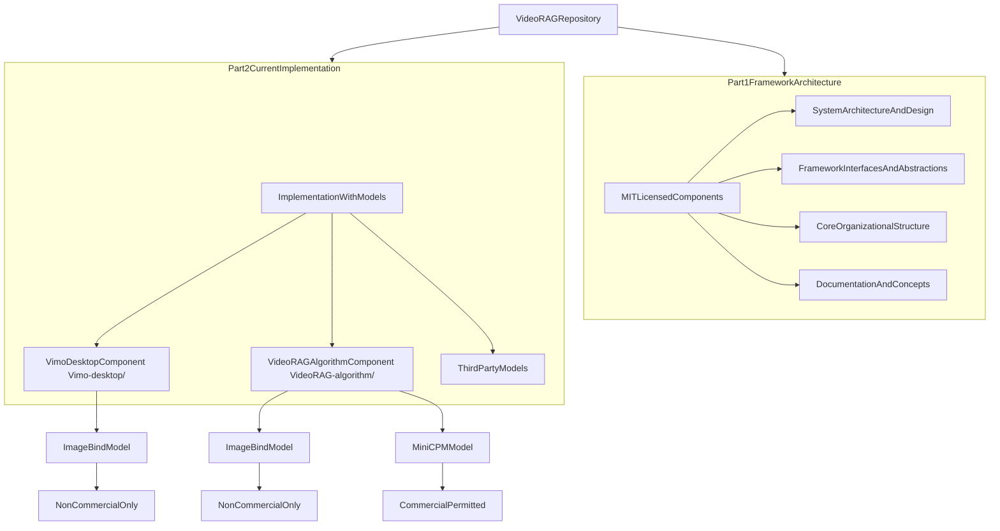
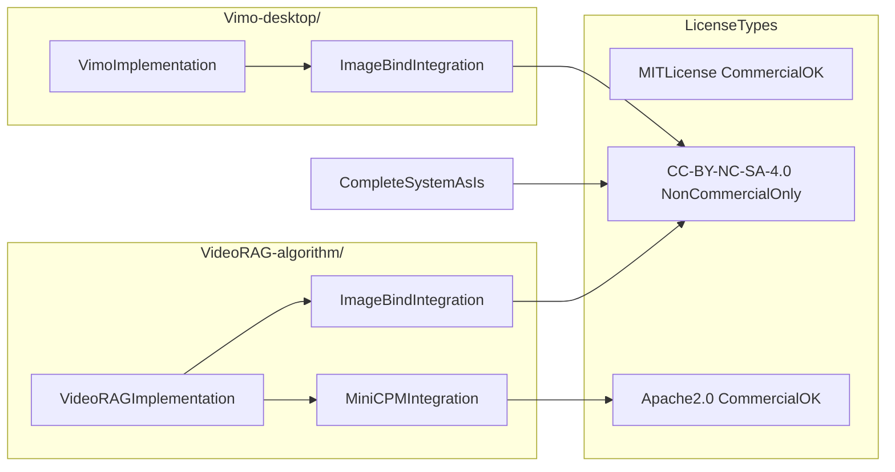
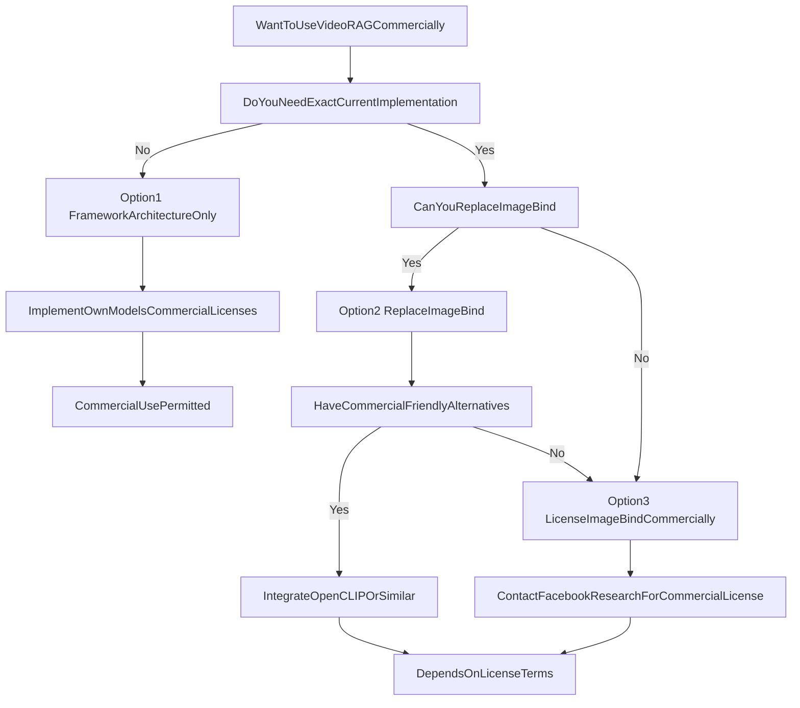

<!-- source: DeepWiki mcp.deepwiki.com · repo HKUDS/VideoRAG · page 7 Licensing · fetched 2026-11-09 -->

# Licensing

Relevant source files

The following files were used as context for generating this wiki page:

- [LICENSE](LICENSE)
- [VideoRAG-algorithm/LICENSE](VideoRAG-algorithm/LICENSE)
- [Vimo-desktop/LICENSE](Vimo-desktop/LICENSE)

## Purpose and Scope

This document explains the dual licensing model used by the VideoRAG project, which includes both the `Vimo-desktop` application and `VideoRAG-algorithm` framework. The licensing structure separates the MIT-licensed framework architecture from the third-party models integrated in the current implementation, which carry their own licensing restrictions. Understanding this distinction is critical for determining your usage rights, particularly for commercial applications.

Sources: [LICENSE:1-140](), [VideoRAG-algorithm/LICENSE:1-140](), [Vimo-desktop/LICENSE:1-140]()

---

## Dual Licensing Structure Overview

The VideoRAG project employs a two-part licensing structure that distinguishes between the framework's architectural concepts and the specific model implementations across directories:

Title: Dual Licensing Architecture Map

Sources: [LICENSE:1-140](), [VideoRAG-algorithm/LICENSE:1-140](), [Vimo-desktop/LICENSE:1-140]()

---

## Part 1: MIT-Licensed Framework Architecture

### What is Covered by the MIT License

The following components are licensed under the MIT License and can be used without restriction, including for commercial purposes:

| Component | Description | File References |
|-----------|-------------|-----------------|
| **System Architecture** | Overall design patterns, dual-channel architecture concepts, query pipeline design | All architectural decisions |
| **Framework Interfaces** | Abstract base classes, API contracts, extension points | Core interface definitions |
| **Organizational Structure** | Directory layout (`Vimo-desktop/`, `VideoRAG-algorithm/`), separation of concerns | Project structure |
| **Documentation** | All conceptual documentation, methodology descriptions, design rationale | README, wiki pages |

The MIT License text appears in [LICENSE:14-41]() and grants unrestricted rights to use, copy, modify, merge, publish, distribute, sublicense, and sell the software.

Sources: [LICENSE:13-41](), [VideoRAG-algorithm/LICENSE:13-41](), [Vimo-desktop/LICENSE:13-41]()

---

## Part 2: Third-Party Model Integrations

### Model Dependencies and Their Licenses

The current codebase includes hardcoded integrations with specific third-party models, each with its own license:

Title: Model Dependency Mapping

#### ImageBind Model
- **License:** Attribution-NonCommercial-ShareAlike 4.0 International (CC BY-NC-SA 4.0) [LICENSE:62-62]()
- **Usage Restriction:** NonCommercial use only [LICENSE:63-63]()
- **Repository:** https://github.com/facebookresearch/ImageBind [LICENSE:64-64]()
- **Used By:** Both `Vimo-desktop/` and `VideoRAG-algorithm/` components [LICENSE:52-56]()

#### MiniCPM Model
- **License:** Apache License 2.0 [LICENSE:67-67]()
- **Usage Restriction:** Commercial use permitted [LICENSE:68-68]()
- **Repository:** https://github.com/OpenBMB/MiniCPM [LICENSE:69-69]()
- **Used By:** `VideoRAG-algorithm/` component only [LICENSE:55-57]()

Sources: [LICENSE:45-70](), [VideoRAG-algorithm/LICENSE:45-70](), [Vimo-desktop/LICENSE:45-70]()

---

## Component-Specific Model Usage

### Vimo-desktop Component
The `Vimo-desktop/` application integrates ImageBind (CC BY-NC-SA 4.0) for multi-modal embedding generation. Consequently, the component as-is is restricted to non-commercial use [LICENSE:52-53, 85-86]().

### VideoRAG-algorithm Component
The `VideoRAG-algorithm/` framework integrates ImageBind (CC BY-NC-SA 4.0) and MiniCPM (Apache 2.0). Because ImageBind is present, the component as-is is restricted to non-commercial use [LICENSE:55-57, 88-89]().

Sources: [LICENSE:50-58](), [VideoRAG-algorithm/LICENSE:50-58](), [Vimo-desktop/LICENSE:50-58]()

---

## Usage Scenarios and Applicable License Terms

Your usage rights depend on how you use the project:

1. **Framework Architecture Only:** If you use only the architectural concepts, designs, and framework structure without the current model implementations, the **MIT License** applies [LICENSE:77-80]().
2. **Current Implementation As-Is:** If you use the complete codebase with integrated ImageBind and MiniCPM models, **NonCommercial use only** applies due to ImageBind [LICENSE:82-92]().
3. **Modified Implementation:** If you replace the third-party models with alternatives, license terms depend on the new models chosen while the framework architecture remains under the MIT License [LICENSE:94-97]().

Sources: [LICENSE:73-97](), [VideoRAG-algorithm/LICENSE:73-97](), [Vimo-desktop/LICENSE:73-97]()

---

## Commercial Use Guidance

Title: Commercial Use Decision Flow

Sources: [LICENSE:101-112](), [VideoRAG-algorithm/LICENSE:101-112](), [Vimo-desktop/LICENSE:101-112]()

---

## Model Replaceability Design Principle

The system is designed to be model-agnostic [LICENSE:118-120](), allowing third-party models to be swapped out without altering core pipeline abstractions.

Sources: [LICENSE:118-120](), [VideoRAG-algorithm/LICENSE:118-120](), [Vimo-desktop/LICENSE:118-120]()

---

## Important Disclaimers and Legal Notes

- **Model Replaceability:** Frameworks are designed to be model-agnostic [LICENSE:118-120]().
- **Responsibility:** Users are responsible for understanding and complying with applicable licenses [LICENSE:122-123]().
- **Current State:** Reflects implementation status as of 2025.09.09 [LICENSE:125-127, 140]().
- **Legal Advice:** Informational only, not legal advice [LICENSE:129-130]().

Sources: [LICENSE:116-130](), [VideoRAG-algorithm/LICENSE:116-130](), [Vimo-desktop/LICENSE:116-130]()

---

## Contact and License Updates

For questions regarding licenses or updates, consult the project repository at https://github.com/HKUDS/VideoRAG [LICENSE:134-140]().

Sources: [LICENSE:134-140](), [VideoRAG-algorithm/LICENSE:134-140](), [Vimo-desktop/LICENSE:134-140]()

---

