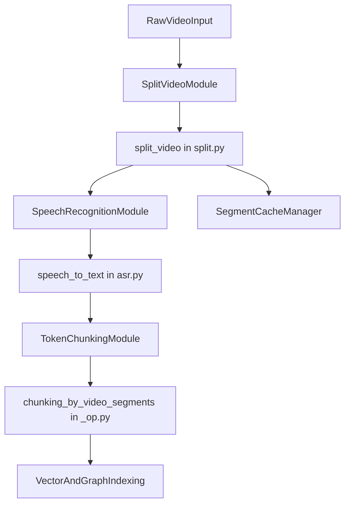
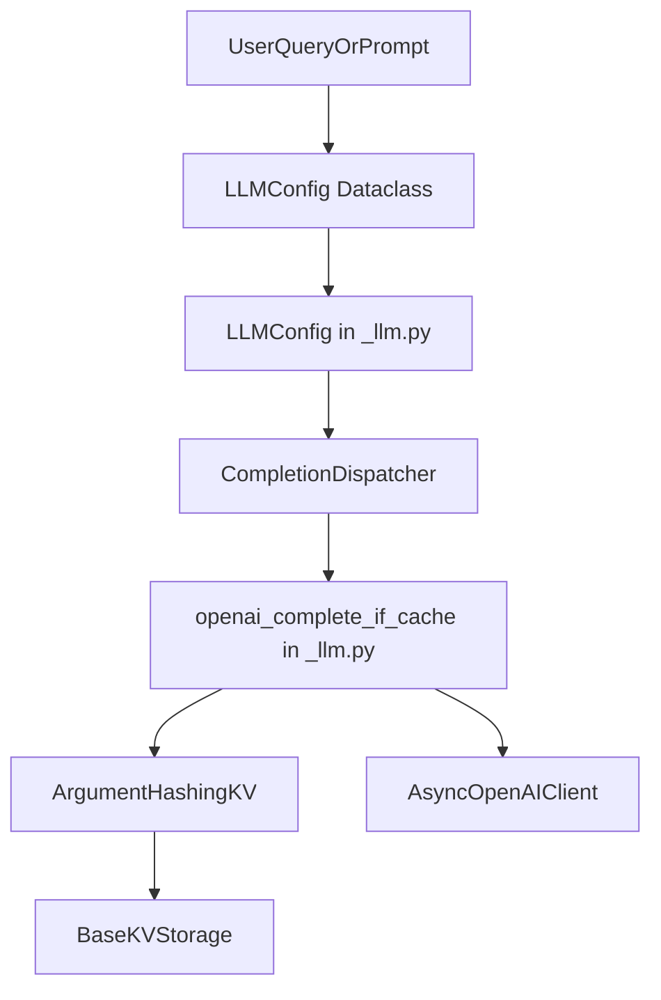

<!-- source: DeepWiki mcp.deepwiki.com · repo HKUDS/VideoRAG · page 8 Glossary · fetched 2026-11-09 -->

# Glossary

Relevant source files

The following files were used as context for generating this wiki page:

- [README.md](README.md)
- [VideoRAG-algorithm/videorag/_llm.py](VideoRAG-algorithm/videorag/_llm.py)
- [VideoRAG-algorithm/videorag/_op.py](VideoRAG-algorithm/videorag/_op.py)
- [VideoRAG-algorithm/videorag/_videoutil/asr.py](VideoRAG-algorithm/videorag/_videoutil/asr.py)
- [VideoRAG-algorithm/videorag/_videoutil/split.py](VideoRAG-algorithm/videorag/_videoutil/split.py)
- [Vimo-desktop/src/renderer/src/components/InitializationWizard.tsx](Vimo-desktop/src/renderer/src/components/InitializationWizard.tsx)
- [Vimo-desktop/src/renderer/src/pages/settings/index.tsx](Vimo-desktop/src/renderer/src/pages/settings/index.tsx)

## Purpose and Scope
This page defines codebase-specific terms, architectural jargon, abbreviations, and domain concepts utilized across the VideoRAG repository. It links high-level natural language descriptions directly to their concrete implementations and code entities within the codebase (`VideoRAG-algorithm/` and `Vimo-desktop/`).

---

## Core Concepts and Code Entity Mapping

### VideoRAG Framework & Engine
The foundational retrieval-augmented generation engine designed for extreme long-context video comprehension. It combines multi-modal context encoding with graph-driven knowledge indexing.
- **Code Entities**: Defined in the core package `VideoRAG-algorithm/videorag/` [README.md:28-28]().

### Vimo Desktop Application
The Electron-based cross-platform desktop application providing an intuitive user interface, drag-and-drop video upload, settings wizard, and IPC integration with the Python backend bridge.
- **Code Entities**: Located in `Vimo-desktop/` [README.md:7-8]().

### Dual-Channel Architecture
An architectural paradigm in VideoRAG that splits video understanding into two channels: graph-driven knowledge indexing (entities, relationships, and global summaries) and hierarchical multimodal context encoding (captions, transcriptions, and visual tokens).
- **Code Entities**: Implemented across indexing operators in `VideoRAG-algorithm/videorag/_op.py:181-204]()`.

### ImageBind
A foundational multi-modal embedding model utilized by VideoRAG and managed via the Vimo Desktop setup wizard to map images, video, text, and audio into a shared embedding space.
- **Code Entities**: Checked and downloaded via `Vimo-desktop/src/renderer/src/components/InitializationWizard.tsx:93-114]()` and `Vimo-desktop/src/renderer/src/pages/settings/index.tsx:71-89]()`.

### ASR (Automatic Speech Recognition)
The subsystem responsible for extracting audio tracks from video segments and transcribing spoken content into timestamped text transcripts using Whisper.
- **Code Entities**: Implemented in `VideoRAG-algorithm/videorag/_videoutil/asr.py:8-29]()`.

### Video Segmentation (`split_video`)
The preprocessing phase that slices a raw video file into discrete chronological segments and extracts corresponding video frames, timestamps, and audio tracks.
- **Code Entities**: Implemented in `VideoRAG-algorithm/videorag/_videoutil/split.py:10-59]()`.

### Token Chunking (`chunking_by_video_segments`)
A chunking strategy that respects video segment boundaries while ensuring generated text chunks do not exceed configured token limits (`max_token_size`).
- **Code Entities**: Implemented in `VideoRAG-algorithm/videorag/_op.py:68-119]()`.

### LLM Configuration (`LLMConfig`)
A centralized dataclass managing model endpoints, embedding functions, execution limits, and concurrency settings for language models (such as GPT-4o, DeepSeek, or Ollama).
- **Code Entities**: Defined in `VideoRAG-algorithm/videorag/_llm.py:45-69]()`.

### Caching Layer (`openai_complete_if_cache`)
A persistence and hashing layer that intercepts LLM calls, computes argument hashes, and checks key-value storage (`hashing_kv`) to avoid redundant API requests.
- **Code Entities**: Implemented in `VideoRAG-algorithm/videorag/_llm.py:91-120]()`.

---

## System-to-Code Mapping Diagrams

### Diagram 1: Video Processing and Indexing Pipeline
Bridges natural language pipeline concepts (Video Splitting, Speech Recognition, Chunking) to exact codebase functions and modules.

Sources: `VideoRAG-algorithm/videorag/_videoutil/split.py:10-59]`, `VideoRAG-algorithm/videorag/_videoutil/asr.py:8-29]`, `VideoRAG-algorithm/videorag/_op.py:68-119]`

---

### Diagram 2: LLM Integration and Caching Architecture
Bridges natural language configuration and caching concepts to their respective classes and wrapper functions.

Sources: `VideoRAG-algorithm/videorag/_llm.py:45-69]`, `VideoRAG-algorithm/videorag/_llm.py:91-120]`, `VideoRAG-algorithm/videorag/base.py`