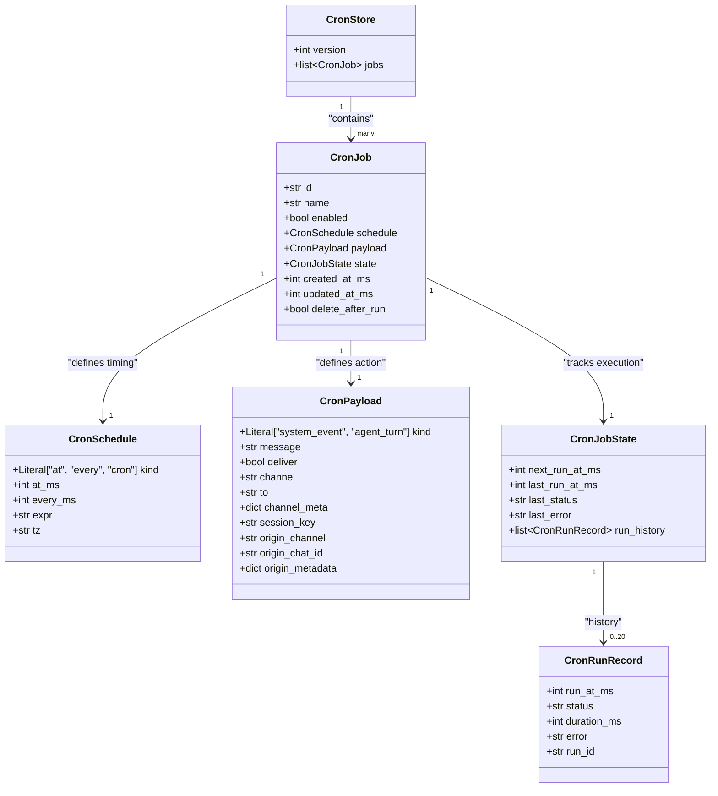
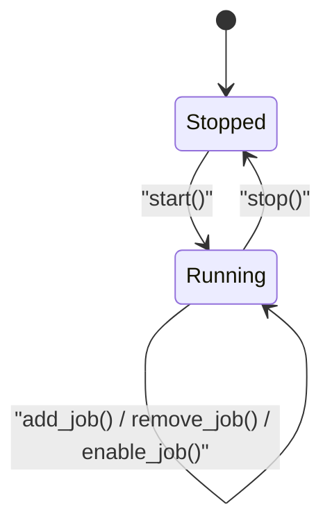
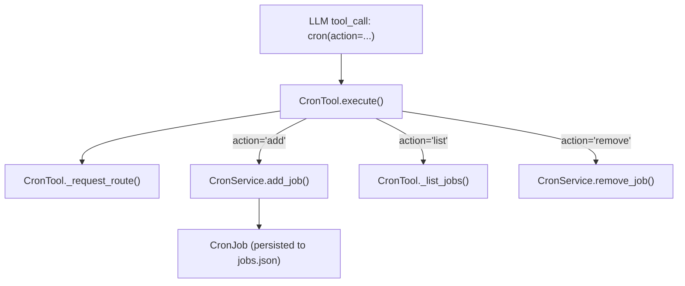
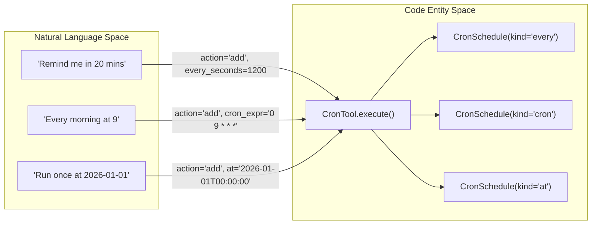

<!-- source: DeepWiki mcp.deepwiki.com · repo HKUDS/nanobot · page 10.1 Cron Service · fetched 2026-11-09 -->

# Cron Service

<details>
<summary>Relevant source files</summary>

The following files were used as context for generating this wiki page:

- [nanobot/agent/automation_turns.py](nanobot/agent/automation_turns.py)
- [nanobot/agent/cron_turns.py](nanobot/agent/cron_turns.py)
- [nanobot/agent/tools/cron.py](nanobot/agent/tools/cron.py)
- [nanobot/cron/bound_runner.py](nanobot/cron/bound_runner.py)
- [nanobot/cron/service.py](nanobot/cron/service.py)
- [nanobot/cron/types.py](nanobot/cron/types.py)
- [nanobot/triggers/local_turns.py](nanobot/triggers/local_turns.py)
- [tests/agent/session_helpers.py](tests/agent/session_helpers.py)
- [tests/agent/test_loop_progress.py](tests/agent/test_loop_progress.py)
- [tests/agent/test_loop_save_turn.py](tests/agent/test_loop_save_turn.py)
- [tests/agent/test_runner_injections.py](tests/agent/test_runner_injections.py)
- [tests/agent/test_session_inbox_controls.py](tests/agent/test_session_inbox_controls.py)
- [tests/cli/test_restart_command.py](tests/cli/test_restart_command.py)
- [tests/command/test_compact_command.py](tests/command/test_compact_command.py)
- [tests/cron/test_cron_active_rearm.py](tests/cron/test_cron_active_rearm.py)
- [tests/cron/test_cron_persistence.py](tests/cron/test_cron_persistence.py)
- [tests/cron/test_cron_service.py](tests/cron/test_cron_service.py)
- [tests/cron/test_cron_tool_list.py](tests/cron/test_cron_tool_list.py)

</details>


This page covers the cron scheduling subsystem: the `CronService` class, the data types it operates on, the `CronTool` agent interface, and the persistence format. For the complementary proactive mechanism that uses `HEARTBEAT.md` instead of explicit jobs, see page 10.2 (Heartbeat Service).

---

## Overview

The Cron Service allows the agent (and operators) to register scheduled tasks that fire prompts back into the `AgentLoop` at defined times. It is one of two proactive task mechanisms in the framework.

The service is implemented in two layers:

| Layer | File | Role |
|---|---|---|
| `CronService` | [nanobot/cron/service.py:169-174]() | Scheduler daemon — persistence, timer, execution |
| `CronTool` | [nanobot/agent/tools/cron.py:57-62]() | Agent-facing tool — `add`, `list`, `remove` actions |

Jobs are persisted in a `jobs.json` file on disk and survive service restarts.

Sources: [nanobot/cron/service.py:1-27](), [nanobot/agent/tools/cron.py:1-20]()

---

## Data Model

All cron types are defined in `nanobot/cron/types.py` and imported by the service.

**Type hierarchy diagram:**



Sources: [nanobot/cron/types.py:26-188]()

### Schedule Kinds

The `CronSchedule.kind` field selects the scheduling mode. All three are mutually exclusive.

| `kind` | Active field(s) | Behaviour | One-shot? |
|---|---|---|---|
| `at` | `at_ms` | Fires once at absolute epoch-ms timestamp [nanobot/cron/service.py:45-46]() | Yes — job is deleted after firing if `delete_after_run` is True |
| `every` | `every_ms` | Fires repeatedly at a fixed interval from "now" [nanobot/cron/service.py:48-53]() | No |
| `cron` | `expr`, `tz` | Standard 5-field cron expression; optional IANA timezone [nanobot/cron/service.py:55-68]() | No |

For `cron` schedules without `tz`, the server's local timezone is used [nanobot/cron/service.py:62](). Timezone validation is performed by `_validate_schedule_for_add` using `zoneinfo.ZoneInfo` [nanobot/cron/service.py:72-93]().

Sources: [nanobot/cron/service.py:43-70](), [nanobot/cron/types.py:27-48]()

### Payload Fields and Migration

`CronPayload` carries the execution context for when the job fires. Recent updates have shifted towards session-bound context via `origin_channel` and `origin_chat_id` [nanobot/cron/service.py:133-165]().

| Field | Type | Purpose |
|---|---|---|
| `kind` | `str` | `"agent_turn"` (default) or `"system_event"` [nanobot/cron/types.py:53]() |
| `message` | `str` | The prompt text sent to the `AgentLoop` [nanobot/cron/types.py:54]() |
| `session_key` | `str` | Original session key for correct session recording [nanobot/cron/types.py:60]() |
| `origin_channel` | `str` | The channel where the job was created [nanobot/cron/types.py:61]() |
| `origin_chat_id` | `str` | The chat ID where the job was created [nanobot/cron/types.py:62]() |
| `origin_metadata` | `dict` | Context metadata (e.g. Slack thread IDs) [nanobot/cron/types.py:63]() |

Legacy jobs (pre-session binding) that used `channel` and `to` are automatically migrated to the new `origin_channel` and `origin_chat_id` format during loading via `_normalize_agent_turn_job` [nanobot/cron/service.py:133-165](). Jobs that cannot be bound to a concrete session are disabled to prevent unroutable executions [nanobot/cron/service.py:172-176](), [tests/cron/test_cron_service.py:185-204]().

Sources: [nanobot/cron/types.py:51-83](), [nanobot/cron/service.py:133-165](), [nanobot/cron/service.py:172-176](), [tests/cron/test_cron_service.py:185-204]()

---

## CronService

`CronService` manages the lifecycle and execution of jobs. Its constructor signature:

```python
CronService(store_path: Path, on_job: Callable[[CronJob], Coroutine[Any, Any, str | CronRunResult | None]] | None = None)
```

- `store_path` — path to the `jobs.json` persistence file [nanobot/cron/service.py:179]().
- `on_job` — async callback invoked for each fired job [nanobot/cron/service.py:181]().

### Lifecycle

**CronService lifecycle diagram:**



1. `start()` — Loads `jobs.json`, recomputes all `next_run_at_ms` values, and arms the first timer [nanobot/cron/service.py:460-477]().
2. `_arm_timer()` — Calculates the earliest `next_run_at_ms` across all enabled jobs, then creates an `asyncio.Task` that sleeps for the required delay [nanobot/cron/service.py:381-406]().
3. `_on_timer()` — Collects all jobs where `now_ms >= next_run_at_ms`, calls `_execute_job()` for each, and re-arms [nanobot/cron/service.py:358-379]().
4. `stop()` — Cancels the pending timer task [nanobot/cron/service.py:479-485]().

Sources: [nanobot/cron/service.py:177-192](), [nanobot/cron/service.py:358-412]()

### Persistence and Atomic Writes

`CronService` implements a robust persistence strategy to prevent data loss. It uses a temporary file and rename operation (`os.replace`) via `_atomic_write` to ensure `jobs.json` is written atomically [nanobot/cron/service.py:442-447](), [nanobot/cron/service.py:449-458]().

If the store file is found to be corrupt during loading, the service preserves the corrupt file with a `.corrupt-<ts>` suffix instead of overwriting it with an empty list [nanobot/cron/service.py:269-281]().

Multi-instance synchronization is handled via an `action.jsonl` journal and a `FileLock` [nanobot/cron/service.py:180-181](). `_merge_action()` reads this journal to update the in-memory state [nanobot/cron/service.py:285-324]().

Sources: [nanobot/cron/service.py:269-324](), [nanobot/cron/service.py:434-458](), [tests/cron/test_cron_persistence.py:69-138]()

### Execution and History

When a job executes, the service records a `CronRunRecord` in the job's `run_history`. The history is trimmed to a maximum of 20 entries defined by `_MAX_RUN_HISTORY` [nanobot/cron/service.py:171](). Success and failure states are captured to allow debugging of scheduled tasks [nanobot/cron/service.py:416-447]().

Sources: [nanobot/cron/service.py:171](), [nanobot/cron/service.py:416-447](), [tests/cron/test_cron_service.py:47-65]()

---

## CronTool

`CronTool` is the agent-facing `Tool` subclass that exposes `CronService` to the LLM.

**Tool-to-service interaction diagram:**



Sources: [nanobot/agent/tools/cron.py:138-148](), [nanobot/agent/tools/cron.py:76-85]()

### Context Binding and Recursion Guard

Before adding a job, `CronTool` calls `_request_route()` to extract the current session context from `current_request_context()` [nanobot/agent/tools/cron.py:76-85](). This ensures that when the job triggers, the prompt is delivered back to the correct `origin_channel` and `origin_chat_id` [nanobot/agent/tools/cron.py:165-168]().

`CronTool` uses a `RequestContext` check to prevent infinite recursion. If a job execution triggers an agent turn, the agent is forbidden from scheduling *new* jobs during that specific turn [nanobot/agent/tools/cron.py:140-142]().

Sources: [nanobot/agent/tools/cron.py:76-85](), [nanobot/agent/tools/cron.py:140-142](), [nanobot/agent/tools/cron.py:165-168]()

### Tool Parameters

The `CronTool` parameters are defined using `tool_parameters_schema`:

| Parameter | Type | Description |
|---|---|---|
| `action` | `string` | `"add"`, `"list"`, or `"remove"` [nanobot/agent/tools/cron.py:24]() |
| `name` | `string` | Optional short human-readable label for the job [nanobot/agent/tools/cron.py:25-28]() |
| `message` | `string` | REQUIRED for `add`. Instruction for the agent to execute when the job triggers [nanobot/agent/tools/cron.py:29-32]() |
| `every_seconds` | `integer` | Interval in seconds (for recurring tasks) [nanobot/agent/tools/cron.py:33]() |
| `cron_expr` | `string` | Cron expression like `'0 9 * * *'` [nanobot/agent/tools/cron.py:34]() |
| `tz` | `string` | IANA timezone for cron expressions [nanobot/agent/tools/cron.py:35-38]() |
| `at` | `string` | ISO datetime for one-time execution [nanobot/agent/tools/cron.py:39-42]() |
| `job_id` | `string` | REQUIRED for `remove`. Job ID to remove [nanobot/agent/tools/cron.py:43]() |

Sources: [nanobot/agent/tools/cron.py:23-52]()

---

## Scheduling Logic

The system translates natural language timing requests into specific `CronSchedule` configurations.

**Natural-language to Code Entity mapping:**



Sources: [nanobot/agent/tools/cron.py:147-154](), [nanobot/cron/service.py:43-70]()

---

## Session Coordination

Scheduled cron turns are identified by specific metadata keys to distinguish them from standard user turns.

| Key | File | Purpose |
|---|---|---|
| `CRON_TRIGGER_META` | [nanobot/cron/session_turns.py:24]() | Marks the turn as triggered by cron |
| `CRON_HISTORY_META` | [nanobot/cron/session_turns.py:25]() | Marks the turn as a cron-related history entry |
| `CRON_DEFER_UNTIL_IDLE_META` | [nanobot/cron/session_turns.py:26]() | Flag to delay turn if session is busy |

The function `is_bound_cron_job` verifies that a job has the necessary session context (`session_key`, `origin_channel`, `origin_chat_id`) to be correctly routed [nanobot/cron/session_turns.py:19](). The `AgentLoop` uses these metadata keys to handle cron-triggered messages, including deferring them if the session is active [tests/agent/test_session_inbox_controls.py:69-92]().

Sources: [nanobot/cron/session_turns.py:19-26](), [tests/agent/test_loop_save_turn.py:189-201](), [tests/agent/test_session_inbox_controls.py:69-92]()

---

