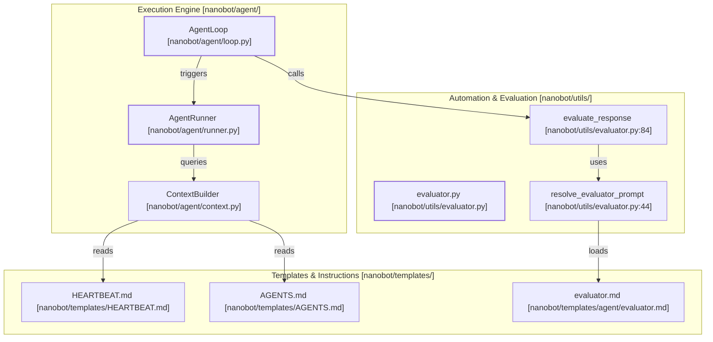
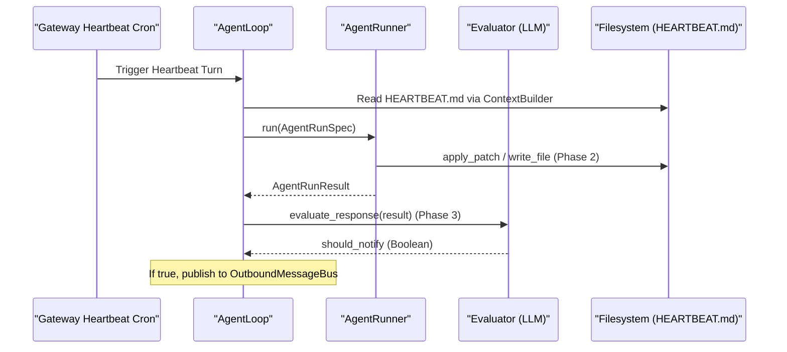
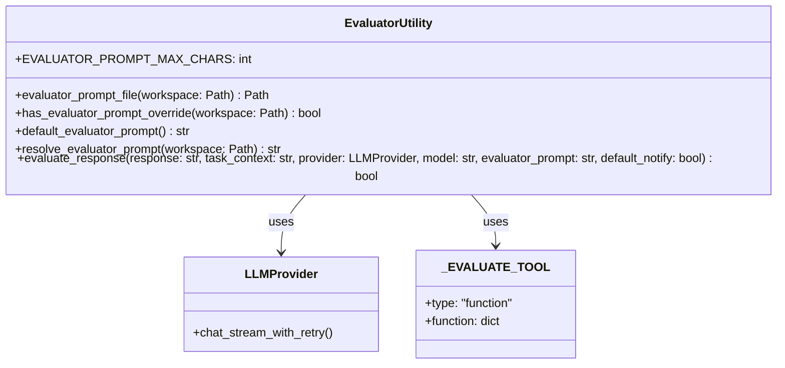

<!-- source: DeepWiki mcp.deepwiki.com · repo HKUDS/nanobot · page 10.2 Heartbeat Service · fetched 2026-11-09 -->

# Heartbeat Service

Relevant source files

The following files were used as context for generating this wiki page:

- [nanobot/agent/context.py](nanobot/agent/context.py)
- [nanobot/skills/memory/SKILL.md](nanobot/skills/memory/SKILL.md)
- [nanobot/templates/AGENTS.md](nanobot/templates/AGENTS.md)
- [nanobot/templates/HEARTBEAT.md](nanobot/templates/HEARTBEAT.md)
- [nanobot/templates/SOUL.md](nanobot/templates/SOUL.md)
- [nanobot/templates/agent/dream.md](nanobot/templates/agent/dream.md)
- [nanobot/templates/agent/identity.md](nanobot/templates/agent/identity.md)
- [nanobot/templates/agent/tool_contract.md](nanobot/templates/agent/tool_contract.md)
- [nanobot/templates/legacy/SOUL.md](nanobot/templates/legacy/SOUL.md)
- [nanobot/templates/prompts/README.md](nanobot/templates/prompts/README.md)
- [nanobot/utils/evaluator.py](nanobot/utils/evaluator.py)
- [nanobot/utils/workspace_prompts.py](nanobot/utils/workspace_prompts.py)
- [tests/agent/test_context_builder.py](tests/agent/test_context_builder.py)
- [tests/agent/test_context_prompt_cache.py](tests/agent/test_context_prompt_cache.py)
- [tests/agent/test_dream.py](tests/agent/test_dream.py)
- [tests/agent/test_evaluator.py](tests/agent/test_evaluator.py)
- [tests/command/test_builtin_evaluator_prompt.py](tests/command/test_builtin_evaluator_prompt.py)
- [tests/tools/test_tool_descriptions.py](tests/tools/test_tool_descriptions.py)

## Purpose and Scope

The Heartbeat Service provides periodic, automated task execution for the nanobot agent. It wakes up at configurable intervals, checks a designated task file (`HEARTBEAT.md`) in the workspace, and executes any pending tasks through the full agent loop [nanobot/templates/AGENTS.md:16-24](), [nanobot/templates/HEARTBEAT.md:1-5]().

The service is designed to be "quiet" by default. Results are filtered through a deliverability check and an LLM-based evaluation phase to ensure only relevant, actionable information is delivered to the user's chat channel. This distinguishes it from standard `cron` jobs, which typically deliver results on every run regardless of content [nanobot/templates/AGENTS.md:21-24]().

---

## Three-Phase Workflow

The heartbeat execution cycle implements a robust three-phase workflow managed by the `AgentLoop` and coordinated via the `nanobot gateway` heartbeat cron job [nanobot/templates/AGENTS.md:18-20]().

### Phase 1: Decision
The service determines if background activity is required.
- **Task Detection:** The service checks `HEARTBEAT.md` for active tasks. If the file contains only headers or instructions, the turn may be skipped to save tokens [nanobot/templates/AGENTS.md:16-24]().
- **Prompt Construction:** The `ContextBuilder` assembles the system prompt, including workspace identity and the `HEARTBEAT.md` content as context [nanobot/agent/context.py:11-12](), [nanobot/templates/agent/identity.md:1-12]().

### Phase 2: Execution
If active tasks are found, the agent enters its standard iteration loop to process them.
- **Tool Access:** The agent uses its standard toolset. Instructions recommend `apply_patch` for normal task-list updates and `write_file` for initial creation [nanobot/templates/AGENTS.md:20-22](), [nanobot/templates/agent/tool_contract.md:77]().
- **Iteration Management:** The agent loop continues for up to 40 iterations (default) or until the goal is complete [nanobot/agent/runner.py:97-101]().
- **Task Management:** Background checks that should only notify on actionable changes are specifically directed to `HEARTBEAT.md` rather than standard cron jobs [nanobot/templates/AGENTS.md:21-24]().

### Phase 3: Evaluation & Deliverability
Before notifying the user, the result is subjected to an automated evaluation by a specialized LLM call [nanobot/utils/evaluator.py:3-5]().
- **Actionability Evaluation:** The `evaluate_response` function uses a tool-calling LLM to decide if the output contains actionable or important info [nanobot/utils/evaluator.py:84-91]().
- **Notification Gate:** The evaluator calls `evaluate_notification` with a `should_notify` boolean [nanobot/utils/evaluator.py:64-72](). If `false`, the notification is suppressed to avoid noise [nanobot/utils/evaluator.py:71-72]().
- **Customization:** Users can customize the evaluator's criteria via the `/evaluator-prompt` command, which writes to a workspace-local override file [nanobot/command/builtin.py:154-160](), [nanobot/utils/evaluator.py:29-32]().

**Sources:** [nanobot/templates/AGENTS.md:16-24](), [nanobot/agent/runner.py:90-118](), [nanobot/utils/evaluator.py:3-134](), [nanobot/command/builtin.py:154-160]()

---

## System Architecture

The Heartbeat Service operates within the agent's workspace and relies on the versioned memory system to track state.

### Code-to-System Mapping
The following diagram bridges the high-level heartbeat concepts to specific codebase entities.

**Sources:** [nanobot/agent/loop.py:10-25](), [nanobot/agent/runner.py:137-142](), [nanobot/utils/evaluator.py:44-91](), [nanobot/agent/context.py:11-12](), [nanobot/templates/AGENTS.md:16-24]()

---

## Data Flow: Heartbeat State Management

The heartbeat flow relies on the `AgentRunner` to execute tool calls and the `evaluator` to gate notifications.

**Sources:** [nanobot/agent/runner.py:90-135](), [nanobot/utils/evaluator.py:84-134](), [nanobot/templates/AGENTS.md:16-24]()

---

## HEARTBEAT.md and Persistence

The `HEARTBEAT.md` file serves as the agent's scratchpad for tracking long-term background goals and periodic checks.

- **State Tracking:** The agent is instructed to treat `HEARTBEAT.md` as the primary source for recurring background tasks [nanobot/templates/AGENTS.md:18-24]().
- **Version Control:** Changes to workspace files during a heartbeat are tracked via the `GitStore`. The `/dream-log` command can be used to see changes made during these autonomous turns [nanobot/command/builtin.py:132-137](), [nanobot/utils/gitstore.py:125-130]().
- **Notification Logic:** The `evaluator.md` template defines the system prompt for the notification gate, ensuring the LLM understands its role as a "notification gate" rather than a participant in the task [nanobot/utils/evaluator.py:39-41]().

**Sources:** [nanobot/templates/AGENTS.md:16-24](), [nanobot/utils/evaluator.py:39-41](), [nanobot/utils/gitstore.py:125-164](), [nanobot/command/builtin.py:132-137]()

---

## Evaluator Utility

The `evaluator.py` module [nanobot/utils/evaluator.py:1-138]() provides the core logic for the LLM-based notification gate.

### `evaluator.py` Components

**Sources:** [nanobot/utils/evaluator.py:1-138]()

### Key Functions

- `evaluator_prompt_file(workspace: Path)`: Returns the path to the workspace-local `evaluator.md` override file [nanobot/utils/evaluator.py:29-32]().
- `has_evaluator_prompt_override(workspace: Path)`: Checks if a non-empty workspace override exists [nanobot/utils/evaluator.py:35-38]().
- `default_evaluator_prompt()`: Returns the built-in system prompt for the evaluator [nanobot/utils/evaluator.py:39-41]().
- `resolve_evaluator_prompt(workspace: Path)`: Determines the active evaluator prompt, prioritizing workspace overrides and truncating oversized ones [nanobot/utils/evaluator.py:44-59]().
- `evaluate_response(...)`: The main function that makes an LLM call to decide if a heartbeat result warrants user notification. It uses a specific tool, `evaluate_notification`, to get a boolean decision and a reason [nanobot/utils/evaluator.py:84-138]().
    - It constructs messages using the resolved evaluator prompt and the task context/response [nanobot/utils/evaluator.py:101-107]().
    - It passes `_EVALUATE_TOOL` to the LLM, which defines the `evaluate_notification` function with `should_notify` (boolean) and `reason` (string) parameters [nanobot/utils/evaluator.py:61-82]().
    - On any failure, it falls back to a `default_notify` value, which is `False` for heartbeats to "fail closed" and prevent spam [nanobot/utils/evaluator.py:90-91](), [nanobot/utils/evaluator.py:137-138]().

**Sources:** [nanobot/utils/evaluator.py:29-138]()

---

## Code Entity Reference

| Concept | Code Entity | Location |
|---------|-------------|----------|
| **Execution Loop** | `AgentRunner` | [nanobot/agent/runner.py:137]() |
| **Notification Gate** | `evaluate_response` | [nanobot/utils/evaluator.py:84]() |
| **Prompt Resolver** | `resolve_evaluator_prompt` | [nanobot/utils/evaluator.py:44]() |
| **Command Override** | `/evaluator-prompt` | [nanobot/command/builtin.py:154]() |
| **Task Definition** | `HEARTBEAT.md` | [nanobot/templates/HEARTBEAT.md:1]() |
| **Agent Guidance** | `AGENTS.md` (Heartbeat Tasks) | [nanobot/templates/AGENTS.md:16]() |
| **Tool Evaluation** | `evaluate_notification` (Function) | [nanobot/utils/evaluator.py:64]() |

**Sources:** [nanobot/agent/runner.py:137](), [nanobot/utils/evaluator.py:44-84](), [nanobot/command/builtin.py:154-160](), [nanobot/templates/AGENTS.md:16-24](), [nanobot/templates/HEARTBEAT.md:1-5]()

---

