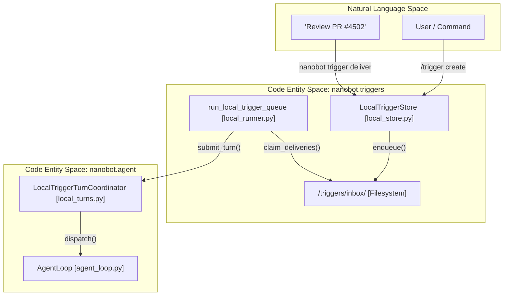
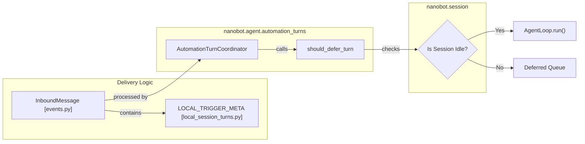

<!-- source: DeepWiki mcp.deepwiki.com · repo HKUDS/nanobot · page 10.3 Local Triggers · fetched 2026-11-09 -->

# Local Triggers

Relevant source files

The following files were used as context for generating this wiki page:

- [nanobot/triggers/local_runner.py](nanobot/triggers/local_runner.py)
- [nanobot/triggers/local_session_turns.py](nanobot/triggers/local_session_turns.py)
- [nanobot/triggers/local_store.py](nanobot/triggers/local_store.py)
- [nanobot/triggers/local_types.py](nanobot/triggers/local_types.py)
- [nanobot/utils/dict_keys.py](nanobot/utils/dict_keys.py)
- [nanobot/utils/run_records.py](nanobot/utils/run_records.py)
- [tests/triggers/test_local_triggers.py](tests/triggers/test_local_triggers.py)

The Local Trigger system allows external events or commands to initiate autonomous agent turns within specific sessions. Triggers are created via the `/trigger` command (or WebUI), stored persistently in the workspace, and delivered to the agent via a dedicated polling loop. This enables nanobot to react to local filesystem changes, external webhooks, or long-running processes by "waking up" and processing a predefined prompt.

## Architecture and Data Flow

The system is split between the **Trigger Store** (persistence), the **Local Runner** (delivery loop), and the **Turn Coordinator** (agent integration).

### Trigger Lifecycle Diagram
This diagram illustrates the flow from trigger creation to execution in the `AgentLoop`.

Sources: [nanobot/triggers/local_store.py:162-182](), [nanobot/triggers/local_runner.py:20-51](), [nanobot/triggers/local_session_turns.py:29-38]()

## Storage and Persistence

Triggers and their delivery states are managed by `LocalTriggerStore`. Each workspace has a `triggers/` directory containing the configuration and several subdirectories for queue management.

### Directory Structure
| Path | Purpose |
| :--- | :--- |
| `triggers.json` | The registry of defined triggers (ID, name, session_key, etc.). |
| `inbox/` | New delivery requests waiting to be processed. |
| `processing/` | Deliveries currently being handled by the agent. |
| `failed/` | Deliveries that exhausted retry attempts. |
| `runs/` | Durable JSON audit records for every trigger execution. |

Sources: [nanobot/triggers/local_store.py:44-52](), [nanobot/triggers/local_store.py:181-190](), [nanobot/triggers/local_store.py:203-228]()

### Key Classes and Types
*   **`LocalTrigger`**: Represents a session-bound local trigger containing configuration like `channel`, `chat_id`, and `session_key`. [nanobot/triggers/local_types.py:51-68]()
*   **`TriggerDelivery`**: Represents a specific instance of a trigger being fired, containing the `content` (prompt) and `attempts` count. [nanobot/triggers/local_types.py:122-131]()
*   **`TriggerRunRecord`**: A single delivery record storing `run_at_ms`, `status`, and potential `error`. [nanobot/triggers/local_types.py:27-32]()
*   **`LocalTriggerStore`**: Handles atomic writes using `FileLock`, queue transitions, and persistence of the trigger registry. It uses `_atomic_write` to ensure filesystem integrity even on shared folders where `fsync` on directories might fail. [nanobot/triggers/local_store.py:41-52](), [nanobot/utils/run_records.py:37-58](), [tests/triggers/test_local_triggers.py:70-98]()

## Delivery Mechanism

The delivery process is decoupled from the agent loop to ensure reliability and allow for retries.

### Local Runner Loop
The `run_local_trigger_queue` function in `nanobot/triggers/local_runner.py` performs the following steps:
1.  **Recovery**: On startup, it calls `store.recover_processing_deliveries()` to move files from `processing/` back to `inbox/` to handle interrupted runs. [nanobot/triggers/local_runner.py:32-37]()
2.  **Polling**: Every `poll_interval_s` (default 0.5s), it uses `store.claim_deliveries()` to fetch a batch. [nanobot/triggers/local_runner.py:38-42]()
3.  **Submission**: It converts the `TriggerDelivery` into an `InboundMessage` with a `session_key_override` and calls the `submit_turn` callback. [nanobot/triggers/local_runner.py:146-154]()
4.  **Completion**: Upon success, it records the delivery status and cleans up the queue file via `store.complete_delivery()`. [nanobot/triggers/local_runner.py:155-166]()

### Error Handling and Retries
If a delivery fails, the runner distinguishes between terminal and transient errors:
*   **Terminal Errors**: If the trigger is deleted, disabled, or the channel is unavailable, the delivery is dropped and marked as an error. This is handled by `_TerminalDeliveryError`. [nanobot/triggers/local_runner.py:62-81](), [nanobot/triggers/local_runner.py:126-127]()
*   **Transient Errors**: Other exceptions trigger a retry via `store.retry_delivery()`. The system allows up to 10 attempts, defined by `_MAX_DELIVERY_ATTEMPTS`. [nanobot/triggers/local_store.py:24-24](), [nanobot/triggers/local_runner.py:103-124]()

## Agent Integration

Local triggers are integrated into the agent's turn management via `LocalTriggerTurnCoordinator`. This ensures that trigger-initiated turns do not conflict with active user sessions.

### Coordination Logic Diagram
This diagram shows how `LocalTriggerTurnCoordinator` manages the transition from an external delivery to an internal agent turn.

Sources: [nanobot/triggers/local_session_turns.py:12-12](), [nanobot/agent/automation_turns.py:7-15]()

### Metadata and History
When a trigger turn starts, specific metadata is attached to the `InboundMessage` to distinguish it from standard user input:
*   **`LOCAL_TRIGGER_META`**: Stores `trigger_id`, `trigger_name`, and `delivery_id`. [nanobot/triggers/local_session_turns.py:12-12]()
*   **History Overrides**: The system uses `LOCAL_TRIGGER_AUTOMATION_SPEC` to format how the trigger appears in the session's history. Instead of a raw prompt, it records a label like "Local trigger received: [Name]". [nanobot/triggers/local_session_turns.py:29-38]()

### Concurrency and Deferral
The `AutomationTurnCoordinator` (used by local triggers) prevents a trigger from interrupting an active LLM turn. If the session is currently active, the trigger message is placed in `deferred_queues` until the session becomes idle. [nanobot/agent/automation_turns.py:16-37]()

Sources:
- `nanobot/triggers/local_store.py`
- `nanobot/triggers/local_runner.py`
- `nanobot/triggers/local_types.py`
- `nanobot/triggers/local_session_turns.py`
- `nanobot/agent/automation_turns.py`
- `nanobot/utils/run_records.py`
- `tests/triggers/test_local_triggers.py`
- `nanobot/utils/dict_keys.py`

---

