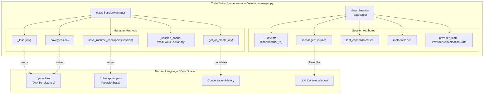
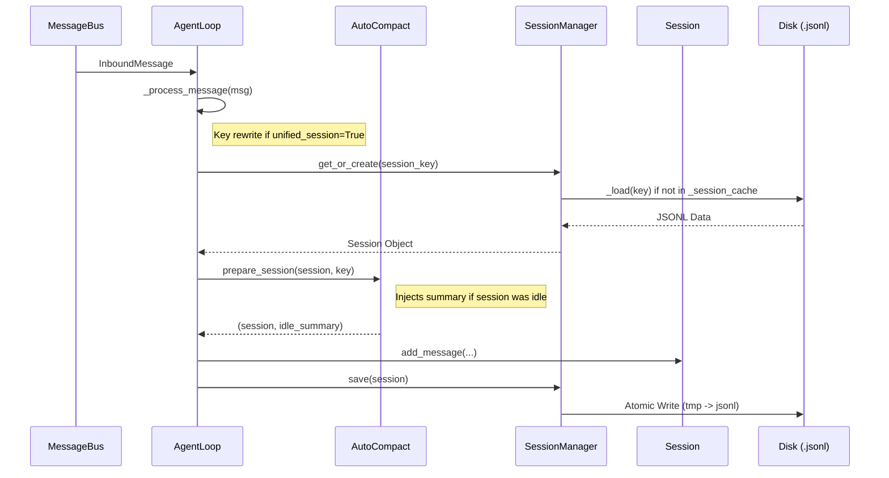

<!-- source: DeepWiki mcp.deepwiki.com · repo HKUDS/nanobot · page 11 Session Management · fetched 2026-11-09 -->

# Session Management

Relevant source files

The following files were used as context for generating this wiki page:

- [nanobot/agent/autocompact.py](nanobot/agent/autocompact.py)
- [nanobot/agent/memory.py](nanobot/agent/memory.py)
- [nanobot/session/manager.py](nanobot/session/manager.py)
- [nanobot/templates/agent/consolidator_archive.md](nanobot/templates/agent/consolidator_archive.md)
- [tests/agent/test_auto_compact.py](tests/agent/test_auto_compact.py)
- [tests/agent/test_autocompact_unit.py](tests/agent/test_autocompact_unit.py)
- [tests/agent/test_consolidator.py](tests/agent/test_consolidator.py)
- [tests/agent/test_loop_consolidation_tokens.py](tests/agent/test_loop_consolidation_tokens.py)
- [tests/agent/test_new_command_archival.py](tests/agent/test_new_command_archival.py)
- [tests/agent/test_session_manager_history.py](tests/agent/test_session_manager_history.py)

## Purpose and Scope

The Session Management system provides persistent conversation state tracking for nanobot. It stores message history in JSONL format, manages in-memory caching, and tracks memory consolidation progress. Each session is identified by a unique key derived from the communication channel and chat identifier.

This page provides a high-level overview of session architecture and lifecycle. For deep technical details on specific components, see the following child pages:
- **[Session Lifecycle](#11.1)**: Details on session creation, keying (including unified sessions), persistence, and turn-saving sanitization.
- **[Memory Consolidation & Auto-Compaction](#11.2)**: Details on the process of compressing history as it approaches context limits, including token estimation, offset tracking, and idle TTL auto-compaction.

---

## Session Architecture

The session management system consists of two primary components: the `Session` dataclass that represents individual conversation sessions, and the `SessionManager` class that handles persistence and lifecycle operations.

### Entity Relationship Diagram
This diagram maps the high-level session concepts to the specific code entities in `nanobot/session/manager.py`.

**Sources:** [nanobot/session/manager.py:171-187](), [nanobot/session/manager.py:463-483](), [nanobot/session/manager.py:646-693](), [nanobot/session/manager.py:840-862]()

---

## Session Dataclass

The `Session` dataclass [nanobot/session/manager.py:171-187]() stores all conversation state for a single chat context. It uses an append-only message list for LLM cache efficiency.

### Key Capabilities
- **Message Storage**: Maintains a list of message dictionaries including `role`, `content`, and metadata via `add_message()` [nanobot/session/manager.py:237-253]().
- **History Retrieval**: The `get_history()` method [nanobot/session/manager.py:260-331]() returns recent messages for LLM input. It includes logic to avoid "orphaned" tool results by finding a legal start boundary where every tool result has a matching assistant `tool_call` using `find_legal_message_start` [nanobot/utils/helpers.py:101-125]().
- **Consolidation Tracking**: Uses `last_consolidated` [nanobot/session/manager.py:181-181]() to track how many messages have been moved to long-term storage or summarized.
- **Content Sanitization**: Internal replay artifacts like image breadcrumbs and tool call echo strings are scrubbed via `_sanitize_assistant_replay_text` [nanobot/session/manager.py:101-114]() before being sent to the LLM.
- **File Capping**: Sessions are governed by a hard message limit defined by `_HISTORY_ENTRY_HARD_CAP` [nanobot/agent/memory.py:10-10]() to prevent unbounded growth of the primary history file.

For details on history slicing and boundary logic, see [Session Lifecycle](#11.1).

**Sources:** [nanobot/agent/memory.py:10-10](), [nanobot/session/manager.py:101-114](), [nanobot/session/manager.py:171-187](), [nanobot/session/manager.py:237-331](), [nanobot/utils/helpers.py:101-125]()

---

## Session Lifecycle and Persistence

Sessions are managed by the `SessionManager` [nanobot/session/manager.py:463-483](), which ensures that conversations persist across restarts using atomic file operations.

### Persistence Logic
- **Storage Format**: Sessions are stored as JSONL files. The first line is typically a `_PROVIDER_STATE_RECORD_TYPE` or metadata record, followed by individual message records [nanobot/session/manager.py:52-55](), [nanobot/session/manager.py:840-862]().
- **Atomic Saves**: To prevent corruption, sessions are written to a `.tmp` file and then renamed (moved) to the final `.jsonl` path [nanobot/session/manager.py:878-893]().
- **Runtime Checkpoints**: Volatile state like pending tool calls and internal provider states are saved to a separate `.checkpoint.json` file via `save_runtime_checkpoint` [nanobot/session/manager.py:646-693]() to avoid rewriting large history files during multi-step turns.
- **Session Listing**: The `list_sessions()` method [nanobot/session/manager.py:346-363]() scans the sessions directory to provide metadata and message previews for UI consumption.

### Process Flow: Message to Session
This diagram shows how an `InboundMessage` triggers session retrieval and eventually updates persistence within the `AgentLoop`.

For details on the full lifecycle and migration from legacy paths, see [Session Lifecycle](#11.1).

**Sources:** [nanobot/session/manager.py:52-55](), [nanobot/session/manager.py:346-363](), [nanobot/session/manager.py:463-483](), [nanobot/session/manager.py:646-693](), [nanobot/session/manager.py:840-893](), [nanobot/agent/autocompact.py:112-130]()

---

## Memory Consolidation & Auto-Compaction

As conversation history grows, it eventually exceeds the LLM's context window. The `Consolidator` manages the process of summarizing old history, and `AutoCompact` handles idle session compaction.

### Consolidation Process
1.  **Detection**: The `AgentLoop` (via `Consolidator`) checks if the estimated prompt tokens approach the `context_window_tokens` limit [nanobot/agent/memory.py:456-474]().
2.  **Consolidation**: The system summarizes old messages using the LLM and archives them to the `history.jsonl` store (managed by `MemoryStore`) to free up context space while preserving information [nanobot/agent/memory.py:488-508](). The prompt for this summarization is defined in `consolidator_archive.md` [nanobot/templates/agent/consolidator_archive.md:1-42]().
3.  **Boundary Alignment**: Consolidation always occurs at "legal" boundaries to avoid breaking tool-calling sequences using `find_legal_message_start` [nanobot/utils/helpers.py:101-125]().
4.  **Tracking**: The `Session` updates its `last_consolidated` index [nanobot/session/manager.py:181-181]() to reflect the new boundary.

### Auto-Compaction
The `AutoCompact` class [nanobot/agent/autocompact.py:27-37]() proactively compacts idle sessions to reduce token cost and latency.
-   **Idle Detection**: It periodically scans sessions and identifies those that have not been updated for a configurable `session_ttl_minutes` [nanobot/agent/autocompact.py:31-31](), [nanobot/agent/autocompact.py:38-54]().
-   **Background Archival**: Expired sessions with unarchived messages are scheduled for background archival via `_archive` [nanobot/agent/autocompact.py:89-111]().
-   **Summary Injection**: When an idle session is reactivated, `prepare_session` [nanobot/agent/autocompact.py:112-130]() injects the previously generated summary into the session's metadata.

For details on the consolidation algorithm, offset tracking, and auto-compaction configuration, see [Memory Consolidation & Auto-Compaction](#11.2).

**Sources:** [nanobot/session/manager.py:181-181](), [nanobot/agent/memory.py:456-508](), [nanobot/agent/autocompact.py:27-130](), [nanobot/templates/agent/consolidator_archive.md:1-42](), [nanobot/utils/helpers.py:101-125]()

---

## Goal State and Internal Continuation

Sessions track persistent objectives and handle multi-turn execution logic that may span across LLM context boundaries.

-   **Goal Tracking**: Tools or system logic can set `metadata[GOAL_STATE_KEY]` to track "active" vs "completed" objectives [nanobot/session/goal_state.py:15-15]().
-   **Internal Continuation**: If an agent reaches its iteration limit (`max_iterations`) but has a sustained goal active, the `maybe_continue_turn` helper can queue an internal "continuation" message to keep the task moving without user intervention [nanobot/session/turn_continuation.py:107-142]().
-   **Turn Bookkeeping**: The system uses `_save_skip_for_turn` to ensure that internal continuation messages are not duplicated in the user-visible history [nanobot/session/turn_continuation.py:184-210]().

**Sources:** [nanobot/session/goal_state.py:15-15](), [nanobot/session/turn_continuation.py:107-142](), [nanobot/session/turn_continuation.py:184-210]()

---

