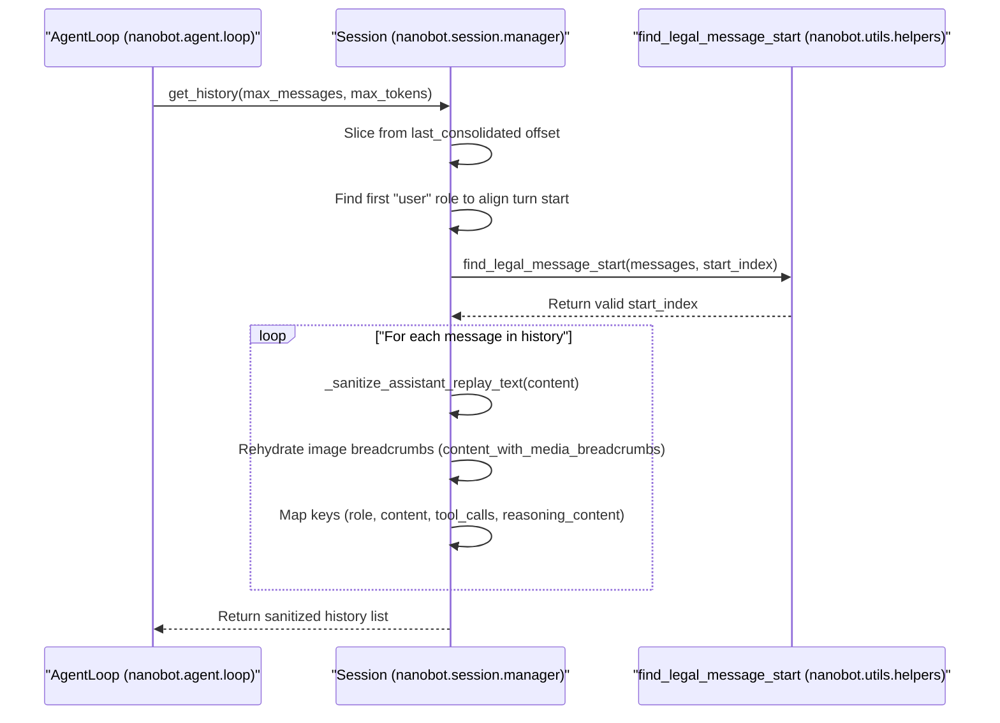

<!-- source: DeepWiki mcp.deepwiki.com · repo HKUDS/nanobot · page 11.1 Session Lifecycle · fetched 2026-11-09 -->

# Session Lifecycle

<details>
<summary>Relevant source files</summary>

The following files were used as context for generating this wiki page:

- [nanobot/agent/autocompact.py](nanobot/agent/autocompact.py)
- [nanobot/agent/memory.py](nanobot/agent/memory.py)
- [nanobot/agent/turn_delivery.py](nanobot/agent/turn_delivery.py)
- [nanobot/session/keys.py](nanobot/session/keys.py)
- [nanobot/session/manager.py](nanobot/session/manager.py)
- [nanobot/session/recovery.py](nanobot/session/recovery.py)
- [nanobot/templates/agent/consolidator_archive.md](nanobot/templates/agent/consolidator_archive.md)
- [tests/agent/test_auto_compact.py](tests/agent/test_auto_compact.py)
- [tests/agent/test_autocompact_unit.py](tests/agent/test_autocompact_unit.py)
- [tests/agent/test_consolidator.py](tests/agent/test_consolidator.py)
- [tests/agent/test_loop_consolidation_tokens.py](tests/agent/test_loop_consolidation_tokens.py)
- [tests/agent/test_new_command_archival.py](tests/agent/test_new_command_archival.py)
- [tests/agent/test_session_manager_history.py](tests/agent/test_session_manager_history.py)
- [tests/agent/test_stop_preserves_context.py](tests/agent/test_stop_preserves_context.py)
- [tests/agent/test_turn_delivery.py](tests/agent/test_turn_delivery.py)
- [tests/session/test_recovery.py](tests/session/test_recovery.py)
- [tests/session/test_session_store.py](tests/session/test_session_store.py)
- [webui/src/components/thread/activity/WebSearchRun.tsx](webui/src/components/thread/activity/WebSearchRun.tsx)
- [webui/src/components/thread/activity/generic-tool-model.ts](webui/src/components/thread/activity/generic-tool-model.ts)
- [webui/src/components/thread/activity/trace-activity-model.ts](webui/src/components/thread/activity/trace-activity-model.ts)
- [webui/src/components/thread/activity/web-search-model.ts](webui/src/components/thread/activity/web-search-model.ts)
- [webui/src/tests/generic-tool-model.test.ts](webui/src/tests/generic-tool-model.test.ts)
- [webui/src/tests/trace-activity-model.test.ts](webui/src/tests/trace-activity-model.test.ts)

</details>


Nanobot manages conversation state through a persistent session system that ensures dialogue continuity across different communication channels. Sessions are keyed by the originating platform and chat identifier, providing isolation between different users and groups while maintaining a structured history for LLM context.

## Session Identification and Storage

Sessions are uniquely identified by a `key` string, typically formatted as `channel:chat_id` [nanobot/session/manager.py:173-173](). This key allows the `SessionManager` to partition conversations based on their source (e.g., `telegram:123456` or `feishu:oc_123`).

### Persistence Mechanism
Sessions are persisted to disk as **JSONL (JSON Lines)** files. This format allows for efficient append-only updates and robust recovery, as each line represents either a single message, metadata, or provider state.

*   **Storage Location**: Files are stored in the `sessions/` directory within the active runtime directory [nanobot/session/manager.py:644-645]().
*   **Filename Sanitization**: To prevent collisions between keys that might look similar when sanitized (e.g., `a:b` vs `a_b`), Nanobot uses a collision-resistant `_storage_key` based on a SHA-256 hash of the raw key [nanobot/session/manager.py:868-877]().
*   **Atomic Saves**: The `SessionManager` performs atomic writes by saving to a unique `.tmp` file and then renaming it to the final `.jsonl` path [nanobot/session/manager.py:680-690]().
*   **Message Cap**: To prevent performance degradation, the `SessionManager` enforces a limit of 2000 messages per session file, defined by `FILE_MAX_MESSAGES` [nanobot/session/manager.py:40-40]().
*   **Fsync Support**: For critical data integrity, the manager supports `fsync=True` to ensure data is physically written to disk, including directory-level fsync on supported platforms [nanobot/session/manager.py:694-709]().

### Session Structure
The `Session` dataclass encapsulates the state of a single conversation [nanobot/session/manager.py:170-181]().

| Field | Type | Description |
| :--- | :--- | :--- |
| `key` | `str` | The `channel:chat_id` identifier [nanobot/session/manager.py:173-173](). |
| `messages` | `list[dict]` | The full list of message objects in the session [nanobot/session/manager.py:174-174](). |
| `created_at` | `datetime` | Timestamp of session initiation [nanobot/session/manager.py:175-175](). |
| `updated_at` | `datetime` | Timestamp of the last update [nanobot/session/manager.py:176-176](). |
| `metadata` | `dict` | Session-specific data, including WebUI titles and goal states [nanobot/session/manager.py:177-177](). |
| `last_consolidated` | `int` | Offset tracking messages already archived to durable files [nanobot/session/manager.py:178-178](). |
| `provider_state` | `ProviderConversationState` | Opaque provider-specific state (e.g., OpenAI Responses API items) [nanobot/session/manager.py:179-179](). |

**Sources:** [nanobot/session/manager.py:40-195](), [nanobot/session/manager.py:644-709](), [nanobot/session/manager.py:868-877]()

## The Session Lifecycle Flow

The lifecycle of a session spans from the initial message arrival to history retrieval and eventual turn saving.

### 1. Initialization and Loading
When a message arrives, the agent system retrieves the session via `SessionManager.get_or_create(key)` [nanobot/session/manager.py:636-650](). It first checks an in-memory `WeakValueDictionary` cache [nanobot/session/manager.py:640-641](). If not cached, it attempts to load from the JSONL file via the `_load` method [nanobot/session/manager.py:642-643]().

### 2. Message Append and Updates
As the agent iterates, messages are added via `Session.add_message(role, content, **kwargs)` [nanobot/session/manager.py:196-206](). This method automatically attaches an ISO-formatted timestamp and updates the `updated_at` field [nanobot/session/manager.py:202-205]().

### 3. Repair and Recovery
If a session file is corrupted (e.g., due to a partial write), the `_load` logic is designed to be resilient. It reads the file line-by-line, discarding invalid JSON lines while preserving valid messages and metadata [nanobot/session/manager.py:822-857]().

### Session Management Data Flow
This diagram illustrates how the `SessionManager` bridges raw storage and the active Agent execution.

```mermaid
graph TD
    subgraph "Natural Language Space (External)"
        InboundMessage["InboundMessage"] -->| "channel:chat_id" | SessionManager["SessionManager"]
    end

    subgraph "Code Entity Space (nanobot.session.manager)"
        SessionManager -- "get_or_create(key)" --> Session["Session"]
        Session -- "add_message(role, content)" --> Session
        Session -- "get_history(max_messages, max_tokens)" --> History_Slicer["History Slicer"]
        SessionManager -- "_load(key)" --> Repair_Logic["JSONL Repair Logic"]
    end

    subgraph "Storage Layer (Disk)"
        JSONL_File["JSONL File (storage_key.jsonl)"] -. "read_text" .-> Repair_Logic
        Session -. "save(session, fsync)" .-> JSONL_File
    end

    History_Slicer -->| "sanitized list" | LLMProvider["LLMProvider"]

    style InboundMessage stroke-dasharray: 5 5
    style LLMProvider stroke-dasharray: 5 5
```
**Sources:** [nanobot/session/manager.py:170-245](), [nanobot/session/manager.py:636-650](), [nanobot/session/manager.py:822-857]()

## Turn Saving and History Sanitization

A critical part of the session lifecycle is ensuring history remains valid for LLM providers, specifically regarding tool-call sequences and internal metadata.

### Handling Orphan Tool Results
Many LLM providers require every `tool` role message be preceded by an `assistant` message containing matching `tool_calls`. If a window is sliced purely by message count or token budget, the `assistant` message might be lost.

The `Session.get_history` logic prevents this:
1.  **Slicing**: It first takes messages starting from the `last_consolidated` offset [nanobot/session/manager.py:220-220]().
2.  **User Alignment**: It attempts to find the first `user` role message to avoid starting mid-turn [nanobot/session/manager.py:234-240]().
3.  **Boundary Validation**: It calls `find_legal_message_start` to identify the first index that does not contain an orphan tool result [nanobot/session/manager.py:243-245](). This function ensures that if an `assistant` message with `tool_calls` is included, all corresponding `tool` messages are also included, and vice-versa [tests/agent/test_session_manager_history.py:108-121]().

### Assistant Replay Sanitization
When the model generates a reply, it might copy internal metadata. The `_sanitize_assistant_replay_text` function removes these artifacts:
*   **Time Prefixes**: Removes `[Message Time: ...]` using `_MESSAGE_TIME_PREFIX_RE` [nanobot/session/manager.py:99-99]().
*   **Image Breadcrumbs**: Removes lines matching `_LOCAL_IMAGE_BREADCRUMB_RE` [nanobot/session/manager.py:103-103]().
*   **Tool Echoes**: Removes lines matching `_TOOL_CALL_ECHO_RE` (e.g., `message(...)` or `generate_image(...)`) [nanobot/session/manager.py:104-104]().

### Multimodal Rehydration
During `get_history`, if a user message contained media, the system synthesizes `[image: path]` breadcrumbs into the text content for the LLM using `content_with_media_breadcrumbs` [nanobot/session/manager.py:265-270]().

### History Preparation Logic
This diagram shows how `Session` logic transforms raw stored messages into a valid LLM payload.


**Sources:** [nanobot/session/manager.py:93-107](), [nanobot/session/manager.py:208-281](), [nanobot/utils/helpers.py:31-31](), [tests/agent/test_session_manager_history.py:108-121]()

## Runtime Checkpoints and State Persistence

To support long-running agent iterations and recovery from crashes, Nanobot uses a "Runtime Checkpoint" system.

*   **Partial Turn Saving**: Instead of rewriting the entire session history during a tool-execution loop, the `SessionManager` saves a lightweight `.checkpoint.json` file [nanobot/session/manager.py:56-58](). This is done via `save_runtime_checkpoint` [tests/session/test_session_store.py:147-147]().
*   **Checkpoint Content**: This file stores the current `assistant_message`, `pending_tool_calls`, and `completed_tool_results` [nanobot/session/manager.py:724-733]().
*   **Provider State**: Opaque provider data (like OpenAI Responses API state) is persisted in a private `provider_state` record within the JSONL to allow session resumption without losing context [nanobot/session/manager.py:146-156]().
*   **Recovery**: If an agent turn is interrupted (e.g., by a `/stop` command or a crash), the `RUNTIME_CHECKPOINT_KEY` in `session.metadata` is used to restore the partial progress. The assistant message and completed tool results from the interrupted turn are materialized into `session.messages` [tests/agent/test_stop_preserves_context.py:108-113](). The checkpoint metadata is then cleared [tests/agent/test_stop_preserves_context.py:114-115]().
*   **Gateway Shutdown**: During a graceful gateway shutdown, the runtime checkpoint is preserved in `session.metadata` and not immediately materialized into `session.messages`, allowing for a seamless restart [tests/agent/test_stop_preserves_context.py:121-151]().

**Sources:** [nanobot/session/manager.py:56-69](), [nanobot/session/manager.py:710-745](), [nanobot/session/manager.py:136-156](), [tests/agent/test_stop_preserves_context.py:108-115](), [tests/agent/test_stop_preserves_context.py:121-151](), [tests/session/test_session_store.py:147-147]()

## Session Forking

Session forking allows creating a new session based on the history of an existing one, enabling experimentation or parallel conversations without altering the original.

*   **`fork_session(source_key, new_key)`**: This method creates a new session with `new_key` by copying the messages and relevant metadata from the `source_key` session [nanobot/session/manager.py:950-950]().
*   **Volatile Metadata Exclusion**: Certain metadata keys, such as `goal_state`, `pending_user_turn`, and `runtime_checkpoint`, are considered volatile and are explicitly excluded from the forked session to ensure a clean starting state [nanobot/session/manager.py:61-71]().
*   **Provider State Reset**: The `provider_state` is not copied during a fork, as it is specific to the original conversation's context with the LLM provider [nanobot/session/manager.py:960-960]().

**Sources:** [nanobot/session/manager.py:61-71](), [nanobot/session/manager.py:950-960]()

## Auto-Compaction of Idle Sessions

Nanobot includes an auto-compaction feature to proactively summarize and archive idle sessions, reducing token costs and latency for future interactions.

*   **`AutoCompact` Class**: The `AutoCompact` class [nanobot/agent/autocompact.py:27-36]() is responsible for managing this process.
*   **Idle TTL**: Sessions are considered idle and eligible for compaction if their `updated_at` timestamp exceeds a configured `session_ttl_minutes` [nanobot/agent/autocompact.py:38-54](). The default TTL is 15 minutes [tests/agent/test_autocompact.py:160-161](). A TTL of 0 disables auto-compaction [tests/agent/test_autocompact.py:164-165]().
*   **`check_expired`**: This method scans all sessions, identifies expired ones, and schedules an archival task for them in the background [nanobot/agent/autocompact.py:63-88](). It skips sessions that are currently active or already being archived [nanobot/agent/autocompact.py:74-75]().
*   **Archival Process**: The `_archive` method [nanobot/agent/autocompact.py:89-111]() calls the `Consolidator` to summarize the session history. The summary is then stored in the session's metadata under `_last_summary` [nanobot/agent/autocompact.py:115-118]().
*   **Summary Prompt**: The `Consolidator` uses a specific prompt (`agent/consolidator_archive.md`) to guide the LLM in creating a compact, relevant summary of the conversation [nanobot/templates/agent/consolidator_archive.md:1-42](). This prompt emphasizes retaining active objectives, status, results, blockers, and next actions, while also defining criteria (Signal, Novel, Important, Persistent - SNIP) for other facts [nanobot/templates/agent/consolidator_archive.md:23-27]().
*   **Ephemeral Compaction**: For ephemeral runs, the system can summarize the context without persisting the summary to disk, ensuring that the original session remains unchanged [tests/agent/test_loop_consolidation_tokens.py:94-144]().

**Sources:** [nanobot/agent/autocompact.py:27-130](), [nanobot/templates/agent/consolidator_archive.md:1-42](), [tests/agent/test_autocompact.py:160-161](), [tests/agent/test_autocompact.py:164-165](), [tests/agent/test_loop_consolidation_tokens.py:94-144]()

## Session Lifecycle and Auto-Compaction Flow

This diagram illustrates the interaction between the `AgentLoop`, `SessionManager`, and `AutoCompact` components during session processing and idle compaction.

```mermaid
graph TD
    subgraph "Agent Runtime"
        AL[AgentLoop] -- "1. Inbound Message" --> SM[SessionManager]
        AL -- "2. Turn Processing" --> S[Session]
        AL -- "3. Schedule Background Task" --> AC[AutoCompact]
    end

    subgraph "Session Management"
        SM -- "get_or_create(key)" --> S
        S -- "add_message(role, content)" --> S
        S -- "save(session)" --> JSONL[Session JSONL File]
        S -- "save_runtime_checkpoint(session)" --> CHECKPOINT[Runtime Checkpoint File]
    end

    subgraph "Auto-Compaction"
        AC -- "check_expired()" --> SM
        SM -- "list_sessions()" --> S_INFO[Session Info (key, updated_at)]
        AC -- "is_expired(updated_at)" --> S_INFO
        AC -- "has_unarchived_messages(key)" --> S
        AC -- "schedule _archive(key, runtime)" --> ARCHIVE_TASK[Background Archival Task]
        ARCHIVE_TASK -- "compact_idle_session(key)" --> CON[Consolidator]
        CON -- "summarize_transcript(...)" --> LLM[LLM Provider]
        LLM -- "Summary Text" --> CON
        CON -- "commit_summary_checkpoint(summary)" --> S
        S -- "save(session)" --> JSONL
    end

    style AL stroke-dasharray: 5 5
    style LLM stroke-dasharray: 5 5
```
**Sources:** [nanobot/agent/autocompact.py:63-88](), [nanobot/agent/autocompact.py:89-111](), [nanobot/agent/memory.py:117-127](), [nanobot/session/manager.py:636-650](), [nanobot/session/manager.py:710-745]()

---

