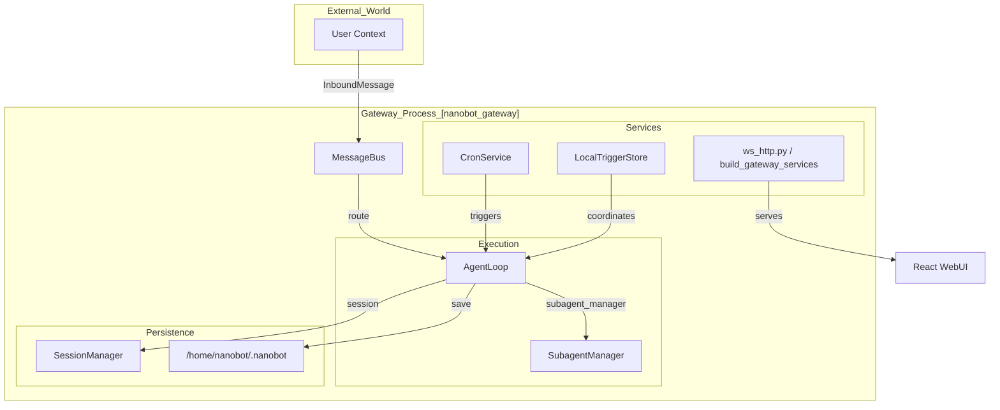
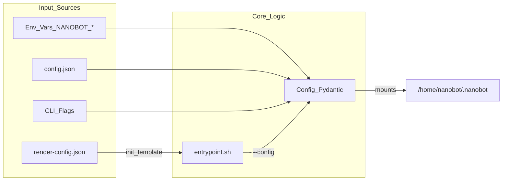

<!-- source: DeepWiki mcp.deepwiki.com · repo HKUDS/nanobot · page 12 Deployment · fetched 2026-11-09 -->

# Deployment

Relevant source files

The following files were used as context for generating this wiki page:

- [.dockerignore](.dockerignore)
- [.github/workflows/ci.yml](.github/workflows/ci.yml)
- [.github/workflows/tui-release.yml](.github/workflows/tui-release.yml)
- [Dockerfile](Dockerfile)
- [docker-compose.bwrap.yml](docker-compose.bwrap.yml)
- [docker-compose.yml](docker-compose.yml)
- [docs/deployment.md](docs/deployment.md)
- [docs/websocket.md](docs/websocket.md)
- [entrypoint.sh](entrypoint.sh)
- [render-config.json](render-config.json)
- [render.yaml](render.yaml)
- [tui/scripts/prepare-target.ts](tui/scripts/prepare-target.ts)

This page covers production deployment strategies for nanobot, including gateway server setup, process management, environment configuration, and scaling considerations. It bridges the gap between local development and persistent, multi-channel production environments.

## Deployment Overview

Nanobot supports multiple execution modes to accommodate different lifecycle requirements:

| Deployment Mode | Use Case | Entry Point | Persistence |
|----------------|----------|-------------|-------------|
| **CLI Agent** | Development, one-off tasks | `nanobot agent` | Session-based |
| **Gateway Server** | Production, multi-channel | `nanobot gateway` | Continuous operation |
| **Docker Container** | Isolated deployment | `docker run` / `docker compose` | Container volume |
| **API Server** | Programmatic interaction | `nanobot serve` | REST API / Workspace |
| **CLI Status** | Health checks / Monitoring | `nanobot status` | N/A |

Sources: [Dockerfile:80](), [docker-compose.yml:22-60](), [docs/deployment.md:23-29]()

## Deployment Architecture

### Gateway vs CLI Mode

The system transitions from a simple interactive loop in CLI mode to a persistent event-driven architecture in Gateway mode.

**CLI Mode** runs a single interactive agent session. The agent loop executes directly in the terminal using the `agent` command.

**Gateway Mode** runs a persistent server that:
- Listens on a configurable port (default `18790`) for health checks and `8765` for WebSocket/WebUI [Dockerfile:76-77](), [docker-compose.yml:27-29]().
- Routes messages through a `MessageBus` to various channels.
- Maintains persistent sessions per channel/chat via the session management system.
- Supports background automation through cron and heartbeat services.

Title: Gateway Process & Component Mapping

Sources: [docker-compose.yml:22-37](), [Dockerfile:76-77](), [nanobot/webui/ws_http.py:1-8](), [docs/deployment.md:23-29]()

### Configuration Resolution

Title: Configuration Data Flow and Lifecycle

The configuration system uses a tiered priority model:
1. **CLI flags** — provided during command execution, such as `--port`, `--workspace`, or `--config` [entrypoint.sh:23-24]().
2. **Environment variables** — `NANOBOT_*` prefix for container and CI/CD environments. Secrets can also be injected via `${VAR}` placeholders in templates [render-config.json:10-22]().
3. **config.json** — persistent configuration file initialized via `nanobot onboard`.

In Docker environments, the default configuration directory is mapped to `/home/nanobot/.nanobot` [Dockerfile:58-60](), [docker-compose.yml:7-8](). The container runs as a non-root `nanobot` user (UID 1000) for enhanced security, with privileges dropped via `setpriv` in the entrypoint [entrypoint.sh:31-39]().

Sources: [Dockerfile:57-60](), [docker-compose.yml:7-8](), [entrypoint.sh:31-39](), [docs/deployment.md:61-64](), [render-config.json:1-33]()

## Choose a Runtime

Nanobot can be deployed to various environments depending on the required uptime and management overhead:

| Runtime | Best For | Persistence Mechanism |
|---------|----------|-----------------------|
| **Render** | One-click hosting | Persistent Disk mount at `/home/nanobot/.nanobot` [docs/deployment.md:25](), [render.yaml:45-48]() |
| **Docker Compose** | Linux servers | Bind-mount `~/.nanobot` to `/home/nanobot/.nanobot` [docs/deployment.md:26](), [docker-compose.yml:8]() |
| **systemd** | Linux user services | Host user's `~/.nanobot` directory [docs/deployment.md:28]() |
| **LaunchAgent** | macOS persistence | Host user's `~/.nanobot` directory [docs/deployment.md:29]() |

Sources: [docs/deployment.md:21-30](), [render.yaml:45-48](), [docker-compose.yml:7-8]()

## Docker Deployment

Nanobot provides a production-ready `Dockerfile` based on `uv` and Python 3.12 [Dockerfile:10](). It includes a multi-stage build to compile the React WebUI using Node.js before copying it into the final Python image [Dockerfile:1-9](), [Dockerfile:41]().

### Security and Sandboxing
When deployed via Docker, the system can utilize `bubblewrap` (`bwrap`) to sandbox shell command execution if configured in `config.json` [Dockerfile:13]().
- **Isolation**: The container drops all Linux capabilities by default in the standard compose file [docker-compose.yml:9-10]().
- **Privilege Boundary**: The `entrypoint.sh` ensures the agent never runs as root, failing closed if the `setpriv` drop fails [entrypoint.sh:31-39]().

For detailed Docker instructions, see [Docker & Container Deployment](#12.1).

Sources: [Dockerfile:1-80](), [docker-compose.yml:1-62](), [docs/deployment.md:59-91](), [entrypoint.sh:31-39]()

## Render Deployment

Nanobot supports one-click deployment to Render using the provided `render.yaml` blueprint [docs/deployment.md:31-38]().
- **Persistence**: Requires a paid Render service for persistent disks to store `config.json`, sessions, and memory [docs/deployment.md:35-36]().
- **Initialization**: The `entrypoint.sh` script detects the `RENDER=true` environment variable and initializes the configuration from `render-config.json` if it does not exist [entrypoint.sh:10-24]().
- **Authentication**: Access to the WebUI is protected by `NANOBOT_WEB_TOKEN`, which is mapped to the WebSocket channel's `tokenIssueSecret` [render-config.json:22](), [docs/deployment.md:45-47]().

Sources: [render.yaml:1-48](), [render-config.json:1-33](), [entrypoint.sh:10-24](), [docs/deployment.md:31-58]()

## CI/CD & Contributing

Nanobot employs a robust CI/CD pipeline using GitHub Actions to ensure code quality and deployment stability.

- **Automated Testing**: The test suite runs across multiple Python versions (3.11 to 3.14) and operating systems (Ubuntu, Windows) [.github/workflows/ci.yml:145-164]().
- **Dependency Management**: The pipeline uses `uv` for fast, reproducible environment synchronization [.github/workflows/ci.yml:173-177]().
- **WebUI Validation**: A dedicated job handles Bun-based linting, testing, and building of the frontend assets [.github/workflows/ci.yml:90-94]().
- **Terminal UI Release**: A manual workflow handles cross-platform binary builds for the TUI, including checksum generation and compliance reviews [.github/workflows/tui-release.yml:1-96]().

For details on the automated test suite and contribution guidelines, see [CI/CD & Contributing](#12.2).

Sources: [.github/workflows/ci.yml:1-192](), [.github/workflows/tui-release.yml:1-96]()

---

### Child Pages
- [Docker & Container Deployment](#12.1) — Document Dockerfile structure, docker-compose configuration, environment variable injection, and container-specific considerations
- [CI/CD & Contributing](#12.2) — Explain the GitHub Actions CI pipeline, test suite structure, and contribution guidelines

---

