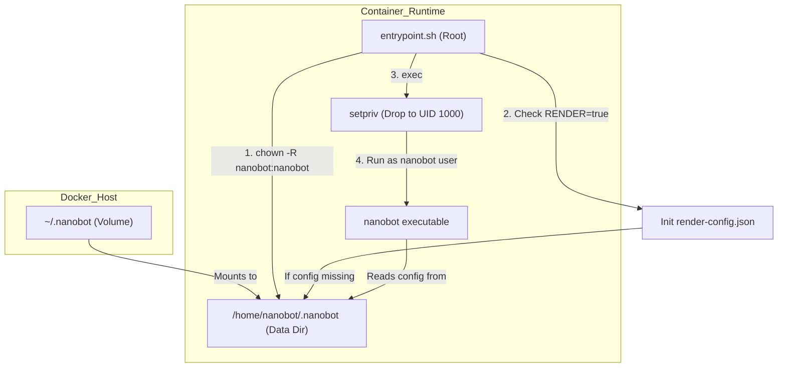
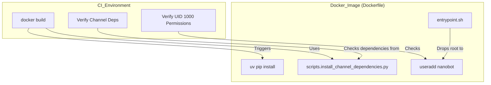

<!-- source: DeepWiki mcp.deepwiki.com · repo HKUDS/nanobot · page 12.1 Docker & Container Deployment · fetched 2026-11-09 -->

# Docker & Container Deployment

Relevant source files

The following files were used as context for generating this wiki page:

- [.dockerignore](.dockerignore)
- [.github/workflows/ci.yml](.github/workflows/ci.yml)
- [.github/workflows/tui-release.yml](.github/workflows/tui-release.yml)
- [Dockerfile](Dockerfile)
- [docker-compose.bwrap.yml](docker-compose.bwrap.yml)
- [docker-compose.yml](docker-compose.yml)
- [docs/deployment.md](docs/deployment.md)
- [docs/websocket.md](docs/websocket.md)
- [entrypoint.sh](entrypoint.sh)
- [render-config.json](render-config.json)
- [render.yaml](render.yaml)
- [tui/scripts/prepare-target.ts](tui/scripts/prepare-target.ts)

The `nanobot` framework is designed for containerized environments to ensure consistent runtime behavior across different platforms. The deployment architecture leverages a multi-stage build process to handle both the React-based WebUI and the Python-based agent system, while enforcing security through non-root execution and sandboxing.

## Dockerfile Structure

The `Dockerfile` uses a multi-stage build to separate the frontend build environment from the final runtime image, ensuring a smaller and more secure production container.

### Build Phases

1.  **WebUI Builder**: Uses `node:24-bookworm-slim` to build the React frontend. It copies the `webui/` source, installs dependencies via `npm ci`, and executes `npm run build` to generate static assets in `nanobot/web/dist/` [Dockerfile:1-9]().
2.  **Runtime Base**: Uses `ghcr.io/astral-sh/uv:python3.12-bookworm-slim` as the foundation [Dockerfile:11-11]().
3.  **System Dependencies**: Installs `ca-certificates`, `git`, `bubblewrap`, `openssh-client`, and `libmagic1`. `bubblewrap` is required for secure tool execution sandboxing [Dockerfile:13-14]().
4.  **Dependency Management**:
    *   The container sets up a virtual environment at `/app/.venv` [Dockerfile:20-22]().
    *   It uses `uv` for high-performance dependency resolution.
    *   `NANOBOT_EXTRAS` build argument allows pre-installing specific provider support (e.g., `bedrock`) [Dockerfile:27-35]().
    *   `NANOBOT_CHANNELS` build argument triggers the `scripts.install_channel_dependencies` module to pre-bake channel-specific requirements (defaulting to `whatsapp`) into the image [Dockerfile:47-50]().
5.  **Final Assembly**: The full `nanobot/` source is copied, and the static WebUI assets from the `webui-builder` stage are placed into `nanobot/web/dist/` [Dockerfile:40-42]().

### Runtime Configuration

*   **User Security**: Creates a non-root user `nanobot` (UID 1000). The virtual environment is owned by this user to allow runtime installation of missing channel dependencies if necessary [Dockerfile:59-61]().
*   **Entrypoint**: The `entrypoint.sh` script handles privilege management. It starts as `root` to allow `chown` operations on persistent disks (common in environments like Render) before dropping privileges to the `nanobot` user via `setpriv` [Dockerfile:64-70]() [entrypoint.sh:31-39]().
*   **Environment**: Sets `PYTHONUNBUFFERED=1` and `PYTHONFAULTHANDLER=1` to ensure crash logs are captured in container orchestrator logs [Dockerfile:74-74]().
*   **Port Exposure**: Port `18790` (Gateway health endpoint) and `8765` (WebSocket/WebUI) are exposed [Dockerfile:77-77]().

### Data Flow: Container Initialization

The following diagram illustrates how the Docker environment initializes the `nanobot` system, mapping host resources to the internal configuration directory and handling privilege drops.

**Container Startup Sequence**

Sources:
- [Dockerfile:1-81]()
- [entrypoint.sh:1-55]()
- [render.yaml:1-48]()

## Docker Compose Configuration

The deployment strategy for Docker Compose focuses on separating long-running background tasks from interactive CLI operations and API serving.

### Services

The `docker-compose.yml` defines a common configuration `x-common-config` that handles the build context, volume mapping, and capability drops for security [docker-compose.yml:1-20]().

1.  **nanobot-gateway**:
    *   Runs the `gateway` command to manage long-running communication channels and background services [docker-compose.yml:22-25]().
    *   Exposes port `18790` for health checks and `8765` for the `WebSocketChannel` [docker-compose.yml:27-29]().
2.  **nanobot-api**:
    *   Runs the `serve` command to provide an OpenAI-compatible API endpoint [docker-compose.yml:39-43]().
    *   Exposes port `8900` [docker-compose.yml:45-46]().
3.  **nanobot-cli**:
    *   A profile-gated service for interactive tasks [docker-compose.yml:56-62]().
    *   Typically executed with `docker compose run --rm nanobot-cli agent -m "Hello!"` [docs/deployment.md:26-26]().

### Volume Persistence
The primary state location in a container is `/home/nanobot/.nanobot`. This directory houses:
*   `config.json`: The central configuration [docs/deployment.md:14-15]().
*   `sessions/`: Persisted chat history and turn data [docs/deployment.md:14-14]().
*   Memory and Identity: `MEMORY.md` and workspace identity markers [docs/deployment.md:14-14]().

Sources:
- [docker-compose.yml:1-62]()
- [docs/deployment.md:1-91]()
- [Dockerfile:59-61]()
- [entrypoint.sh:1-24]()

## Container-Specific Considerations

### Environment Variable Injection
Nanobot supports environment variable substitution in its configuration files. This is particularly used in cloud deployments (like Render) where a `render-config.json` template is used [Dockerfile:52-55]().

*   **Secret Management**: Sensitive keys like `ANTHROPIC_API_KEY` or `NANOBOT_WEB_TOKEN` are injected into `config.json` at runtime via `${VAR}` syntax [render-config.json:10-22]().
*   **Initialization**: The `entrypoint.sh` only copies the template to the persistent disk if a config does not already exist, preserving runtime changes made through the WebUI [entrypoint.sh:17-22]().

### Network Binding
By default, the gateway and WebSocket channels bind to `127.0.0.1`. In a Docker environment, these must be explicitly set to `0.0.0.0` in `config.json` to allow the Docker engine's port forwarding to reach the internal services [docs/deployment.md:70-85]() [render-config.json:14-20]().

### Security and Capabilities
The `docker-compose.yml` implements several security hardening measures:
*   `cap_drop: [ALL]`: Drops all Linux capabilities by default [docker-compose.yml:9-10]().
*   `cap_add: [CHOWN, SETGID, SETUID]`: Adds only the minimum capabilities required for `entrypoint.sh` to fix volume ownership and drop privileges [docker-compose.yml:12-15]().
*   `no-new-privileges:true`: Prevents the non-root process from regaining capabilities [docker-compose.yml:18-19]().

### Bubblewrap (bwrap) Variant
For enhanced sandboxing, a `docker-compose.bwrap.yml` file is provided. This variant overrides the default security settings to enable `bubblewrap` (bwrap) for tool execution.

*   `cap_add: [SYS_ADMIN]`: The `SYS_ADMIN` capability is required for `bwrap` to create isolated environments [docker-compose.bwrap.yml:2-3]().
*   `security_opt: [apparmor=unconfined, seccomp=unconfined]`: These options disable AppArmor and Seccomp profiles, which might interfere with `bwrap`'s operation [docker-compose.bwrap.yml:4-6]().

This configuration allows `nanobot` to leverage `bwrap` for more robust sandboxing of executed tools, preventing them from accessing the host filesystem or network beyond what is explicitly allowed.

**Docker Build & CI Relationship**

Sources:
- [Dockerfile:47-50]()
- [Dockerfile:59-61]()
- [docker-compose.yml:1-20]()
- [docker-compose.bwrap.yml:1-16]()
- [render-config.json:1-33]()
- [docs/deployment.md:70-91]()
- [entrypoint.sh:1-55]()

---

