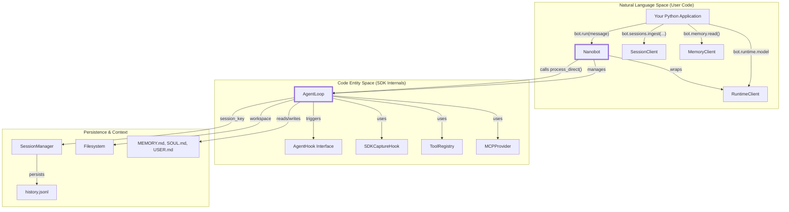
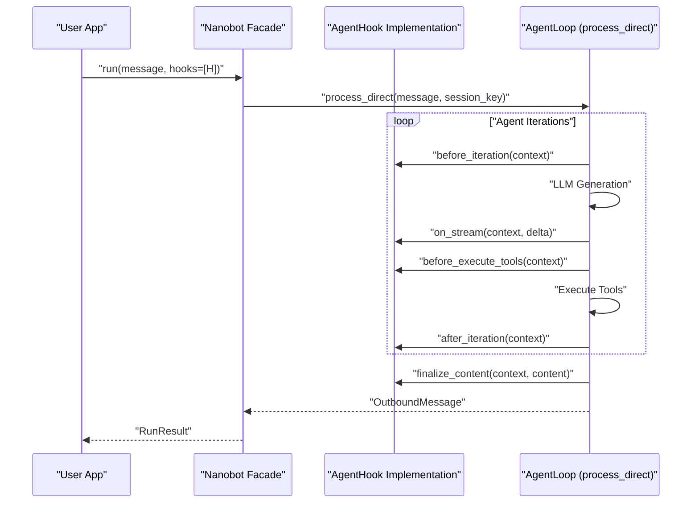

<!-- source: DeepWiki mcp.deepwiki.com · repo HKUDS/nanobot · page 13 Python SDK · fetched 2026-11-09 -->

# Python SDK

Relevant source files

The following files were used as context for generating this wiki page:

- [docs/memory.md](docs/memory.md)
- [docs/python-sdk.md](docs/python-sdk.md)
- [nanobot/nanobot.py](nanobot/nanobot.py)
- [nanobot/sdk/clients.py](nanobot/sdk/clients.py)
- [tests/agent/test_runtime_refresh.py](tests/agent/test_runtime_refresh.py)
- [tests/test_nanobot_facade.py](tests/test_nanobot_facade.py)

The Nanobot Python SDK provides a high-level programmatic interface for embedding the AI agent directly into Python applications. It abstracts the complexities of the message bus, provider registry, and agent loop into a simple facade, allowing developers to run tasks, manage conversation sessions, and intercept lifecycle events with minimal boilerplate. [nanobot/nanobot.py:1-42]()

### Core Components

The SDK is centered around several primary entities that bridge the gap between simple function calls and a complex agentic runtime:

1.  **`Nanobot`**: The main entry point and facade that manages the underlying `AgentLoop`. [nanobot/nanobot.py:68-90]()
2.  **`RunResult`**: A dataclass containing the final response content, tools used, token usage, and the raw message history from an agent execution. [nanobot/sdk/types.py:36-41](), [nanobot/sdk/types.py:50-60]()
3.  **`RunStream`**: A handle for asynchronous event streaming, allowing applications to consume tokens and tool events as they happen. [nanobot/nanobot.py:203-219](), [nanobot/sdk/streaming.py:15-30]()
4.  **`AgentHook`**: An interface for implementing callbacks that trigger at various stages of the agent's reasoning loop. [nanobot/agent/hook.py:65-152]()

### SDK Architecture & Data Flow

The following diagram illustrates how the `Nanobot` facade bridges high-level SDK calls to the internal agent systems and specialized clients for memory and session management.

**SDK to Internal Mapping**

Sources: [nanobot/nanobot.py:68-90](), [nanobot/sdk/clients.py:23-183](), [nanobot/agent/hook.py:65-152](), [nanobot/nanobot.py:177-201](), [nanobot/nanobot.py:88-90](), [nanobot/nanobot.py:134-136](), [nanobot/nanobot.py:140-142](), [nanobot/sdk/clients.py:155-174](), [docs/memory.md:19-21]()

---

### SDK Quick Start & API Reference

The SDK allows for rapid initialization using `Nanobot.from_config()`, which automatically loads provider credentials and agent settings from the standard `~/.nanobot/config.json`. [nanobot/nanobot.py:93-110](). Developers can override the workspace directory or provide a specific model/preset during instantiation. [nanobot/nanobot.py:123-132]()

The primary interaction methods are:
*   **`bot.run()`**: Awaits the full completion of the agent loop (including multi-turn tool usage) before returning a `RunResult`. [nanobot/nanobot.py:144-201]()
*   **`bot.stream()`**: Returns an async iterator of `StreamEvent` objects for fine-grained event consumption (text deltas, tool starts, etc.). [nanobot/nanobot.py:203-219]()
*   **`bot.sessions`**: A `SessionClient` for listing, exporting, clearing, or ingesting message history into isolated sessions. [nanobot/sdk/clients.py:23-153]()
*   **`bot.memory`**: A `MemoryClient` for direct access to the agent's long-term memory files (`MEMORY.md`, `history.jsonl`). [nanobot/sdk/clients.py:155-174]()
*   **`bot.runtime`**: A `RuntimeClient` providing access to the current LLM runtime configuration, such as the active model and workspace. [nanobot/nanobot.py:90]()

For details, see [SDK Quick Start & API Reference](#13.1).

**Key Classes and Methods**
| Symbol | Responsibility |
| :--- | :--- |
| `Nanobot` | Programmatic facade; handles config loading and loop setup. [nanobot/nanobot.py:68-90]() |
| `RunResult` | Data container for `content`, `tools_used`, `usage`, and `messages`. [nanobot/sdk/types.py:50-60]() |
| `SessionClient` | Manages session lifecycle and history ingestion. [nanobot/sdk/clients.py:23-153]() |
| `MemoryClient` | Direct access to `memory/MEMORY.md` and `memory/history.jsonl`. [nanobot/sdk/clients.py:155-174]() |
| `RuntimeClient` | Provides access to the current LLM runtime configuration. [nanobot/nanobot.py:90]() |
| `SDKCaptureHook` | Internal hook used to collect metadata for `RunResult`. [nanobot/nanobot.py:177-201]() |

Sources: [nanobot/nanobot.py:68-90](), [nanobot/sdk/types.py:50-60](), [nanobot/sdk/clients.py:23-183](), [nanobot/sdk/clients.py:155-174]()

---

### AgentHook & Lifecycle Callbacks

`AgentHook` provides a powerful mechanism for observability and control. By subclassing `AgentHook`, developers can tap into the agent's "thinking" process without modifying the core framework. [nanobot/agent/hook.py:65-152]()

Hooks support several interaction patterns:
1.  **Event Callbacks**: Async methods like `before_iteration`, `on_stream`, or `before_execute_tools` allow logging, auditing, or UI updates. [nanobot/agent/hook.py:86-114]()
2.  **Reasoning Streams**: Methods like `emit_reasoning` allow capturing "Chain of Thought" output from models that support it. [nanobot/agent/hook.py:135-144]()
3.  **Output Transformation**: The `finalize_content` method acts as a synchronous pipeline to post-process the agent's final output. [nanobot/agent/hook.py:149-150]()
4.  **Composite Execution**: Multiple hooks can be combined using `CompositeHook`, which provides error isolation to ensure a faulty hook does not crash the agent loop. [nanobot/agent/hook.py:156-220]()

**Hook Execution Flow**

Sources: [nanobot/nanobot.py:177-201](), [nanobot/agent/hook.py:65-152](), [nanobot/agent/hook.py:156-220]()

For details, see [AgentHook & Lifecycle Callbacks](#13.2).

---

### Session Isolation & Persistence

The SDK leverages the core `AgentLoop` session management to provide durable conversation threads. [nanobot/sdk/clients.py:23-153]()

*   **Session Keys**: Every `run()` call specifies a `session_key` (defaulting to `sdk:default`). Different keys receive independent message histories via `SessionManager`, ensuring that context from one task does not bleed into another. [nanobot/nanobot.py:148-164](), [nanobot/sdk/runtime.py:20-30]()
*   **Manual Management**: Through `bot.sessions`, developers can `clear()` a session, `delete()` it from disk, or `ingest()` external transcripts to bootstrap an agent's context. [nanobot/sdk/clients.py:32-148]()
*   **Context Control**: The SDK allows for `ephemeral` runs that do not persist turns to history, useful for one-off classifications or tool invocations. [nanobot/nanobot.py:153-190](), [nanobot/sdk/runtime.py:39-41]()

Sources: [nanobot/nanobot.py:144-201](), [nanobot/sdk/clients.py:23-153](), [nanobot/sdk/runtime.py:9-48]()

---

