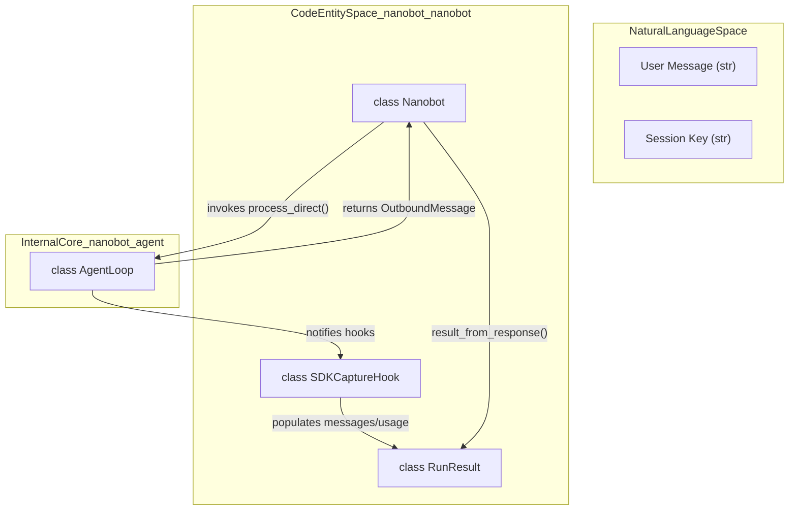

<!-- source: DeepWiki mcp.deepwiki.com · repo HKUDS/nanobot · page 13.1 SDK Quick Start & API Reference · fetched 2026-11-09 -->

# SDK Quick Start & API Reference

<details>
<summary>Relevant source files</summary>

The following files were used as context for generating this wiki page:

- [docs/memory.md](docs/memory.md)
- [docs/python-sdk.md](docs/python-sdk.md)
- [nanobot/nanobot.py](nanobot/nanobot.py)
- [nanobot/sdk/clients.py](nanobot/sdk/clients.py)
- [tests/agent/test_runtime_refresh.py](tests/agent/test_runtime_refresh.py)
- [tests/test_nanobot_facade.py](tests/test_nanobot_facade.py)

</details>


The `nanobot` framework provides a high-level programmatic interface through the `Nanobot` facade, allowing developers to embed the agent's capabilities into custom Python applications. This SDK abstracts the complexities of provider initialization, tool connectivity, and agent loop management. [nanobot/nanobot.py:68-76]()

## Quick Start

To use the SDK, you must have a valid `config.json` (typically generated via the `nanobot onboard` CLI command). The primary entry point is the `Nanobot` class.

```python
import asyncio
from nanobot import Nanobot

async def main():
    # Initialize from default config (~/.nanobot/config.json)
    # Reuses your normal workspace and provider settings
    # Use 'async with' to ensure clean resource shutdown (MCP, tool connections, etc.)
    async with Nanobot.from_config() as bot:
        # Run a single interaction
        result = await bot.run("Summarize the files in the current directory")
        
        print(f"Agent Response: {result.content}")
        print(f"Tools used: {result.tools_used}")
        print(f"Token usage: {result.usage}")

if __name__ == "__main__":
    asyncio.run(main())
```

**Sources:** [nanobot/nanobot.py:68-76](), [nanobot/nanobot.py:92-142](), [docs/python-sdk.md:59-85]()

## Core API Reference

### Nanobot Class

The `Nanobot` class manages the lifecycle of the underlying `AgentLoop` and provides access to specialized clients for session, memory, and runtime management. [nanobot/nanobot.py:78-90]()

#### `Nanobot.from_config()`
Creates a `Nanobot` instance from a configuration file. [nanobot/nanobot.py:92-142]()

*   **`config_path`**: (Optional) Path to `config.json`. Defaults to `~/.nanobot/config.json`. [nanobot/nanobot.py:104-105]()
*   **`workspace`**: (Optional) Overrides the workspace directory defined in the config. [nanobot/nanobot.py:123-126]()
*   **`model` / `model_preset`**: (Optional) Overrides the default model or preset for the instance. These are mutually exclusive. [nanobot/nanobot.py:127-132]()

#### `bot.run()`
Executes the agent for a single turn. It processes the message through the agent loop, executing tools as needed until a final answer is reached or the iteration limit is hit. [nanobot/nanobot.py:144-203]()

*   **`message`**: The user prompt string. [nanobot/nanobot.py:146]()
*   **`session_key`**: (Default: `"sdk:default"`) The identifier for conversation isolation. Different keys get independent history. [nanobot/nanobot.py:148]()
*   **`media`**: (Optional) List of local file paths to attach to the message. [nanobot/nanobot.py:152]()
*   **`ephemeral`**: (Default: `False`) If `True`, the turn is not persisted to history files. [nanobot/nanobot.py:153]()
*   **`hooks`**: (Optional) Custom `AgentHook` implementations for lifecycle callbacks. [nanobot/nanobot.py:155]()

#### `bot.stream()`
Starts a streamed run, returning an async iterator that yields `StreamEvent` objects like `text.delta` or `tool.started`. [nanobot/nanobot.py:230-255]()

**Sources:** [nanobot/nanobot.py:92-255](), [nanobot/sdk/runtime.py:19-22]()

### RunResult

The result of a `bot.run()` call, encapsulating the final state of the agent's turn. [nanobot/sdk/types.py:36-42]()

| Field | Type | Description |
| :--- | :--- | :--- |
| `content` | `str` | The final text response from the assistant. |
| `tools_used` | `list[str]` | Names of all tools invoked during this run. |
| `usage` | `LLMUsage \| None` | Token usage stats (prompt, completion, total). |
| `messages` | `list[dict]` | The full list of messages (system, user, tool, assistant) from this turn. |
| `stop_reason` | `str \| None` | Why the run ended (e.g., `"completed"`, `"max_iterations"`). |
| `error` | `str \| None` | Error message if the run failed. |

**Sources:** [nanobot/sdk/types.py:36-42](), [nanobot/sdk/types.py:164-175]()

---

## Data Flow & Architecture

The SDK acts as a facade over the `AgentLoop`, using an `SDKCaptureHook` to extract internal state and tool usage into the final `RunResult`. [nanobot/nanobot.py:177-203]()

### SDK Execution and Data Capture
This diagram maps SDK entities to the internal agent components and data flow.

Title: SDK Execution and Data Capture

**Sources:** [nanobot/nanobot.py:177-203](), [nanobot/sdk/types.py:164-175]()

### Initialization Sequence
Title: Nanobot Initialization Sequence
```mermaid
sequenceDiagram
    participant App as "Python Application"
    participant SDK as "Nanobot.from_config()"
    participant Loader as "nanobot.config.loader"
    participant Loop as "nanobot.agent.loop.AgentLoop"

    App->>SDK: "Nanobot.from_config(path)"
    SDK->>Loader: "load_config(path)"
    Loader-->>SDK: "Config"
    SDK->>Loader: "resolve_config_env_vars(Config)"
    Loader-->>SDK: "Resolved Config"
    SDK->>Loop: "AgentLoop.from_config(ResolvedConfig)"
    Loop-->>SDK: "AgentLoop Instance"
    SDK-->>App: "Nanobot Instance"
```
**Sources:** [nanobot/nanobot.py:92-142](), [nanobot/config/loader.py:110-122]()

---

## Session Management

The `session_key` provides conversation isolation. When a `session_key` is provided, the agent loads history from the workspace specific to that key. Internally, SDK calls default to the `cli` channel and `direct` chat_id unless overridden. [nanobot/nanobot.py:148-151](), [nanobot/sdk/runtime.py:28-44]()

### SDK Clients

The `Nanobot` instance exposes several clients for interacting with core agent functionalities:

*   **`bot.sessions`**: A `SessionClient` for managing conversation history. [nanobot/nanobot.py:88]()
*   **`bot.memory`**: A `MemoryClient` for interacting with the agent's long-term memory files (`MEMORY.md`, `history.jsonl`). [nanobot/nanobot.py:89]()
*   **`bot.runtime`**: A `RuntimeClient` for querying the current agent runtime configuration (e.g., active model, workspace). [nanobot/nanobot.py:90]()

#### Session Client (`bot.sessions`)
The SDK provides a `SessionClient` for programmatic session manipulation: [nanobot/sdk/clients.py:23-153]()
*   **`bot.sessions.list()`**: Returns metadata for all persisted sessions including `created_at` and `updated_at`. [nanobot/sdk/clients.py:77-89]()
*   **`bot.sessions.get(key)`**: Returns a `SessionSnapshot` of the conversation, either from the LRU cache or disk. [nanobot/sdk/clients.py:67-75]()
*   **`bot.sessions.ingest(key, messages)`**: Imports an existing transcript into a session without running the model. [nanobot/sdk/clients.py:32-65]()
*   **`bot.sessions.clear(key)`**: Wipes the history for a specific session and persists the empty state. [nanobot/sdk/clients.py:138-144]()
*   **`bot.sessions.delete(key)`**: Removes the session from both disk and the runtime cache. [nanobot/sdk/clients.py:146-148]()

#### Memory Client (`bot.memory`)
The `MemoryClient` provides methods to interact with the agent's memory system: [nanobot/sdk/clients.py:156-160]()
*   **`bot.memory.read()`**: Reads the content of `memory/MEMORY.md`. [nanobot/sdk/clients.py:162-163]()
*   **`bot.memory.write(text)`**: Overwrites the content of `memory/MEMORY.md`. [nanobot/sdk/clients.py:165-166]()
*   **`bot.memory.append_history(text, session_key=None)`**: Appends an entry to `memory/history.jsonl`. [nanobot/sdk/clients.py:168-171]()
*   **`bot.memory.read_history(session_key=None)`**: Reads history entries, optionally filtered by session. [nanobot/sdk/clients.py:173-174]()

#### Runtime Client (`bot.runtime`)
The `RuntimeClient` allows inspection of the agent's current operational parameters: [nanobot/nanobot.py:90]()
*   **`bot.runtime.model`**: The currently active model. [tests/test_nanobot_facade.py:130]()
*   **`bot.runtime.workspace`**: The agent's current workspace directory. [tests/test_nanobot_facade.py:104]()
*   **`bot.runtime.model_preset`**: The active model preset, if any. [tests/agent/test_runtime_refresh.py:147]()

### Usage and Isolation Example
```python
# Alice's thread
await bot.run("My name is Alice", session_key="user:alice")

# Bob's thread (Isolated)
res = await bot.run("What is my name?", session_key="user:bob")
# res.content -> "I'm sorry, I don't know your name yet."

# Alice's thread (Resumed)
res = await bot.run("What is my name?", session_key="user:alice")
# res.content -> "Your name is Alice."
```

**Sources:** [nanobot/sdk/clients.py:23-153](), [docs/python-sdk.md:100-113]()

## Advanced Usage: Streaming

The SDK supports typed event streaming via `bot.stream()`. This returns an `RunStream` async generator yielding `StreamEvent` objects. [nanobot/nanobot.py:230-255]()

```python
from nanobot import STREAM_EVENT_TEXT_DELTA, STREAM_EVENT_TOOL_STARTED

async for event in bot.stream("Search for nanobot documentation"):
    if event.type == STREAM_EVENT_TEXT_DELTA:
        print(event.delta, end="", flush=True)
    elif event.type == STREAM_EVENT_TOOL_STARTED:
        print(f"\n[Using tool: {event.name}]")
```

### Event Types
Available `StreamEventType` values include: [nanobot/sdk/types.py:24-35]()
*   `text.delta` / `text.completed`: Incremental and final assistant text.
*   `reasoning.delta` / `reasoning.completed`: Thinking process for models supporting reasoning.
*   `tool.started` / `tool.completed` / `tool.failed`: Lifecycle of tool execution.
*   `run.completed` / `run.failed`: Final status of the entire agent turn.

**Sources:** [nanobot/nanobot.py:230-255](), [nanobot/sdk/types.py:24-35](), [docs/python-sdk.md:115-128]()

---

