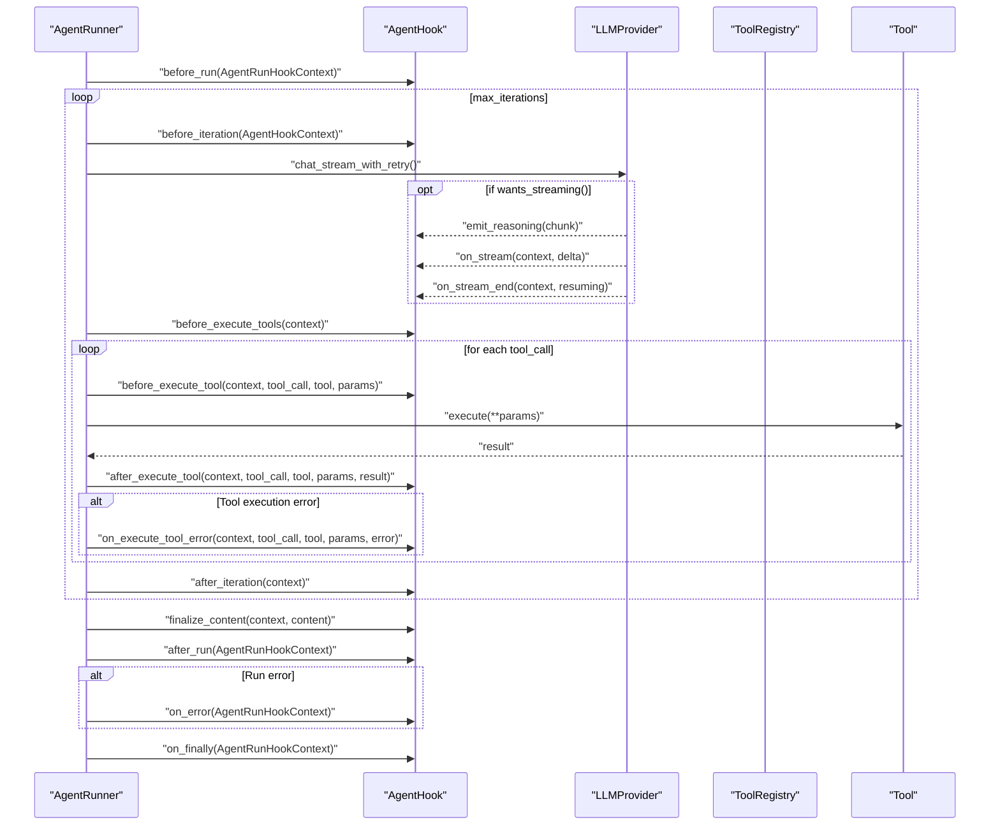
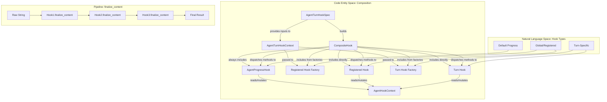

<!-- source: DeepWiki mcp.deepwiki.com · repo HKUDS/nanobot · page 13.2 AgentHook & Lifecycle Callbacks · fetched 2026-11-09 -->

# AgentHook & Lifecycle Callbacks

<details>
<summary>Relevant source files</summary>

The following files were used as context for generating this wiki page:

- [nanobot/agent/__init__.py](nanobot/agent/__init__.py)
- [nanobot/agent/hook.py](nanobot/agent/hook.py)
- [nanobot/agent/progress_hook.py](nanobot/agent/progress_hook.py)
- [nanobot/agent/tools/context.py](nanobot/agent/tools/context.py)
- [nanobot/agent/tools/execution.py](nanobot/agent/tools/execution.py)
- [nanobot/agent/tools/message.py](nanobot/agent/tools/message.py)
- [nanobot/agent/turn_hooks.py](nanobot/agent/turn_hooks.py)
- [nanobot/utils/runtime.py](nanobot/utils/runtime.py)
- [tests/agent/test_attachment_references.py](tests/agent/test_attachment_references.py)
- [tests/agent/test_hook_composite.py](tests/agent/test_hook_composite.py)
- [tests/agent/test_loop_tool_context.py](tests/agent/test_loop_tool_context.py)
- [tests/agent/test_runner_goal_continue.py](tests/agent/test_runner_goal_continue.py)
- [tests/agent/test_turn_hooks.py](tests/agent/test_turn_hooks.py)
- [tests/tools/test_message_tool.py](tests/tools/test_message_tool.py)
- [tests/tools/test_message_tool_suppress.py](tests/tools/test_message_tool_suppress.py)

</details>


The `AgentHook` system provides a minimal lifecycle surface for customizing and observing the execution of an AI agent run. It allows developers to inject logic at critical points of the agent's iteration loop, such as before tool execution, during token streaming, or when reasoning is emitted by the model.

## Overview of AgentHook

The `AgentHook` is an interface defined in `nanobot/agent/hook.py`. It is used by the `AgentRunner` and `AgentLoop` to notify external observers of internal state changes and to allow modification of the final output content [nanobot/agent/hook.py:65-67]().

When using the `Nanobot` programmatic facade, hooks are used to capture streaming events, tool calls, and usage statistics for the `RunResult` [nanobot/agent/runner.py:130-144]().

### The Hook Contexts
Lifecycle methods interact with three types of context objects depending on the scope of the callback.

#### AgentHookContext (Iteration Level)
This mutable container holds the state of a single loop iteration [nanobot/agent/hook.py:16-17]().

| Field | Type | Description |
| :--- | :--- | :--- |
| `iteration` | `int` | The current loop index [nanobot/agent/hook.py:19](). |
| `messages` | `list[dict[str, Any]]` | The conversation history including system prompts and previous turns [nanobot/agent/hook.py:20](). |
| `response` | `LLMResponse \| None` | The raw response from the LLM (if available) [nanobot/agent/hook.py:21](). |
| `usage` | `LLMUsage \| None` | Token usage statistics for the current call [nanobot/agent/hook.py:22](). |
| `tool_calls` | `list[ToolCallRequest]` | Tools the LLM has requested to execute [nanobot/agent/hook.py:23](). |
| `tool_results` | `list[Any]` | Results returned by the executed tools [nanobot/agent/hook.py:24](). |
| `tool_events` | `list[dict[str, str]]`| Metadata about tool execution events (e.g., status, detail) [nanobot/agent/hook.py:25](). |
| `streamed_content` | `bool` | True if the LLM response included streamed content [nanobot/agent/hook.py:27](). |
| `streamed_reasoning` | `bool` | True if the LLM response included streamed reasoning [nanobot/agent/hook.py:28](). |
| `stream_continues_current_message` | `bool` | True if the stream is continuing a previous message [nanobot/agent/hook.py:29](). |
| `final_content` | `str \| None` | The accumulated text response [nanobot/agent/hook.py:31](). |
| `stop_reason` | `str \| None` | Reason the iteration stopped (e.g., "completed", "tool_error") [nanobot/agent/hook.py:32](). |
| `error` | `str \| None` | An error message if an error occurred during the iteration [nanobot/agent/hook.py:33](). |
| `session_key` | `str \| None` | The identifier for the current session [nanobot/agent/hook.py:34]().

#### AgentRunHookContext (Run Level)
This snapshot is exposed to hooks at the beginning and end of the entire agent execution turn [nanobot/agent/hook.py:36-38]().

| Field | Type | Description |
| :--- | :--- | :--- |
| `messages` | `list[dict[str, Any]]` | The final conversation history of the run [nanobot/agent/hook.py:40](). |
| `final_content` | `str \| None` | The final content produced by the run [nanobot/agent/hook.py:41](). |
| `tools_used` | `list[str]` | List of all tool names called during the run [nanobot/agent/hook.py:42](). |
| `usage` | `LLMUsage \| None` | Total token usage for the entire run [nanobot/agent/hook.py:43](). |
| `stop_reason` | `str \| None` | Reason the run stopped (e.g., "completed", "max_iterations") [nanobot/agent/hook.py:44](). |
| `error` | `str \| None` | An error message if an error occurred during the run [nanobot/agent/hook.py:45](). |
| `tool_events` | `list[dict[str, str]]` | All tool execution events during the run [nanobot/agent/hook.py:46](). |
| `had_injections` | `bool` | Whether user messages were injected during the loop [nanobot/agent/hook.py:47](). |
| `exception` | `BaseException \| None` | The exception that crashed the run, if any [nanobot/agent/hook.py:48]().

#### AgentTurnHookContext (Factory Level)
Inputs provided to `AgentTurnHookFactory` to instantiate hooks with turn-specific metadata [nanobot/agent/hook.py:51-53](). It includes fields like `channel`, `chat_id`, and `workspace` [nanobot/agent/hook.py:55-60]().

| Field | Type | Description |
| :--- | :--- | :--- |
| `events` | `EventSink` | An event sink for publishing events [nanobot/agent/hook.py:56](). |
| `workspace` | `Path \| None` | The current workspace path [nanobot/agent/hook.py:57](). |
| `channel` | `str` | The channel identifier (e.g., "cli", "telegram") [nanobot/agent/hook.py:58](). |
| `chat_id` | `str` | The chat identifier [nanobot/agent/hook.py:59](). |
| `message_id` | `str \| None` | The message identifier [nanobot/agent/hook.py:60](). |
| `session_key` | `str \| None` | The session key [nanobot/agent/hook.py:61](). |
| `metadata` | `dict[str, Any]` | Additional metadata for the turn [nanobot/agent/hook.py:62](). |
| `ephemeral` | `bool` | True if the turn is ephemeral (e.g., for internal checks) [nanobot/agent/hook.py:63](). |
| `attributes` | `dict[str, Any]` | Arbitrary attributes for the turn [nanobot/agent/hook.py:64]().

Sources: [nanobot/agent/hook.py:15-64]()

## Lifecycle Methods

The following methods can be implemented in a subclass of `AgentHook`.

### `wants_streaming`
Returns `True` if the hook wants to receive streaming updates from the LLM [nanobot/agent/hook.py:71-72]().

### `before_run`, `after_run`, `on_error`, `on_finally`
These methods are called at the run level:
*   `before_run`: Called at the very beginning of the runner process [nanobot/agent/hook.py:74-75]().
*   `after_run`: Called at the very end of the runner process, regardless of success or failure [nanobot/agent/hook.py:77-78](). This is the authoritative place to capture the final state of the turn.
*   `on_error`: Called if an unhandled exception occurs during the run [nanobot/agent/hook.py:80-81]().
*   `on_finally`: Always called at the end of the run, after `after_run` or `on_error` [nanobot/agent/hook.py:83-84]().

### `before_iteration` & `after_iteration`
These methods are called at the iteration level:
*   `before_iteration`: Called at the start of every loop iteration before the LLM is invoked [nanobot/agent/hook.py:86-87]().
*   `after_iteration`: Called after a single iteration finishes, including tool execution if any occurred [nanobot/agent/hook.py:146-147]().

### `on_stream` & `on_stream_end`
If `wants_streaming()` returns `True` [nanobot/agent/hook.py:71-72](), these methods are triggered as chunks of text arrive from the LLM:
*   `on_stream`: Receives the `delta` (new text chunk) [nanobot/agent/hook.py:89-90]().
*   `on_stream_end`: Called when the stream finishes. The `resuming` flag indicates if the loop will continue (e.g., because tool calls were detected) [nanobot/agent/hook.py:92-93]().

### `on_provider_tool_event`
Observes a provider-hosted tool lifecycle event [nanobot/agent/hook.py:97-102]().

### `before_execute_tools`, `before_execute_tool`, `after_execute_tool`, `on_execute_tool_error`
These methods are called around tool execution:
*   `before_execute_tools`: Called after the LLM has responded with one or more tool calls, but before any tools are executed [nanobot/agent/hook.py:103-104]().
*   `before_execute_tool`: Called immediately before a specific tool is invoked, providing the `tool_call` request, the `tool` instance, and the validated `params` [nanobot/agent/hook.py:106-113]().
*   `after_execute_tool`: Called after a tool has successfully executed [nanobot/agent/hook.py:115-124]().
*   `on_execute_tool_error`: Called if an error occurs during tool execution [nanobot/agent/hook.py:126-135]().

### `emit_reasoning` & `emit_reasoning_end`
Used for models that support hidden "thinking" or reasoning blocks (e.g., DeepSeek-R1, Claude 3.7):
*   `emit_reasoning`: Receives reasoning content chunks [nanobot/agent/hook.py:137-138]().
*   `emit_reasoning_end`: Signals the end of a reasoning stream, allowing hooks to flush UI buffers [nanobot/agent/hook.py:140-144]().

### `finalize_content`
The only non-async method. It allows for post-processing the final string returned to the user [nanobot/agent/hook.py:149-150](). This acts as a pipeline; if multiple hooks are used, the output of one is passed as the input to the next [nanobot/agent/hook.py:255-258]().

Sources: [nanobot/agent/hook.py:65-151](), [nanobot/agent/runner.py:311-325](), [nanobot/agent/runner.py:465-475]()

## Code Entity Interaction Diagram

This diagram illustrates how the `AgentRunner` triggers hook methods and how the context flows during a single execution turn.

**Agent Lifecycle and Hook Interaction**

Sources: [nanobot/agent/hook.py:65-151](), [nanobot/agent/runner.py:311-532](), [nanobot/agent/tools/execution.py:166-184]()

## Composing Multiple Hooks

The framework uses the `CompositeHook` class to manage multiple hooks simultaneously. This class implements a "fan-out" pattern where it iterates through a list of hooks and executes their methods sequentially [nanobot/agent/hook.py:156-169]().

### Error Isolation
The `CompositeHook` provides safety via the `_for_each_hook_safe` helper. It catches and logs exceptions within individual hooks during async lifecycle methods [nanobot/agent/hook.py:173-183](). This prevents a single faulty custom hook from crashing the entire agent loop [nanobot/agent/hook.py:159-161]().

Hooks can opt-out of this safety by setting `self._reraise = True` in `__init__`, which forces exceptions to bubble up [nanobot/agent/hook.py:68-69](), [nanobot/agent/hook.py:174-177](). Note that `finalize_content` does **not** have this isolation, as it is a functional pipeline [nanobot/agent/hook.py:161-162]().

### Turn-Scoped Hook Assembly
In the `AgentLoop`, hooks are assembled for each turn using `build_agent_turn_hook` [nanobot/agent/turn_hooks:44](). This function takes an `AgentTurnHookSpec` [nanobot/agent/turn_hooks:21-41]() and constructs a `CompositeHook` from various sources:
1.  A default `AgentProgressHook` is always included [nanobot/agent/turn_hooks:47-52]().
2.  `registered_hook_factories` are called to create hooks based on the `AgentTurnHookContext` [nanobot/agent/turn_hooks:70-81]().
3.  `registered_hooks` are added directly [nanobot/agent/turn_hooks:83]().
4.  `turn_hook_factories` are called [nanobot/agent/turn_hooks:85-96]().
5.  `turn_hooks` are added directly [nanobot/agent/turn_hooks:98]().

For ephemeral turns, by default, only the `AgentProgressHook` is run, unless `run_extra_hooks_for_ephemeral` is set to `True` [nanobot/agent/turn_hooks:54-55](), [tests/agent/test_turn_hooks.py:139-157](), [tests/agent/test_turn_hooks.py:160-171]().

**Hook Composition and Context Space**

Sources: [nanobot/agent/hook.py:156-260](), [nanobot/agent/turn_hooks.py:21-97](), [tests/agent/test_turn_hooks.py:71-136]()

## Implementation Example

To create a custom hook, inherit from `AgentHook` and override the desired methods:

```python
from nanobot.agent.hook import AgentHook, AgentHookContext

class MyLoggingHook(AgentHook):
    def wants_streaming(self) -> bool:
        return True

    async def before_iteration(self, context: AgentHookContext):
        # Access iteration count and message history
        print(f"Iteration {context.iteration} starting")

    async def on_stream(self, context: AgentHookContext, delta: str):
        # Print streaming tokens to console
        print(delta, end="", flush=True)

    def finalize_content(self, context: AgentHookContext, content: str | None) -> str | None:
        # Append metadata to the final response
        if content:
            return content + f"\n\n(Total Iterations: {context.iteration + 1})"
        return content
```
Sources: [nanobot/agent/hook.py:65-151](), [tests/agent/test_runner_hooks.py:40-79]()

---

