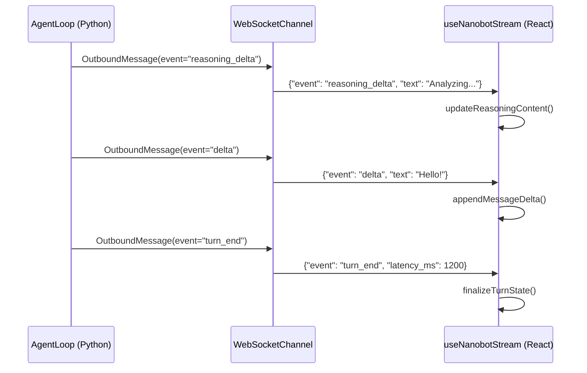

<!-- source: DeepWiki mcp.deepwiki.com · repo HKUDS/nanobot · page 14.1 WebUI Architecture & Components · fetched 2026-11-09 -->

# WebUI Architecture & Components

<details>
<summary>Relevant source files</summary>

The following files were used as context for generating this wiki page:

- [webui/bun.lock](webui/bun.lock)
- [webui/package-lock.json](webui/package-lock.json)
- [webui/package.json](webui/package.json)
- [webui/src/App.tsx](webui/src/App.tsx)
- [webui/src/components/ChatList.tsx](webui/src/components/ChatList.tsx)
- [webui/src/components/CliAppMentionText.tsx](webui/src/components/CliAppMentionText.tsx)
- [webui/src/components/CodeBlock.tsx](webui/src/components/CodeBlock.tsx)
- [webui/src/components/InlineTokenHighlight.tsx](webui/src/components/InlineTokenHighlight.tsx)
- [webui/src/components/MarkdownTextRenderer.tsx](webui/src/components/MarkdownTextRenderer.tsx)
- [webui/src/components/MessageBubble.tsx](webui/src/components/MessageBubble.tsx)
- [webui/src/components/SessionSearchDialog.tsx](webui/src/components/SessionSearchDialog.tsx)
- [webui/src/components/Sidebar.tsx](webui/src/components/Sidebar.tsx)
- [webui/src/components/SlashCommandText.tsx](webui/src/components/SlashCommandText.tsx)
- [webui/src/components/UserMessageText.tsx](webui/src/components/UserMessageText.tsx)
- [webui/src/components/settings/SettingsView.tsx](webui/src/components/settings/SettingsView.tsx)
- [webui/src/components/thread/AgentActivityCluster.tsx](webui/src/components/thread/AgentActivityCluster.tsx)
- [webui/src/components/thread/ModelPresetBadge.tsx](webui/src/components/thread/ModelPresetBadge.tsx)
- [webui/src/components/thread/PromptRail.tsx](webui/src/components/thread/PromptRail.tsx)
- [webui/src/components/thread/ThreadComposer.tsx](webui/src/components/thread/ThreadComposer.tsx)
- [webui/src/components/thread/ThreadHeader.tsx](webui/src/components/thread/ThreadHeader.tsx)
- [webui/src/components/thread/ThreadMessages.tsx](webui/src/components/thread/ThreadMessages.tsx)
- [webui/src/components/thread/ThreadShell.tsx](webui/src/components/thread/ThreadShell.tsx)
- [webui/src/components/thread/ThreadViewport.tsx](webui/src/components/thread/ThreadViewport.tsx)
- [webui/src/components/thread/activity/ActivityStep.tsx](webui/src/components/thread/activity/ActivityStep.tsx)
- [webui/src/components/thread/activity/FileEditRow.tsx](webui/src/components/thread/activity/FileEditRow.tsx)
- [webui/src/components/thread/activity/ReasoningRow.tsx](webui/src/components/thread/activity/ReasoningRow.tsx)
- [webui/src/components/thread/activity/ThinkingReasoningShell.tsx](webui/src/components/thread/activity/ThinkingReasoningShell.tsx)
- [webui/src/components/thread/promptNavigation.ts](webui/src/components/thread/promptNavigation.ts)
- [webui/src/components/thread/thread-camera.ts](webui/src/components/thread/thread-camera.ts)
- [webui/src/components/thread/thread-motion.ts](webui/src/components/thread/thread-motion.ts)
- [webui/src/globals.css](webui/src/globals.css)
- [webui/src/lib/activity-timeline.ts](webui/src/lib/activity-timeline.ts)
- [webui/src/lib/remark-tex-math.ts](webui/src/lib/remark-tex-math.ts)
- [webui/src/tests/agent-activity-cluster.test.tsx](webui/src/tests/agent-activity-cluster.test.tsx)
- [webui/src/tests/app-layout.test.tsx](webui/src/tests/app-layout.test.tsx)
- [webui/src/tests/chat-list.test.tsx](webui/src/tests/chat-list.test.tsx)
- [webui/src/tests/code-block.test.tsx](webui/src/tests/code-block.test.tsx)
- [webui/src/tests/markdown-text-renderer.test.tsx](webui/src/tests/markdown-text-renderer.test.tsx)
- [webui/src/tests/message-bubble.test.tsx](webui/src/tests/message-bubble.test.tsx)
- [webui/src/tests/model-preset-badge.test.tsx](webui/src/tests/model-preset-badge.test.tsx)
- [webui/src/tests/reasoning-row.test.tsx](webui/src/tests/reasoning-row.test.tsx)
- [webui/src/tests/session-search-dialog.test.tsx](webui/src/tests/session-search-dialog.test.tsx)
- [webui/src/tests/thinking-reasoning-shell.test.tsx](webui/src/tests/thinking-reasoning-shell.test.tsx)
- [webui/src/tests/thread-camera.test.ts](webui/src/tests/thread-camera.test.ts)
- [webui/src/tests/thread-composer.test.tsx](webui/src/tests/thread-composer.test.tsx)
- [webui/src/tests/thread-messages.test.tsx](webui/src/tests/thread-messages.test.tsx)
- [webui/src/tests/thread-motion.test.ts](webui/src/tests/thread-motion.test.ts)
- [webui/src/tests/thread-shell.test.tsx](webui/src/tests/thread-shell.test.tsx)
- [webui/src/tests/thread-viewport.test.tsx](webui/src/tests/thread-viewport.test.tsx)

</details>


The nanobot WebUI is a modern, responsive single-page application (SPA) built with **Vite**, **React**, and **TypeScript**. It serves as a rich interface for interacting with the AI agent, providing real-time streaming updates, tool execution visualization, and comprehensive session management.

## Tech Stack & Core Patterns

The WebUI leverages a reactive architecture to handle asynchronous AI streams and complex agent states.

| Component | Technology | Role |
| :--- | :--- | :--- |
| **Build Tool** | Vite | Fast development server and optimized production bundling. |
| **Framework** | React | Component-based UI rendering with Hooks for state management. |
| **State Management** | React Hooks / Context | Local and shared state (e.g., `ClientProvider`, `useNanobotStream`). |
| **Communication** | WebSocket | Real-time bi-directional streaming via `NanobotClient`. |
| **Styling** | Tailwind CSS | Utility-first styling for responsive layouts. |
| **Components** | Radix UI / Shadcn | Accessible UI primitives (Sheets, Dialogs, Buttons). |

### Data Flow Overview

The WebUI interacts with the nanobot backend primarily through a dedicated WebSocket client and a set of RESTful APIs for bootstrap and session history.

Title: WebUI to Backend Communication Flow
```mermaid
graph TD
    subgraph "WebUI (React Space)"
        A["App.tsx"] --> B["ClientProvider"]
        B --> C["ThreadShell.tsx"]
        C --> D["useNanobotStream.ts"]
        D --> E["NanobotClient.ts"]
    end

    subgraph "Backend (Python Space)"
        E <--- "ws_protocol" ---> F["WebSocketChannel"]
        F <--- "events" ---> G["MessageBus"]
        G <--- "loop" ---> H["AgentLoop"]
        F --- "http_routes" ---> I["ws_http.py / GatewayServices"]
        I --- "persistence" ---> J["SessionManager"]
    end

    E -- "auth/bootstrap" --> I
```
Sources: [webui/src/App.tsx:60-61](), [webui/src/providers/ClientProvider.tsx:1-20](), [nanobot/channels/websocket/runtime.py:73-73](), [nanobot/webui/ws_http.py:1-8]()

## Core Components

### 1. App/Shell Bootstrap

The `App` component [webui/src/App.tsx:1-3071]() is the root of the WebUI, responsible for bootstrapping the application, managing global state, and routing between different views (chat, settings, etc.). It handles the initial connection to the nanobot backend, authentication, and overall layout.

The `App` component manages the `BootState` [webui/src/App.tsx:98-110]() which transitions from `loading` to `auth` (if required) and finally to `ready`. Upon being `ready`, it instantiates the `NanobotClient` [webui/src/App.tsx:104-106]() which handles WebSocket communication.

The main content area of the application is determined by the `ShellRoute` [webui/src/App.tsx:128-133](), which can be either a `ThreadShell` for chat interactions or a `SettingsView` for configuration. These are loaded lazily using `lazy` and `Suspense` for performance [webui/src/App.tsx:134-154]().

Sources: [webui/src/App.tsx:1-3071]()

### 2. Sidebar & ChatList

The `Sidebar` [webui/src/components/Sidebar.tsx:1-244]() provides navigation across historical sessions, settings, and specialized views.

*   **Session Navigation**: The `ChatList` [webui/src/components/ChatList.tsx:1-244]() renders a list of `ChatSummary` objects [webui/src/components/ChatList.tsx:231-251](). These summaries include `key`, `channel`, `chatId`, `createdAt`, `updatedAt`, `title`, `preview`, and `workspaceScope` [webui/src/tests/app-layout.test.tsx:177-186]().
*   **State Persistence**: Sidebar collapse state and session updates are persisted in local storage using keys like `nanobot-webui.sidebar` and `nanobot-webui.sidebar.session-updates.v1` [webui/src/App.tsx:112-113]().
*   **Workbench Integration**: Supports multi-pane "Workbench" layouts, allowing users to drag and drop sessions into groups using `SidebarPaneGroup` [webui/src/components/ChatList.tsx:182-193](), [webui/src/App.tsx:18-35]().

Sources: [webui/src/App.tsx:14-15](), [webui/src/components/ChatList.tsx:1-244](), [webui/src/tests/app-layout.test.tsx:177-186]()

### 3. ThreadShell

The `ThreadShell` [webui/src/components/thread/ThreadShell.tsx:1-1810]() is the primary container for a conversation. It manages the lifecycle of a chat session, including loading history and coordinating real-time message streaming.

*   **Message Projection**: Normalizes and filters messages before rendering using `projectWebuiThreadMessages` [webui/src/lib/thread-display-projection.ts:1-1]().
*   **Stale Snapshot Prevention**: Implements logic in `snapshotPreservesMessage` [webui/src/components/thread/ThreadShell.tsx:181-198]() to ensure that race conditions between WebSocket deltas and authoritative history refreshes do not drop user/assistant messages.
*   **Turn Lifecycle**: Tracks `historyVersion` and `runGeneration` to reconcile local optimistic updates with authoritative server snapshots [webui/src/components/thread/ThreadShell.tsx:56-63]().
*   **Context Monitoring**: Calculates LLM token usage via `latestComposerContextUsage` [webui/src/components/thread/ThreadShell.tsx:100-125]() to display context window proximity in the UI.
*   **Recent Round Usage**: `recentComposerRoundUsage` [webui/src/components/thread/ThreadShell.tsx:127-179]() extracts and formats usage statistics for recent turns, including input/output tokens and generation time.

Sources: [webui/src/components/thread/ThreadShell.tsx:1-1810](), [webui/src/lib/thread-display-projection.ts:1-1]()

### 4. ThreadComposer

The input area `ThreadComposer` [webui/src/components/thread/ThreadComposer.tsx:1-3332]() handles user input and multi-modal attachments.

*   **Slash Commands**: Provides a palette for commands like `/stop` or `/history` [webui/src/tests/thread-composer.test.tsx:18-35](). The `slashCommandLifecycle` function [webui/src/lib/slash-command.ts:1-1]() determines how commands affect the agent's turn.
*   **Voice Recording**: Integrates audio capture via `useVoiceRecorder` [webui/src/hooks/useVoiceRecorder.ts:1-1]() with platform-specific shortcuts (e.g., `⌃⇧D` on Apple) [webui/src/components/thread/ThreadComposer.tsx:170-180]().
*   **Context Usage Meter**: Displays a circular progress ring showing `contextTokens` vs `contextWindowTokens` [webui/src/components/thread/ComposerUsagePopover.tsx:1-1]() in the `ComposerUsagePopover`.
*   **Capability Mentions**: Supports `@` mentions for CLI apps and MCP presets via `CapabilityMentionToken` [webui/src/components/CliAppMentionText.tsx:15-20](). The `splitCapabilityMentionSegments` function [webui/src/components/CliAppMentionText.tsx:18-20]() parses these mentions.
*   **Image Attachments**: Manages image attachments using `useAttachedImages` [webui/src/hooks/useAttachedImages.ts:1-1]() and encodes them via `encodeImage` [webui/src/lib/imageEncode.ts:1-1]() before sending.

Sources: [webui/src/components/thread/ThreadComposer.tsx:1-3332](), [webui/src/tests/thread-composer.test.tsx:18-35](), [webui/src/hooks/useVoiceRecorder.ts:1-1](), [webui/src/components/thread/ComposerUsagePopover.tsx:1-1](), [webui/src/components/CliAppMentionText.tsx:15-20](), [webui/src/hooks/useAttachedImages.ts:1-1](), [webui/src/lib/imageEncode.ts:1-1]()

### 5. MessageBubble

Messages are rendered using `MessageBubble` [webui/src/components/MessageBubble.tsx:1-977](). It distinguishes between user "pills" and assistant document-style prose.

*   **Role-Based Rendering**: Supports `user`, `assistant`, `tool`, and `system` roles [webui/src/lib/types.ts:1-1]().
*   **Trace Handling**: Renders `trace` kind messages (tool-call hints, progress breadcrumbs) as a subdued collapsible group [webui/src/lib/types.ts:3-5](), [webui/src/lib/types.ts:69-71]().
*   **Reasoning Blocks**: Supports "Thinking" blocks via accumulated reasoning text, built up from `reasoning_delta` frames [webui/src/components/thread/activity/ReasoningRow.tsx:1-1]().
*   **Delivery Status**: Displays `sending`, `accepted`, or `failed` states for optimistic user messages, including specific error kinds like `message_too_big` or `workspace_scope_rejected` [webui/src/lib/types.ts:8-12](), [webui/src/lib/types.ts:115-118]().
*   **Markdown Rendering**: Uses `MarkdownText` [webui/src/components/MarkdownText.tsx:1-1]() for rich text display, which in turn uses `MarkdownTextRenderer` [webui/src/components/MarkdownTextRenderer.tsx:1-1]() for parsing and rendering. Code blocks are handled by `CodeBlock` [webui/src/components/CodeBlock.tsx:1-1]().
*   **Activity Clusters**: `AgentActivityCluster` [webui/src/components/thread/AgentActivityCluster.tsx:1-1]() groups related agent activities (e.g., tool calls, file edits) into a single visual unit. The `isAgentActivityMember` function [webui/src/components/thread/AgentActivityCluster.tsx:17-20]() helps identify messages belonging to an activity cluster.

Sources: [webui/src/components/MessageBubble.tsx:1-977](), [webui/src/lib/types.ts:1-119](), [webui/src/components/thread/activity/ReasoningRow.tsx:1-1](), [webui/src/components/MarkdownText.tsx:1-1](), [webui/src/components/MarkdownTextRenderer.tsx:1-1](), [webui/src/components/CodeBlock.tsx:1-1](), [webui/src/components/thread/AgentActivityCluster.tsx:1-1]()

### 6. Markdown Rendering

Markdown content within messages is rendered using a dedicated component hierarchy.

*   **`MarkdownText`**: The top-level component that takes markdown string as input [webui/src/components/MarkdownText.tsx:1-1](). It uses `preloadMarkdownText` for performance [webui/src/components/MarkdownText.tsx:14-14]().
*   **`MarkdownTextRenderer`**: This component handles the actual parsing and rendering of markdown. It supports various markdown features, including code blocks, tables, and inline code.
*   **`CodeBlock`**: Renders code snippets with syntax highlighting and copy-to-clipboard functionality [webui/src/components/CodeBlock.tsx:1-1]().
*   **`remark-tex-math`**: A remark plugin used for rendering mathematical expressions [webui/src/lib/remark-tex-math.ts:1-1]().

Sources: [webui/src/components/MarkdownText.tsx:1-1](), [webui/src/components/MarkdownTextRenderer.tsx:1-1](), [webui/src/components/CodeBlock.tsx:1-1](), [webui/src/lib/remark-tex-math.ts:1-1]()

## WebSocket Streaming Protocol

The `NanobotClient` and `useNanobotStream` hook implement a frame-based protocol for real-time interaction.

### Event Types & Handling

| Event | Direction | Purpose |
| :--- | :--- | :--- |
| `delta` | Backend -> UI | Incremental text for the assistant's answer [webui/src/hooks/useNanobotStream.ts:38](). |
| `reasoning_delta` | Backend -> UI | Incremental text for the agent's internal thought process [webui/src/lib/types.ts:92-95](). |
| `turn_end` | Backend -> UI | Signals completion of an agent turn, finalizes message state [webui/src/lib/types.ts:99-102](). |
| `goal_state` | Backend -> UI | Updates the sustained objective (e.g., background tasks) for the current session [webui/src/lib/types.ts:211-211]().

### Stream Processing Flow

The `useNanobotStream` hook acts as the primary orchestrator for merging incoming WebSocket frames into the React component state.

Title: WebSocket Streaming Sequence

Sources: [nanobot/channels/websocket/runtime.py:31-42](), [webui/src/lib/types.ts:62-119]()

## LLM Usage Tracking (Heatmap)

The WebUI provides a token usage visualization backed by a SQLite store on the backend.

*   **Data Source**: Usage is tracked per provider and model in the backend via `LLMUsage` [nanobot/channels/websocket/runtime.py:47-47]().
*   **UI Representation**: The `TokenUsageHeatmap` (part of `SettingsView`) visualizes these tokens over time [webui/src/components/settings/SettingsView.tsx:1-24]().
*   **Backend Persistence**: The usage data is persisted in a local SQLite database, allowing the WebUI to query historical costs and token counts across different providers [nanobot/webui/ws_http.py:79-79]().

Sources: [nanobot/channels/websocket/runtime.py:47-47](), [nanobot/webui/ws_http.py:79-79](), [webui/src/components/settings/SettingsView.tsx:1-66]()

---

