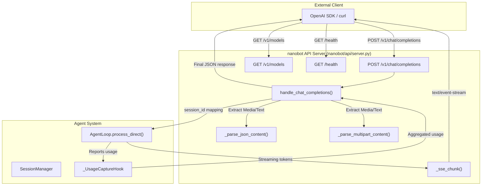
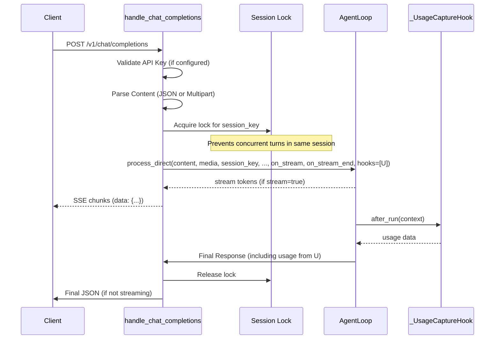
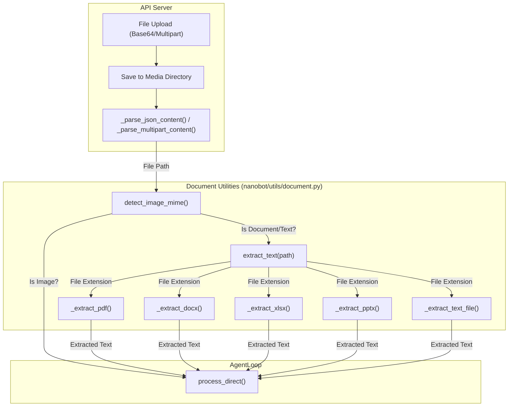

<!-- source: DeepWiki mcp.deepwiki.com · repo HKUDS/nanobot · page 16.1 API Server Reference · fetched 2026-11-09 -->

# API Server Reference

Relevant source files

The following files were used as context for generating this wiki page:

- [SECURITY.md](SECURITY.md)
- [docs/openai-api.md](docs/openai-api.md)
- [nanobot/agent/tools/sandbox.py](nanobot/agent/tools/sandbox.py)
- [nanobot/api/server.py](nanobot/api/server.py)
- [nanobot/security/workspace_access.py](nanobot/security/workspace_access.py)
- [nanobot/utils/document.py](nanobot/utils/document.py)
- [tests/test_api_attachment.py](tests/test_api_attachment.py)
- [tests/test_api_stream.py](tests/test_api_stream.py)
- [tests/test_context_documents.py](tests/test_context_documents.py)
- [tests/test_document_parsing.py](tests/test_document_parsing.py)
- [tests/test_openai_api.py](tests/test_openai_api.py)
- [tests/tools/test_sandbox.py](tests/tools/test_sandbox.py)
- [tests/tools/test_seatbelt_native.py](tests/tools/test_seatbelt_native.py)

The `nanobot serve` command exposes an `aiohttp.web`-based OpenAI-compatible HTTP server. This allows nanobot to act as a drop-in replacement for LLM providers in local integrations, providing a `/v1/chat/completions` endpoint that routes requests to a persistent AI agent session [nanobot/api/server.py:1-5]().

## Server Architecture

The API server is designed to bridge standard OpenAI-formatted requests into the `AgentLoop`. It manages session persistence, file uploads, and streaming responses via Server-Sent Events (SSE).

### Component Relationship Diagram
This diagram shows how an external HTTP request is transformed into an `AgentLoop` execution.

**Sources:** [nanobot/api/server.py:42-43](), [nanobot/api/server.py:180-181](), [nanobot/api/server.py:155-156](), [nanobot/api/server.py:58-67](), [nanobot/api/server.py:323-326](), [nanobot/api/server.py:46-47]()

## Endpoint Contract

### `/v1/chat/completions`
The primary endpoint for interaction. While it mimics OpenAI, it has specific behaviors:

*   **Message Limit**: Each request must contain exactly one `user` message [nanobot/api/server.py:198-206]().
*   **Session Mapping**:
    *   If `session_id` is provided in the request body, it is mapped to a unique session key [nanobot/api/server.py:323-326]().
    *   If omitted, it defaults to a shared session keyed as `api:default` [nanobot/api/server.py:46-47]().
*   **Timeout**: Requests are subject to a configurable timeout (defaulting to 600s), managed by `asyncio.wait_for` during the agent's execution [nanobot/api/server.py:339-344]().
*   **Model**: The `model` field in the request body is currently ignored. The server uses a fixed model specified during its creation [docs/openai-api.md:44](). The available model can be queried via `/v1/models`.

### Data Flow for Request Processing
The following diagram traces a request from the HTTP handler to the internal agent state.

**Sources:** [nanobot/api/server.py:334-360](), [nanobot/api/server.py:382-390](), [nanobot/api/server.py:58-67]()

## Session Management

The API server uses a locking mechanism to ensure that a single session does not process multiple requests simultaneously.
*   **Session Locks**: Stored in the aiohttp application state under `_SESSION_LOCKS_KEY` [nanobot/api/server.py:51]().
*   **Locking Logic**: The handler retrieves or creates an `asyncio.Lock` for the specific `session_key` before calling `process_direct` [nanobot/api/server.py:334-337]().

## Streaming SSE Format

When `stream: true` is passed, the server returns `text/event-stream` [nanobot/api/server.py:392-395]().
*   **Chunks**: Each token or delta is wrapped in an OpenAI-compatible JSON payload via `_sse_chunk()` [nanobot/api/server.py:168-182]().
*   **Termination**: The stream ends with a standard `data: [DONE]\n\n` message [nanobot/api/server.py:186]().
*   **Usage Reporting**: The final chunk before `[DONE]` includes `finish_reason: "stop"` and an empty `delta` object [tests/test_api_stream.py:128-129](). Aggregate usage statistics are not included in streaming responses, only in the final non-streaming JSON response [tests/test_api_stream.py:200-201]().

## Document and Attachment Parsing

The API supports multimodal inputs through two formats:

1.  **JSON Base64**: Standard OpenAI `image_url` blocks containing `data:image/...;base64,...` [nanobot/api/server.py:212-225]().
    *   `_save_base64_data_url()` handles decoding and saving these to disk [nanobot/api/server.py:31]().
2.  **Multipart/form-data**: Files uploaded as parts alongside a `message` field [nanobot/api/server.py:254-282]().
    *   `_parse_multipart_content()` processes these uploads [nanobot/api/server.py:254-282]().

### Document Extraction Process
When a file is uploaded, the server first saves it to the media directory. Then, `_parse_json_content` or `_parse_multipart_content` determines how to handle it:
*   **Images**: If the file is an image (PNG, JPEG, GIF, WebP), its path is passed directly to the `AgentLoop` for vision models [tests/test_context_documents.py:26-36]().
*   **Documents**: For document types like PDF, DOCX, XLSX, and PPTX, the `extract_text()` utility is used to extract their textual content [nanobot/utils/document.py:100-131](). This extracted text is then included in the agent's prompt.
*   **Text Files**: For plain text files (TXT, MD, CSV, JSON), their content is read directly [nanobot/utils/document.py:126-127]().

### Document Extraction Diagram

**Sources:** [nanobot/api/server.py:193-282](), [nanobot/utils/document.py:100-131](), [nanobot/utils/helpers:23](), [tests/test_context_documents.py:26-44]()

### Security Constraints
*   **File Size**: A strict limit of 10MB (`MAX_FILE_SIZE`) is enforced per file [nanobot/api/server.py:24](), [nanobot/api/server.py:277-279](). This applies to both base64 and multipart uploads [tests/test_api_attachment.py:96-101](), [tests/test_api_attachment.py:179-202]().
*   **Storage**: Uploaded files are saved to a dedicated `api` subdirectory within the media directory [nanobot/api/server.py:196-197](). Filenames are sanitized using `safe_filename` [nanobot/api/server.py:23]().
*   **Document Safety**: Document parsers (e.g., PDF, DOCX) include safety limits to prevent resource exhaustion or malicious content from crashing the server. For example, `PdfSafetyError` is raised for oversized PDF content streams [nanobot/utils/document.py:58-61](), [nanobot/utils/document.py:205-208]().

## Security Considerations

As detailed in `SECURITY.md`, the API server includes several safeguards for network deployment:

*   **API Key Requirement**: If the server is bound to a public interface (`0.0.0.0` or `::`), an `api.apiKey` **must** be configured in `config.json`. If missing, the server will fail to start to prevent unauthenticated access [docs/openai-api.md:17-21]().
*   **Authentication**: When an API key is set, all routes (except `/health`) require an `Authorization: Bearer <key>` header [nanobot/api/server.py:307-318]().
*   **Health Check**: The `GET /health` endpoint remains unauthenticated to allow load balancer probes [nanobot/api/server.py:313](), [docs/openai-api.md:35-36]().
*   **Path Traversal**: All file uploads and workspace interactions are subject to path traversal protections and workspace restrictions [SECURITY.md:113-116](). The `bwrap` (Linux) and `seatbelt` (macOS) sandboxes further restrict filesystem access for `exec` tool commands, ensuring that only the workspace and explicitly allowed paths are accessible [nanobot/agent/tools/sandbox.py:56-61](), [nanobot/agent/tools/sandbox.py:192-201](), [tests/tools/test_sandbox.py:52-61](), [tests/tools/test_seatbelt_native.py:68-74]().

**Sources:** [nanobot/api/server.py:305-318](), [docs/openai-api.md:17-21](), [docs/openai-api.md:35-36](), [SECURITY.md:113-116](), [nanobot/agent/tools/sandbox.py:56-61](), [nanobot/agent/tools/sandbox.py:192-201](), [tests/tools/test_sandbox.py:52-61](), [tests/tools/test_seatbelt_native.py:68-74]()

---

