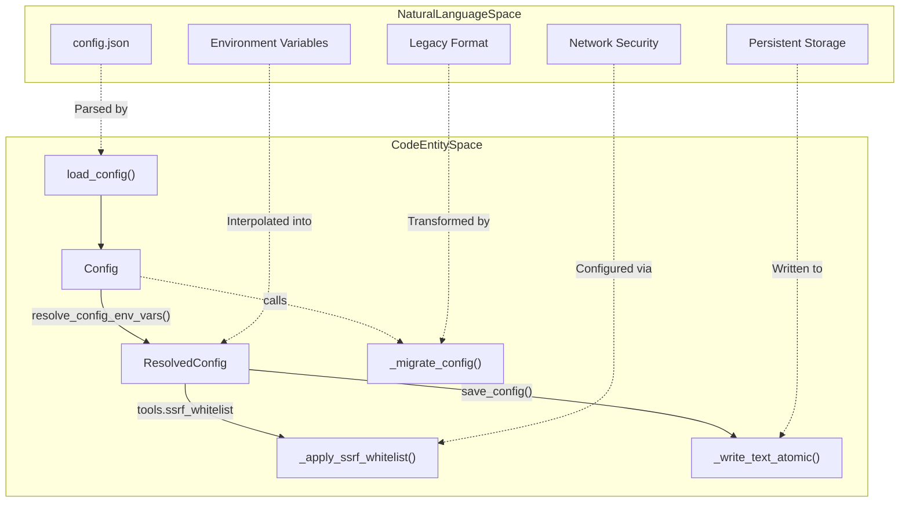
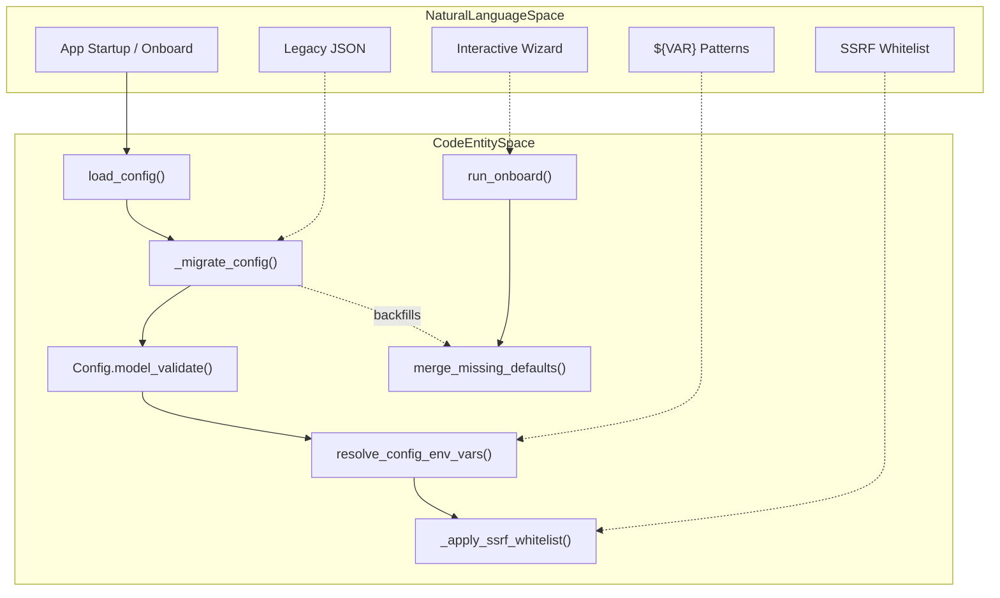

<!-- source: DeepWiki mcp.deepwiki.com · repo HKUDS/nanobot · page 2.1 Installation & Configuration · fetched 2026-11-09 -->

# Installation & Configuration

<details>
<summary>Relevant source files</summary>

The following files were used as context for generating this wiki page:

- [CONTRIBUTING.md](CONTRIBUTING.md)
- [docs/README.md](docs/README.md)
- [docs/chat-commands.md](docs/chat-commands.md)
- [docs/concepts.md](docs/concepts.md)
- [docs/multiple-instances.md](docs/multiple-instances.md)
- [docs/quick-start.md](docs/quick-start.md)
- [docs/releasing.md](docs/releasing.md)
- [docs/start-without-technical-background.md](docs/start-without-technical-background.md)
- [docs/troubleshooting.md](docs/troubleshooting.md)
- [docs/webui.md](docs/webui.md)
- [nanobot/__init__.py](nanobot/__init__.py)
- [nanobot/channels/registry.py](nanobot/channels/registry.py)
- [nanobot/cli/onboard.py](nanobot/cli/onboard.py)
- [nanobot/config/loader.py](nanobot/config/loader.py)
- [pyproject.toml](pyproject.toml)
- [scripts/build_tui_wheels.py](scripts/build_tui_wheels.py)
- [tests/agent/test_onboard_logic.py](tests/agent/test_onboard_logic.py)
- [tests/cli/test_tui_wheels.py](tests/cli/test_tui_wheels.py)
- [tests/config/test_config_migration.py](tests/config/test_config_migration.py)
- [tests/config/test_dream_config.py](tests/config/test_dream_config.py)
- [tests/config/test_env_interpolation.py](tests/config/test_env_interpolation.py)
- [tests/providers/test_openai_compat_timeout.py](tests/providers/test_openai_compat_timeout.py)
- [tests/providers/test_proxy_env.py](tests/providers/test_proxy_env.py)
- [tui/scripts/build.ts](tui/scripts/build.ts)

</details>


This page details the setup process for `nanobot`, covering installation methods via `pip`, `uv`, and bootstrap scripts, the Pydantic-backed `config.json` structure with environment variable interpolation, and the interactive onboarding wizard flow (`run_onboard`) used to initialize agent environments.

## Installation

`nanobot` is a lightweight AI assistant framework requiring **Python ≥ 3.11** `[pyproject.toml:6-6]()`. The package bundles dependencies for multi-platform support (Telegram, Feishu, Matrix, etc.) and LLM provider integrations `[pyproject.toml:25-63]()`.

### One-Command Installer
The recommended setup path on macOS, Linux, or Windows uses the one-command installer script, which provisions a managed virtual environment and starts the onboarding wizard or WebUI automatically `[docs/quick-start.md:17-33]()`.

**macOS / Linux:**
```bash
curl -fsSL https://raw.githubusercontent.com/HKUDS/nanobot/main/scripts/install.sh | sh
```

**Windows PowerShell:**
```powershell
irm https://raw.githubusercontent.com/HKUDS/nanobot/main/scripts/install.ps1 | iex
```

### Manual Installation
Stable releases can be installed from PyPI using `pip` or `uv` `[docs/quick-start.md:140-154]()`.

**Via uv (Recommended):**
```bash
uv tool install nanobot-ai
```

**Via pip:**
```bash
python -m pip install nanobot-ai
```

Sources: `[pyproject.toml:6-6]()`, `[pyproject.toml:25-63]()`, `[docs/quick-start.md:17-33]`, `[docs/quick-start.md:140-154]()`

## Configuration Structure

System configuration is stored in `config.json`, defaulting to `~/.nanobot/config.json` `[nanobot/config/loader.py:35-39]()`. Configuration parsing and validation are governed by Pydantic models rooted in the `Config` class `[nanobot/config/loader.py:124-124]()`.

### Core Configuration Sections

| Section | Description |
| :--- | :--- |
| `providers` | Credentials and endpoints for LLM services (e.g., `apiKey`, `apiBase`) `[docs/configuration.md:85-87]()`. |
| `modelPresets` | Named configurations pairing a provider with a specific model and parameters (e.g., `temperature`, `maxTokens`) `[docs/providers.md:37-45]()`. |
| `agents` | Defines default settings like the active `modelPreset`, `workspace` path, and fallback models `[docs/configuration.md:58-59]()`. |
| `channels` | Settings for communication platforms (Telegram, WebSocket/WebUI, etc.) `[docs/configuration.md:78-84]()`. |
| `tools` | Configuration for external capabilities, including `web` search, `mcpServers`, and security constraints like workspace restrictions `[docs/configuration.md:64-67]()`. |

### Environment Variable Interpolation
Secrets and configuration values support `${VAR_NAME}` syntax `[docs/configuration.md:72-83]()`. These references are resolved in-memory at startup by `resolve_config_env_vars()` `[nanobot/config/loader.py:196-214]()`, which matches patterns using `_ENV_REF_PATTERN` against `os.environ` `[nanobot/config/loader.py:193-193]()`. Resolved secrets are never written back to disk during serialization `[nanobot/config/loader.py:157-172]()`.

### Configuration Data Flow
The following diagram illustrates how the `Config` object is instantiated, migrated, and used to resolve runtime paths and security policies.

**Figure 1: Configuration to Code Entity Mapping**

Sources: `[nanobot/config/loader.py:42-136]`, `[nanobot/config/loader.py:139-143]`, `[nanobot/config/loader.py:196-214]`, `[docs/configuration.md:72-87]`

## The Onboard Wizard

The `nanobot onboard --wizard` command invokes an interactive terminal questionnaire powered by the `questionary` library `[nanobot/cli/onboard.py:131-138]()` to initialize or refresh the configuration file `[docs/quick-start.md:60-64]()`.

### Execution Flow
1. **Quick Start vs. Advanced**: Users select between a streamlined `[Q] Quick Start` flow or granular component configuration categories `[nanobot/cli/onboard.py:92-93]()`.
2. **Provider Selection**: The wizard presents available LLM provider definitions and model suggestions `[nanobot/cli/onboard.py:28-32]()`.
3. **Migration & Merging**: When an existing config file is detected, `merge_missing_defaults()` backfills omitted fields without overwriting active user customizations `[nanobot/config/loader.py:177-191]()`.
4. **Validation**: Field inputs are dynamically checked against expected Pydantic field types (e.g., `int`, `bool`, `Literal`) via `_get_field_type_info()` `[tests/agent/test_onboard_logic.py:114-216]()`.

**Figure 2: Configuration Lifecycle & Onboarding**

Sources: `[nanobot/config/loader.py:42-136]`, `[nanobot/config/loader.py:177-191]`, `[nanobot/cli/onboard.py:1-138]`, `[tests/agent/test_onboard_logic.py:29-112]`

## Config Migration & Security

`nanobot` handles configuration schema evolution and execution security via dedicated internal utilities:

1. **Legacy Migration**: `_migrate_config()` inspects older schemas and normalizes keys to match current structures `[nanobot/config/loader.py:122-122]()`.
2. **SSRF Protection**: `_apply_ssrf_whitelist()` configures network filtering rules from `tools.ssrf_whitelist` to prevent Server-Side Request Forgery during tool execution `[nanobot/config/loader.py:139-143]()`.
3. **Atomic Writes**: `save_config()` writes configuration updates using `_write_text_atomic()` to guarantee that disk corruption or process crashes mid-write never result in a truncated `config.json` `[nanobot/config/loader.py:173-174]()`.

### Configuration Field Mapping
| Code Symbol | Config Key (CamelCase) | Purpose |
| :--- | :--- | :--- |
| `AgentDefaults.workspace` | `workspace` | Root directory for agent workspace files `[docs/concepts.md:29-29]()`. |
| `AgentDefaults.model_preset` | `modelPreset` | Active named model configuration preset `[docs/providers.md:13-13]()`. |
| `Config.tools.ssrf_whitelist` | `ssrfWhitelist` | Permitted IP ranges and domains for network tools `[nanobot/config/loader.py:143-143]()`. |
| `TranscriptionConfig.enabled` | `enabled` | Controls cross-channel audio transcription features `[docs/configuration.md:63-63]()`. |
| `GatewayHeartbeatConfig.interval_s` | `intervalS` | Polling interval in seconds between heartbeat evaluations `[docs/chat-commands.md:148-148]()`. |

Sources: `[nanobot/config/loader.py:122-143]`, `[nanobot/config/schema.py:1-210]`, `[docs/configuration.md:52-70]`

---

