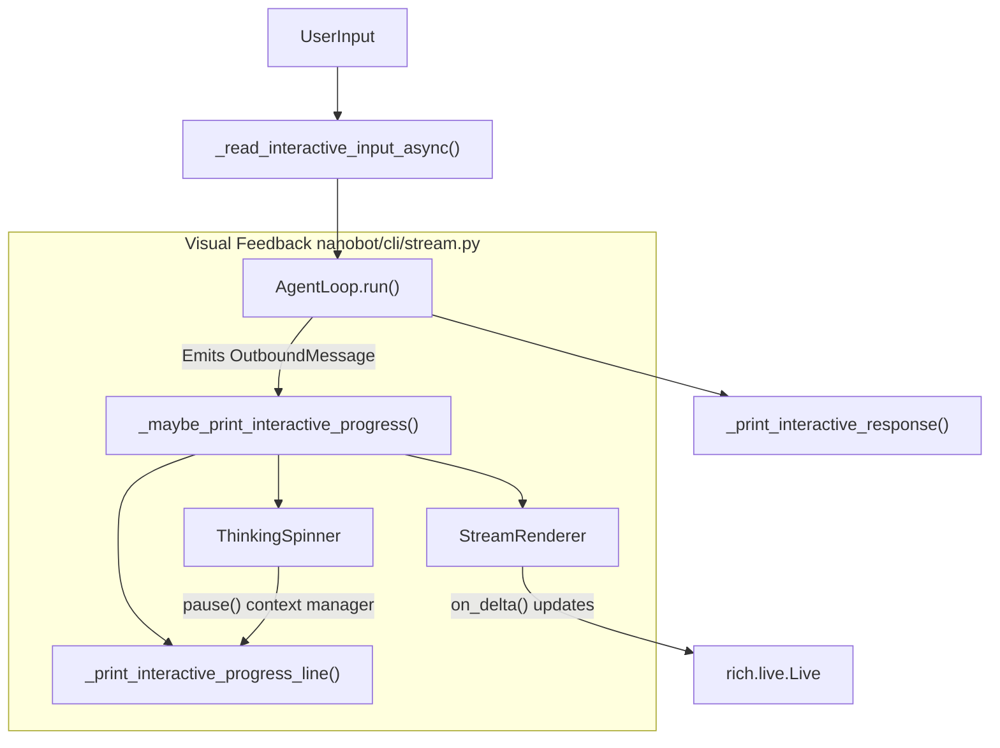
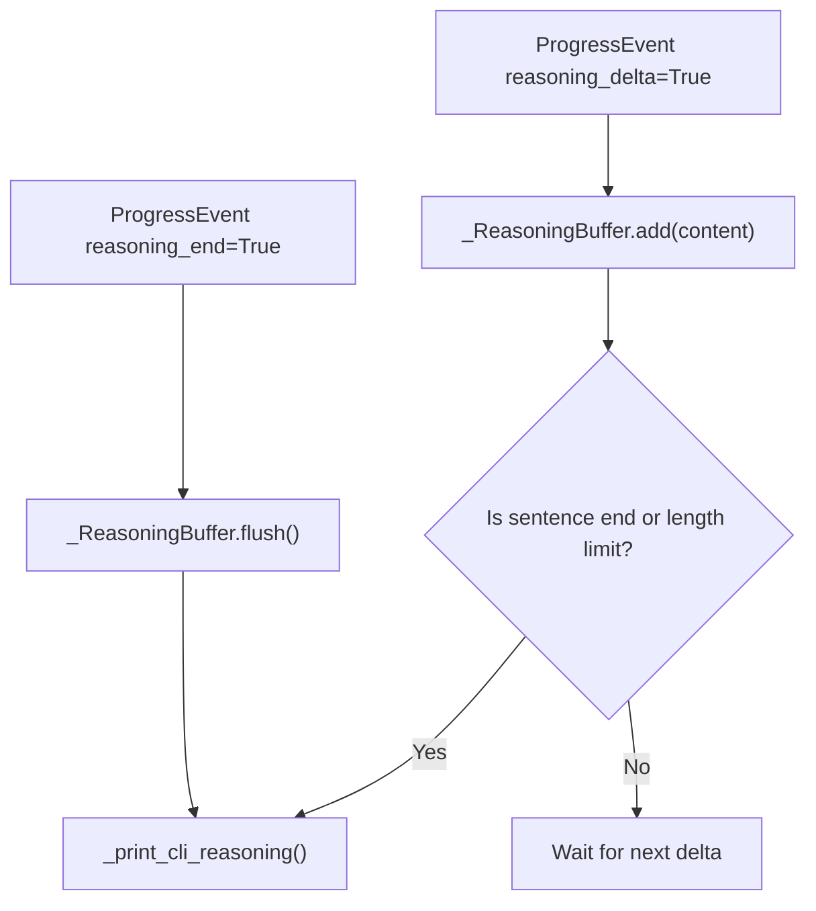

<!-- source: DeepWiki mcp.deepwiki.com · repo HKUDS/nanobot · page 2.2 First Run & Interactive Mode · fetched 2026-11-09 -->

# First Run & Interactive Mode

Relevant source files

The following files were used as context for generating this wiki page:

- [nanobot/channels/feishu/tests/test_feishu_reaction.py](nanobot/channels/feishu/tests/test_feishu_reaction.py)
- [nanobot/cli/stream.py](nanobot/cli/stream.py)
- [nanobot/utils/tool_hints.py](nanobot/utils/tool_hints.py)
- [nanobot/webui/version_check.py](nanobot/webui/version_check.py)
- [tests/agent/test_tool_hint.py](tests/agent/test_tool_hint.py)
- [tests/cli/test_cli_input.py](tests/cli/test_cli_input.py)
- [tests/cli/test_interactive_retry_wait.py](tests/cli/test_interactive_retry_wait.py)
- [tests/cli/test_stream_refresh.py](tests/cli/test_stream_refresh.py)
- [tests/webui/test_forking.py](tests/webui/test_forking.py)

This page details the initial execution of the nanobot agent, focusing on the Command Line Interface (CLI) REPL (Read-Eval-Print Loop) and the interactive onboarding wizard. It explains how the system handles user input, provides visual feedback through the `ThinkingSpinner` and `StreamRenderer`, and renders agent responses using smart tool hints and reasoning buffers.

## Interactive Onboarding

For users running nanobot for the first time without a pre-existing `config.json`, the system provides an interactive wizard via `nanobot onboard --wizard` [nanobot/cli/onboard.py:622-624]().

### The Wizard Flow
The onboarding process uses the `questionary` library to guide users through configuration [nanobot/cli/onboard.py:131-138]().
1.  **Quick Start**: A streamlined path for common providers (OpenAI, Anthropic, DeepSeek, etc.) that sets up a provider and a WebSocket channel [nanobot/cli/onboard.py:92-93]().
2.  **Navigation**: The wizard supports "Back" navigation using Escape or Left arrow keys, implemented via custom key bindings in `_select_with_back` [nanobot/cli/onboard.py:141-200]().
3.  **Model Suggestions**: It provides intelligent autocomplete for model IDs based on the selected provider [nanobot/cli/onboard.py:31-32]().
4.  **Config Merging**: When refreshing an existing configuration, the `merge_missing_defaults` function ensures new configuration fields are added without overwriting user customizations [tests/agent/test_onboard_logic.py:24-112]().

Sources: [nanobot/cli/onboard.py:31-32](), [nanobot/cli/onboard.py:92-138](), [nanobot/cli/onboard.py:141-200](), [nanobot/cli/onboard.py:622-624](), [tests/agent/test_onboard_logic.py:24-112]()

## Initial Launch & Terminal Setup

When a user executes `nanobot agent`, the system enters an interactive session. This mode is designed for direct communication with the assistant using a terminal-based interface.

### Terminal Initialization
1.  **Encoding**: The system handles surrogate pairs and lone surrogates to prevent `UnicodeEncodeError` during serialization, which is critical for Windows console input [nanobot/utils/helpers.py:38-63]().
2.  **Session Creation**: A `PromptSession` from `prompt_toolkit` is initialized with `FileHistory` for persistent command history [tests/cli/test_cli_input.py:44-65]().
3.  **Key Bindings**: The CLI supports multi-line input where `Enter` submits the buffer and `Alt+Enter` inserts a newline [tests/cli/test_cli_input.py:67-91](). It also handles `CSI-u` Shift+Enter for modern terminals [tests/cli/test_cli_input.py:131-145]().

Sources: [nanobot/utils/helpers.py:38-63](), [tests/cli/test_cli_input.py:44-91](), [tests/cli/test_cli_input.py:131-145]()

## The Interactive REPL Loop

The core of the interactive mode is an asynchronous loop that waits for user input and dispatches it to the agent.

### UI Feedback Components
During processing, nanobot uses specialized classes to communicate state:

| Component | Class | Role |
| :--- | :--- | :--- |
| **Thinking Spinner** | `ThinkingSpinner` | Displays `<bot_name> is thinking...` with an animation using `rich.status` [nanobot/cli/stream.py:50-56](). |
| **Stream Renderer** | `StreamRenderer` | Handles real-time Markdown rendering during token generation [nanobot/cli/stream.py:88-112](). |

### Feedback Synchronization
To prevent garbled output, the `ThinkingSpinner` includes a `pause()` context manager. This allows "Tool Hints" or progress lines to be printed cleanly by stopping the spinner, flushing the line, and restarting the spinner afterward [nanobot/cli/stream.py:70-85]().

Title: REPL Data Flow and Code Entity Association

Sources: [nanobot/cli/stream.py:50-85](), [nanobot/cli/stream.py:88-112](), [tests/cli/test_cli_input.py:148-164]()

## Tool Hints System

When an agent calls a tool, `format_tool_hints` generates a concise "hint" to show activity in the terminal [nanobot/utils/tool_hints.py:37-40]().

### Smart Abbreviation & Formatting
Tool hints are mapped via `_TOOL_FORMATS` to provide human-readable summaries [nanobot/utils/tool_hints.py:11-24]():
- **File Operations**: `read_file` becomes `read <path>`, `write_file` becomes `write <path>` [tests/agent/test_tool_hint.py:19-31]().
- **Search**: `grep` shows the pattern as `grep "<pattern>"` [tests/agent/test_tool_hint.py:37-39]().
- **Execution**: `exec` calls are prefixed with `$` and internal paths are folded (e.g., `src/…/main.py`) to save space [nanobot/utils/tool_hints.py:114-129]().
- **MCP Tools**: Formatted as `server::tool` or `server::tool("arg")` [nanobot/utils/tool_hints.py:131-150]().

### Call Folding
Consecutive calls to the same tool with identical arguments are "folded" into a single line with a multiplier (e.g., `read config.json × 2`) [nanobot/utils/tool_hints.py:57-66]().

Sources: [nanobot/utils/tool_hints.py:11-24](), [nanobot/utils/tool_hints.py:37-66](), [nanobot/utils/tool_hints.py:114-150](), [tests/agent/test_tool_hint.py:19-39]()

## Reasoning and Progress Handling

Nanobot handles modern LLM features like internal reasoning and provider retries.

### Reasoning Buffer
For models that provide reasoning deltas, nanobot uses a `_ReasoningBuffer`. It accumulates tokens and only flushes them to the screen when a sentence boundary is reached or the buffer exceeds a character limit [tests/cli/test_interactive_retry_wait.py:77-108](). The `strip_think` utility is also used to ensure well-formed `<think>` blocks are handled correctly before persistence or final rendering [nanobot/utils/helpers.py:168-193]().

### Provider Retries
If a provider request fails and enters a retry cycle, the CLI captures the `RetryWaitEvent` and renders it as a progress line (e.g., "Model request failed, retry in 2s") [tests/cli/test_interactive_retry_wait.py:11-34]().

Title: Reasoning Delivery Flow via _ReasoningBuffer

Sources: [nanobot/utils/helpers.py:168-193](), [tests/cli/test_interactive_retry_wait.py:11-34](), [tests/cli/test_interactive_retry_wait.py:77-108]()

## Rendering Responses

### Streaming Mode
`StreamRenderer` manages the transition from the "thinking" state to the final answer:
- **Header**: `ensure_header()` prints the bot's name/icon once before the first token [nanobot/cli/stream.py:152-164]().
- **Live Updates**: Uses `rich.live.Live` with `transient=True` to update the markdown in-place without polluting the terminal scrollback with partial frames [nanobot/cli/stream.py:88-112]().
- **Finalization**: Upon `on_end()`, the transient area is cleared and the complete message is printed as a static block [nanobot/cli/stream.py:88-112]().

Sources: [nanobot/cli/stream.py:88-112](), [nanobot/cli/stream.py:152-164]()

---

