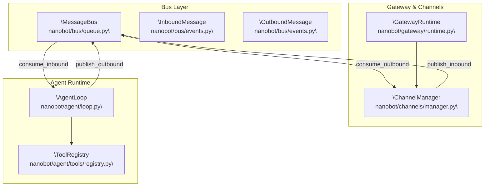

<!-- source: DeepWiki mcp.deepwiki.com · repo HKUDS/nanobot · page 3 Architecture · fetched 2026-11-09 -->

# Architecture

Relevant source files

The following files were used as context for generating this wiki page:

- [README.md](README.md)
- [docs/configuration.md](docs/configuration.md)
- [docs/providers.md](docs/providers.md)
- [nanobot/agent/loop.py](nanobot/agent/loop.py)
- [nanobot/channels/websocket/tests/test_websocket_runtime_lifecycle.py](nanobot/channels/websocket/tests/test_websocket_runtime_lifecycle.py)
- [nanobot/cli/commands.py](nanobot/cli/commands.py)
- [nanobot/cli/gateway.py](nanobot/cli/gateway.py)
- [nanobot/cli/gateway_runtime.py](nanobot/cli/gateway_runtime.py)
- [nanobot/config/schema.py](nanobot/config/schema.py)
- [nanobot/gateway/__init__.py](nanobot/gateway/__init__.py)
- [nanobot/gateway/runtime.py](nanobot/gateway/runtime.py)
- [nanobot/process_runtime.py](nanobot/process_runtime.py)
- [nanobot/providers/registry.py](nanobot/providers/registry.py)
- [tests/cli/test_commands.py](tests/cli/test_commands.py)
- [tests/cli/test_gateway_commands.py](tests/cli/test_gateway_commands.py)
- [tests/cli/test_gateway_runtime.py](tests/cli/test_gateway_runtime.py)
- [tests/gateway/test_runtime.py](tests/gateway/test_runtime.py)

## Purpose and Scope

This page explains the high-level system architecture of nanobot, describing how its major subsystems are organized, how components relate to one another, and how data flows through the framework. 

As a parent page, this document provides a structural overview and high-level summaries of core messaging, multi-instance isolation, and gateway process management. For deep technical details, follow the links to the child pages:
- [Message Bus & Event Flow](#3.1)
- [Multi-Instance Architecture](#3.2)
- [Gateway Runtime & Process Management](#3.3)

---

## System Overview & Architectural Layers

nanobot is designed around a layered asynchronous architecture where communication channels, core agent execution, and tool registries are decoupled via a central message bus [nanobot/bus/queue.py:51]().

| Layer | Purpose | Key Components |
|---|---|---|
| **User Interaction** | Entry points and CLI runtime | `nanobot/cli/commands.py` [nanobot/cli/commands.py:85-96]() |
| **Communication** | Message routing and channel management | `MessageBus` [nanobot/bus/queue.py:51](), `ChannelManager` [nanobot/channels/manager.py:79-87]() |
| **Core Intelligence** | Agent processing, hooks, and context | `AgentLoop` [nanobot/agent/loop.py:118-122](), `ContextBuilder` [nanobot/agent/context.py:26-26]() |
| **LLM Integration** | Provider abstraction and registry | `LLMProvider` [nanobot/providers/base.py:57](), `ProviderSpec` [nanobot/providers/registry.py:35-41]() |
| **Data & State** | Persistence, scheduling, and workspace | `SessionManager` [nanobot/session/manager.py:78-80](), `CronService` [nanobot/cron/service.py]() |

Sources: [nanobot/bus/queue.py:51](), [nanobot/agent/loop.py:118-122](), [nanobot/channels/manager.py:79-87](), [nanobot/providers/registry.py:35-41]()

---

## Component Relationship Map

The diagram below maps natural-language subsystem concepts to their concrete Python classes and module paths across the codebase.

**Diagram: High-level component relationships and module mapping**

Sources: [nanobot/bus/queue.py:51](), [nanobot/bus/events.py:45-50](), [nanobot/agent/loop.py:118-122](), [nanobot/channels/manager.py:79-87](), [nanobot/gateway/runtime.py:202-205]()

---

## 3.1. Message Bus & Event Flow

The `MessageBus` acts as the central asynchronous nerve center connecting communication channels to the `AgentLoop` [nanobot/bus/queue.py:51](). Inbound messages (`InboundMessage`) are produced by adapters (such as Telegram, Feishu, or WebUI WebSocket) and dispatched to queues [nanobot/bus/events.py:45](). The agent processes turns and emits `OutboundMessage` or streaming delta events (`StreamDeltaEvent`) back through the bus [nanobot/bus/events.py:45](), [nanobot/bus/outbound_events.py:47]().

For detailed coverage of queue structures, routing logic, and event-driven patterns, see [Message Bus & Event Flow](#3.1).

Sources: [nanobot/bus/queue.py:51](), [nanobot/bus/events.py:45-50](), [nanobot/bus/outbound_events.py:47-50]()

---

## 3.2. Multi-Instance Architecture

nanobot supports running multiple isolated bot instances concurrently on the same host. Isolation is achieved by binding separate workspace directories [nanobot/config/schema.py:119-120](), configuration file paths [nanobot/cli/commands.py:148-151](), and listening ports [nanobot/gateway/runtime.py:186-200](). Each instance resolves its own runtime paths via `GatewayInstance` to prevent state collision [nanobot/gateway/runtime.py:153-159]().

For full details on configuring and launching isolated instances, see [Multi-Instance Architecture](#3.2).

Sources: [nanobot/config/schema.py:116-120](), [nanobot/cli/commands.py:145-155](), [nanobot/gateway/runtime.py:153-200]()

---

## 3.3. Gateway Runtime & Process Management

The `gateway` mode supervises long-running background services, unifying channel event processing, cron jobs, and WebUI HTTP/WebSocket connections. Managed via `GatewayRuntime` and `ManagedProcessRuntime`, the daemon controls background process spawning, health monitoring, log rotation, and clean signal shutdown [nanobot/gateway/runtime.py:202-205](), [nanobot/process_runtime.py:81-85]().

For comprehensive documentation on daemon supervision, restart modes, and lifecycle CLI commands, see [Gateway Runtime & Process Management](#3.3).

Sources: [nanobot/gateway/runtime.py:202-205](), [nanobot/process_runtime.py:81-115]()

---

