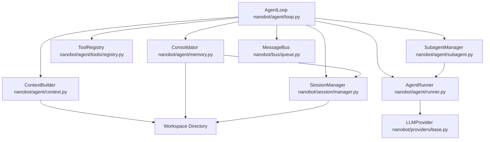

<!-- source: DeepWiki mcp.deepwiki.com · repo HKUDS/nanobot · page 4 Agent System · fetched 2026-11-09 -->

# Agent System

<details>
<summary>Relevant source files</summary>

The following files were used as context for generating this wiki page:

- [README.md](README.md)
- [docs/configuration.md](docs/configuration.md)
- [docs/providers.md](docs/providers.md)
- [nanobot/agent/context_governance.py](nanobot/agent/context_governance.py)
- [nanobot/agent/loop.py](nanobot/agent/loop.py)
- [nanobot/agent/runner.py](nanobot/agent/runner.py)
- [nanobot/cli/commands.py](nanobot/cli/commands.py)
- [nanobot/config/schema.py](nanobot/config/schema.py)
- [nanobot/providers/conversation_state.py](nanobot/providers/conversation_state.py)
- [nanobot/providers/registry.py](nanobot/providers/registry.py)
- [tests/agent/test_loop_runner_integration.py](tests/agent/test_loop_runner_integration.py)
- [tests/agent/test_runner_core.py](tests/agent/test_runner_core.py)
- [tests/agent/test_runner_file_reads.py](tests/agent/test_runner_file_reads.py)
- [tests/agent/test_runner_governance.py](tests/agent/test_runner_governance.py)
- [tests/agent/test_runner_runtime_identity.py](tests/agent/test_runner_runtime_identity.py)
- [tests/cli/test_commands.py](tests/cli/test_commands.py)

</details>


The Agent System is the core intelligence layer of nanobot. It receives messages from the communication layer, assembles contextual prompts, executes LLM calls, manages tool execution through multiple iterations, and generates responses. The system orchestrates interactions between the LLM provider, memory consolidation, skills loading, session management, and tool registry to provide stateful, context-aware AI assistance.

**This page provides a high-level overview of the agent architecture and core components.**

For detailed information on specific subsystems, refer to the respective child pages:
- **[Agent Loop](#4.1)** — Deep dive into the `AgentLoop` class, its iteration cycle, tool execution, turn admission, and message persistence logic.
- **[Context Building](#4.2)** — Explain the `ContextBuilder` system for assembling prompts from identity, bootstrap files, memory, skills, and history.
- **[Memory System](#4.3)** — Document the memory architecture (`MEMORY.md`, `history.jsonl`, `SOUL.md`/`USER.md`), dream consolidation, and `MemoryArchiver`.
- **[Skills](#4.4)** — Explain the skills system, `SKILL.md` format, always-active vs. on-demand skills, skill-creator, and skill loading mechanisms.
- **[Subagents](#4.5)** — Detail the `SubagentManager` for background task delegation, isolated execution, spawn tool, and result announcement.
- **[Agent Runner & Context Governance](#4.6)** — Document the shared `AgentRunner` tool-using execution loop, `AgentRunSpec`/`AgentRunResult`, `ContextGovernor` token budgeting, H/delta compaction, length recovery, and provider conversation state.
- **[Hooks & Turn Lifecycle](#4.7)** — Explain `AgentHook`, turn hooks, progress hooks, file-edit activity hooks, tool execution context vars, and how hooks compose.

Sources: [nanobot/agent/loop.py:1-51](), [nanobot/agent/runner.py:88-146]()

---

## Component Architecture

The agent system is built around `AgentLoop` [nanobot/agent/loop.py:51]() as the central orchestrator and supporting components that provide context, memory, tools, sessions, and skills. The `AgentRunner` class [nanobot/agent/runner.py:141]() provides a shared, low-level execution loop used by both the main agent and subagents.

**Agent System Component Dependency Graph**



Sources: [nanobot/agent/loop.py:22-38](), [nanobot/agent/runner.py:141-146](), [nanobot/agent/subagent.py:92-156]()

---

## Core Subsystems Overview

### 1. Agent Loop & Turn Lifecycle
The `AgentLoop` class coordinates incoming turns from the `MessageBus`, manages concurrency, resolves runtime environments via `ModelRuntimeResolver`, and persists transcripts. Turn hooks and lifecycle callbacks (`AgentHook`) monitor execution progress. For full details, see [Agent Loop](#4.1) and [Hooks & Turn Lifecycle](#4.7).

Sources: [nanobot/agent/loop.py:22-51](), [nanobot/agent/hook.py:21-28]()

### 2. Context Building & Governance
The `ContextBuilder` aggregates instructions, memory files (`MEMORY.md`), skills (`SKILL.md`), and recent conversation history into an initial prompt structure. During execution, the `ContextGovernor` monitors token budgets and applies compaction strategies (such as H/delta compaction). For full details, see [Context Building](#4.2) and [Agent Runner & Context Governance](#4.6).

Sources: [nanobot/agent/context.py:20-30](), [nanobot/agent/context_governance.py:112-135]()

### 3. Memory & Skills
Long-term memory is structured across core identity files (`SOUL.md`, `USER.md`, `MEMORY.md`) and session logs (`history.jsonl`), managed by `Consolidator` and `AutoCompact`. Skills provide modular capabilities defined via `SKILL.md`. For full details, see [Memory System](#4.3) and [Skills](#4.4).

Sources: [nanobot/agent/loop.py:24-30](), [nanobot/agent/autocompact.py:15-30]()

### 4. Delegation & Shared Runner
The `SubagentManager` enables background task spawning and isolated execution. Both main agent turns and subagents execute via the shared `AgentRunner` execution loop (`AgentRunSpec` and `AgentRunResult`). For full details, see [Subagents](#4.5) and [Agent Runner & Context Governance](#4.6).

Sources: [nanobot/agent/subagent.py:92-156](), [nanobot/agent/runner.py:88-140]()

---

## Execution Flow

The sequence below illustrates how an incoming message flows from the `MessageBus` through `AgentLoop` and `AgentRunner` to interact with LLM providers and execute tools.

**End-to-End Processing Pipeline**

```mermaid
sequenceDiagram
    participant Bus as "MessageBus nanobot/bus/queue.py"
    participant Loop as "AgentLoop nanobot/agent/loop.py"
    participant Runner as "AgentRunner nanobot/agent/runner.py"
    participant Prov as "LLMProvider nanobot/providers/base.py"
    participant Tools as "ToolRegistry nanobot/agent/tools/registry.py"
    
    Bus->>Loop: "InboundMessage"
    Loop->>Loop: "Retrieve/Create Session SessionManager"
    
    Loop->>Runner: "AgentRunner.run(spec)"
    
    loop "Up to max_iterations"
        Runner->>Runner: "prepare_for_model / ContextGovernor"
        Runner->>Prov: "chat_stream_with_retry(messages, tools)"
        Prov-->>Runner: "LLMResponse (Content or ToolCalls)"
        
        alt "Has Tool Calls"
            Runner->>Tools: "execute_tool_calls"
            Tools-->>Runner: "Tool Result"
        else "Final Content"
            Runner-->>Loop: "AgentRunResult"
        end
    end
    
    Loop->>Bus: "publish_outbound(OutboundMessage)"
```

Sources: [nanobot/agent/loop.py:48-51](), [nanobot/agent/runner.py:141-146](), [nanobot/agent/subagent.py:150-156]()

---

