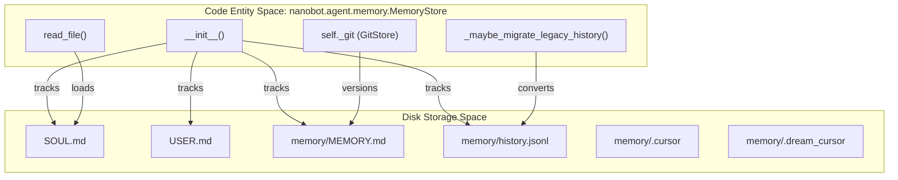
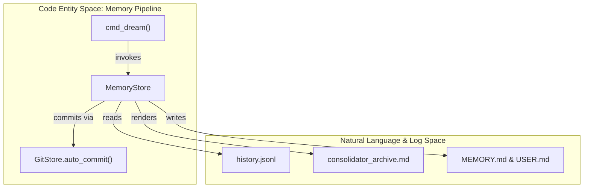

<!-- source: DeepWiki mcp.deepwiki.com · repo HKUDS/nanobot · page 4.3 Memory System · fetched 2026-11-09 -->

# Memory System

Relevant source files

The following files were used as context for generating this wiki page:

- [nanobot/agent/autocompact.py](nanobot/agent/autocompact.py)
- [nanobot/agent/memory.py](nanobot/agent/memory.py)
- [nanobot/command/builtin.py](nanobot/command/builtin.py)
- [nanobot/session/manager.py](nanobot/session/manager.py)
- [nanobot/templates/agent/consolidator_archive.md](nanobot/templates/agent/consolidator_archive.md)
- [nanobot/utils/gitstore.py](nanobot/utils/gitstore.py)
- [tests/agent/test_auto_compact.py](tests/agent/test_auto_compact.py)
- [tests/agent/test_autocompact_unit.py](tests/agent/test_autocompact_unit.py)
- [tests/agent/test_consolidator.py](tests/agent/test_consolidator.py)
- [tests/agent/test_git_store.py](tests/agent/test_git_store.py)
- [tests/agent/test_loop_consolidation_tokens.py](tests/agent/test_loop_consolidation_tokens.py)
- [tests/agent/test_new_command_archival.py](tests/agent/test_new_command_archival.py)
- [tests/agent/test_session_manager_history.py](tests/agent/test_session_manager_history.py)
- [tests/command/test_builtin_dream.py](tests/command/test_builtin_dream.py)
- [tests/utils/test_gitstore.py](tests/utils/test_gitstore.py)

The memory system provides a dual-tier architecture designed to balance immediate context window constraints with long-term knowledge retention. It cleanly separates **Events** (chronological interaction logs in `history.jsonl`) from **Facts** (synthesized knowledge in `MEMORY.md`, `SOUL.md`, and `USER.md`), using an automated "Dream" process and idle consolidation routines to distill raw histories into durable workspace state.

Sources: [nanobot/agent/memory.py:1-60]()

---

## Storage Architecture & `MemoryStore`

The physical persistence layer is managed by `MemoryStore` (`nanobot/agent/memory.py:59`), which handles pure file I/O for workspace memory artifacts and coordinates cursor tracking.

### Durable Files and Cursors
- `SOUL.md`: Stores bot personality, system voice, and style guidelines (`workspace/SOUL.md`) [nanobot/agent/memory.py:80-80]().
- `USER.md`: Stores stable user preferences, facts, and constraints (`workspace/USER.md`) [nanobot/agent/memory.py:81-81]().
- `MEMORY.md`: Stores project-level facts, decisions, and working context (`workspace/memory/MEMORY.md`) [nanobot/agent/memory.py:77-77]().
- `history.jsonl`: Append-only JSONL event log of past conversation turns (`workspace/memory/history.jsonl`) [nanobot/agent/memory.py:78-78]().
- Cursors: `.cursor` tracks the last written history index (`nanobot/agent/memory.py:82-82`), while `.dream_cursor` tracks the last entry processed by the background Dream consolidation pipeline (`nanobot/agent/memory.py:83-83`).

`MemoryStore` also incorporates a one-time migration utility (`_maybe_migrate_legacy_history`) to upgrade legacy plain-text `HISTORY.md` files into structured `history.jsonl` entries upon initialization [nanobot/agent/memory.py:107-145]().

Sources: [nanobot/agent/memory.py:59-145]()

---

## Auto-Compact & Token-Based Consolidation

Memory transitions from active conversation turns to compressed checkpoints via proactive idle compaction and reactive token pressure handling.

### Proactive Auto-Compact
The `AutoCompact` class (`nanobot/agent/autocompact.py:27`) scans idle sessions to reduce token footprints and latency before user turns occur.
- **Trigger**: Activated when a session has been inactive longer than `session_ttl_minutes` (configured via `idleCompactAfterMinutes` in `config.json`) [nanobot/agent/autocompact.py:27-54](), [nanobot/config/schema.py:121-125]().
- **Execution**: `check_expired` identifies eligible sessions and schedules background archival through `_archive()` [nanobot/agent/autocompact.py:63-111]().
- **Preparation**: `prepare_session` reloads session state and merges active summary checkpoints from metadata or the hot-path cache [nanobot/agent/autocompact.py:112-130]().

### Token-Based Consolidation
During active execution, `Consolidator` (`nanobot/agent/memory.py:575`) monitors token usage against `context_window_tokens`. When limits are approached, it summarizes older message prefixes using `archive()`, saving checkpoints while keeping a recent suffix for conversational continuity [nanobot/session/summary.py:1-50]().

Sources: [nanobot/agent/autocompact.py:27-130](), [nanobot/agent/memory.py:575-625]()

---

## The Dream Process & Version Control

`Dream` is a background maintenance workflow that extracts high-level facts from `history.jsonl` and updates durable markdown knowledge files.

### Execution Workflow
1. **Fetch**: Reads unindexed history entries since the last `.dream_cursor` [nanobot/agent/memory.py:390-403]().
2. **Consolidation Prompt**: Evaluates the history against existing memory using structured prompts defined in template files (`nanobot/templates/agent/consolidator_archive.md`) [nanobot/templates/agent/consolidator_archive.md:1-42]().
3. **Surgical Updates**: Updates `MEMORY.md`, `USER.md`, or `SOUL.md` with refined facts and rules [nanobot/agent/memory.py:750-780]().
4. **Git Versioning**: Every consolidation batch is committed automatically via `GitStore` (`nanobot/utils/gitstore.py:47`), ensuring full auditability and rollback capability (`auto_commit`) [nanobot/utils/gitstore.py:125-166]().

Sources: [nanobot/agent/memory.py:390-403](), [nanobot/utils/gitstore.py:47-166](), [nanobot/command/builtin.py:135-139]()

---

## Retrieval and Search

Past events stored in `history.jsonl` remain searchable without clogging the active LLM context window through specialized tool execution and grep utilities [nanobot/skills/memory/SKILL.md:1-20](). Agents query JSONL records by timestamp or keyword patterns on demand.

Sources: [nanobot/skills/memory/SKILL.md:1-20]()

---

